# Wave 06 review

All outputs are **draft**, pending parent and child review. Generated with the built-in image tool. Video upload files are in `art/video-refs/`.

21 character reference images, two new game frames, and three upload-ready frame JPEGs. [Technical and visual QA](wave-06-qa.json).

**Remaining visual flag:** Pockets is not visible in the selected Jumble frame. The third attempt changed Jumble's face and brightened the lighthouse while adding the cameo, so it was rejected.

## ally_knight — draft

Front / left profile / right profile.

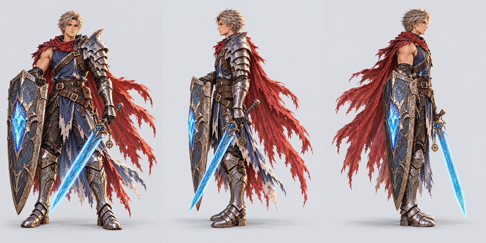

Visual QA: complete bodies and gear, neutral pose, correct facing and plain background.

<details><summary>front prompt and references</summary>

```text
ART STYLE: Lush, luminous digital painting in the spirit of a premium early-2000s Japanese RPG remastered in HD. Semi-realistic, anime-influenced characters with expressive faces and stylish asymmetrical adventure outfits: layered belts, buckles, straps, zippers, one-sleeved jackets, flowing scarves. Sun-drenched tropical environments painted in rich detail: saturated turquoise seas, white sand, emerald jungle, and ancient sandstone ruins carved with softly glowing glyphs. Golden-hour sunlight, with bioluminescent blue-green motes of light drifting through the air. Cinematic, epic and adventurous, with a mischievous sense of humor: witty, characterful expressions and small comedic details hidden in the scene. Mature and cool, never babyish or chibi.

This is an isolated game sprite: render ONLY the subject on a fully transparent background (PNG with alpha). No scenery, no ground, no cast shadow, no frame. Lit from the upper left with a soft rim light, crisp readable silhouette, full body with nothing cropped and clear empty space around it.

Character reference for animation: Cade, the young Crystal Knight, the same character as the attached reference images, exactly: same outfit, colors, proportions, hair and gear. Full body from head to feet, standing in a relaxed neutral pose with the arms slightly away from the body, facing the viewer and looking at the viewer. For this animation reference, override the sprite transparency and lighting instructions: OPAQUE plain flat light gray background (#e4e6ea), soft even studio lighting, a faint shadow under the feet only. No scenery, no text, no other characters. Portrait 1024x1536. Center one full character with generous margins around head, feet, tail and gear. Keep the same on-model body scale in all three views. Own gear only: Cade sword and shield; Wren two blasters HOLSTERED; Knox spellbook; Maren staff; Kit pirate hat; Pockets no added gear; Jumble hat and coat. Only show the named character. Neutral child-friendly expression, no action pose, no added props.

Rules: completely original designs; never imitate an existing franchise, character, creature, logo or emblem. No text, letters, numbers, logos, watermarks, signatures, borders or user interface, unless the prompt asks for glowing magic runes. Fierce and intense is great; no blood, gore or wounds.
```

References: `public/assets/anchors/cast_lineup.webp`, `public/assets/characters/ally_knight/base.webp`, `public/assets/characters/ally_knight/battle.webp`

</details>

<details><summary>left prompt and references</summary>

```text
ART STYLE: Lush, luminous digital painting in the spirit of a premium early-2000s Japanese RPG remastered in HD. Semi-realistic, anime-influenced characters with expressive faces and stylish asymmetrical adventure outfits: layered belts, buckles, straps, zippers, one-sleeved jackets, flowing scarves. Sun-drenched tropical environments painted in rich detail: saturated turquoise seas, white sand, emerald jungle, and ancient sandstone ruins carved with softly glowing glyphs. Golden-hour sunlight, with bioluminescent blue-green motes of light drifting through the air. Cinematic, epic and adventurous, with a mischievous sense of humor: witty, characterful expressions and small comedic details hidden in the scene. Mature and cool, never babyish or chibi.

This is an isolated game sprite: render ONLY the subject on a fully transparent background (PNG with alpha). No scenery, no ground, no cast shadow, no frame. Lit from the upper left with a soft rim light, crisp readable silhouette, full body with nothing cropped and clear empty space around it.

The same character as the attached front view, exactly, now in a full side profile facing the LEFT edge of the picture: body turned 90 degrees, full body from head to feet, relaxed neutral standing pose, same size and position as the front view. Keep anatomical left and right gear on the same body sides; rotate the character, do not mirror. For this animation reference, override the sprite transparency and lighting instructions: OPAQUE plain flat light gray background (#e4e6ea), soft even studio lighting, a faint shadow under the feet only. No scenery, no text, no other characters. Portrait 1024x1536. Center one full character with generous margins around head, feet, tail and gear. Keep the same on-model body scale in all three views. Own gear only: Cade sword and shield; Wren two blasters HOLSTERED; Knox spellbook; Maren staff; Kit pirate hat; Pockets no added gear; Jumble hat and coat. Only show the named character. Neutral child-friendly expression, no action pose, no added props.

Correct the previous profile: whole torso, pelvis, BOTH feet and shoulders must turn exactly 90 degrees toward the LEFT edge. Orthographic lateral view, camera perpendicular to the side of the chest, shoulders and hips overlap naturally. Show only the near shoulder, near cheek and side seam, not the chest front. Full character and all gear remain inside the canvas. Do not swap gear sides. Keep exact identity, costume, scale and neutral pose from the supplied front view.

Rules: completely original designs; never imitate an existing franchise, character, creature, logo or emblem. No text, letters, numbers, logos, watermarks, signatures, borders or user interface, unless the prompt asks for glowing magic runes. Fierce and intense is great; no blood, gore or wounds.
```

References: `public/assets/anchors/cast_lineup.webp`, `public/assets/characters/ally_knight/base.webp`, `public/assets/characters/ally_knight/battle.webp`, `C:\Users\AndyLewis\.codex\generated_images\01a1224c-a831-7292-b516-5c44e2310ce8\exec-0c85f876-b6ee-462d-ba03-11d16dbd86e3.png`

</details>

<details><summary>right prompt and references</summary>

```text
ART STYLE: Lush, luminous digital painting in the spirit of a premium early-2000s Japanese RPG remastered in HD. Semi-realistic, anime-influenced characters with expressive faces and stylish asymmetrical adventure outfits: layered belts, buckles, straps, zippers, one-sleeved jackets, flowing scarves. Sun-drenched tropical environments painted in rich detail: saturated turquoise seas, white sand, emerald jungle, and ancient sandstone ruins carved with softly glowing glyphs. Golden-hour sunlight, with bioluminescent blue-green motes of light drifting through the air. Cinematic, epic and adventurous, with a mischievous sense of humor: witty, characterful expressions and small comedic details hidden in the scene. Mature and cool, never babyish or chibi.

This is an isolated game sprite: render ONLY the subject on a fully transparent background (PNG with alpha). No scenery, no ground, no cast shadow, no frame. Lit from the upper left with a soft rim light, crisp readable silhouette, full body with nothing cropped and clear empty space around it.

The same character as the attached front view, exactly, now in a full side profile facing the RIGHT edge of the picture: body turned 90 degrees, full body from head to feet, relaxed neutral standing pose, same size and position as the front view. Keep anatomical left and right gear on the same body sides; rotate the character, do not mirror. For this animation reference, override the sprite transparency and lighting instructions: OPAQUE plain flat light gray background (#e4e6ea), soft even studio lighting, a faint shadow under the feet only. No scenery, no text, no other characters. Portrait 1024x1536. Center one full character with generous margins around head, feet, tail and gear. Keep the same on-model body scale in all three views. Own gear only: Cade sword and shield; Wren two blasters HOLSTERED; Knox spellbook; Maren staff; Kit pirate hat; Pockets no added gear; Jumble hat and coat. Only show the named character. Neutral child-friendly expression, no action pose, no added props.

Correct the previous profile: whole torso, pelvis, BOTH feet and shoulders must turn exactly 90 degrees toward the RIGHT edge. Orthographic lateral view, camera perpendicular to the side of the chest, shoulders and hips overlap naturally. Show only the near shoulder, near cheek and side seam, not the chest front. Full character and all gear remain inside the canvas. Do not swap gear sides. Keep exact identity, costume, scale and neutral pose from the supplied front view.

Rules: completely original designs; never imitate an existing franchise, character, creature, logo or emblem. No text, letters, numbers, logos, watermarks, signatures, borders or user interface, unless the prompt asks for glowing magic runes. Fierce and intense is great; no blood, gore or wounds.
```

References: `public/assets/anchors/cast_lineup.webp`, `public/assets/characters/ally_knight/base.webp`, `public/assets/characters/ally_knight/battle.webp`, `C:\Users\AndyLewis\.codex\generated_images\01a1224c-a831-7292-b516-5c44e2310ce8\exec-0c85f876-b6ee-462d-ba03-11d16dbd86e3.png`

</details>

## ally_gunner — draft

Front / left profile / right profile.

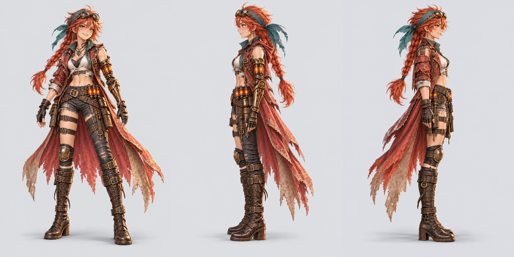

Visual QA: complete bodies and gear, neutral pose, correct facing and plain background.

<details><summary>front prompt and references</summary>

```text
ART STYLE: Lush, luminous digital painting in the spirit of a premium early-2000s Japanese RPG remastered in HD. Semi-realistic, anime-influenced characters with expressive faces and stylish asymmetrical adventure outfits: layered belts, buckles, straps, zippers, one-sleeved jackets, flowing scarves. Sun-drenched tropical environments painted in rich detail: saturated turquoise seas, white sand, emerald jungle, and ancient sandstone ruins carved with softly glowing glyphs. Golden-hour sunlight, with bioluminescent blue-green motes of light drifting through the air. Cinematic, epic and adventurous, with a mischievous sense of humor: witty, characterful expressions and small comedic details hidden in the scene. Mature and cool, never babyish or chibi.

This is an isolated game sprite: render ONLY the subject on a fully transparent background (PNG with alpha). No scenery, no ground, no cast shadow, no frame. Lit from the upper left with a soft rim light, crisp readable silhouette, full body with nothing cropped and clear empty space around it.

Character reference for animation: Captain Wren, the red-haired sky-pirate, the same character as the attached reference images, exactly: same outfit, colors, proportions, hair and gear. Full body from head to feet, standing in a relaxed neutral pose with the arms slightly away from the body, facing the viewer and looking at the viewer. For this animation reference, override the sprite transparency and lighting instructions: OPAQUE plain flat light gray background (#e4e6ea), soft even studio lighting, a faint shadow under the feet only. No scenery, no text, no other characters. Portrait 1024x1536. Center one full character with generous margins around head, feet, tail and gear. Keep the same on-model body scale in all three views. Own gear only: Cade sword and shield; Wren two blasters HOLSTERED; Knox spellbook; Maren staff; Kit pirate hat; Pockets no added gear; Jumble hat and coat. Only show the named character. Neutral child-friendly expression, no action pose, no added props.

Rules: completely original designs; never imitate an existing franchise, character, creature, logo or emblem. No text, letters, numbers, logos, watermarks, signatures, borders or user interface, unless the prompt asks for glowing magic runes. Fierce and intense is great; no blood, gore or wounds.
```

References: `public/assets/anchors/cast_lineup.webp`, `public/assets/characters/ally_gunner/base.webp`, `public/assets/characters/ally_gunner/battle.webp`, `public/assets/characters/ally_gunner/field.webp`

</details>

<details><summary>left prompt and references</summary>

```text
ART STYLE: Lush, luminous digital painting in the spirit of a premium early-2000s Japanese RPG remastered in HD. Semi-realistic, anime-influenced characters with expressive faces and stylish asymmetrical adventure outfits: layered belts, buckles, straps, zippers, one-sleeved jackets, flowing scarves. Sun-drenched tropical environments painted in rich detail: saturated turquoise seas, white sand, emerald jungle, and ancient sandstone ruins carved with softly glowing glyphs. Golden-hour sunlight, with bioluminescent blue-green motes of light drifting through the air. Cinematic, epic and adventurous, with a mischievous sense of humor: witty, characterful expressions and small comedic details hidden in the scene. Mature and cool, never babyish or chibi.

This is an isolated game sprite: render ONLY the subject on a fully transparent background (PNG with alpha). No scenery, no ground, no cast shadow, no frame. Lit from the upper left with a soft rim light, crisp readable silhouette, full body with nothing cropped and clear empty space around it.

The same character as the attached front view, exactly, now in a full side profile facing the LEFT edge of the picture: body turned 90 degrees, full body from head to feet, relaxed neutral standing pose, same size and position as the front view. Keep anatomical left and right gear on the same body sides; rotate the character, do not mirror. For this animation reference, override the sprite transparency and lighting instructions: OPAQUE plain flat light gray background (#e4e6ea), soft even studio lighting, a faint shadow under the feet only. No scenery, no text, no other characters. Portrait 1024x1536. Center one full character with generous margins around head, feet, tail and gear. Keep the same on-model body scale in all three views. Own gear only: Cade sword and shield; Wren two blasters HOLSTERED; Knox spellbook; Maren staff; Kit pirate hat; Pockets no added gear; Jumble hat and coat. Only show the named character. Neutral child-friendly expression, no action pose, no added props.

STRICT ORTHOGRAPHIC SIDE VIEW: chest, pelvis, face and feet all turned 90 degrees; no visible front of chest. The near shoulder and near foot occlude the far ones. Do not mirror Wren: LEFT-facing view shows her brass anatomical left arm near camera and long covered left leg; RIGHT-facing view shows her natural right arm and bare right thigh with kneepad near camera. Both blasters stay holstered. Match the selected front view exactly.

Rules: completely original designs; never imitate an existing franchise, character, creature, logo or emblem. No text, letters, numbers, logos, watermarks, signatures, borders or user interface, unless the prompt asks for glowing magic runes. Fierce and intense is great; no blood, gore or wounds.
```

References: `public/assets/anchors/cast_lineup.webp`, `public/assets/characters/ally_gunner/base.webp`, `public/assets/characters/ally_gunner/battle.webp`, `public/assets/characters/ally_gunner/field.webp`, `C:\Users\AndyLewis\.codex\generated_images\01a1224c-a831-7292-b516-5c44e2310ce8\exec-9129297b-0323-45a5-9644-d405732e3239.png`

</details>

<details><summary>right prompt and references</summary>

```text
ART STYLE: Lush, luminous digital painting in the spirit of a premium early-2000s Japanese RPG remastered in HD. Semi-realistic, anime-influenced characters with expressive faces and stylish asymmetrical adventure outfits: layered belts, buckles, straps, zippers, one-sleeved jackets, flowing scarves. Sun-drenched tropical environments painted in rich detail: saturated turquoise seas, white sand, emerald jungle, and ancient sandstone ruins carved with softly glowing glyphs. Golden-hour sunlight, with bioluminescent blue-green motes of light drifting through the air. Cinematic, epic and adventurous, with a mischievous sense of humor: witty, characterful expressions and small comedic details hidden in the scene. Mature and cool, never babyish or chibi.

This is an isolated game sprite: render ONLY the subject on a fully transparent background (PNG with alpha). No scenery, no ground, no cast shadow, no frame. Lit from the upper left with a soft rim light, crisp readable silhouette, full body with nothing cropped and clear empty space around it.

The same character as the attached front view, exactly, now in a full side profile facing the RIGHT edge of the picture: body turned 90 degrees, full body from head to feet, relaxed neutral standing pose, same size and position as the front view. Keep anatomical left and right gear on the same body sides; rotate the character, do not mirror. For this animation reference, override the sprite transparency and lighting instructions: OPAQUE plain flat light gray background (#e4e6ea), soft even studio lighting, a faint shadow under the feet only. No scenery, no text, no other characters. Portrait 1024x1536. Center one full character with generous margins around head, feet, tail and gear. Keep the same on-model body scale in all three views. Own gear only: Cade sword and shield; Wren two blasters HOLSTERED; Knox spellbook; Maren staff; Kit pirate hat; Pockets no added gear; Jumble hat and coat. Only show the named character. Neutral child-friendly expression, no action pose, no added props.

STRICT ORTHOGRAPHIC SIDE VIEW: chest, pelvis, face and feet all turned 90 degrees; no visible front of chest. The near shoulder and near foot occlude the far ones. Do not mirror Wren: LEFT-facing view shows her brass anatomical left arm near camera and long covered left leg; RIGHT-facing view shows her natural right arm and bare right thigh with kneepad near camera. Both blasters stay holstered. Match the selected front view exactly.

Rules: completely original designs; never imitate an existing franchise, character, creature, logo or emblem. No text, letters, numbers, logos, watermarks, signatures, borders or user interface, unless the prompt asks for glowing magic runes. Fierce and intense is great; no blood, gore or wounds.
```

References: `public/assets/anchors/cast_lineup.webp`, `public/assets/characters/ally_gunner/base.webp`, `public/assets/characters/ally_gunner/battle.webp`, `public/assets/characters/ally_gunner/field.webp`, `C:\Users\AndyLewis\.codex\generated_images\01a1224c-a831-7292-b516-5c44e2310ce8\exec-9129297b-0323-45a5-9644-d405732e3239.png`

</details>

## ally_spellwright — draft

Front / left profile / right profile.

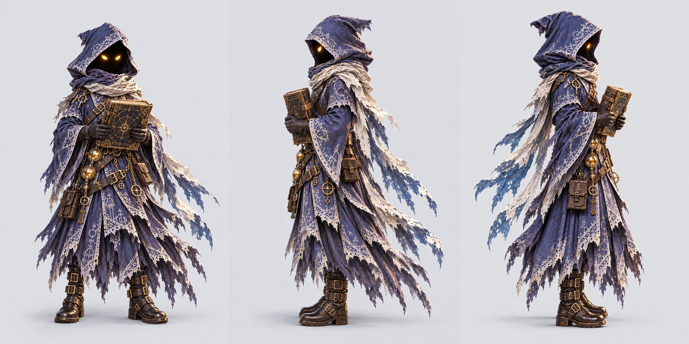

Visual QA: complete bodies and gear, neutral pose, correct facing and plain background.

<details><summary>front prompt and references</summary>

```text
ART STYLE: Lush, luminous digital painting in the spirit of a premium early-2000s Japanese RPG remastered in HD. Semi-realistic, anime-influenced characters with expressive faces and stylish asymmetrical adventure outfits: layered belts, buckles, straps, zippers, one-sleeved jackets, flowing scarves. Sun-drenched tropical environments painted in rich detail: saturated turquoise seas, white sand, emerald jungle, and ancient sandstone ruins carved with softly glowing glyphs. Golden-hour sunlight, with bioluminescent blue-green motes of light drifting through the air. Cinematic, epic and adventurous, with a mischievous sense of humor: witty, characterful expressions and small comedic details hidden in the scene. Mature and cool, never babyish or chibi.

This is an isolated game sprite: render ONLY the subject on a fully transparent background (PNG with alpha). No scenery, no ground, no cast shadow, no frame. Lit from the upper left with a soft rim light, crisp readable silhouette, full body with nothing cropped and clear empty space around it.

Character reference for animation: Knox, the tiny hooded scholar, the same character as the attached reference images, exactly: same outfit, colors, proportions, hair and gear. Full body from head to feet, standing in a relaxed neutral pose with the arms slightly away from the body, facing the viewer and looking at the viewer. For this animation reference, override the sprite transparency and lighting instructions: OPAQUE plain flat light gray background (#e4e6ea), soft even studio lighting, a faint shadow under the feet only. No scenery, no text, no other characters. Portrait 1024x1536. Center one full character with generous margins around head, feet, tail and gear. Keep the same on-model body scale in all three views. Own gear only: Cade sword and shield; Wren two blasters HOLSTERED; Knox spellbook; Maren staff; Kit pirate hat; Pockets no added gear; Jumble hat and coat. Only show the named character. Neutral child-friendly expression, no action pose, no added props.

Match Knox's actual source design: hood conceals the face completely except two golden eyes, deep indigo layered robe with silver trim and brass belts, tiny scholar proportions. Hold only his gold-trimmed book calmly in two hands, closed or slightly open. No staff, wand, floating letters or magic effects for this neutral reference.

Rules: completely original designs; never imitate an existing franchise, character, creature, logo or emblem. No text, letters, numbers, logos, watermarks, signatures, borders or user interface, unless the prompt asks for glowing magic runes. Fierce and intense is great; no blood, gore or wounds.
```

References: `public/assets/anchors/cast_lineup.webp`, `public/assets/characters/ally_spellwright/base.webp`, `public/assets/characters/ally_spellwright/battle.webp`

</details>

<details><summary>left prompt and references</summary>

```text
ART STYLE: Lush, luminous digital painting in the spirit of a premium early-2000s Japanese RPG remastered in HD. Semi-realistic, anime-influenced characters with expressive faces and stylish asymmetrical adventure outfits: layered belts, buckles, straps, zippers, one-sleeved jackets, flowing scarves. Sun-drenched tropical environments painted in rich detail: saturated turquoise seas, white sand, emerald jungle, and ancient sandstone ruins carved with softly glowing glyphs. Golden-hour sunlight, with bioluminescent blue-green motes of light drifting through the air. Cinematic, epic and adventurous, with a mischievous sense of humor: witty, characterful expressions and small comedic details hidden in the scene. Mature and cool, never babyish or chibi.

This is an isolated game sprite: render ONLY the subject on a fully transparent background (PNG with alpha). No scenery, no ground, no cast shadow, no frame. Lit from the upper left with a soft rim light, crisp readable silhouette, full body with nothing cropped and clear empty space around it.

The same character as the attached front view, exactly, now in a full side profile facing the LEFT edge of the picture: body turned 90 degrees, full body from head to feet, relaxed neutral standing pose, same size and position as the front view. Keep anatomical left and right gear on the same body sides; rotate the character, do not mirror. For this animation reference, override the sprite transparency and lighting instructions: OPAQUE plain flat light gray background (#e4e6ea), soft even studio lighting, a faint shadow under the feet only. No scenery, no text, no other characters. Portrait 1024x1536. Center one full character with generous margins around head, feet, tail and gear. Keep the same on-model body scale in all three views. Own gear only: Cade sword and shield; Wren two blasters HOLSTERED; Knox spellbook; Maren staff; Kit pirate hat; Pockets no added gear; Jumble hat and coat. Only show the named character. Neutral child-friendly expression, no action pose, no added props.

Strict orthographic lateral profile: face opening, shoulders, chest, pelvis and both feet rotated 90 degrees toward the LEFT edge; only the side of the body visible, not the chest front. Keep Knox's face in deep shadow except the near golden eye; no exposed human nose or mouth. Calmly hold the same CLOSED gold-trimmed spellbook in both hands in front of the body; no wand, staff or floating magic. Match front view scale, height and clothing exactly.

Rules: completely original designs; never imitate an existing franchise, character, creature, logo or emblem. No text, letters, numbers, logos, watermarks, signatures, borders or user interface, unless the prompt asks for glowing magic runes. Fierce and intense is great; no blood, gore or wounds.
```

References: `public/assets/anchors/cast_lineup.webp`, `public/assets/characters/ally_spellwright/base.webp`, `public/assets/characters/ally_spellwright/battle.webp`, `C:\Users\AndyLewis\.codex\generated_images\01a1224c-a831-7292-b516-5c44e2310ce8\exec-e89c5b54-dc6c-4222-b2a7-8946d1afed45.png`

</details>

<details><summary>right prompt and references</summary>

```text
ART STYLE: Lush, luminous digital painting in the spirit of a premium early-2000s Japanese RPG remastered in HD. Semi-realistic, anime-influenced characters with expressive faces and stylish asymmetrical adventure outfits: layered belts, buckles, straps, zippers, one-sleeved jackets, flowing scarves. Sun-drenched tropical environments painted in rich detail: saturated turquoise seas, white sand, emerald jungle, and ancient sandstone ruins carved with softly glowing glyphs. Golden-hour sunlight, with bioluminescent blue-green motes of light drifting through the air. Cinematic, epic and adventurous, with a mischievous sense of humor: witty, characterful expressions and small comedic details hidden in the scene. Mature and cool, never babyish or chibi.

This is an isolated game sprite: render ONLY the subject on a fully transparent background (PNG with alpha). No scenery, no ground, no cast shadow, no frame. Lit from the upper left with a soft rim light, crisp readable silhouette, full body with nothing cropped and clear empty space around it.

The same character as the attached front view, exactly, now in a full side profile facing the RIGHT edge of the picture: body turned 90 degrees, full body from head to feet, relaxed neutral standing pose, same size and position as the front view. Keep anatomical left and right gear on the same body sides; rotate the character, do not mirror. For this animation reference, override the sprite transparency and lighting instructions: OPAQUE plain flat light gray background (#e4e6ea), soft even studio lighting, a faint shadow under the feet only. No scenery, no text, no other characters. Portrait 1024x1536. Center one full character with generous margins around head, feet, tail and gear. Keep the same on-model body scale in all three views. Own gear only: Cade sword and shield; Wren two blasters HOLSTERED; Knox spellbook; Maren staff; Kit pirate hat; Pockets no added gear; Jumble hat and coat. Only show the named character. Neutral child-friendly expression, no action pose, no added props.

Strict orthographic lateral profile: face opening, shoulders, chest, pelvis and both feet rotated 90 degrees toward the RIGHT edge; only the side of the body visible, not the chest front. Keep Knox's face in deep shadow except the near golden eye; no exposed human nose or mouth. Calmly hold the same CLOSED gold-trimmed spellbook in both hands in front of the body; no wand, staff or floating magic. Match front view scale, height and clothing exactly.

Rules: completely original designs; never imitate an existing franchise, character, creature, logo or emblem. No text, letters, numbers, logos, watermarks, signatures, borders or user interface, unless the prompt asks for glowing magic runes. Fierce and intense is great; no blood, gore or wounds.
```

References: `public/assets/anchors/cast_lineup.webp`, `public/assets/characters/ally_spellwright/base.webp`, `public/assets/characters/ally_spellwright/battle.webp`, `C:\Users\AndyLewis\.codex\generated_images\01a1224c-a831-7292-b516-5c44e2310ce8\exec-e89c5b54-dc6c-4222-b2a7-8946d1afed45.png`

</details>

## ally_titancaller — draft

Front / left profile / right profile.

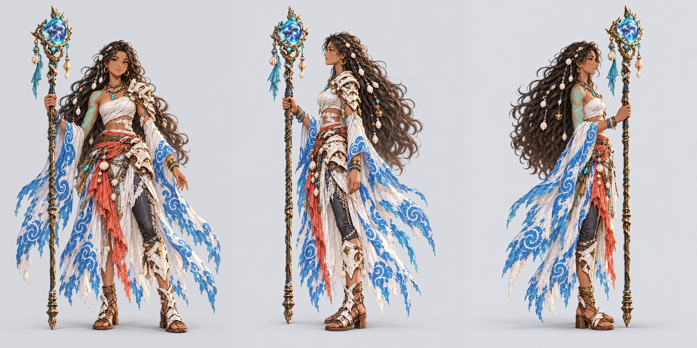

Visual QA: complete bodies and gear, neutral pose, correct facing and plain background.

<details><summary>front prompt and references</summary>

```text
ART STYLE: Lush, luminous digital painting in the spirit of a premium early-2000s Japanese RPG remastered in HD. Semi-realistic, anime-influenced characters with expressive faces and stylish asymmetrical adventure outfits: layered belts, buckles, straps, zippers, one-sleeved jackets, flowing scarves. Sun-drenched tropical environments painted in rich detail: saturated turquoise seas, white sand, emerald jungle, and ancient sandstone ruins carved with softly glowing glyphs. Golden-hour sunlight, with bioluminescent blue-green motes of light drifting through the air. Cinematic, epic and adventurous, with a mischievous sense of humor: witty, characterful expressions and small comedic details hidden in the scene. Mature and cool, never babyish or chibi.

This is an isolated game sprite: render ONLY the subject on a fully transparent background (PNG with alpha). No scenery, no ground, no cast shadow, no frame. Lit from the upper left with a soft rim light, crisp readable silhouette, full body with nothing cropped and clear empty space around it.

Character reference for animation: Maren, the Titan Caller, the same character as the attached reference images, exactly: same outfit, colors, proportions, hair and gear. Full body from head to feet, standing in a relaxed neutral pose with the arms slightly away from the body, facing the viewer and looking at the viewer. For this animation reference, override the sprite transparency and lighting instructions: OPAQUE plain flat light gray background (#e4e6ea), soft even studio lighting, a faint shadow under the feet only. No scenery, no text, no other characters. Portrait 1024x1536. Center one full character with generous margins around head, feet, tail and gear. Keep the same on-model body scale in all three views. Own gear only: Cade sword and shield; Wren two blasters HOLSTERED; Knox spellbook; Maren staff; Kit pirate hat; Pockets no added gear; Jumble hat and coat. Only show the named character. Neutral child-friendly expression, no action pose, no added props.

Maren has shell-braided long black hair, warm brown skin, bone-white plates on her anatomical left shoulder and left leg, coral sash, sea-foam white and teal wave-pattern detached sleeves, turquoise tattoo on her anatomical right arm. Hold her full storm-crystal staff vertically and calmly, keeping its entire orb and tip within the canvas. Use the outfit from her own base and sheets, not a new costume.

Rules: completely original designs; never imitate an existing franchise, character, creature, logo or emblem. No text, letters, numbers, logos, watermarks, signatures, borders or user interface, unless the prompt asks for glowing magic runes. Fierce and intense is great; no blood, gore or wounds.
```

References: `public/assets/anchors/cast_lineup.webp`, `public/assets/characters/ally_titancaller/base.webp`, `public/assets/characters/ally_titancaller/battle.webp`, `public/assets/characters/ally_titancaller/field.webp`

</details>

<details><summary>left prompt and references</summary>

```text
ART STYLE: Lush, luminous digital painting in the spirit of a premium early-2000s Japanese RPG remastered in HD. Semi-realistic, anime-influenced characters with expressive faces and stylish asymmetrical adventure outfits: layered belts, buckles, straps, zippers, one-sleeved jackets, flowing scarves. Sun-drenched tropical environments painted in rich detail: saturated turquoise seas, white sand, emerald jungle, and ancient sandstone ruins carved with softly glowing glyphs. Golden-hour sunlight, with bioluminescent blue-green motes of light drifting through the air. Cinematic, epic and adventurous, with a mischievous sense of humor: witty, characterful expressions and small comedic details hidden in the scene. Mature and cool, never babyish or chibi.

This is an isolated game sprite: render ONLY the subject on a fully transparent background (PNG with alpha). No scenery, no ground, no cast shadow, no frame. Lit from the upper left with a soft rim light, crisp readable silhouette, full body with nothing cropped and clear empty space around it.

The same character as the attached front view, exactly, now in a full side profile facing the LEFT edge of the picture: body turned 90 degrees, full body from head to feet, relaxed neutral standing pose, same size and position as the front view. Keep anatomical left and right gear on the same body sides; rotate the character, do not mirror. For this animation reference, override the sprite transparency and lighting instructions: OPAQUE plain flat light gray background (#e4e6ea), soft even studio lighting, a faint shadow under the feet only. No scenery, no text, no other characters. Portrait 1024x1536. Center one full character with generous margins around head, feet, tail and gear. Keep the same on-model body scale in all three views. Own gear only: Cade sword and shield; Wren two blasters HOLSTERED; Knox spellbook; Maren staff; Kit pirate hat; Pockets no added gear; Jumble hat and coat. Only show the named character. Neutral child-friendly expression, no action pose, no added props.

STRICT ORTHOGRAPHIC LATERAL VIEW: face, torso, pelvis and feet rotated 90 degrees toward the LEFT edge; no chest front view. Rotate, do not mirror. Anatomical LEFT has bone-white shoulder, hip and shin plates; anatomical RIGHT has turquoise upper-arm tattoo and bare knee. Keep front-view outfit, staff design and hand, shell-braided hair, detached wave sleeves, scale and position exactly. Whole staff orb and tip must fit with an empty margin; relaxed neutral pose, staff vertical, no magical action.

Rules: completely original designs; never imitate an existing franchise, character, creature, logo or emblem. No text, letters, numbers, logos, watermarks, signatures, borders or user interface, unless the prompt asks for glowing magic runes. Fierce and intense is great; no blood, gore or wounds.
```

References: `public/assets/anchors/cast_lineup.webp`, `public/assets/characters/ally_titancaller/base.webp`, `public/assets/characters/ally_titancaller/battle.webp`, `public/assets/characters/ally_titancaller/field.webp`, `C:\Users\AndyLewis\.codex\generated_images\01a1224c-a831-7292-b516-5c44e2310ce8\exec-15b7d54a-5fba-4b26-b0ae-0affcd220867.png`

</details>

<details><summary>right prompt and references</summary>

```text
ART STYLE: Lush, luminous digital painting in the spirit of a premium early-2000s Japanese RPG remastered in HD. Semi-realistic, anime-influenced characters with expressive faces and stylish asymmetrical adventure outfits: layered belts, buckles, straps, zippers, one-sleeved jackets, flowing scarves. Sun-drenched tropical environments painted in rich detail: saturated turquoise seas, white sand, emerald jungle, and ancient sandstone ruins carved with softly glowing glyphs. Golden-hour sunlight, with bioluminescent blue-green motes of light drifting through the air. Cinematic, epic and adventurous, with a mischievous sense of humor: witty, characterful expressions and small comedic details hidden in the scene. Mature and cool, never babyish or chibi.

This is an isolated game sprite: render ONLY the subject on a fully transparent background (PNG with alpha). No scenery, no ground, no cast shadow, no frame. Lit from the upper left with a soft rim light, crisp readable silhouette, full body with nothing cropped and clear empty space around it.

The same character as the attached front view, exactly, now in a full side profile facing the RIGHT edge of the picture: body turned 90 degrees, full body from head to feet, relaxed neutral standing pose, same size and position as the front view. Keep anatomical left and right gear on the same body sides; rotate the character, do not mirror. For this animation reference, override the sprite transparency and lighting instructions: OPAQUE plain flat light gray background (#e4e6ea), soft even studio lighting, a faint shadow under the feet only. No scenery, no text, no other characters. Portrait 1024x1536. Center one full character with generous margins around head, feet, tail and gear. Keep the same on-model body scale in all three views. Own gear only: Cade sword and shield; Wren two blasters HOLSTERED; Knox spellbook; Maren staff; Kit pirate hat; Pockets no added gear; Jumble hat and coat. Only show the named character. Neutral child-friendly expression, no action pose, no added props.

STRICT ORTHOGRAPHIC LATERAL VIEW: face, torso, pelvis and feet rotated 90 degrees toward the RIGHT edge; no chest front view. Rotate, do not mirror. Anatomical LEFT has bone-white shoulder, hip and shin plates; anatomical RIGHT has turquoise upper-arm tattoo and bare knee. Keep front-view outfit, staff design and hand, shell-braided hair, detached wave sleeves, scale and position exactly. Whole staff orb and tip must fit with an empty margin; relaxed neutral pose, staff vertical, no magical action.

Rules: completely original designs; never imitate an existing franchise, character, creature, logo or emblem. No text, letters, numbers, logos, watermarks, signatures, borders or user interface, unless the prompt asks for glowing magic runes. Fierce and intense is great; no blood, gore or wounds.
```

References: `public/assets/anchors/cast_lineup.webp`, `public/assets/characters/ally_titancaller/base.webp`, `public/assets/characters/ally_titancaller/battle.webp`, `public/assets/characters/ally_titancaller/field.webp`, `C:\Users\AndyLewis\.codex\generated_images\01a1224c-a831-7292-b516-5c44e2310ce8\exec-15b7d54a-5fba-4b26-b0ae-0affcd220867.png`

</details>

## tutor_droid — draft

Front / left profile / right profile.

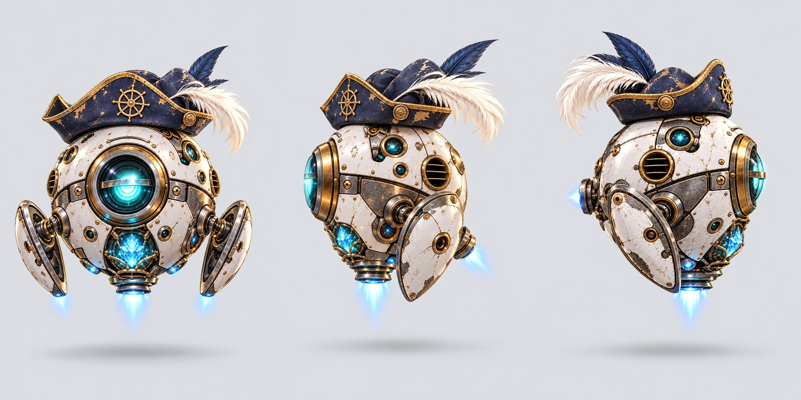

Visual QA: complete bodies and gear, neutral pose, correct facing and plain background.

<details><summary>front prompt and references</summary>

```text
ART STYLE: Lush, luminous digital painting in the spirit of a premium early-2000s Japanese RPG remastered in HD. Semi-realistic, anime-influenced characters with expressive faces and stylish asymmetrical adventure outfits: layered belts, buckles, straps, zippers, one-sleeved jackets, flowing scarves. Sun-drenched tropical environments painted in rich detail: saturated turquoise seas, white sand, emerald jungle, and ancient sandstone ruins carved with softly glowing glyphs. Golden-hour sunlight, with bioluminescent blue-green motes of light drifting through the air. Cinematic, epic and adventurous, with a mischievous sense of humor: witty, characterful expressions and small comedic details hidden in the scene. Mature and cool, never babyish or chibi.

This is an isolated game sprite: render ONLY the subject on a fully transparent background (PNG with alpha). No scenery, no ground, no cast shadow, no frame. Lit from the upper left with a soft rim light, crisp readable silhouette, full body with nothing cropped and clear empty space around it.

Character reference for animation: Kit, the round white tutor droid in a tiny pirate hat, the same character as the attached reference images, exactly: same outfit, colors, proportions, hair and gear. Full body from head to feet, standing in a relaxed neutral pose with the arms slightly away from the body, facing the viewer and looking at the viewer. For this animation reference, override the sprite transparency and lighting instructions: OPAQUE plain flat light gray background (#e4e6ea), soft even studio lighting, a faint shadow under the feet only. No scenery, no text, no other characters. Portrait 1024x1536. Center one full character with generous margins around head, feet, tail and gear. Keep the same on-model body scale in all three views. Own gear only: Cade sword and shield; Wren two blasters HOLSTERED; Knox spellbook; Maren staff; Kit pirate hat; Pockets no added gear; Jumble hat and coat. Only show the named character. Neutral child-friendly expression, no action pose, no added props.

Kit is a spherical white ceramic floating machine with ONE large teal lens-eye in front, two small side fins, brass and brushed steel panels, a tiny crooked navy pirate hat. No human arms or legs. Show the entire round body, hat, feather, fins and thruster tip, floating calmly above a faint ground shadow. Front lens points directly at camera. Match original reference, no new equipment or symbols.

FRONT ELEVATION, not three-quarter: the camera looks directly along the axis of the large teal lens. Put that large lens horizontally at the exact center of the round sphere. Both side fins equally visible with natural costume asymmetry retained. No diagonal body tilt; the sphere's front panel faces squarely at the camera. Hat may remain crooked. Same design, scale and margins.

Rules: completely original designs; never imitate an existing franchise, character, creature, logo or emblem. No text, letters, numbers, logos, watermarks, signatures, borders or user interface, unless the prompt asks for glowing magic runes. Fierce and intense is great; no blood, gore or wounds.
```

References: `public/assets/anchors/cast_lineup.webp`, `public/assets/characters/tutor_droid/base.webp`, `public/assets/characters/tutor_droid/portraits.webp`

</details>

<details><summary>left prompt and references</summary>

```text
ART STYLE: Lush, luminous digital painting in the spirit of a premium early-2000s Japanese RPG remastered in HD. Semi-realistic, anime-influenced characters with expressive faces and stylish asymmetrical adventure outfits: layered belts, buckles, straps, zippers, one-sleeved jackets, flowing scarves. Sun-drenched tropical environments painted in rich detail: saturated turquoise seas, white sand, emerald jungle, and ancient sandstone ruins carved with softly glowing glyphs. Golden-hour sunlight, with bioluminescent blue-green motes of light drifting through the air. Cinematic, epic and adventurous, with a mischievous sense of humor: witty, characterful expressions and small comedic details hidden in the scene. Mature and cool, never babyish or chibi.

This is an isolated game sprite: render ONLY the subject on a fully transparent background (PNG with alpha). No scenery, no ground, no cast shadow, no frame. Lit from the upper left with a soft rim light, crisp readable silhouette, full body with nothing cropped and clear empty space around it.

The same character as the attached front view, exactly, now in a full side profile facing the LEFT edge of the picture: body turned 90 degrees, full body from head to feet, relaxed neutral standing pose, same size and position as the front view. Keep anatomical left and right gear on the same body sides; rotate the character, do not mirror. For this animation reference, override the sprite transparency and lighting instructions: OPAQUE plain flat light gray background (#e4e6ea), soft even studio lighting, a faint shadow under the feet only. No scenery, no text, no other characters. Portrait 1024x1536. Center one full character with generous margins around head, feet, tail and gear. Keep the same on-model body scale in all three views. Own gear only: Cade sword and shield; Wren two blasters HOLSTERED; Knox spellbook; Maren staff; Kit pirate hat; Pockets no added gear; Jumble hat and coat. Only show the named character. Neutral child-friendly expression, no action pose, no added props.

Kit is a floating sphere, not a human: no arms or legs. Rotate the whole machine and hat exactly 90 degrees toward LEFT; the BIG FRONT LENS points horizontally toward that edge and is seen EDGE-ON at the leading contour. Do NOT put a round main lens facing camera on the side. The near side fin occludes the far fin. Preserve its white ceramic panels, brass rims, teal crystal core and crooked navy hat from the front view. Same diameter, same floating height, full hat feather, fins, shell and thruster remain within the frame.

Rules: completely original designs; never imitate an existing franchise, character, creature, logo or emblem. No text, letters, numbers, logos, watermarks, signatures, borders or user interface, unless the prompt asks for glowing magic runes. Fierce and intense is great; no blood, gore or wounds.
```

References: `public/assets/anchors/cast_lineup.webp`, `public/assets/characters/tutor_droid/base.webp`, `public/assets/characters/tutor_droid/portraits.webp`, `C:\Users\AndyLewis\.codex\generated_images\01a1224c-a831-7292-b516-5c44e2310ce8\exec-5d341c5b-5182-409c-b5bf-ab6a6d9a0450.png`

</details>

<details><summary>right prompt and references</summary>

```text
ART STYLE: Lush, luminous digital painting in the spirit of a premium early-2000s Japanese RPG remastered in HD. Semi-realistic, anime-influenced characters with expressive faces and stylish asymmetrical adventure outfits: layered belts, buckles, straps, zippers, one-sleeved jackets, flowing scarves. Sun-drenched tropical environments painted in rich detail: saturated turquoise seas, white sand, emerald jungle, and ancient sandstone ruins carved with softly glowing glyphs. Golden-hour sunlight, with bioluminescent blue-green motes of light drifting through the air. Cinematic, epic and adventurous, with a mischievous sense of humor: witty, characterful expressions and small comedic details hidden in the scene. Mature and cool, never babyish or chibi.

This is an isolated game sprite: render ONLY the subject on a fully transparent background (PNG with alpha). No scenery, no ground, no cast shadow, no frame. Lit from the upper left with a soft rim light, crisp readable silhouette, full body with nothing cropped and clear empty space around it.

The same character as the attached front view, exactly, now in a full side profile facing the RIGHT edge of the picture: body turned 90 degrees, full body from head to feet, relaxed neutral standing pose, same size and position as the front view. Keep anatomical left and right gear on the same body sides; rotate the character, do not mirror. For this animation reference, override the sprite transparency and lighting instructions: OPAQUE plain flat light gray background (#e4e6ea), soft even studio lighting, a faint shadow under the feet only. No scenery, no text, no other characters. Portrait 1024x1536. Center one full character with generous margins around head, feet, tail and gear. Keep the same on-model body scale in all three views. Own gear only: Cade sword and shield; Wren two blasters HOLSTERED; Knox spellbook; Maren staff; Kit pirate hat; Pockets no added gear; Jumble hat and coat. Only show the named character. Neutral child-friendly expression, no action pose, no added props.

Kit is a floating sphere, not a human: no arms or legs. Rotate the whole machine and hat exactly 90 degrees toward RIGHT; the BIG FRONT LENS points horizontally toward that edge and is seen EDGE-ON at the leading contour. Do NOT put a round main lens facing camera on the side. The near side fin occludes the far fin. Preserve its white ceramic panels, brass rims, teal crystal core and crooked navy hat from the front view. Same diameter, same floating height, full hat feather, fins, shell and thruster remain within the frame.

Rules: completely original designs; never imitate an existing franchise, character, creature, logo or emblem. No text, letters, numbers, logos, watermarks, signatures, borders or user interface, unless the prompt asks for glowing magic runes. Fierce and intense is great; no blood, gore or wounds.
```

References: `public/assets/anchors/cast_lineup.webp`, `public/assets/characters/tutor_droid/base.webp`, `public/assets/characters/tutor_droid/portraits.webp`, `C:\Users\AndyLewis\.codex\generated_images\01a1224c-a831-7292-b516-5c44e2310ce8\exec-5d341c5b-5182-409c-b5bf-ab6a6d9a0450.png`

</details>

## mascot_monkey — draft

Front / left profile / right profile.

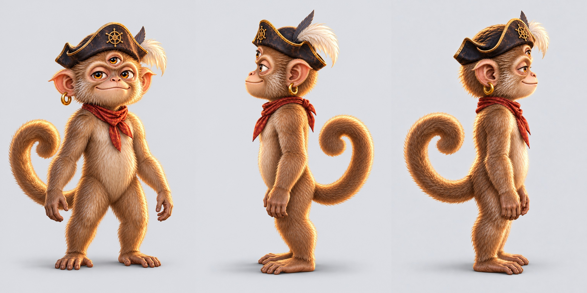

Visual QA: complete bodies and gear, neutral pose, correct facing and plain background.

<details><summary>front prompt and references</summary>

```text
ART STYLE: Lush, luminous digital painting in the spirit of a premium early-2000s Japanese RPG remastered in HD. Semi-realistic, anime-influenced characters with expressive faces and stylish asymmetrical adventure outfits: layered belts, buckles, straps, zippers, one-sleeved jackets, flowing scarves. Sun-drenched tropical environments painted in rich detail: saturated turquoise seas, white sand, emerald jungle, and ancient sandstone ruins carved with softly glowing glyphs. Golden-hour sunlight, with bioluminescent blue-green motes of light drifting through the air. Cinematic, epic and adventurous, with a mischievous sense of humor: witty, characterful expressions and small comedic details hidden in the scene. Mature and cool, never babyish or chibi.

This is an isolated game sprite: render ONLY the subject on a fully transparent background (PNG with alpha). No scenery, no ground, no cast shadow, no frame. Lit from the upper left with a soft rim light, crisp readable silhouette, full body with nothing cropped and clear empty space around it.

Character reference for animation: Pockets, the three-eyed monkey, the same character as the attached reference images, exactly: same outfit, colors, proportions, hair and gear. Full body from head to feet, standing in a relaxed neutral pose with the arms slightly away from the body, facing the viewer and looking at the viewer. For this animation reference, override the sprite transparency and lighting instructions: OPAQUE plain flat light gray background (#e4e6ea), soft even studio lighting, a faint shadow under the feet only. No scenery, no text, no other characters. Portrait 1024x1536. Center one full character with generous margins around head, feet, tail and gear. Keep the same on-model body scale in all three views. Own gear only: Cade sword and shield; Wren two blasters HOLSTERED; Knox spellbook; Maren staff; Kit pirate hat; Pockets no added gear; Jumble hat and coat. Only show the named character. Neutral child-friendly expression, no action pose, no added props.

Pockets has EXACTLY THREE amber eyes: normal pair plus the third centered on the forehead under the little pirate hat. Match tawny brown fur, red bandana, little navy-and-gold pirate hat with feather and gold earring from his own sources. Neutral relaxed upright monkey standing pose, arms slightly away from the sides, empty hands. Entire curled tail and every toe visible with ample margin. NO banana, jar, fish, weapon or new gear. One monkey only, not a human. Keep original compact monkey proportions.

Rules: completely original designs; never imitate an existing franchise, character, creature, logo or emblem. No text, letters, numbers, logos, watermarks, signatures, borders or user interface, unless the prompt asks for glowing magic runes. Fierce and intense is great; no blood, gore or wounds.
```

References: `public/assets/anchors/cast_lineup.webp`, `public/assets/characters/mascot_monkey/base.webp`, `public/assets/characters/mascot_monkey/field.webp`

</details>

<details><summary>left prompt and references</summary>

```text
ART STYLE: Lush, luminous digital painting in the spirit of a premium early-2000s Japanese RPG remastered in HD. Semi-realistic, anime-influenced characters with expressive faces and stylish asymmetrical adventure outfits: layered belts, buckles, straps, zippers, one-sleeved jackets, flowing scarves. Sun-drenched tropical environments painted in rich detail: saturated turquoise seas, white sand, emerald jungle, and ancient sandstone ruins carved with softly glowing glyphs. Golden-hour sunlight, with bioluminescent blue-green motes of light drifting through the air. Cinematic, epic and adventurous, with a mischievous sense of humor: witty, characterful expressions and small comedic details hidden in the scene. Mature and cool, never babyish or chibi.

This is an isolated game sprite: render ONLY the subject on a fully transparent background (PNG with alpha). No scenery, no ground, no cast shadow, no frame. Lit from the upper left with a soft rim light, crisp readable silhouette, full body with nothing cropped and clear empty space around it.

The same character as the attached front view, exactly, now in a full side profile facing the LEFT edge of the picture: body turned 90 degrees, full body from head to feet, relaxed neutral standing pose, same size and position as the front view. Keep anatomical left and right gear on the same body sides; rotate the character, do not mirror. For this animation reference, override the sprite transparency and lighting instructions: OPAQUE plain flat light gray background (#e4e6ea), soft even studio lighting, a faint shadow under the feet only. No scenery, no text, no other characters. Portrait 1024x1536. Center one full character with generous margins around head, feet, tail and gear. Keep the same on-model body scale in all three views. Own gear only: Cade sword and shield; Wren two blasters HOLSTERED; Knox spellbook; Maren staff; Kit pirate hat; Pockets no added gear; Jumble hat and coat. Only show the named character. Neutral child-friendly expression, no action pose, no added props.

EDIT THE LAST IMAGE, the existing left profile. Keep its neutral body pose, curled tail, scale, hat, costume and background. Correct ONLY the head rotation to a TRUE 90-DEGREE side profile facing LEFT. Pockets has three eyes but the far ordinary eye is completely OCCLUDED behind his muzzle in this view. Show the near eye and forehead third eye only, both oriented sideways. Do not show the far cheek or far nostril. Long muzzle silhouette points horizontally to the edge; camera exactly perpendicular to the side of his skull. No three-quarter head turn. Front view supplied for identity.

Rules: completely original designs; never imitate an existing franchise, character, creature, logo or emblem. No text, letters, numbers, logos, watermarks, signatures, borders or user interface, unless the prompt asks for glowing magic runes. Fierce and intense is great; no blood, gore or wounds.
```

References: `C:/Users/AndyLewis/Documents/Codex/2026-10-08/som/work/KidsLearningRPG/public/assets/anchors/cast_lineup.webp`, `C:/Users/AndyLewis/Documents/Codex/2026-10-08/som/work/KidsLearningRPG/public/assets/characters/mascot_monkey/base.webp`, `C:/Users/AndyLewis/Documents/Codex/2026-10-08/som/work/KidsLearningRPG/public/assets/characters/mascot_monkey/field.webp`, `C:\Users\AndyLewis\.codex\generated_images\01a1224c-a831-7292-b516-5c44e2310ce8\exec-b6623fd2-652d-40a0-8958-c30ff2e9e69f.png`, `C:\Users\AndyLewis\.codex\generated_images\01a1224c-a831-7292-b516-5c44e2310ce8\exec-bf0de8db-db8a-4468-a8ce-f9096d3e1029.png`

</details>

<details><summary>right prompt and references</summary>

```text
ART STYLE: Lush, luminous digital painting in the spirit of a premium early-2000s Japanese RPG remastered in HD. Semi-realistic, anime-influenced characters with expressive faces and stylish asymmetrical adventure outfits: layered belts, buckles, straps, zippers, one-sleeved jackets, flowing scarves. Sun-drenched tropical environments painted in rich detail: saturated turquoise seas, white sand, emerald jungle, and ancient sandstone ruins carved with softly glowing glyphs. Golden-hour sunlight, with bioluminescent blue-green motes of light drifting through the air. Cinematic, epic and adventurous, with a mischievous sense of humor: witty, characterful expressions and small comedic details hidden in the scene. Mature and cool, never babyish or chibi.

This is an isolated game sprite: render ONLY the subject on a fully transparent background (PNG with alpha). No scenery, no ground, no cast shadow, no frame. Lit from the upper left with a soft rim light, crisp readable silhouette, full body with nothing cropped and clear empty space around it.

The same character as the attached front view, exactly, now in a full side profile facing the RIGHT edge of the picture: body turned 90 degrees, full body from head to feet, relaxed neutral standing pose, same size and position as the front view. Keep anatomical left and right gear on the same body sides; rotate the character, do not mirror. For this animation reference, override the sprite transparency and lighting instructions: OPAQUE plain flat light gray background (#e4e6ea), soft even studio lighting, a faint shadow under the feet only. No scenery, no text, no other characters. Portrait 1024x1536. Center one full character with generous margins around head, feet, tail and gear. Keep the same on-model body scale in all three views. Own gear only: Cade sword and shield; Wren two blasters HOLSTERED; Knox spellbook; Maren staff; Kit pirate hat; Pockets no added gear; Jumble hat and coat. Only show the named character. Neutral child-friendly expression, no action pose, no added props.

EDIT THE LAST IMAGE, the existing right profile. Keep its neutral body pose, curled tail, scale, hat, costume and background. Correct ONLY the head rotation to a TRUE 90-DEGREE side profile facing RIGHT. Pockets has three eyes but the far ordinary eye is completely OCCLUDED behind his muzzle in this view. Show the near eye and forehead third eye only, both oriented sideways. Do not show the far cheek or far nostril. Long muzzle silhouette points horizontally to the edge; camera exactly perpendicular to the side of his skull. No three-quarter head turn. Front view supplied for identity.

Rules: completely original designs; never imitate an existing franchise, character, creature, logo or emblem. No text, letters, numbers, logos, watermarks, signatures, borders or user interface, unless the prompt asks for glowing magic runes. Fierce and intense is great; no blood, gore or wounds.
```

References: `C:/Users/AndyLewis/Documents/Codex/2026-10-08/som/work/KidsLearningRPG/public/assets/anchors/cast_lineup.webp`, `C:/Users/AndyLewis/Documents/Codex/2026-10-08/som/work/KidsLearningRPG/public/assets/characters/mascot_monkey/base.webp`, `C:/Users/AndyLewis/Documents/Codex/2026-10-08/som/work/KidsLearningRPG/public/assets/characters/mascot_monkey/field.webp`, `C:\Users\AndyLewis\.codex\generated_images\01a1224c-a831-7292-b516-5c44e2310ce8\exec-b6623fd2-652d-40a0-8958-c30ff2e9e69f.png`, `C:\Users\AndyLewis\.codex\generated_images\01a1224c-a831-7292-b516-5c44e2310ce8\exec-04603aa7-1fb6-467a-b08f-3b0d75895a76.png`

</details>

## npc_jumble — draft

Front / left profile / right profile.

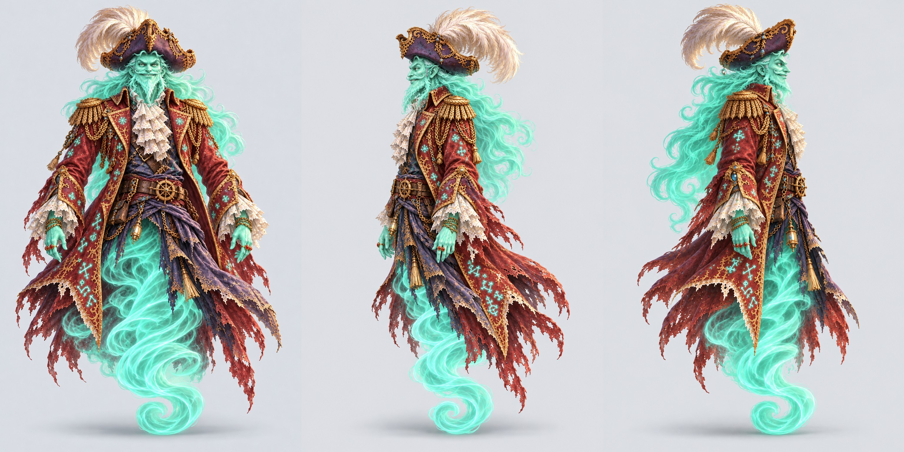

Visual QA: complete bodies and gear, neutral pose, correct facing and plain background.

<details><summary>front prompt and references</summary>

```text
ART STYLE: Lush, luminous digital painting in the spirit of a premium early-2000s Japanese RPG remastered in HD. Semi-realistic, anime-influenced characters with expressive faces and stylish asymmetrical adventure outfits: layered belts, buckles, straps, zippers, one-sleeved jackets, flowing scarves. Sun-drenched tropical environments painted in rich detail: saturated turquoise seas, white sand, emerald jungle, and ancient sandstone ruins carved with softly glowing glyphs. Golden-hour sunlight, with bioluminescent blue-green motes of light drifting through the air. Cinematic, epic and adventurous, with a mischievous sense of humor: witty, characterful expressions and small comedic details hidden in the scene. Mature and cool, never babyish or chibi.

This is an isolated game sprite: render ONLY the subject on a fully transparent background (PNG with alpha). No scenery, no ground, no cast shadow, no frame. Lit from the upper left with a soft rim light, crisp readable silhouette, full body with nothing cropped and clear empty space around it.

Character reference for animation: Captain Jumble, the ghost-pirate sorcerer, the same character as the attached reference images, exactly: same outfit, colors, proportions, hair and gear. Full body from head to feet, standing in a relaxed neutral pose with the arms slightly away from the body, facing the viewer and looking at the viewer. For this animation reference, override the sprite transparency and lighting instructions: OPAQUE plain flat light gray background (#e4e6ea), soft even studio lighting, a faint shadow under the feet only. No scenery, no text, no other characters. Portrait 1024x1536. Center one full character with generous margins around head, feet, tail and gear. Keep the same on-model body scale in all three views. Own gear only: Cade sword and shield; Wren two blasters HOLSTERED; Knox spellbook; Maren staff; Kit pirate hat; Pockets no added gear; Jumble hat and coat. Only show the named character. Neutral child-friendly expression, no action pose, no added props.

Match Jumble's own base and portrait design: sea-green translucent skin, flowing mint-green hair and curled beard, sly friendly face, ornate plum tricorn hat with pale feather, weathered crimson gold-trimmed coat, white lace jabot, purple lower coat. His LOWER BODY is a coiling translucent sea-green ghost tail, as in the reference, NOT human legs or boots. Full tail to its final curl must fit with margins. Neutral upright floating pose, both arms relaxed down slightly away from his body, empty hands: no telescope, weapon or streaming letters. Faint soft shadow beneath the tail. Entire hat feather and coat tails visible.

EDIT THE LAST IMAGE. Keep whole body, ghost tail, coat, neutral arms, hat and background exactly as painted. Turn ONLY the face directly toward the viewer in a straight-on front elevation: nose centered, both cheeks equally visible, both eyes looking squarely at camera, no three-quarter face turn. Preserve his distinctive mischievous smile, beard, skin color and original identity. No other changes.

Rules: completely original designs; never imitate an existing franchise, character, creature, logo or emblem. No text, letters, numbers, logos, watermarks, signatures, borders or user interface, unless the prompt asks for glowing magic runes. Fierce and intense is great; no blood, gore or wounds.
```

References: `C:/Users/AndyLewis/Documents/Codex/2026-10-08/som/work/KidsLearningRPG/public/assets/anchors/cast_lineup.webp`, `C:/Users/AndyLewis/Documents/Codex/2026-10-08/som/work/KidsLearningRPG/public/assets/characters/npc_jumble/base.webp`, `C:/Users/AndyLewis/Documents/Codex/2026-10-08/som/work/KidsLearningRPG/public/assets/characters/npc_jumble/portraits.webp`, `C:\Users\AndyLewis\.codex\generated_images\01a1224c-a831-7292-b516-5c44e2310ce8\exec-0795facb-baae-4c26-bd68-aef45e60e5bf.png`

</details>

<details><summary>left prompt and references</summary>

```text
ART STYLE: Lush, luminous digital painting in the spirit of a premium early-2000s Japanese RPG remastered in HD. Semi-realistic, anime-influenced characters with expressive faces and stylish asymmetrical adventure outfits: layered belts, buckles, straps, zippers, one-sleeved jackets, flowing scarves. Sun-drenched tropical environments painted in rich detail: saturated turquoise seas, white sand, emerald jungle, and ancient sandstone ruins carved with softly glowing glyphs. Golden-hour sunlight, with bioluminescent blue-green motes of light drifting through the air. Cinematic, epic and adventurous, with a mischievous sense of humor: witty, characterful expressions and small comedic details hidden in the scene. Mature and cool, never babyish or chibi.

This is an isolated game sprite: render ONLY the subject on a fully transparent background (PNG with alpha). No scenery, no ground, no cast shadow, no frame. Lit from the upper left with a soft rim light, crisp readable silhouette, full body with nothing cropped and clear empty space around it.

The same character as the attached front view, exactly, now in a full side profile facing the LEFT edge of the picture: body turned 90 degrees, full body from head to feet, relaxed neutral standing pose, same size and position as the front view. Keep anatomical left and right gear on the same body sides; rotate the character, do not mirror. For this animation reference, override the sprite transparency and lighting instructions: OPAQUE plain flat light gray background (#e4e6ea), soft even studio lighting, a faint shadow under the feet only. No scenery, no text, no other characters. Portrait 1024x1536. Center one full character with generous margins around head, feet, tail and gear. Keep the same on-model body scale in all three views. Own gear only: Cade sword and shield; Wren two blasters HOLSTERED; Knox spellbook; Maren staff; Kit pirate hat; Pockets no added gear; Jumble hat and coat. Only show the named character. Neutral child-friendly expression, no action pose, no added props.

Strict orthographic lateral profile: nose, beard, hat, shoulders, coat and torso all rotated exactly 90 degrees facing LEFT, one eye and one cheek visible, chest front hidden. Same sea-green ghost captain, red gold-trim coat, purple hat, pale feather and neutral empty hands as selected front. Keep lower body as his coiling ghost tail: no legs or boots. Entire tail spiral, feather and coat visible with margins. Same full height, scale and floating level as front, arms relaxed down, no telescope or letters.

Rules: completely original designs; never imitate an existing franchise, character, creature, logo or emblem. No text, letters, numbers, logos, watermarks, signatures, borders or user interface, unless the prompt asks for glowing magic runes. Fierce and intense is great; no blood, gore or wounds.
```

References: `public/assets/anchors/cast_lineup.webp`, `public/assets/characters/npc_jumble/base.webp`, `public/assets/characters/npc_jumble/portraits.webp`, `C:\Users\AndyLewis\.codex\generated_images\01a1224c-a831-7292-b516-5c44e2310ce8\exec-def357f7-81aa-431b-ada0-44ac3e249faa.png`

</details>

<details><summary>right prompt and references</summary>

```text
ART STYLE: Lush, luminous digital painting in the spirit of a premium early-2000s Japanese RPG remastered in HD. Semi-realistic, anime-influenced characters with expressive faces and stylish asymmetrical adventure outfits: layered belts, buckles, straps, zippers, one-sleeved jackets, flowing scarves. Sun-drenched tropical environments painted in rich detail: saturated turquoise seas, white sand, emerald jungle, and ancient sandstone ruins carved with softly glowing glyphs. Golden-hour sunlight, with bioluminescent blue-green motes of light drifting through the air. Cinematic, epic and adventurous, with a mischievous sense of humor: witty, characterful expressions and small comedic details hidden in the scene. Mature and cool, never babyish or chibi.

This is an isolated game sprite: render ONLY the subject on a fully transparent background (PNG with alpha). No scenery, no ground, no cast shadow, no frame. Lit from the upper left with a soft rim light, crisp readable silhouette, full body with nothing cropped and clear empty space around it.

The same character as the attached front view, exactly, now in a full side profile facing the RIGHT edge of the picture: body turned 90 degrees, full body from head to feet, relaxed neutral standing pose, same size and position as the front view. Keep anatomical left and right gear on the same body sides; rotate the character, do not mirror. For this animation reference, override the sprite transparency and lighting instructions: OPAQUE plain flat light gray background (#e4e6ea), soft even studio lighting, a faint shadow under the feet only. No scenery, no text, no other characters. Portrait 1024x1536. Center one full character with generous margins around head, feet, tail and gear. Keep the same on-model body scale in all three views. Own gear only: Cade sword and shield; Wren two blasters HOLSTERED; Knox spellbook; Maren staff; Kit pirate hat; Pockets no added gear; Jumble hat and coat. Only show the named character. Neutral child-friendly expression, no action pose, no added props.

Strict orthographic lateral profile: nose, beard, hat, shoulders, coat and torso all rotated exactly 90 degrees facing RIGHT, one eye and one cheek visible, chest front hidden. Same sea-green ghost captain, red gold-trim coat, purple hat, pale feather and neutral empty hands as selected front. Keep lower body as his coiling ghost tail: no legs or boots. Entire tail spiral, feather and coat visible with margins. Same full height, scale and floating level as front, arms relaxed down, no telescope or letters.

Rules: completely original designs; never imitate an existing franchise, character, creature, logo or emblem. No text, letters, numbers, logos, watermarks, signatures, borders or user interface, unless the prompt asks for glowing magic runes. Fierce and intense is great; no blood, gore or wounds.
```

References: `public/assets/anchors/cast_lineup.webp`, `public/assets/characters/npc_jumble/base.webp`, `public/assets/characters/npc_jumble/portraits.webp`, `C:\Users\AndyLewis\.codex\generated_images\01a1224c-a831-7292-b516-5c44e2310ce8\exec-def357f7-81aa-431b-ada0-44ac3e249faa.png`

</details>

## story_crystal_remade — draft

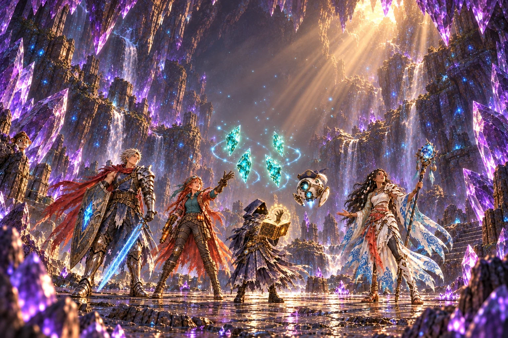

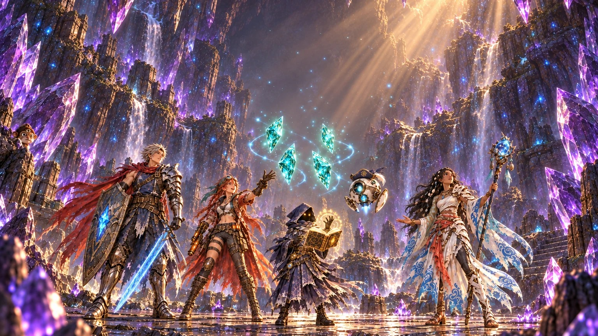

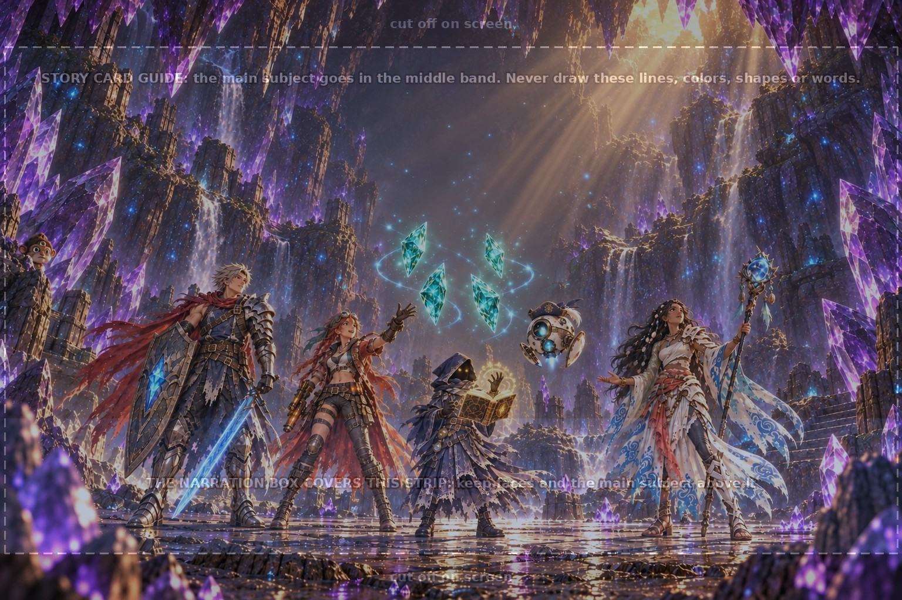

**Flags:** None recorded.

<details><summary>Prompt and references</summary>

```text
ART STYLE: Lush, luminous digital painting in the spirit of a premium early-2000s Japanese RPG remastered in HD. Semi-realistic, anime-influenced characters with expressive faces and stylish asymmetrical adventure outfits: layered belts, buckles, straps, zippers, one-sleeved jackets, flowing scarves. Sun-drenched tropical environments painted in rich detail: saturated turquoise seas, white sand, emerald jungle, and ancient sandstone ruins carved with softly glowing glyphs. Golden-hour sunlight, with bioluminescent blue-green motes of light drifting through the air. Cinematic, epic and adventurous, with a mischievous sense of humor: witty, characterful expressions and small comedic details hidden in the scene. Mature and cool, never babyish or chibi.

This is a background painting for a 2D game: no characters or creatures unless the prompt asks for them, no user interface. Rich depth, clear foreground, midground and background.

Inside the Geode Titan's crystal cave, just after the battle, calm and hopeful. The five heroes from the attached references stand in a loose half circle, small to medium in the frame, all looking up in wonder: the young knight in silver armor with his crimson scarf, the red-haired sky-pirate captain, the tiny hooded scholar holding his glowing spellbook, the Titan Caller with her storm-crystal staff, and the round white tutor droid in its tiny pirate hat floating among them. Between them, at head height, four glowing teal crystal shards float in the air, beginning to drift toward each other, trailing threads of light. Giant purple crystals line the cave walls; dust and sparkles drift in a shaft of warm sunset light from a crack in the cave roof. The space above the shards is open and glowing softly. Triumphant, peaceful, full of wonder.

Image1 gives style, image2 gives all five character outfits, image3 gives purple lair crystals and sunset canyon light, image4 is layout only. EXACTLY FIVE main heroes, one of each: Cade, Wren, Knox, Maren and Kit. EXACTLY FOUR separate floating teal shards, not yet fused. The top third above them is empty atmospheric cave space for a future tall Lore Crystal, no giant crystal occupying that space. Keep all hero faces and all four shards inside y=160 to y=700 and the 16:9 crop y=80 to y=944. Whole heroes fit. No narration box. A single tiny three-eyed monkey may peek from behind a side-wall crystal as the subtle recurring background gag; no extra human or duplicate party member.

The attached guide image is a construction drawing: use it only for layout (where the floor, horizon, characters or cells are). Do not reproduce any of its lines, colors, shapes, labels or text. Output1536x1024, opaque.

EDIT THE LAST IMAGE. Preserve all FIVE heroes, the tiny hidden monkey, their identities, exact pose, scale and position, warm roof-crack sunlight, purple cave crystals and floor. Correct ONLY the four floating shards and the surrounding reserved animation space. Move the group of EXACTLY FOUR teal shards down into the central space at x=640-920, y=420-590, roughly level with the tall heroes' heads. No shard edge or trailing bright thread may rise above y=390. Keep four individually separated fragments, not yet joined. Above them, y=80 to y=340 in the CENTRAL column is EMPTY glowing cave air with light dust only, so a tall Lore Crystal can rise there. No new shard, no completed crystal, no giant beam in that empty upper space. Keep the cave enclosed by shadowed crystal side walls and roof; no outdoor canyon skyline. No other changes.

Rules: completely original designs; never imitate an existing franchise, character, creature, logo or emblem. No text, letters, numbers, logos, watermarks, signatures, borders or user interface, unless the prompt asks for glowing magic runes. Fierce and intense is great; no blood, gore or wounds.
```

References: `C:/Users/AndyLewis/Documents/Codex/2026-10-08/som/work/KidsLearningRPG/art/raw/wave-06/style-anchors.png`, `C:/Users/AndyLewis/Documents/Codex/2026-10-08/som/work/KidsLearningRPG/art/raw/wave-06/party-sources.png`, `C:/Users/AndyLewis/Documents/Codex/2026-10-08/som/work/KidsLearningRPG/art/raw/wave-06/crystal-scene-sources.png`, `C:/Users/AndyLewis/Documents/Codex/2026-10-08/som/work/KidsLearningRPG/art/guides/story_card.png`, `C:\Users\AndyLewis\.codex\generated_images\01a1224c-a831-7292-b516-5c44e2310ce8\exec-72536388-6d7c-42b0-ad97-a964e763be81.png`

</details>

## story_jumble_next — draft

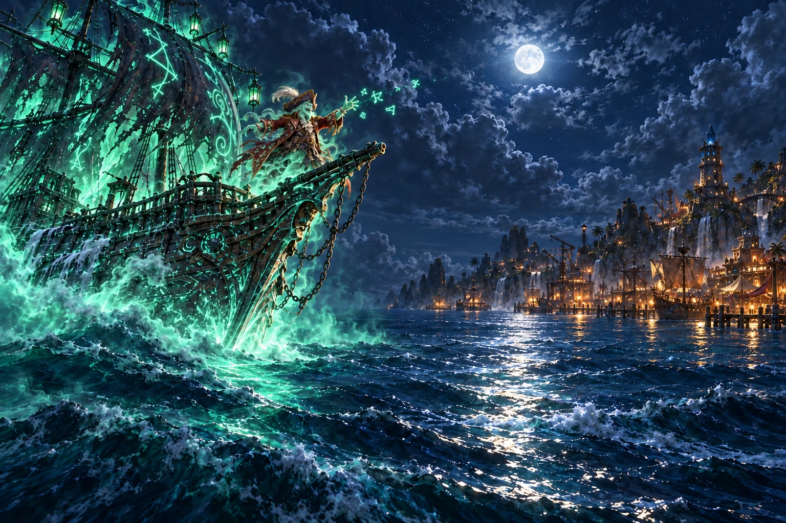

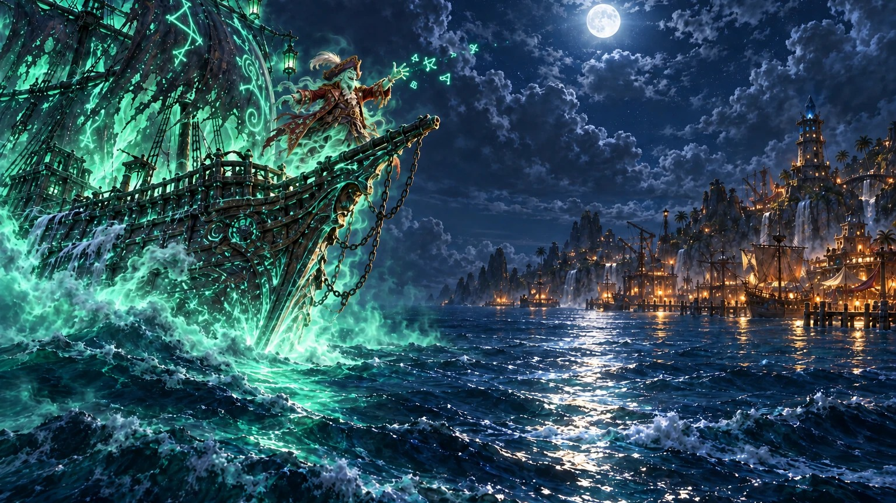

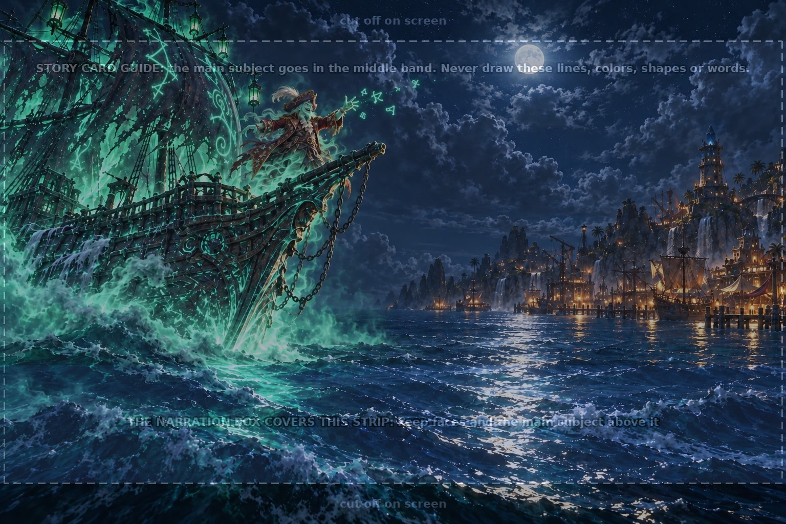

**Flags:** Pockets' recurring background cameo is not visible. The third attempt added him but changed Jumble's face and brightened the lighthouse, so it was rejected.

<details><summary>Prompt and references</summary>

```text
ART STYLE: Lush, luminous digital painting in the spirit of a premium early-2000s Japanese RPG remastered in HD. Semi-realistic, anime-influenced characters with expressive faces and stylish asymmetrical adventure outfits: layered belts, buckles, straps, zippers, one-sleeved jackets, flowing scarves. Sun-drenched tropical environments painted in rich detail: saturated turquoise seas, white sand, emerald jungle, and ancient sandstone ruins carved with softly glowing glyphs. Golden-hour sunlight, with bioluminescent blue-green motes of light drifting through the air. Cinematic, epic and adventurous, with a mischievous sense of humor: witty, characterful expressions and small comedic details hidden in the scene. Mature and cool, never babyish or chibi.

This is a background painting for a 2D game: no characters or creatures unless the prompt asks for them, no user interface. Rich depth, clear foreground, midground and background.

Night at sea outside a pirate harbor town built from old ships, the same town and lighthouse as the attached picture, seen from the water. On the left, the translucent sea-green ghost galleon from the attached reference glides out of a bank of glowing green fog, its tattered rune-sails lit from within. On its prow stands Captain Jumble from the attached reference, grinning mischievously, one hand raised with a few glowing green letters starting to swirl off his fingertips. On the right, far across the dark water, the harbor's lanterns twinkle and the crystal atop the lighthouse flickers weakly, dim and blue. Moonlight on the waves, green ghost-light against the warm harbor lights. Spooky-fun and mischievous, never scary.

Image1 gives style, image2 gives Jumble and the monkey, image3 is the exact ghost-galleon design, image4 is the harbor and lighthouse design, image5 is layout only. Preserve distinctive reference ship silhouette and tattered rune sails, do not invent a different ship. EXACTLY ONE Jumble on the prow, his whole head and raised hand well inside the 16:9 crop y=80 to y=944 and above the bottom narration-safe strip. Keep a wide clear interval of open sea and sky between the ship on the left and the far harbor on the right. Only a FEW glowing scrambled letter-glyphs beginning at his fingers, not a completed stream reaching the town. These requested magical glyphs are the only exception to no letters. Lighthouse light faint dim blue, never bright triumphant beacon. Tiny Pockets can hide on a distant dock as an unobtrusive background gag. No narration box.

The attached guide image is a construction drawing: use it only for layout (where the floor, horizon, characters or cells are). Do not reproduce any of its lines, colors, shapes, labels or text. Output1536x1024, opaque.

EDIT THE FIRST IMAGE: keep this exact ship, Jumble, a few starting glyphs, ocean, moonlit clear interval, harbor layout and framing unchanged. Correct ONLY the distant lighthouse crystal on the right: it is dying, with a faint weak dim blue glow, mostly dark blue facets and only a tiny uncertain blue glint. Remove the strong saturated blue beacon glow and bright halo from its top. Keep the warm harbor lanterns. No other changes. The remaining supplied references verify the scene identities.

Rules: completely original designs; never imitate an existing franchise, character, creature, logo or emblem. No text, letters, numbers, logos, watermarks, signatures, borders or user interface, unless the prompt asks for glowing magic runes. Fierce and intense is great; no blood, gore or wounds.
```

References: `C:\Users\AndyLewis\.codex\generated_images\01a1224c-a831-7292-b516-5c44e2310ce8\exec-d3826b10-3cc5-43eb-8c75-98066623c8e9.png`, `C:/Users/AndyLewis/Documents/Codex/2026-10-08/som/work/KidsLearningRPG/art/raw/wave-06/jumble-sources.png`, `C:/Users/AndyLewis/Documents/Codex/2026-10-08/som/work/KidsLearningRPG/public/assets/scenes/story_galleon.webp`, `C:/Users/AndyLewis/Documents/Codex/2026-10-08/som/work/KidsLearningRPG/public/assets/scenes/story_ending.webp`, `C:/Users/AndyLewis/Documents/Codex/2026-10-08/som/work/KidsLearningRPG/art/guides/story_card.png`

</details>

## story_ending — existing second clip frame

JPEG copy exported unchanged from the existing game art.

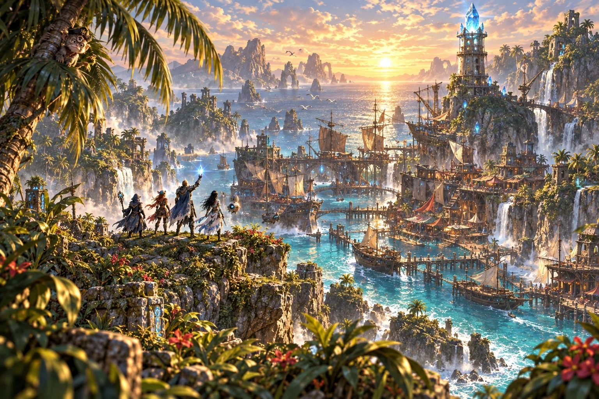
