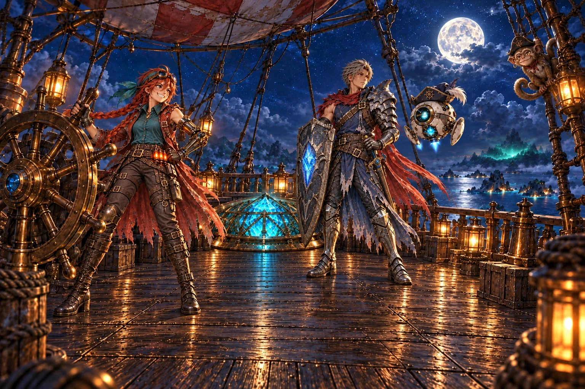
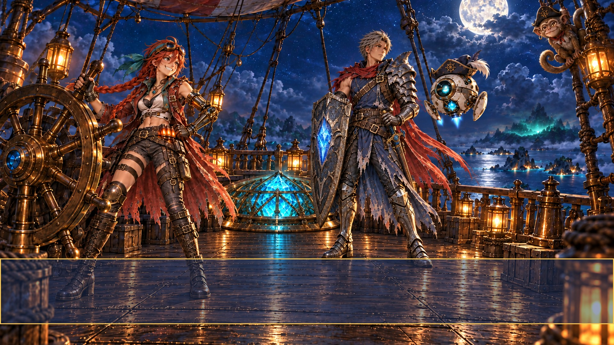
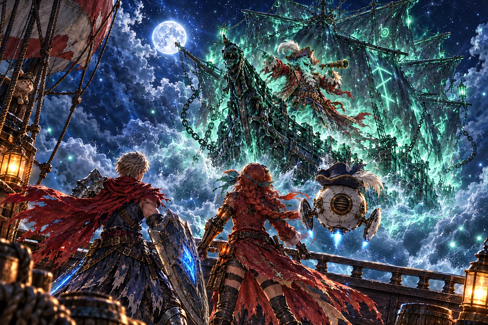
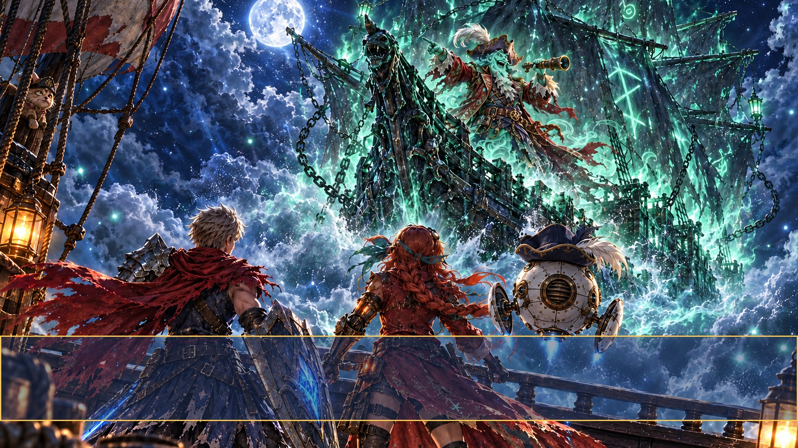
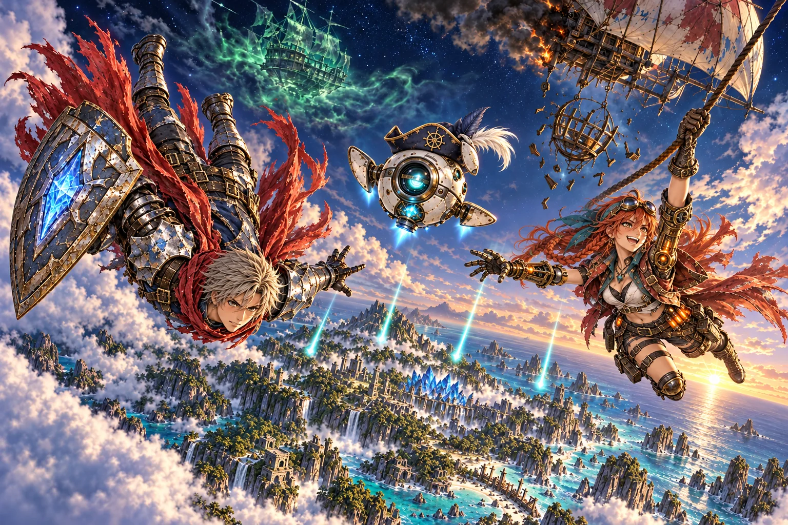
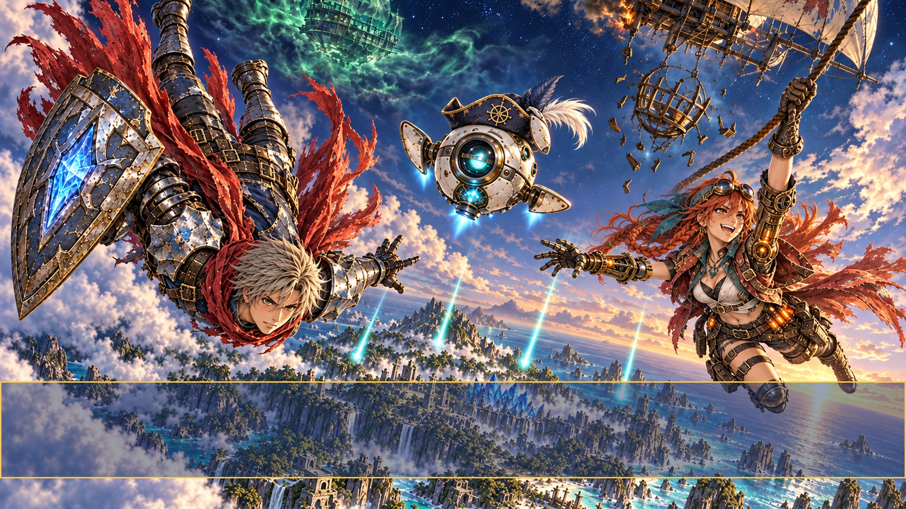
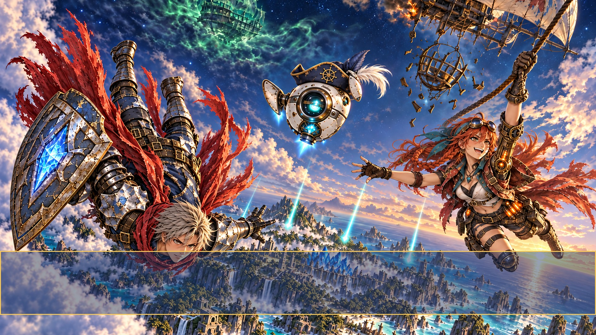

# Wave 07 review

All three opening paintings are **draft**, pending parent and child approval. **The fall has unresolved character and framing flags; see its notes below.** Made with the built-in image tool. Night flows into the first gold of dawn.

The clean full-frame and 1920×1080 JPEGs are in [video frames](../video-refs/frames/). The shaded review crops below mark the narration strip only; upload frames contain no overlay.

## story_deck — draft





Selected attempt 3/3. Night moonlight and warm lanterns; one Wren, Cade, Kit and Pockets. Crystal and faces clear of narration; Cade's shield restored. Framing flag: crystal center is 45.3% across rather than requested 50%. Pockets' hat has a narrow 16:9 top margin. Small peripheral grate rim is occluded by Cade's shield.

[Original stand-in for comparison](wave-07/story_deck-stand-in.webp)

Crystal center: **45.3% across, 57% down** (approximately pixel 696, 584). Slightly left of the requested 50%; use this measured position for the glow. The grate bottom is approximately 65% down, above the narration strip.

<details><summary>Selected prompt and reference boards</summary>

```text
ART STYLE: Lush, luminous digital painting in the spirit of a premium early-2000s Japanese RPG remastered in HD. Semi-realistic, anime-influenced characters with expressive faces and stylish asymmetrical adventure outfits: layered belts, buckles, straps, zippers, one-sleeved jackets, flowing scarves. Sun-drenched tropical environments painted in rich detail: saturated turquoise seas, white sand, emerald jungle, and ancient sandstone ruins carved with softly glowing glyphs. Golden-hour sunlight, with bioluminescent blue-green motes of light drifting through the air. Cinematic, epic and adventurous, with a mischievous sense of humor: witty, characterful expressions and small comedic details hidden in the scene. Mature and cool, never babyish or chibi.

This is a background painting for a 2D game: no characters or creatures unless the prompt asks for them, no user interface. Rich depth, clear foreground, midground and background.

Night just before dawn, cool blue moonlight with warm lantern glow, on the open deck of the patched airship from the attached picture, high above the sea, under the same full moon and stars. In the middle of the deck, an open round brass grate: a big faceted teal-blue crystal glows up through it from its cradle below, lighting the faces above from beneath. At the big brass ship's wheel on the left stands the red-haired sky-pirate captain from the attached references, grinning, her long red coat flapping. Beside the grate the young silver-haired knight from the attached references stands guard, earnest, one hand on his sword hilt, his red scarf stirring. Floating at his shoulder, the round white tutor droid in its tiny pirate hat. Lanterns along the rail, the patched red-and-white balloon overhead, ropes and rigging. Far off over the dark sea, one cloud bank glows faintly green. Half hidden up in the rigging, the small three-eyed monkey in a tricorn hat just like the droid's, eyeing the crystal. Calm before the storm, warm and a little mysterious.

Opaque landscape 1536x1024. Override golden-hour lighting with the time of day specified above. Match the attached reference's character exactly: same face, outfit, colors and weapon. The attached guide image is a construction drawing: use it only for layout (where the floor, horizon, characters or cells are). Do not reproduce any of its lines, colors, shapes, labels or text. Keep all faces, hats and key action between 12% and 68% of canvas height, clear of the narration strip at 71%-87%. Only one of each requested character. The crystal center is 50% across and 58% down, with entire grate above 70%.

Rules: completely original designs; never imitate an existing franchise, character, creature, logo or emblem. No text, letters, numbers, logos, watermarks, signatures, borders or user interface, unless the prompt asks for glowing magic runes. Fierce and intense is great; no blood, gore or wounds.
Reference boards in order: style anchors; individual character bases; their pose sheets; scene continuity references (stand-in for layout only); construction guide. Paint ONE single unified scene, never a collage or sheet.
CORRECTION TO ATTACHED FIRST IMAGE (edit target): Keep the beautiful night deck, exactly one Wren at wheel, one Cade, one Kit, one Pockets, same faces and gear. MOVE AND SHRINK THE ROUND CRYSTAL GRATE UP into the midground: its bounding ellipse must span x=570..965, y=505..685 on a 1536x1024 canvas. Crystal's center at x768 y594. Its bottom MUST be ABOVE y710. Put empty wooden deck across the bottom third. Shift Cade slightly right so his shield does not hide the crystal; his hand rests on sword hilt. Do not retain the large foreground crystal/grate; replace that old foreground area with uninterrupted deck planks. Pockets' hat and entire face must be below y125, not cropped in 16:9. Faint green cloud bank far over sea.
Now edit the newly supplied corrected image. Preserve the improved small midground crystal grate and empty foreground EXACTLY. Restore Cade's large dark metal tower shield with glowing blue crystal on his arm, placed to his RIGHT (viewer right) so it does not cover the grate. Sheathe his sword at his hip and rest his sword hand on its hilt. Keep all figures and faces otherwise exactly unchanged. Add one subtle distant green glowing cloud in the sky over sea. DO NOT move the grate down again. Its actual visual center may remain x700 y594, around46% across58% down; priority is keeping its bottom above y710.
```

References: art/raw/wave-07/story_deck/02.png, art/raw/wave-07/anchors.png, art/raw/wave-07/story_deck/characters.png, art/raw/wave-07/story_deck/poses.png, art/guides/story_card.png

</details>

## story_galleon_night — draft





Selected attempt 2/3. Night and green ghost light. Jumble's full hat, feather and face fit the crop. Cade, Wren and Kit face the galleon; Kit shows its rear grille. Heroes' heads are above narration; Kit's lower fin/jet partly enters the covered strip. Pockets peeks from airship rigging. No injuries or guide marks.

[Original stand-in for comparison](wave-07/story_galleon_night-stand-in.webp)

<details><summary>Selected prompt and reference boards</summary>

```text
ART STYLE: Lush, luminous digital painting in the spirit of a premium early-2000s Japanese RPG remastered in HD. Semi-realistic, anime-influenced characters with expressive faces and stylish asymmetrical adventure outfits: layered belts, buckles, straps, zippers, one-sleeved jackets, flowing scarves. Sun-drenched tropical environments painted in rich detail: saturated turquoise seas, white sand, emerald jungle, and ancient sandstone ruins carved with softly glowing glyphs. Golden-hour sunlight, with bioluminescent blue-green motes of light drifting through the air. Cinematic, epic and adventurous, with a mischievous sense of humor: witty, characterful expressions and small comedic details hidden in the scene. Mature and cool, never babyish or chibi.

This is a background painting for a 2D game: no characters or creatures unless the prompt asks for them, no user interface. Rich depth, clear foreground, midground and background.

Night under a big full moon and stars, cool blue moonlight and eerie sea-green ghost light. We stand on the stern deck of the patched airship from the attached picture, looking out past three heroes seen from behind in the foreground, bracing against the wind: on the left the young silver-haired knight with his crimson scarf and glowing blue crystal shield, in the middle the red-haired sky-pirate captain in her long red coat, on the right the round white tutor droid in its tiny pirate hat. Bursting bow-first out of a glowing green storm cloud and charging straight at them, one second from impact, comes the translucent sea-green ghost galleon from the attached reference, its tattered rune-sails lit from within, chains and spray swirling around its hull. Standing big on its prow, one arm flung forward and pointing at the heroes, laughing, is Captain Jumble from the attached references: the ghost-pirate captain with a flowing green spectral beard, a red coat and a plumed tricorn hat. Dramatic and spooky-fun, never scary.

Opaque landscape 1536x1024. Override golden-hour lighting with the time of day specified above. Match the attached reference's character exactly: same face, outfit, colors and weapon. The attached guide image is a construction drawing: use it only for layout (where the floor, horizon, characters or cells are). Do not reproduce any of its lines, colors, shapes, labels or text. Keep all faces, hats and key action between 12% and 68% of canvas height, clear of the narration strip at 71%-87%. Only one of each requested character. 

Rules: completely original designs; never imitate an existing franchise, character, creature, logo or emblem. No text, letters, numbers, logos, watermarks, signatures, borders or user interface, unless the prompt asks for glowing magic runes. Fierce and intense is great; no blood, gore or wounds.
Reference boards in order: style anchors; individual character bases; their pose sheets; scene continuity references (stand-in for layout only); construction guide. Paint ONE single unified scene, never a collage or sheet.
Framing priority: Jumble's whole feather, hat and face fit BELOW y130 and ABOVE y440, centered on the incoming prow, never against the top border. Heroes' heads are near y480; their bodies may extend behind narration. No impact yet. One ship and one captain. Small Pockets cameo peeking from airship rigging is permitted by scene style, not another foreground figure.
Edit target is the FIRST attached painting. Preserve Jumble, his entire hat, face, ghost galleon, Cade, Wren, Pockets, sea-green storm, moon and deck exactly. Correct ONLY KIT on the lower right: rotate the white spherical tutor droid to a full REAR view, looking at Jumble, showing the circular rear ventilation grille instead of front eye/core. Move it UP to float beside Wren's shoulder: hat around y470, spherical body centered x1240 y585, body bottom around y685, ALL above story box. Same white ceramic/brass construction and crooked navy hat with white feather. Two short fins, reference scale. Fill its old low position with deck and storm scenery. Do not change any other character's position.
```

References: art/raw/wave-07/story_galleon_night/01.png, art/raw/wave-07/anchors.png, art/raw/wave-07/story_galleon_night/characters.png, art/raw/wave-07/story_galleon_night/scenes.png, art/guides/story_card.png

</details>

## story_fall — draft





Selected attempt 2 of 3. Four shard trails, recognizable dawn island, one of each hero, Wren grips the rope, empty broken cradle. **Visual flags:** Kit has a third fin instead of two; Wren has two mechanical arms instead of only her anatomical left; Cade's upper boot slightly intersects the 16:9 crop. Pockets cameo absent (the wave asks for only these three heroes). Faces remain above narration. Attempt 3 fixes the extra fin and Wren's right arm but drops Cade's face into the narration strip, so it was rejected. Requires parent review; no further attempts under the three-attempt production limit.

<details><summary>Selected prompt and reference boards</summary>

```text
ART STYLE: Lush, luminous digital painting in the spirit of a premium early-2000s Japanese RPG remastered in HD. Semi-realistic, anime-influenced characters with expressive faces and stylish asymmetrical adventure outfits: layered belts, buckles, straps, zippers, one-sleeved jackets, flowing scarves. Sun-drenched tropical environments painted in rich detail: saturated turquoise seas, white sand, emerald jungle, and ancient sandstone ruins carved with softly glowing glyphs. Golden-hour sunlight, with bioluminescent blue-green motes of light drifting through the air. Cinematic, epic and adventurous, with a mischievous sense of humor: witty, characterful expressions and small comedic details hidden in the scene. Mature and cool, never babyish or chibi.

This is a background painting for a 2D game: no characters or creatures unless the prompt asks for them, no user interface. Rich depth, clear foreground, midground and background.

The last of the night turning to dawn: deep blue sky above, the first gold of sunrise along the horizon. High above the sea, three heroes fall through the clouds, large in the frame and close to the camera, as if the camera were falling with them. On the left, the young silver-haired knight tumbles head-first, his crimson scarf streaming, his glowing blue crystal shield on his arm, his face determined. In the middle, the round white tutor droid in its tiny pirate hat spins with its fins spread, one fin clamping its hat on. On the right, the red-haired sky-pirate captain reaches up and grabs a rope trailing down from her patched airship high above; the airship trails smoke, and only a broken, empty cradle hangs beneath it. Far below, the jungle island from the attached picture catches the dawn, and four streaks of teal light fall ahead of the heroes toward it. High in the sky, a green ghost ship dissolves into green fog. Thrilling and brave, never scary: nobody looks hurt.

Opaque landscape 1536x1024. Override golden-hour lighting with the time of day specified above. Match the attached reference's character exactly: same face, outfit, colors and weapon. The attached guide image is a construction drawing: use it only for layout (where the floor, horizon, characters or cells are). Do not reproduce any of its lines, colors, shapes, labels or text. Keep all faces, hats and key action between 12% and 68% of canvas height, clear of the narration strip at 71%-87%. Only one of each requested character. 

Rules: completely original designs; never imitate an existing franchise, character, creature, logo or emblem. No text, letters, numbers, logos, watermarks, signatures, borders or user interface, unless the prompt asks for glowing magic runes. Fierce and intense is great; no blood, gore or wounds.
Reference boards in order: style anchors; individual character bases; their pose sheets; scene continuity references (stand-in for layout only); construction guide. Paint ONE single unified scene, never a collage or sheet.
Framing priority: all three distinct heroes large but completely inside x100..1440 and y140..710. Wren's raised hand grips the rope around x1190 y240; her face around y410. Cade tumbles genuinely head-first on left, head lower than his boots; his determined face around y600. Kit spins in the middle with one fin securing the crooked hat. EXACTLY FOUR separate teal shard trails below the heroes. Absolutely NO intact crystal under the damaged airship; show a recognizable shattered EMPTY brass cradle. Island below is the specific reference's canyon, ruined temple, beaches and waterfalls.
EDIT ONLY these defects in the FIRST attached painting: (1) There are currently six teal trails: remove the two EXTRA LOW trails ending around x500 y825 and x976 y860. Keep EXACTLY FOUR bright shard streaks ending around x584 y680, x749 y659, x888 y697, x1065 y745. (2) Kit is a round spherical robot with TWO short fins ONLY, NO HUMAN HANDS, NO ARMS, NO fingers. Replace the human hand touching the hat with the tip of its right short ceramic fin braced against the hat rim. Two fins total, the other extends left. Keep round face and pirate hat unchanged. (3) Move Cade's entire inverted figure down a little so both boots are wholly below y120 and inside 16:9 crop; keep his head above y690. Whole shield inside x30..740. (4) Wren's outfit must retain a brass mechanical left arm. Show it extending outward toward center, while her natural right hand remains gripping rope. Preserve one Wren, joyful brave face, red braid, teal bandana and orange holstered blasters. Keep empty broken crystal cradle, island landmarks, moonless dawn horizon and ghost ship unchanged. No new figures, no new trails.
```

References: art/raw/wave-07/story_fall/01.png, art/raw/wave-07/anchors.png, art/raw/wave-07/story_fall/characters.png, art/raw/wave-07/story_fall/poses.png, art/guides/story_card.png

</details>

## Rejected fall alternative: attempt 3

This fixes Wren’s second mechanical arm and Kit’s third fin, but places Cade’s face under the narration strip. Kept for comparison, not selected for the game.


