# Wave 08: Gate B review

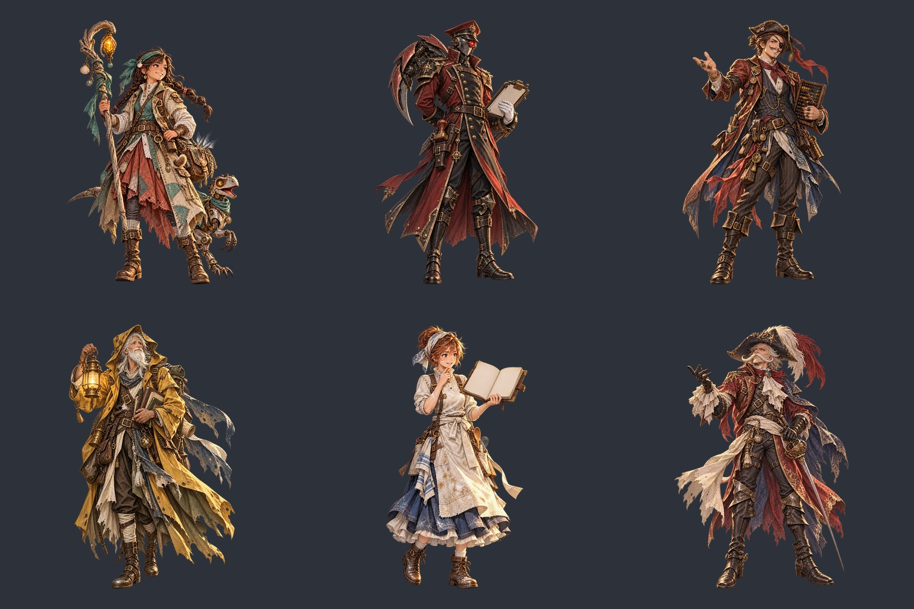

Six character bases, all **approved** by the parent at Gate A (13 October). Two candidates per character; selected bases below, with comparisons and visual notes. Sections B–K are delivered below as 89 outputs, all **approved** by the parent at Gate B (14 October), as delivered.

Generated on the chapter two branch `claude/project-thread-ftrlee` for PR #3. Raw inputs are 1024×1536; shipped sprites are trimmed, padded by 4%, and scaled to a maximum edge of 1024, following PRODUCTION.md.

## ally_beastkeeper — approved

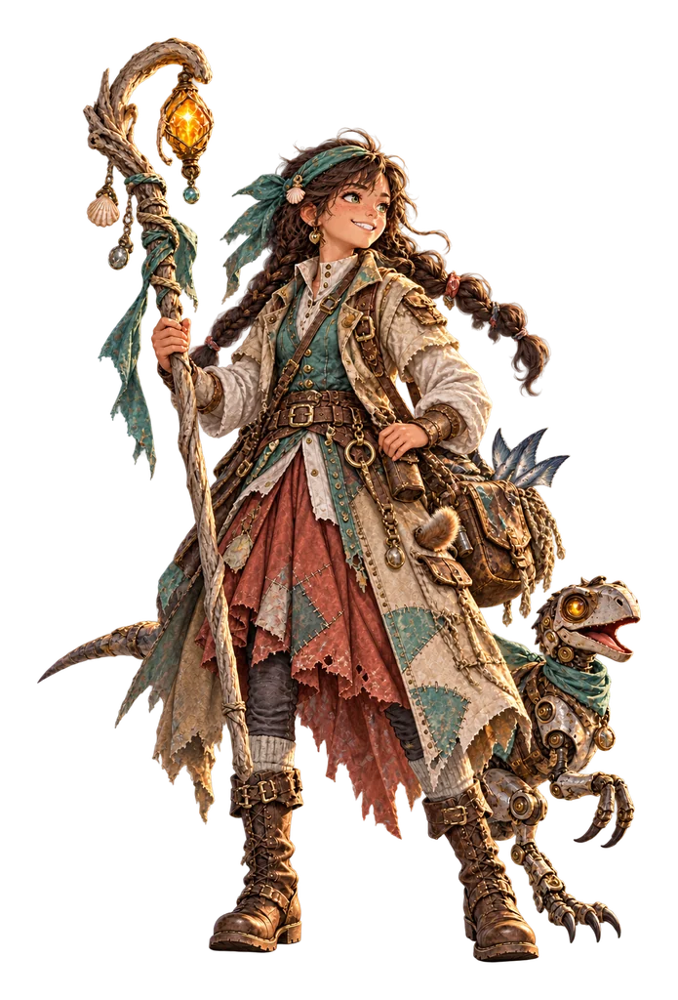

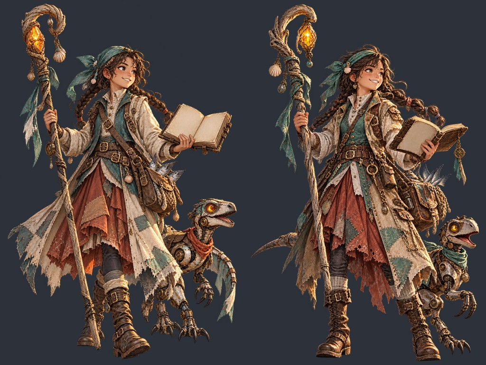

**Candidate 6 selected.** Revised to the parent's new brief: long dark curly braids, freckled girl's face, sea-green bandana with shell charm, collarbone-high blouse, waistcoat and belted coat fully cover the torso. Rust skirt over leggings and ankle boots; only face and hands exposed. Candidates 4 and 5 compared; final correction 6 removes an unintended book and adds the pocket tail. Amber crook, fish satchel and rebuilt raptor retained. Previous design rejected and kept only in ignored raw files.

695×1024; 200.4 KiB; transparent.

<details><summary>Prompt and references</summary>

```text
ART STYLE: Lush, luminous digital painting in the spirit of a premium early-2000s Japanese RPG remastered in HD. Semi-realistic, anime-influenced characters with expressive faces and stylish asymmetrical adventure outfits: layered belts, buckles, straps, zippers, one-sleeved jackets, flowing scarves. Sun-drenched tropical environments painted in rich detail: saturated turquoise seas, white sand, emerald jungle, and ancient sandstone ruins carved with softly glowing glyphs. Golden-hour sunlight, with bioluminescent blue-green motes of light drifting through the air. Cinematic, epic and adventurous, with a mischievous sense of humor: witty, characterful expressions and small comedic details hidden in the scene. Mature and cool, never babyish or chibi.

This is an isolated game sprite: render ONLY the subject on a fully transparent background (PNG with alpha). No scenery, no ground, no cast shadow, no frame. Lit from the upper left with a soft rim light, crisp readable silhouette, full body with nothing cropped and clear empty space around it.

A hero, full body, three-quarter view: a scrappy harbor girl of about twelve, clearly a girl at a glance: a friendly, freckled girl's face with bright eyes and a confident half-smile, and long dark curly hair worn in two thick braids, tied back under a knotted sea-green bandana with a small shell charm. Modestly dressed: a long-sleeved cream blouse buttoned to the collarbone, a sea-green waistcoat, and a long patched sailcloth coat with far too many pockets (a small creature's tail pokes out of one) worn over it, closed at the waist with a belt. A knee-length rust-colored skirt over leggings, and sturdy ankle boots. No bare midriff and no exposed skin beyond her face and hands. A satchel with fish tails sticking out. She holds a tall shepherd's crook carved from pale driftwood, with a glowing amber crystal set in the hook. A small friendly rebuilt creature (a little scrap-metal raptor with neat patched plates) peeks out from behind her coat. Palette: sea-green, sailcloth tan, rust, and an amber glow.

Portrait canvas 1024x1536. Create ONE NEW character design as described, all clothing modest and practical, not a copy of costumes in the anchors. Anchors show paint style ONLY. Full body, whole staff, companion, book and boots inside generous transparent margins. No shadows or scenery. No book, no lettering. High collar reaches collarbone, roomy layers completely cover the chest and waist; no exposed belly, low necklines, form-fitting bust shaping or exaggerated proportions.

Edit target: the first attached revised Tamsin image. Preserve her young freckled face, two long dark braids, sea-green bandana, full high-neck blouse and waistcoat, closed belt, rust skirt over leggings, ankle boots, amber crook and scrap raptor exactly. REMOVE the unnecessary open book from her right hand; her right hand rests naturally on the top of her fish satchel instead. Put a small friendly creature's furry tail peeking from one coat pocket near the waist. Never reveal chest, belly or legs; clothes stay fully closed and roomy. Only these changes.

Rules: completely original designs; never imitate an existing franchise, character, creature, logo or emblem. No text, letters, numbers, logos, watermarks, signatures, borders or user interface, unless the prompt asks for glowing magic runes. Fierce and intense is great; no blood, gore or wounds. Every character is dressed for an all-ages game: modest clothing, no bare midriffs, no low necklines or cleavage, no revealing or tight-fitting costumes, and nothing sexualized in pose or proportion.
```

References: public/assets/anchors/key_art.webp, public/assets/anchors/cast_lineup.webp

</details>

## npc_clamp — approved

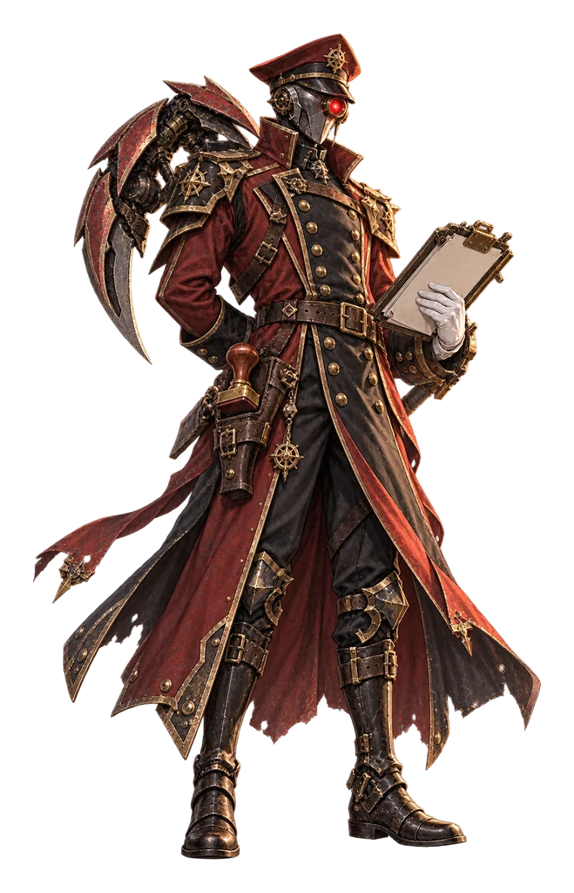

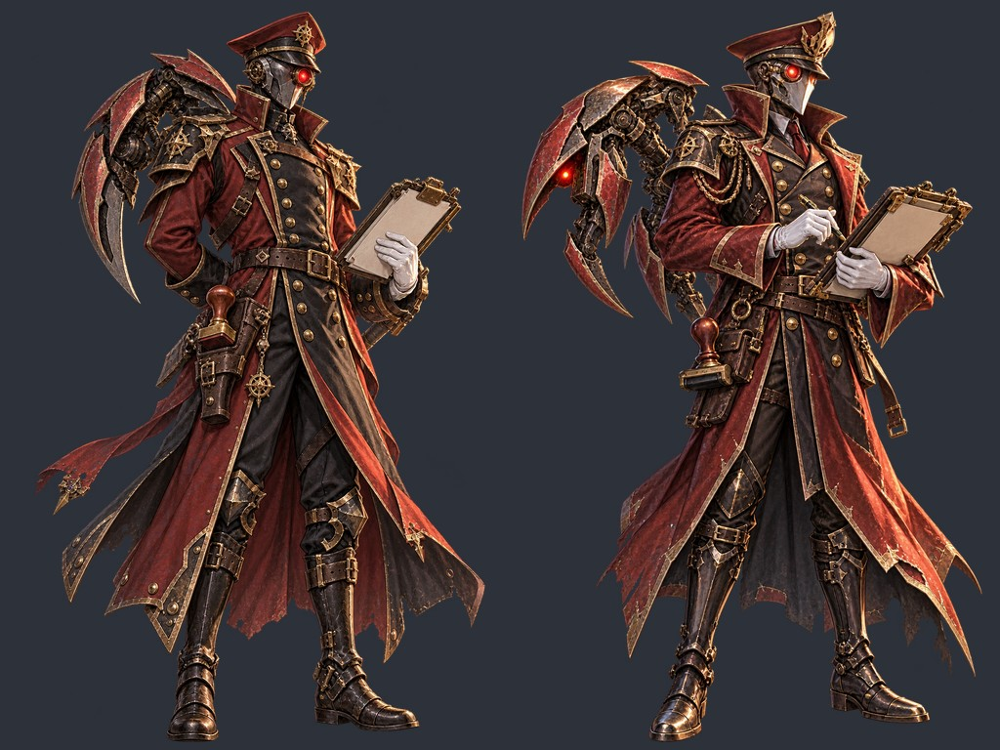

**Candidate 1 selected.** Candidate 1 has the more rigid, upright inspector stance, a single red monocle lens, mouthless gunmetal mask, crisp button rows and clearly holstered stamp. Folded back claw matches Dominion drone materials. Blank forms; full boots and coat. Review flag: clipboard attachment is partly hidden by the supporting glove, so the bolted forearm mounting is not clearly established.

659×1024; 168.6 KiB; transparent.

<details><summary>Prompt and references</summary>

```text
ART STYLE: Lush, luminous digital painting in the spirit of a premium early-2000s Japanese RPG remastered in HD. Semi-realistic, anime-influenced characters with expressive faces and stylish asymmetrical adventure outfits: layered belts, buckles, straps, zippers, one-sleeved jackets, flowing scarves. Sun-drenched tropical environments painted in rich detail: saturated turquoise seas, white sand, emerald jungle, and ancient sandstone ruins carved with softly glowing glyphs. Golden-hour sunlight, with bioluminescent blue-green motes of light drifting through the air. Cinematic, epic and adventurous, with a mischievous sense of humor: witty, characterful expressions and small comedic details hidden in the scene. Mature and cool, never babyish or chibi.

This is an isolated game sprite: render ONLY the subject on a fully transparent background (PNG with alpha). No scenery, no ground, no cast shadow, no frame. Lit from the upper left with a soft rim light, crisp readable silhouette, full body with nothing cropped and clear empty space around it.

A villain, full body, three-quarter view: a tall, very upright inspector of an evil iron empire, perfectly still and polite. A smooth gunmetal face-mask with no mouth and one round glowing red lens over one eye like a monocle. A high-collared crimson-and-black greatcoat with brass buttons in perfectly straight rows, white gloves, and a clipboard of forms bolted to his left forearm. A large rubber stamp hangs in a holster on his hip where a weapon would be. A folded mechanical crab claw rests on his back. Cold, precise and menacing, and a little absurd in how tidy he is.

Portrait canvas 1024x1536. One complete character with all gear inside the frame, generous transparent margin all around. Use the attached anchors for painting style only; create the new character described, not a copy of a hero in the anchors. Blank paperwork and books; no lettering, numbers, seals or printed marks.

Rules: completely original designs; never imitate an existing franchise, character, creature, logo or emblem. No text, letters, numbers, logos, watermarks, signatures, borders or user interface, unless the prompt asks for glowing magic runes. Fierce and intense is great; no blood, gore or wounds.
```

References: public/assets/anchors/key_art.webp, public/assets/anchors/cast_lineup.webp, public/assets/fiends/fiend_dominion_drone/base.webp

</details>

## npc_hal — approved

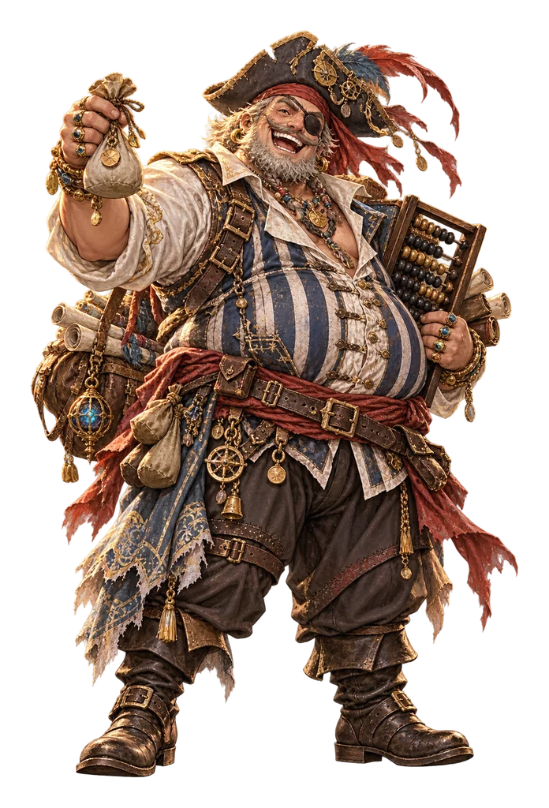

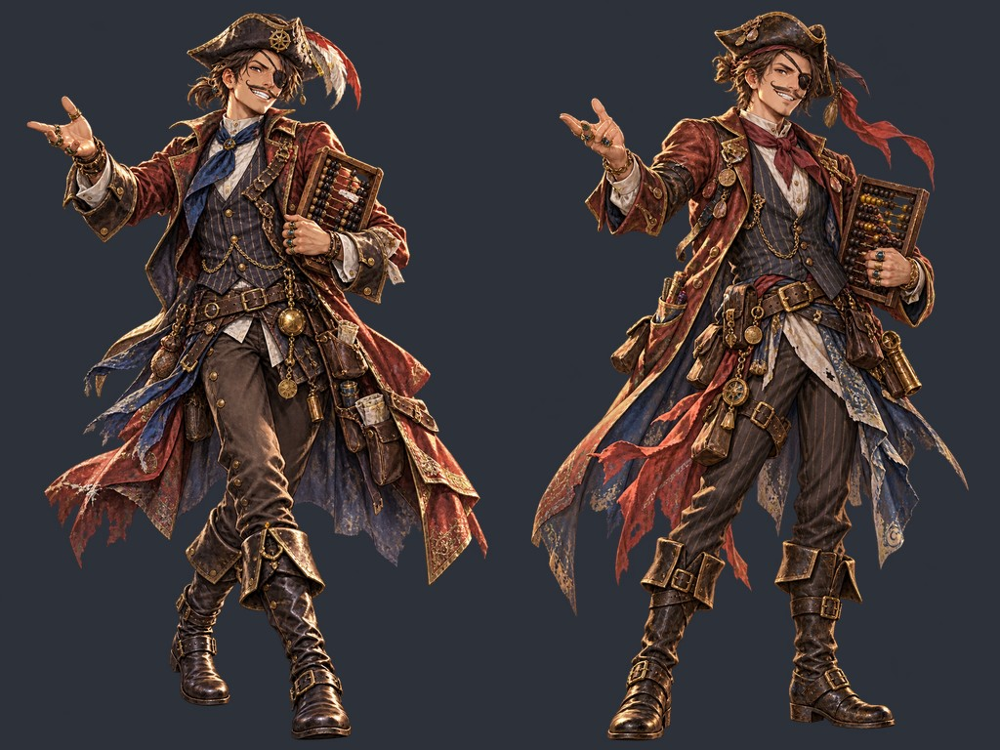

**Candidate 4 selected.** Two new voice-matching candidates compared; candidate 4 selected for the cleaner thin twirled mustache, smaller battered tricorn and clearer missing abacus beads. Lean, wiry merchant in his thirties, quick sales gesture, huge grin, eyepatch, rings, striped waistcoat and fully collar-buttoned shirt with neckerchief. Complete boots and gear, no lettering or exposed torso. Earlier round design replaced.

645×1024; 176.0 KiB; transparent.

<details><summary>Prompt and references</summary>

```text
ART STYLE: Lush, luminous digital painting in the spirit of a premium early-2000s Japanese RPG remastered in HD. Semi-realistic, anime-influenced characters with expressive faces and stylish asymmetrical adventure outfits: layered belts, buckles, straps, zippers, one-sleeved jackets, flowing scarves. Sun-drenched tropical environments painted in rich detail: saturated turquoise seas, white sand, emerald jungle, and ancient sandstone ruins carved with softly glowing glyphs. Golden-hour sunlight, with bioluminescent blue-green motes of light drifting through the air. Cinematic, epic and adventurous, with a mischievous sense of humor: witty, characterful expressions and small comedic details hidden in the scene. Mature and cool, never babyish or chibi.

This is an isolated game sprite: render ONLY the subject on a fully transparent background (PNG with alpha). No scenery, no ground, no cast shadow, no frame. Lit from the upper left with a soft rim light, crisp readable silhouette, full body with nothing cropped and clear empty space around it.

A shopkeeper, full body: a lean, wiry pirate merchant in his thirties, quick and restless, mid-gesture as if halfway through a sales pitch, with a huge salesman's grin, a thin twirled mustache and slicked-back hair under a small battered tricorn. A shirt buttoned to the collar with a neat neckerchief, a well-fitted striped waistcoat, a coat with too many hidden inner pockets, an eyepatch, rings on every finger, and an abacus missing a few beads tucked under one arm. Slim build, nothing bulging or open.

Portrait canvas 1024x1536. Exactly ONE human character, complete body and all props inside generous transparent margins. Use the attached anchors for paint style ONLY. Follow this new age and body-type brief; do not copy the anchor characters or add animals, companions, weapons, scenery, book lettering or extra figures. Slim silhouette with modest, comfortable clothing, high neckline and fully covered torso. Hal has NO beard; only a thin twirled mustache. Show a youthful man in his thirties, lean shoulders and narrow waist, brisk sales gesture, shirt fully buttoned to the collar, small battered tricorn, and obvious gaps where abacus beads are missing. No book.

Rules: completely original designs; never imitate an existing franchise, character, creature, logo or emblem. No text, letters, numbers, logos, watermarks, signatures, borders or user interface, unless the prompt asks for glowing magic runes. Fierce and intense is great; no blood, gore or wounds. Every character is dressed for an all-ages game: modest clothing, no bare midriffs, no low necklines or cleavage, no revealing or tight-fitting costumes, and nothing sexualized in pose or proportion.
```

References: public/assets/anchors/key_art.webp, public/assets/anchors/cast_lineup.webp

</details>

## npc_keeper — approved

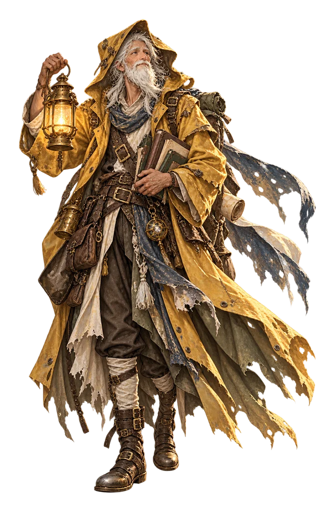

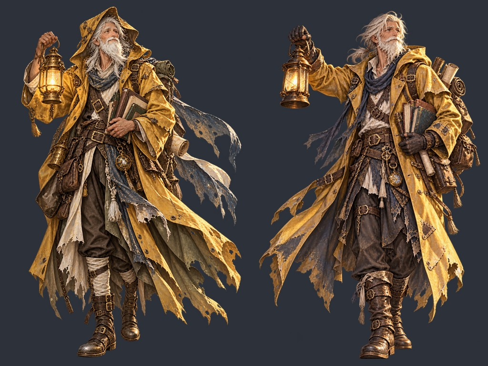

**Candidate 1 selected.** Candidate 1 is thinner, older and gentler, with a more tender, faraway expression than candidate 2. White beard, long yellow oilskin coat and lit brass lantern are prominent. Whole lantern and boots retained; book covers blank.

671×1024; 217.2 KiB; transparent.

<details><summary>Prompt and references</summary>

```text
ART STYLE: Lush, luminous digital painting in the spirit of a premium early-2000s Japanese RPG remastered in HD. Semi-realistic, anime-influenced characters with expressive faces and stylish asymmetrical adventure outfits: layered belts, buckles, straps, zippers, one-sleeved jackets, flowing scarves. Sun-drenched tropical environments painted in rich detail: saturated turquoise seas, white sand, emerald jungle, and ancient sandstone ruins carved with softly glowing glyphs. Golden-hour sunlight, with bioluminescent blue-green motes of light drifting through the air. Cinematic, epic and adventurous, with a mischievous sense of humor: witty, characterful expressions and small comedic details hidden in the scene. Mature and cool, never babyish or chibi.

This is an isolated game sprite: render ONLY the subject on a fully transparent background (PNG with alpha). No scenery, no ground, no cast shadow, no frame. Lit from the upper left with a soft rim light, crisp readable silhouette, full body with nothing cropped and clear empty space around it.

An old man, full body: tall, thin and gentle, in a long yellow oilskin coat, with a white beard and kind, faraway eyes. He holds an old brass lantern, lit, as if he has forgotten why he carries it. Quiet and dignified; his face should carry tenderness.

Portrait canvas 1024x1536. One complete character with all gear inside the frame, generous transparent margin all around. Use the attached anchors for painting style only; create the new character described, not a copy of a hero in the anchors. Blank paperwork and books; no lettering, numbers, seals or printed marks.

Rules: completely original designs; never imitate an existing franchise, character, creature, logo or emblem. No text, letters, numbers, logos, watermarks, signatures, borders or user interface, unless the prompt asks for glowing magic runes. Fierce and intense is great; no blood, gore or wounds.
```

References: public/assets/anchors/key_art.webp, public/assets/anchors/cast_lineup.webp

</details>

## npc_baker — approved

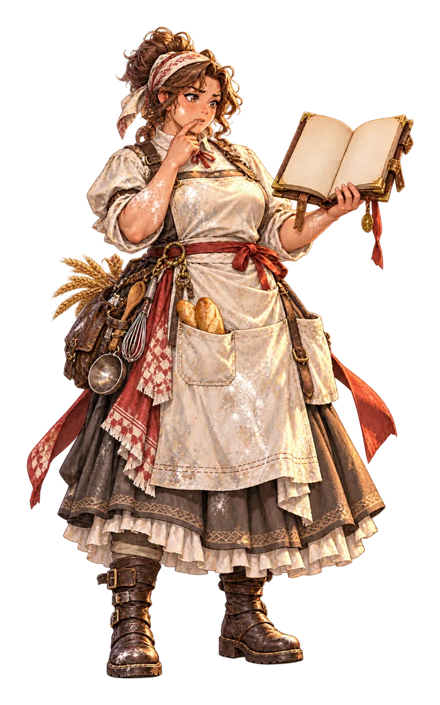

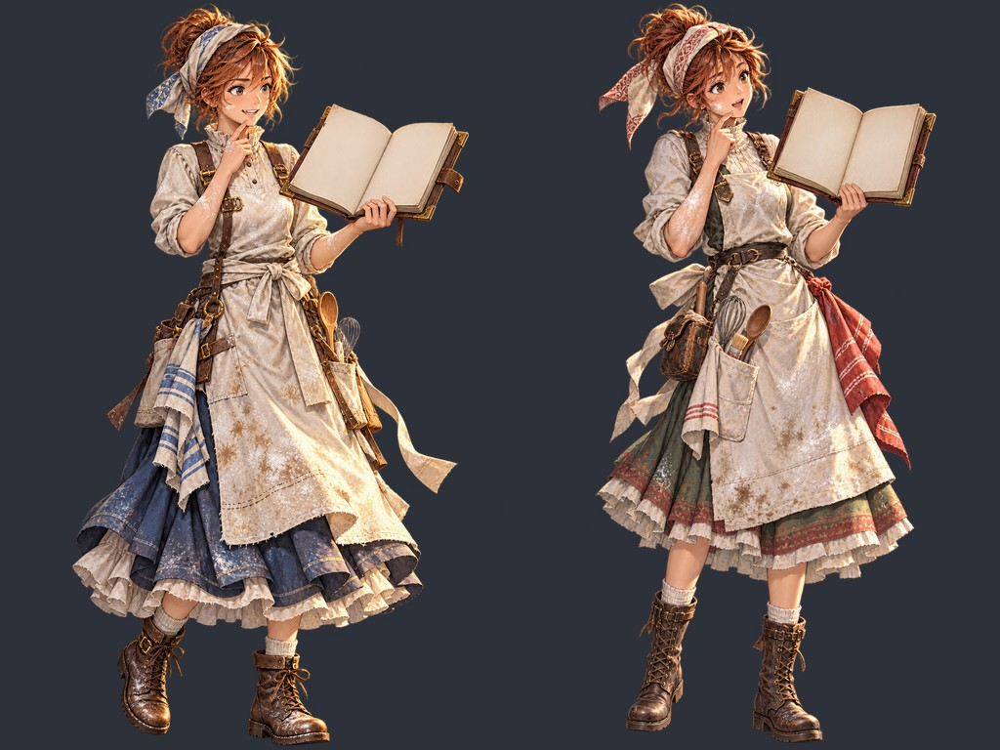

**Candidate 7 selected.** Two new voice-matching candidates compared; candidate 7 selected for the cheerful, bright expression instead of candidate 8's surprised look. Slim young woman in her early twenties, hair in a kerchief, high-neck blouse with sleeves rolled to elbows and full bib apron from collarbone to knees. Flour-covered forearms, cheek smudge, clearly blank book pages and full boots. No cleavage, exposed waist, pets or added figures. Earlier motherly design replaced.

582×1024; 152.3 KiB; transparent.

<details><summary>Prompt and references</summary>

```text
ART STYLE: Lush, luminous digital painting in the spirit of a premium early-2000s Japanese RPG remastered in HD. Semi-realistic, anime-influenced characters with expressive faces and stylish asymmetrical adventure outfits: layered belts, buckles, straps, zippers, one-sleeved jackets, flowing scarves. Sun-drenched tropical environments painted in rich detail: saturated turquoise seas, white sand, emerald jungle, and ancient sandstone ruins carved with softly glowing glyphs. Golden-hour sunlight, with bioluminescent blue-green motes of light drifting through the air. Cinematic, epic and adventurous, with a mischievous sense of humor: witty, characterful expressions and small comedic details hidden in the scene. Mature and cool, never babyish or chibi.

This is an isolated game sprite: render ONLY the subject on a fully transparent background (PNG with alpha). No scenery, no ground, no cast shadow, no frame. Lit from the upper left with a soft rim light, crisp readable silhouette, full body with nothing cropped and clear empty space around it.

A baker, full body: a slim, bright young woman in her early twenties, quick and cheerful, with her hair tied up in a kerchief, in a high-necked, long-sleeved blouse with the sleeves rolled to the elbows and a full bib apron that covers her from the collarbone to the knees, flour on her forearms and a smudge on her cheek, holding an open recipe book whose pages are blank, looking at it in puzzlement. A modest neckline, no cleavage.

Portrait canvas 1024x1536. Exactly ONE human character, complete body and all props inside generous transparent margins. Use the attached anchors for paint style ONLY. Follow this new age and body-type brief; do not copy the anchor characters or add animals, companions, weapons, scenery, book lettering or extra figures. Slim silhouette with modest, comfortable clothing, high neckline and fully covered torso. The baker is a young adult in her early twenties, slim shoulders and slender overall build. A full bib apron OVER her high-neck blouse; no visible chest or belly. Clearly show BOTH completely blank recipe-book pages, her bright eyes looking at them in cheerful puzzlement.

Rules: completely original designs; never imitate an existing franchise, character, creature, logo or emblem. No text, letters, numbers, logos, watermarks, signatures, borders or user interface, unless the prompt asks for glowing magic runes. Fierce and intense is great; no blood, gore or wounds. Every character is dressed for an all-ages game: modest clothing, no bare midriffs, no low necklines or cleavage, no revealing or tight-fitting costumes, and nothing sexualized in pose or proportion.
```

References: public/assets/anchors/key_art.webp, public/assets/anchors/cast_lineup.webp

</details>

## npc_swordmaster — approved

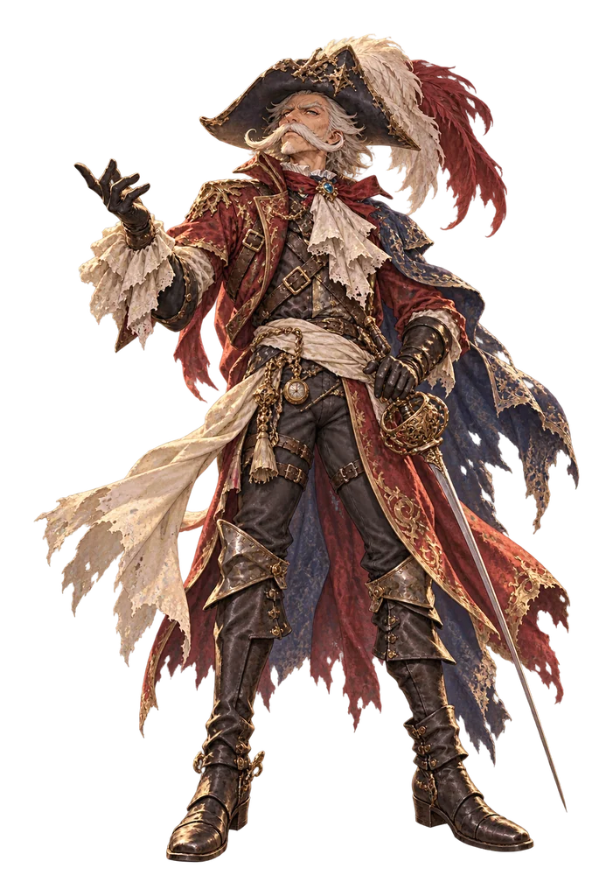

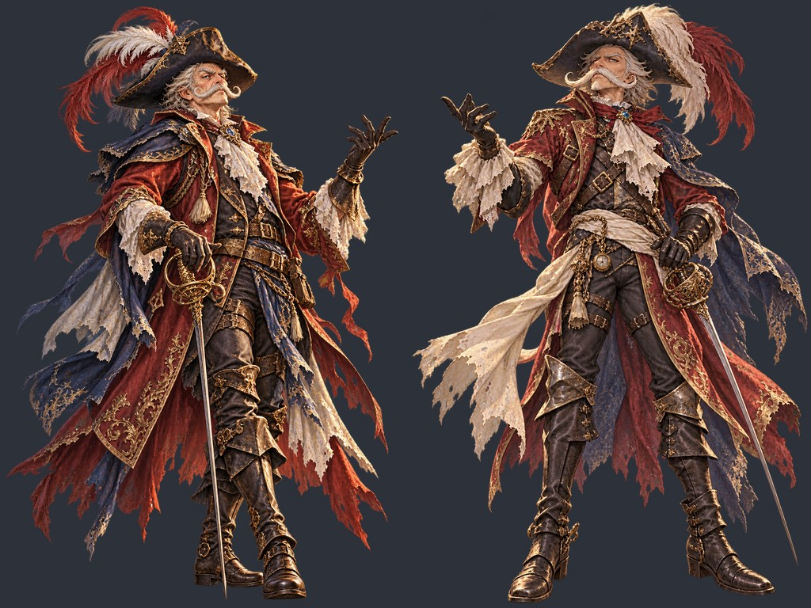

**Candidate 2 selected.** Candidate 2 has the clearer broad stance, enormous curled mustache, indignant raised chin and theatrical hand gesture. Complete faded hat and plume, worn once-fine coat, thin rapier at the hip and both boots remain inside the canvas.

701×1024; 216.7 KiB; transparent.

<details><summary>Prompt and references</summary>

```text
ART STYLE: Lush, luminous digital painting in the spirit of a premium early-2000s Japanese RPG remastered in HD. Semi-realistic, anime-influenced characters with expressive faces and stylish asymmetrical adventure outfits: layered belts, buckles, straps, zippers, one-sleeved jackets, flowing scarves. Sun-drenched tropical environments painted in rich detail: saturated turquoise seas, white sand, emerald jungle, and ancient sandstone ruins carved with softly glowing glyphs. Golden-hour sunlight, with bioluminescent blue-green motes of light drifting through the air. Cinematic, epic and adventurous, with a mischievous sense of humor: witty, characterful expressions and small comedic details hidden in the scene. Mature and cool, never babyish or chibi.

This is an isolated game sprite: render ONLY the subject on a fully transparent background (PNG with alpha). No scenery, no ground, no cast shadow, no frame. Lit from the upper left with a soft rim light, crisp readable silhouette, full body with nothing cropped and clear empty space around it.

An old swordmaster, full body: a grand, theatrical duelist with an enormous curled mustache, a faded plumed hat and a once-fine coat, a thin rapier at his hip, looking indignant.

Portrait canvas 1024x1536. One complete character with all gear inside the frame, generous transparent margin all around. Use the attached anchors for painting style only; create the new character described, not a copy of a hero in the anchors. Blank paperwork and books; no lettering, numbers, seals or printed marks.

Rules: completely original designs; never imitate an existing franchise, character, creature, logo or emblem. No text, letters, numbers, logos, watermarks, signatures, borders or user interface, unless the prompt asks for glowing magic runes. Fierce and intense is great; no blood, gore or wounds.
```

References: public/assets/anchors/key_art.webp, public/assets/anchors/cast_lineup.webp

</details>


## Voice-matching revision

Hal and the baker have been remade from the updated wave briefs, with two new candidates each. Hal is lean and wiry, in his thirties, with his shirt buttoned to the collar. The baker is slim, young and cheerful, in her early twenties, with a modest high-neck blouse and full bib apron. The other four bases are unchanged byte for byte. Earlier versions are retained in ignored raw files.

Technical QA passed: transparent border rings, maximum edge 1024, all within 400 KiB, correct manifest dimensions and anchors. [QA record](wave-08-qa.json). Stop at Gate A for parent review; Sections B–K remain unstarted.

**Gate B ready for review — 13 October 2026.** Sections B–K contain all 89 requested draft outputs: character sheets, pets, fiends, boss/Titan poses, eleven painted places, eleven state patches, two arenas with foregrounds, map variant, Crystal Grid, weapons, ten story cards and props/icons. Three film first frames are provided at 1920×1080; no films were generated.

Review the annotated object boxes and before/after patch comparisons in Section G, and the three first-frame links in Section J. Source-cell warnings remain beside each affected sheet. Pay particular attention to Tamsin's hurt facing/walk alternation, the Sword Master's feather tips, the Wick Moth's special sparks, jelly stage 3's acting and the harbor tower's scale/placement. The item sheet reached the three-attempt limit: inspect its tight fish-fin, paper-corner and hat framing. Neighbor fragments were removed from item/weapon exports. The ceiling web reaches the canvas edge intentionally. The Engine and waking-bird stills use a top-aligned 16:9 crop to retain the spire and feathers; confirm narration staging in game.

Validation: 184 repository tests pass. The final asset report is [wave-08-qa.json](wave-08-qa.json). In-game animation, narration overlap and walking/click behavior remain for human review. Approved Section A bases are unchanged.


<!-- WAVE08 BK START -->

# Sections B–K: production review

Gate B passed on 14 October: the parent approved all new outputs as delivered. Approved Section A bases are retained. Each asset includes its recorded production prompt and QA flags. Earlier targeted correction wording is summarized in visual notes where it was not retained verbatim.


## Section B


### ally_beastkeeper / battle — approved

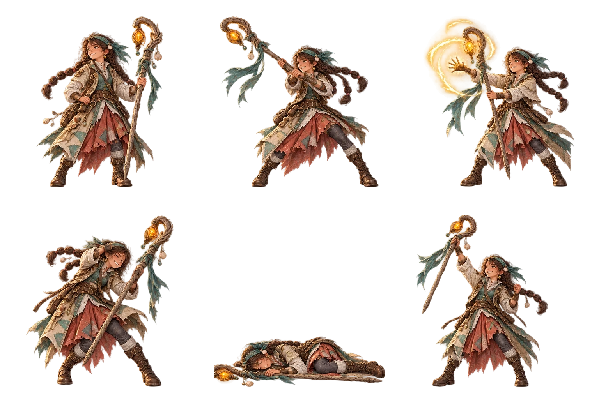

1536×1024; 426.6 KiB. Attempt 3.

- FLAG: Cell 0 source touches cell edge; inspect cropping/bleed

- FLAG: Cell 1 source touches cell edge; inspect cropping/bleed

- FLAG: Cell 2 source touches cell edge; inspect cropping/bleed

- FLAG: Cell 4 source touches cell edge; inspect cropping/bleed

- FLAG: Cell 5 source touches cell edge; inspect cropping/bleed

Third attempt selected. Every cell mirrored in processing to face the enemy on the left, then rebuilt with a shared standing baseline; KO placed lying on that baseline. Review flags: spell glow and KO crook run close to source cell edges; hurt pose is three-quarter frontal while recoiling. No additional retries after the three-attempt limit. Stray fragment removed from victory cell; intentional spell effects kept.

<details><summary>Prompt and references</summary>

```text
ART STYLE: Lush, luminous digital painting in the spirit of a premium early-2000s Japanese RPG remastered in HD. Semi-realistic, anime-influenced characters with expressive faces and stylish asymmetrical adventure outfits: layered belts, buckles, straps, zippers, one-sleeved jackets, flowing scarves. Sun-drenched tropical environments painted in rich detail: saturated turquoise seas, white sand, emerald jungle, and ancient sandstone ruins carved with softly glowing glyphs. Golden-hour sunlight, with bioluminescent blue-green motes of light drifting through the air. Cinematic, epic and adventurous, with a mischievous sense of humor: witty, characterful expressions and small comedic details hidden in the scene. Mature and cool, never babyish or chibi.

This is an isolated game sprite: render ONLY the subject on a fully transparent background (PNG with alpha). No scenery, no ground, no cast shadow, no frame. Lit from the upper left with a soft rim light, crisp readable silhouette, full body with nothing cropped and clear empty space around it.

Tamsin Hollow, in the exact approved modest costume and long braids. Only Tamsin and her crook, no companion raptor in these cells. A sprite sheet for a 2D turn-based battle game: the SAME character shown 6 times in a grid of 3 columns and 2 rows of equal square cells, on a fully transparent background, with no grid lines, borders, labels or text. Every pose shows the full body at the same size and scale, feet on the same invisible baseline near the bottom of each cell, the character facing LEFT, with clear empty space between poses. Top row, left to right: (1) idle battle stance, (2) attacking at the peak of the strike, (3) casting a special move with energy gathering in the hands or weapon. Bottom row, left to right: (4) hurt, recoiling from a hit, (5) knocked out, collapsed on the ground, (6) victory pose. Match the attached character reference exactly. Every standing pose faces LEFT; the KO pose lies flat with her body resting on the baseline near the bottom of its cell.

Canvas 1536x1024. The attached guide image is a construction drawing: use it only for layout (where the floor, horizon, characters or cells are). Do not reproduce any of its lines, colors, shapes, labels or text. Match the attached reference's character exactly: same face, outfit, colors and weapon. Keep all bodies and props entirely inside their cells or frame. No accidental text or extra figures.

Final spacing and facing correction: render every UPRIGHT pose facing RIGHT, including the cast pose: face, torso, knees, feet and spell hand all oriented toward the RIGHT of its own cell. This is intentional; the whole sheet's cells will be mirrored in processing to face LEFT. Never mix left and right poses. Render each complete standing figure AND staff at only 75% of cell height, with at least 48px empty margin on all sides. KO: tuck knees slightly to shorten the silhouette; entire lying person and crook must occupy x600..950 and y850..950, never cross x1024. Feet of top row around y450, bottom row y950. Maintain approved outfit and two long braids. No background, no grid or guide lines.

Rules: completely original designs; never imitate an existing franchise, character, creature, logo or emblem. No text, letters, numbers, logos, watermarks, signatures, borders or user interface, unless the prompt asks for glowing magic runes. Fierce and intense is great; no blood, gore or wounds. Every character is dressed for an all-ages game: modest clothing, no bare midriffs, no low necklines or cleavage, no revealing or tight-fitting costumes, and nothing sexualized in pose or proportion.
```

References: public/assets/anchors/key_art.webp, public/assets/anchors/cast_lineup.webp, public/assets/characters/ally_beastkeeper/base.webp, art/guides/hero_battle_sheet.png

</details>


### ally_beastkeeper / walk — approved

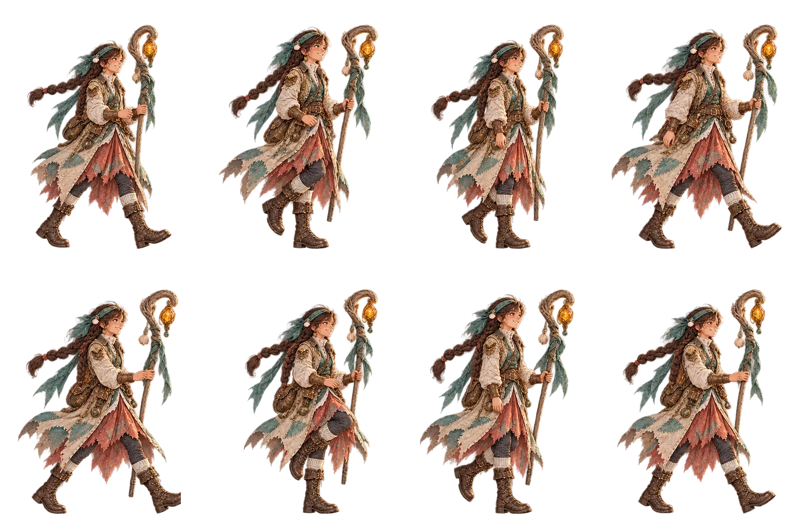

1536×1024; 536.3 KiB. Attempt 2.

- FLAG: Cell 4 source touches cell edge; inspect cropping/bleed

- FLAG: Cell 5 source touches cell edge; inspect cropping/bleed

Second attempt selected: eight right-facing contact, lift and passing frames, shared baseline. A 350px stray boot fragment was removed from frame 5. Near/far leg alternation remains subtle; review the loop in game.

<details><summary>Prompt and references</summary>

```text
ART STYLE: Lush, luminous digital painting in the spirit of a premium early-2000s Japanese RPG remastered in HD. Semi-realistic, anime-influenced characters with expressive faces and stylish asymmetrical adventure outfits: layered belts, buckles, straps, zippers, one-sleeved jackets, flowing scarves. Sun-drenched tropical environments painted in rich detail: saturated turquoise seas, white sand, emerald jungle, and ancient sandstone ruins carved with softly glowing glyphs. Golden-hour sunlight, with bioluminescent blue-green motes of light drifting through the air. Cinematic, epic and adventurous, with a mischievous sense of humor: witty, characterful expressions and small comedic details hidden in the scene. Mature and cool, never babyish or chibi.

This is an isolated game sprite: render ONLY the subject on a fully transparent background (PNG with alpha). No scenery, no ground, no cast shadow, no frame. Lit from the upper left with a soft rim light, crisp readable silhouette, full body with nothing cropped and clear empty space around it.

Tamsin Hollow, exact approved modest clothing and long braids. Only Tamsin and her crook; no companion raptor. A side-view walk cycle sprite sheet: the SAME character in 8 frames in a grid of 4 columns and 2 rows of equal cells, on a fully transparent background, with no grid lines, labels or text. Full body, same size and scale in every frame, feet on the same invisible baseline, walking toward the RIGHT. The frames read left to right, top row then bottom row, as one smooth looping step cycle. Match the attached character reference exactly.

Canvas 1536x1024. The attached guide image is a construction drawing: use it only for layout (where the floor, horizon, characters or cells are). Do not reproduce any of its lines, colors, shapes, labels or text. Match the attached reference's character exactly: same face, outfit, colors and weapon. Keep all bodies and props entirely inside their cells or frame. No accidental text or extra figures.

Gait correction: STRICT side view facing RIGHT, the near and far legs visibly alternate through ONE full walking stride. Frame0: near boot forward heel contact, far boot back; frame1: near boot taking weight, far knee lifting; frame2: legs passing under body, far knee swings forward; frame3: far boot reaching forward; frame4: FAR boot forward heel contact, near boot back (opposite frame0); frame5: far boot taking weight, near knee lifting; frame6: legs passing, near knee swings forward; frame7: near boot reaches forward to return to frame0. Never repeat the same forward boot in every cell. Full crook and braids inside each 384x512 cell, feet on same baseline. Exactly eight modestly clothed Tamsins, no animals.

Rules: completely original designs; never imitate an existing franchise, character, creature, logo or emblem. No text, letters, numbers, logos, watermarks, signatures, borders or user interface, unless the prompt asks for glowing magic runes. Fierce and intense is great; no blood, gore or wounds. Every character is dressed for an all-ages game: modest clothing, no bare midriffs, no low necklines or cleavage, no revealing or tight-fitting costumes, and nothing sexualized in pose or proportion.
```

References: public/assets/anchors/key_art.webp, public/assets/anchors/cast_lineup.webp, public/assets/characters/ally_beastkeeper/base.webp, art/guides/walk_cycle.png

</details>


### ally_beastkeeper / portraits — approved

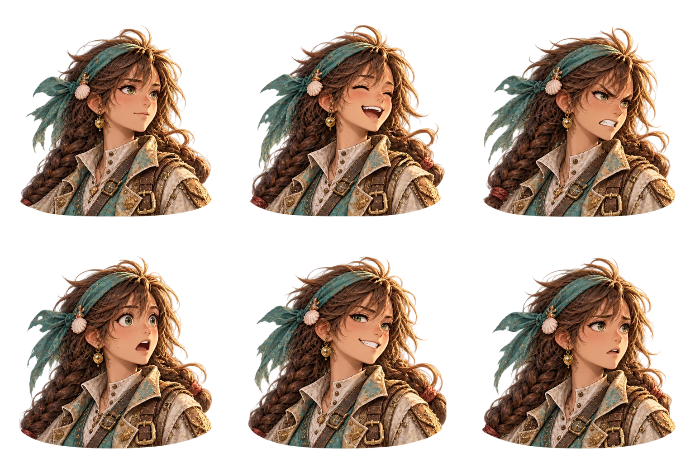

1536×1024; 542.5 KiB. Attempt 2.

- FLAG: Cell 3 source touches cell edge; inspect cropping/bleed

Six distinct requested expressions, matching approved face and clothing. Faces and hats are readable; some lower shoulder edges reach the original cell boundary as portrait framing. Rebuilt with uniform scale and clear output margins.

<details><summary>Prompt and references</summary>

```text
ART STYLE: Lush, luminous digital painting in the spirit of a premium early-2000s Japanese RPG remastered in HD. Semi-realistic, anime-influenced characters with expressive faces and stylish asymmetrical adventure outfits: layered belts, buckles, straps, zippers, one-sleeved jackets, flowing scarves. Sun-drenched tropical environments painted in rich detail: saturated turquoise seas, white sand, emerald jungle, and ancient sandstone ruins carved with softly glowing glyphs. Golden-hour sunlight, with bioluminescent blue-green motes of light drifting through the air. Cinematic, epic and adventurous, with a mischievous sense of humor: witty, characterful expressions and small comedic details hidden in the scene. Mature and cool, never babyish or chibi.

This is an isolated game sprite: render ONLY the subject on a fully transparent background (PNG with alpha). No scenery, no ground, no cast shadow, no frame. Lit from the upper left with a soft rim light, crisp readable silhouette, full body with nothing cropped and clear empty space around it.

An expression sheet for dialogue portraits: the SAME character's head and shoulders shown 6 times in a grid of 3 columns and 2 rows of equal square cells, on a fully transparent background, with no grid lines, labels or text. Identical framing and scale in every cell, facing three-quarters toward the right. Top row: (1) neutral, (2) laughing, (3) angry. Bottom row: (4) shocked, (5) smug, (6) worried. Big, readable, slightly comedic acting. Match the attached character reference exactly.

Canvas 1536x1024. The attached guide image is a construction drawing: use it only for layout (where the floor, horizon, characters or cells are). Do not reproduce any of its lines, colors, shapes, labels or text. Match the attached reference's character exactly: same face, outfit, colors and weapon. Keep all bodies and props entirely inside their cells or frame. No accidental text or extra figures.

STRICT OUTPUT LAYOUT: ONLY six HEAD-AND-SHOULDERS portraits, arranged as exactly 3 columns x 2 rows across the WHOLE 1536x1024 canvas, with centers at (256,256), (768,256), (1280,256), (256,768), (768,768), (1280,768). Each head fits its own 512x512 cell with generous margin. NO FULL-BODY FIGURE, no reference panel, no character standing at the left, no seventh figure. The base picture is an IDENTITY reference only; do not copy its layout. Six equally sized head portraits ONLY.

Rules: completely original designs; never imitate an existing franchise, character, creature, logo or emblem. No text, letters, numbers, logos, watermarks, signatures, borders or user interface, unless the prompt asks for glowing magic runes. Fierce and intense is great; no blood, gore or wounds. Every character is dressed for an all-ages game: modest clothing, no bare midriffs, no low necklines or cleavage, no revealing or tight-fitting costumes, and nothing sexualized in pose or proportion.
```

References: public/assets/anchors/key_art.webp, public/assets/anchors/cast_lineup.webp, public/assets/characters/ally_beastkeeper/base.webp, art/guides/expression_sheet.png

</details>


### npc_clamp / portraits — approved

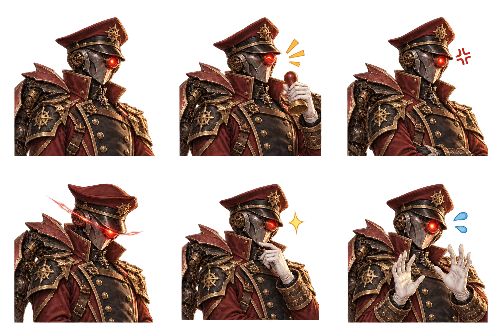

1536×1024; 440.7 KiB. Attempt 2.

- FLAG: Cell 0 source touches cell edge; inspect cropping/bleed

- FLAG: Cell 4 source touches cell edge; inspect cropping/bleed

Six distinct requested expressions, matching approved face and clothing. Faces and hats are readable; some lower shoulder edges reach the original cell boundary as portrait framing. Rebuilt with uniform scale and clear output margins.

<details><summary>Prompt and references</summary>

```text
ART STYLE: Lush, luminous digital painting in the spirit of a premium early-2000s Japanese RPG remastered in HD. Semi-realistic, anime-influenced characters with expressive faces and stylish asymmetrical adventure outfits: layered belts, buckles, straps, zippers, one-sleeved jackets, flowing scarves. Sun-drenched tropical environments painted in rich detail: saturated turquoise seas, white sand, emerald jungle, and ancient sandstone ruins carved with softly glowing glyphs. Golden-hour sunlight, with bioluminescent blue-green motes of light drifting through the air. Cinematic, epic and adventurous, with a mischievous sense of humor: witty, characterful expressions and small comedic details hidden in the scene. Mature and cool, never babyish or chibi.

This is an isolated game sprite: render ONLY the subject on a fully transparent background (PNG with alpha). No scenery, no ground, no cast shadow, no frame. Lit from the upper left with a soft rim light, crisp readable silhouette, full body with nothing cropped and clear empty space around it.

An expression sheet for dialogue portraits: the SAME character's head and shoulders shown 6 times in a grid of 3 columns and 2 rows of equal square cells, on a fully transparent background, with no grid lines, labels or text. Identical framing and scale in every cell, facing three-quarters toward the right. Top row: (1) polite, (2) stamping with his stamp visible beside his face, (3) offended. Bottom row: (4) coldly furious, (5) smug, (6) flustered. Big, readable, slightly comedic acting. Match the attached character reference exactly.

Canvas 1536x1024. The attached guide image is a construction drawing: use it only for layout (where the floor, horizon, characters or cells are). Do not reproduce any of its lines, colors, shapes, labels or text. Match the attached reference's character exactly: same face, outfit, colors and weapon. Keep all bodies and props entirely inside their cells or frame. No accidental text or extra figures.

STRICT OUTPUT LAYOUT: ONLY six HEAD-AND-SHOULDERS portraits, arranged as exactly 3 columns x 2 rows across the WHOLE 1536x1024 canvas, with centers at (256,256), (768,256), (1280,256), (256,768), (768,768), (1280,768). Each head fits its own 512x512 cell with generous margin. NO FULL-BODY FIGURE, no reference panel, no character standing at the left, no seventh figure. The base picture is an IDENTITY reference only; do not copy its layout. Six equally sized head portraits ONLY.

Rules: completely original designs; never imitate an existing franchise, character, creature, logo or emblem. No text, letters, numbers, logos, watermarks, signatures, borders or user interface, unless the prompt asks for glowing magic runes. Fierce and intense is great; no blood, gore or wounds. Every character is dressed for an all-ages game: modest clothing, no bare midriffs, no low necklines or cleavage, no revealing or tight-fitting costumes, and nothing sexualized in pose or proportion.
```

References: public/assets/anchors/key_art.webp, public/assets/anchors/cast_lineup.webp, public/assets/characters/npc_clamp/base.webp, art/guides/expression_sheet.png

</details>


### npc_hal / portraits — approved

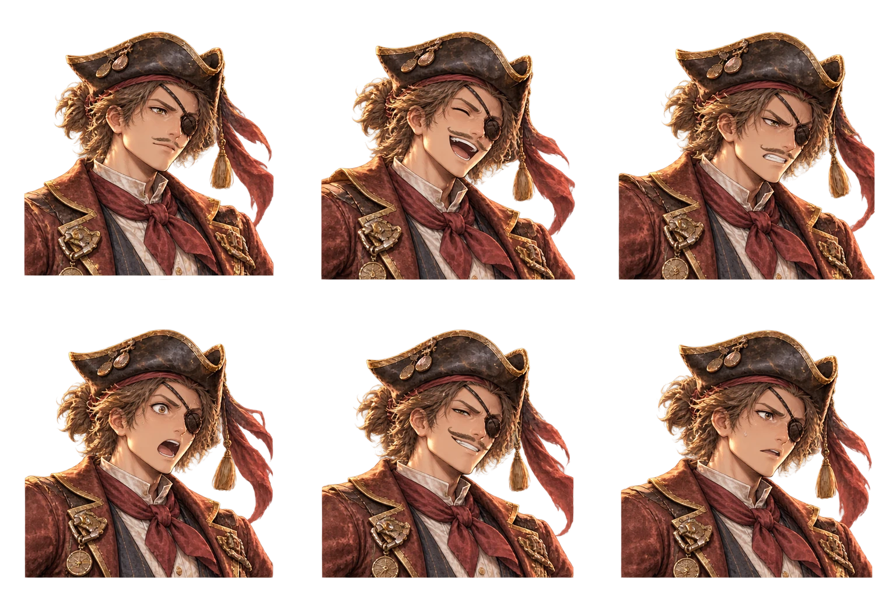

1536×1024; 497.6 KiB. Attempt 1.

- FLAG: Cell 0 source touches cell edge; inspect cropping/bleed

- FLAG: Cell 3 source touches cell edge; inspect cropping/bleed

Six distinct requested expressions, matching approved face and clothing. Faces and hats are readable; some lower shoulder edges reach the original cell boundary as portrait framing. Rebuilt with uniform scale and clear output margins.

<details><summary>Prompt and references</summary>

```text
ART STYLE: Lush, luminous digital painting in the spirit of a premium early-2000s Japanese RPG remastered in HD. Semi-realistic, anime-influenced characters with expressive faces and stylish asymmetrical adventure outfits: layered belts, buckles, straps, zippers, one-sleeved jackets, flowing scarves. Sun-drenched tropical environments painted in rich detail: saturated turquoise seas, white sand, emerald jungle, and ancient sandstone ruins carved with softly glowing glyphs. Golden-hour sunlight, with bioluminescent blue-green motes of light drifting through the air. Cinematic, epic and adventurous, with a mischievous sense of humor: witty, characterful expressions and small comedic details hidden in the scene. Mature and cool, never babyish or chibi.

This is an isolated game sprite: render ONLY the subject on a fully transparent background (PNG with alpha). No scenery, no ground, no cast shadow, no frame. Lit from the upper left with a soft rim light, crisp readable silhouette, full body with nothing cropped and clear empty space around it.

An expression sheet for dialogue portraits: the SAME character's head and shoulders shown 6 times in a grid of 3 columns and 2 rows of equal square cells, on a fully transparent background, with no grid lines, labels or text. Identical framing and scale in every cell, facing three-quarters toward the right. Top row: (1) neutral, (2) laughing, (3) angry. Bottom row: (4) shocked, (5) smug, (6) worried. Big, readable, slightly comedic acting. Match the attached character reference exactly.

Canvas 1536x1024. The attached guide image is a construction drawing: use it only for layout (where the floor, horizon, characters or cells are). Do not reproduce any of its lines, colors, shapes, labels or text. Match the attached reference's character exactly: same face, outfit, colors and weapon. Keep all bodies and props entirely inside their cells or frame. No accidental text or extra figures.

STRICT OUTPUT LAYOUT: ONLY six HEAD-AND-SHOULDERS portraits, arranged as exactly 3 columns x 2 rows across the WHOLE 1536x1024 canvas, with centers at (256,256), (768,256), (1280,256), (256,768), (768,768), (1280,768). Each head fits its own 512x512 cell with generous margin. NO FULL-BODY FIGURE, no reference panel, no character standing at the left, no seventh figure. The base picture is an IDENTITY reference only; do not copy its layout. Six equally sized head portraits ONLY.

Rules: completely original designs; never imitate an existing franchise, character, creature, logo or emblem. No text, letters, numbers, logos, watermarks, signatures, borders or user interface, unless the prompt asks for glowing magic runes. Fierce and intense is great; no blood, gore or wounds. Every character is dressed for an all-ages game: modest clothing, no bare midriffs, no low necklines or cleavage, no revealing or tight-fitting costumes, and nothing sexualized in pose or proportion.
```

References: public/assets/anchors/key_art.webp, public/assets/anchors/cast_lineup.webp, public/assets/characters/npc_hal/base.webp, art/guides/expression_sheet.png

</details>


### npc_keeper / portraits — approved

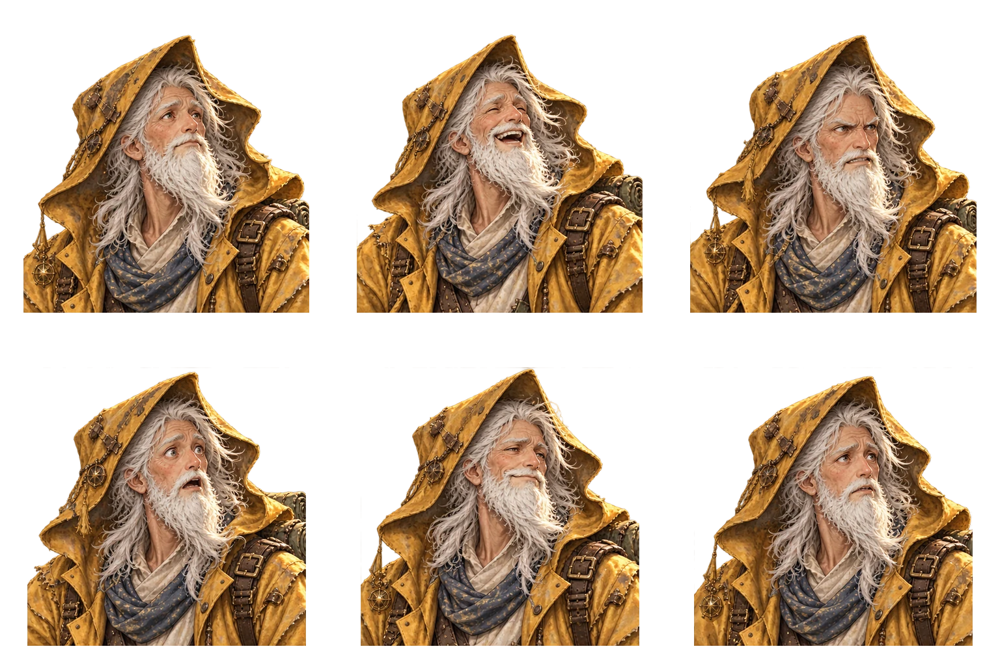

1536×1024; 467.1 KiB. Attempt 1.

- FLAG: Cell 0 source touches cell edge; inspect cropping/bleed

- FLAG: Cell 1 source touches cell edge; inspect cropping/bleed

- FLAG: Cell 2 source touches cell edge; inspect cropping/bleed

- FLAG: Cell 3 source touches cell edge; inspect cropping/bleed

- FLAG: Cell 4 source touches cell edge; inspect cropping/bleed

- FLAG: Cell 5 source touches cell edge; inspect cropping/bleed

Six distinct requested expressions, matching approved face and clothing. Faces and hats are readable; some lower shoulder edges reach the original cell boundary as portrait framing. Rebuilt with uniform scale and clear output margins.

<details><summary>Prompt and references</summary>

```text
ART STYLE: Lush, luminous digital painting in the spirit of a premium early-2000s Japanese RPG remastered in HD. Semi-realistic, anime-influenced characters with expressive faces and stylish asymmetrical adventure outfits: layered belts, buckles, straps, zippers, one-sleeved jackets, flowing scarves. Sun-drenched tropical environments painted in rich detail: saturated turquoise seas, white sand, emerald jungle, and ancient sandstone ruins carved with softly glowing glyphs. Golden-hour sunlight, with bioluminescent blue-green motes of light drifting through the air. Cinematic, epic and adventurous, with a mischievous sense of humor: witty, characterful expressions and small comedic details hidden in the scene. Mature and cool, never babyish or chibi.

This is an isolated game sprite: render ONLY the subject on a fully transparent background (PNG with alpha). No scenery, no ground, no cast shadow, no frame. Lit from the upper left with a soft rim light, crisp readable silhouette, full body with nothing cropped and clear empty space around it.

An expression sheet for dialogue portraits: the SAME character's head and shoulders shown 6 times in a grid of 3 columns and 2 rows of equal square cells, on a fully transparent background, with no grid lines, labels or text. Identical framing and scale in every cell, facing three-quarters toward the right. Top row: (1) neutral, (2) laughing, (3) angry. Bottom row: (4) shocked, (5) smug, (6) worried. Big, readable, slightly comedic acting. Match the attached character reference exactly.

Canvas 1536x1024. The attached guide image is a construction drawing: use it only for layout (where the floor, horizon, characters or cells are). Do not reproduce any of its lines, colors, shapes, labels or text. Match the attached reference's character exactly: same face, outfit, colors and weapon. Keep all bodies and props entirely inside their cells or frame. No accidental text or extra figures.

STRICT OUTPUT LAYOUT: ONLY six HEAD-AND-SHOULDERS portraits, arranged as exactly 3 columns x 2 rows across the WHOLE 1536x1024 canvas, with centers at (256,256), (768,256), (1280,256), (256,768), (768,768), (1280,768). Each head fits its own 512x512 cell with generous margin. NO FULL-BODY FIGURE, no reference panel, no character standing at the left, no seventh figure. The base picture is an IDENTITY reference only; do not copy its layout. Six equally sized head portraits ONLY.

Rules: completely original designs; never imitate an existing franchise, character, creature, logo or emblem. No text, letters, numbers, logos, watermarks, signatures, borders or user interface, unless the prompt asks for glowing magic runes. Fierce and intense is great; no blood, gore or wounds. Every character is dressed for an all-ages game: modest clothing, no bare midriffs, no low necklines or cleavage, no revealing or tight-fitting costumes, and nothing sexualized in pose or proportion.
```

References: public/assets/anchors/key_art.webp, public/assets/anchors/cast_lineup.webp, public/assets/characters/npc_keeper/base.webp, art/guides/expression_sheet.png

</details>


### npc_baker / portraits — approved

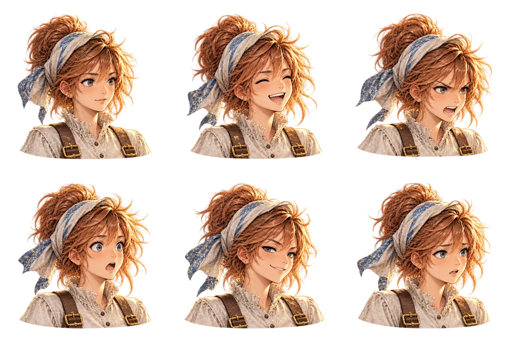

1536×1024; 568.8 KiB. Attempt 1.

- FLAG: Cell 2 source touches cell edge; inspect cropping/bleed

- FLAG: Cell 3 source touches cell edge; inspect cropping/bleed

- FLAG: Cell 5 source touches cell edge; inspect cropping/bleed

Six distinct requested expressions, matching approved face and clothing. Faces and hats are readable; some lower shoulder edges reach the original cell boundary as portrait framing. Rebuilt with uniform scale and clear output margins.

<details><summary>Prompt and references</summary>

```text
ART STYLE: Lush, luminous digital painting in the spirit of a premium early-2000s Japanese RPG remastered in HD. Semi-realistic, anime-influenced characters with expressive faces and stylish asymmetrical adventure outfits: layered belts, buckles, straps, zippers, one-sleeved jackets, flowing scarves. Sun-drenched tropical environments painted in rich detail: saturated turquoise seas, white sand, emerald jungle, and ancient sandstone ruins carved with softly glowing glyphs. Golden-hour sunlight, with bioluminescent blue-green motes of light drifting through the air. Cinematic, epic and adventurous, with a mischievous sense of humor: witty, characterful expressions and small comedic details hidden in the scene. Mature and cool, never babyish or chibi.

This is an isolated game sprite: render ONLY the subject on a fully transparent background (PNG with alpha). No scenery, no ground, no cast shadow, no frame. Lit from the upper left with a soft rim light, crisp readable silhouette, full body with nothing cropped and clear empty space around it.

An expression sheet for dialogue portraits: the SAME character's head and shoulders shown 6 times in a grid of 3 columns and 2 rows of equal square cells, on a fully transparent background, with no grid lines, labels or text. Identical framing and scale in every cell, facing three-quarters toward the right. Top row: (1) neutral, (2) laughing, (3) angry. Bottom row: (4) shocked, (5) smug, (6) worried. Big, readable, slightly comedic acting. Match the attached character reference exactly.

Canvas 1536x1024. The attached guide image is a construction drawing: use it only for layout (where the floor, horizon, characters or cells are). Do not reproduce any of its lines, colors, shapes, labels or text. Match the attached reference's character exactly: same face, outfit, colors and weapon. Keep all bodies and props entirely inside their cells or frame. No accidental text or extra figures.

STRICT OUTPUT LAYOUT: ONLY six HEAD-AND-SHOULDERS portraits, arranged as exactly 3 columns x 2 rows across the WHOLE 1536x1024 canvas, with centers at (256,256), (768,256), (1280,256), (256,768), (768,768), (1280,768). Each head fits its own 512x512 cell with generous margin. NO FULL-BODY FIGURE, no reference panel, no character standing at the left, no seventh figure. The base picture is an IDENTITY reference only; do not copy its layout. Six equally sized head portraits ONLY.

Rules: completely original designs; never imitate an existing franchise, character, creature, logo or emblem. No text, letters, numbers, logos, watermarks, signatures, borders or user interface, unless the prompt asks for glowing magic runes. Fierce and intense is great; no blood, gore or wounds. Every character is dressed for an all-ages game: modest clothing, no bare midriffs, no low necklines or cleavage, no revealing or tight-fitting costumes, and nothing sexualized in pose or proportion.
```

References: public/assets/anchors/key_art.webp, public/assets/anchors/cast_lineup.webp, public/assets/characters/npc_baker/base.webp, art/guides/expression_sheet.png

</details>


### npc_swordmaster / portraits — approved

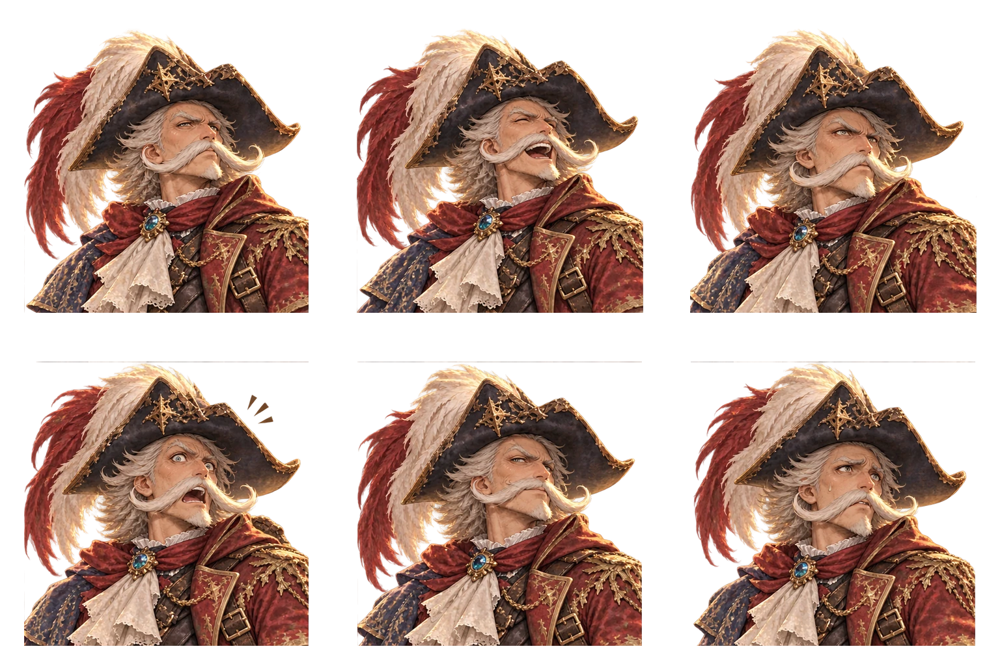

1536×1024; 573.0 KiB. Attempt 1.

- FLAG: Cell 0 source touches cell edge; inspect cropping/bleed

- FLAG: Cell 1 source touches cell edge; inspect cropping/bleed

- FLAG: Cell 2 source touches cell edge; inspect cropping/bleed

- FLAG: Cell 3 source touches cell edge; inspect cropping/bleed

- FLAG: Cell 4 source touches cell edge; inspect cropping/bleed

- FLAG: Cell 5 source touches cell edge; inspect cropping/bleed

Six distinct requested expressions, matching approved face and clothing. Faces and hats are readable; some lower shoulder edges reach the original cell boundary as portrait framing. Rebuilt with uniform scale and clear output margins. All six cells mirrored to face three-quarters right; long feather tips remain close to the source top edge.

<details><summary>Prompt and references</summary>

```text
ART STYLE: Lush, luminous digital painting in the spirit of a premium early-2000s Japanese RPG remastered in HD. Semi-realistic, anime-influenced characters with expressive faces and stylish asymmetrical adventure outfits: layered belts, buckles, straps, zippers, one-sleeved jackets, flowing scarves. Sun-drenched tropical environments painted in rich detail: saturated turquoise seas, white sand, emerald jungle, and ancient sandstone ruins carved with softly glowing glyphs. Golden-hour sunlight, with bioluminescent blue-green motes of light drifting through the air. Cinematic, epic and adventurous, with a mischievous sense of humor: witty, characterful expressions and small comedic details hidden in the scene. Mature and cool, never babyish or chibi.

This is an isolated game sprite: render ONLY the subject on a fully transparent background (PNG with alpha). No scenery, no ground, no cast shadow, no frame. Lit from the upper left with a soft rim light, crisp readable silhouette, full body with nothing cropped and clear empty space around it.

An expression sheet for dialogue portraits: the SAME character's head and shoulders shown 6 times in a grid of 3 columns and 2 rows of equal square cells, on a fully transparent background, with no grid lines, labels or text. Identical framing and scale in every cell, facing three-quarters toward the right. Top row: (1) neutral, (2) laughing, (3) angry. Bottom row: (4) shocked, (5) smug, (6) worried. Big, readable, slightly comedic acting. Match the attached character reference exactly.

Canvas 1536x1024. The attached guide image is a construction drawing: use it only for layout (where the floor, horizon, characters or cells are). Do not reproduce any of its lines, colors, shapes, labels or text. Match the attached reference's character exactly: same face, outfit, colors and weapon. Keep all bodies and props entirely inside their cells or frame. No accidental text or extra figures.

STRICT OUTPUT LAYOUT: ONLY six HEAD-AND-SHOULDERS portraits, arranged as exactly 3 columns x 2 rows across the WHOLE 1536x1024 canvas, with centers at (256,256), (768,256), (1280,256), (256,768), (768,768), (1280,768). Each head fits its own 512x512 cell with generous margin. NO FULL-BODY FIGURE, no reference panel, no character standing at the left, no seventh figure. The base picture is an IDENTITY reference only; do not copy its layout. Six equally sized head portraits ONLY.

Rules: completely original designs; never imitate an existing franchise, character, creature, logo or emblem. No text, letters, numbers, logos, watermarks, signatures, borders or user interface, unless the prompt asks for glowing magic runes. Fierce and intense is great; no blood, gore or wounds. Every character is dressed for an all-ages game: modest clothing, no bare midriffs, no low necklines or cleavage, no revealing or tight-fitting costumes, and nothing sexualized in pose or proportion.
```

References: public/assets/anchors/key_art.webp, public/assets/anchors/cast_lineup.webp, public/assets/characters/npc_swordmaster/base.webp, art/guides/expression_sheet.png

</details>


### tutor_droid / portraits_cozy — approved


1536×1024; 504.3 KiB. Attempt 1.

Six distinct requested expressions, matching approved face and clothing. Faces and hats are readable; some lower shoulder edges reach the original cell boundary as portrait framing. Rebuilt with uniform scale and clear output margins. Faded knitted tea cozy replaces pirate hat; two fins and one lens eye. All cells mirrored to face right.

<details><summary>Prompt and references</summary>

```text
ART STYLE: Lush, luminous digital painting in the spirit of a premium early-2000s Japanese RPG remastered in HD. Semi-realistic, anime-influenced characters with expressive faces and stylish asymmetrical adventure outfits: layered belts, buckles, straps, zippers, one-sleeved jackets, flowing scarves. Sun-drenched tropical environments painted in rich detail: saturated turquoise seas, white sand, emerald jungle, and ancient sandstone ruins carved with softly glowing glyphs. Golden-hour sunlight, with bioluminescent blue-green motes of light drifting through the air. Cinematic, epic and adventurous, with a mischievous sense of humor: witty, characterful expressions and small comedic details hidden in the scene. Mature and cool, never babyish or chibi.

This is an isolated game sprite: render ONLY the subject on a fully transparent background (PNG with alpha). No scenery, no ground, no cast shadow, no frame. Lit from the upper left with a soft rim light, crisp readable silhouette, full body with nothing cropped and clear empty space around it.

Kit the same round white tutor robot, wearing a knitted tea cozy in faded stripes with a pom-pom INSTEAD OF the pirate hat; the cozy sits crooked. Exactly two ceramic fins and one lens eye, never human hands. An expression sheet for dialogue portraits: the SAME character's head and shoulders shown 6 times in a grid of 3 columns and 2 rows of equal square cells, on a fully transparent background, with no grid lines, labels or text. Identical framing and scale in every cell, facing three-quarters toward the right. Top row: (1) neutral, (2) laughing, (3) angry. Bottom row: (4) shocked, (5) smug, (6) worried. Big, readable, slightly comedic acting. Match the attached character reference exactly.

Canvas 1536x1024. The attached guide image is a construction drawing: use it only for layout (where the floor, horizon, characters or cells are). Do not reproduce any of its lines, colors, shapes, labels or text. Match the attached reference's character exactly: same face, outfit, colors and weapon. Keep all bodies and props entirely inside their cells or frame. No accidental text or extra figures.

STRICT OUTPUT LAYOUT: ONLY six HEAD-AND-SHOULDERS portraits, arranged as exactly 3 columns x 2 rows across the WHOLE 1536x1024 canvas, with centers at (256,256), (768,256), (1280,256), (256,768), (768,768), (1280,768). Each head fits its own 512x512 cell with generous margin. NO FULL-BODY FIGURE, no reference panel, no character standing at the left, no seventh figure. The base picture is an IDENTITY reference only; do not copy its layout. Six equally sized head portraits ONLY.

Rules: completely original designs; never imitate an existing franchise, character, creature, logo or emblem. No text, letters, numbers, logos, watermarks, signatures, borders or user interface, unless the prompt asks for glowing magic runes. Fierce and intense is great; no blood, gore or wounds. Every character is dressed for an all-ages game: modest clothing, no bare midriffs, no low necklines or cleavage, no revealing or tight-fitting costumes, and nothing sexualized in pose or proportion.
```

References: public/assets/anchors/key_art.webp, public/assets/anchors/cast_lineup.webp, public/assets/characters/tutor_droid/base.webp, public/assets/characters/tutor_droid/portraits.webp, art/guides/expression_sheet.png

</details>


### mascot_monkey / field_twohats — approved

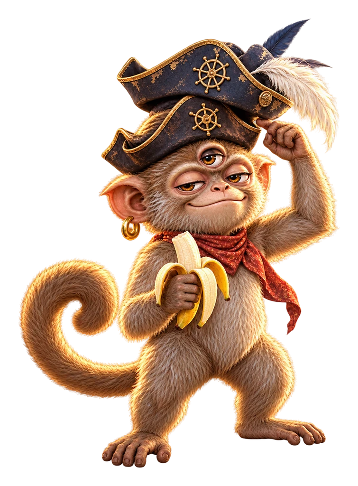

755×1024; 236.0 KiB. Attempt 1.

Three eyes and two complete hats in each pose; curled tail, feet and banana retained.

<details><summary>Prompt and references</summary>

```text
ART STYLE: Lush, luminous digital painting in the spirit of a premium early-2000s Japanese RPG remastered in HD. Semi-realistic, anime-influenced characters with expressive faces and stylish asymmetrical adventure outfits: layered belts, buckles, straps, zippers, one-sleeved jackets, flowing scarves. Sun-drenched tropical environments painted in rich detail: saturated turquoise seas, white sand, emerald jungle, and ancient sandstone ruins carved with softly glowing glyphs. Golden-hour sunlight, with bioluminescent blue-green motes of light drifting through the air. Cinematic, epic and adventurous, with a mischievous sense of humor: witty, characterful expressions and small comedic details hidden in the scene. Mature and cool, never babyish or chibi.

This is an isolated game sprite: render ONLY the subject on a fully transparent background (PNG with alpha). No scenery, no ground, no cast shadow, no frame. Lit from the upper left with a soft rim light, crisp readable silhouette, full body with nothing cropped and clear empty space around it.

ONE full-body Pockets, the small three-eyed monkey, wearing his own navy tricorn and Kit's matching tricorn stacked on top, very pleased. Exactly THREE eyes, same furry face and curled tail. Both complete hats and tail inside the canvas. No other characters.

Canvas 1024x1024.  Match the attached reference's character exactly: same face, outfit, colors and weapon. Keep all bodies and props entirely inside their cells or frame. No accidental text or extra figures.

Rules: completely original designs; never imitate an existing franchise, character, creature, logo or emblem. No text, letters, numbers, logos, watermarks, signatures, borders or user interface, unless the prompt asks for glowing magic runes. Fierce and intense is great; no blood, gore or wounds. Every character is dressed for an all-ages game: modest clothing, no bare midriffs, no low necklines or cleavage, no revealing or tight-fitting costumes, and nothing sexualized in pose or proportion.
```

References: public/assets/anchors/key_art.webp, public/assets/anchors/cast_lineup.webp, public/assets/characters/mascot_monkey/base.webp, public/assets/characters/tutor_droid/base.webp

</details>


## Section C


### pet_raptor_1 / battle — approved

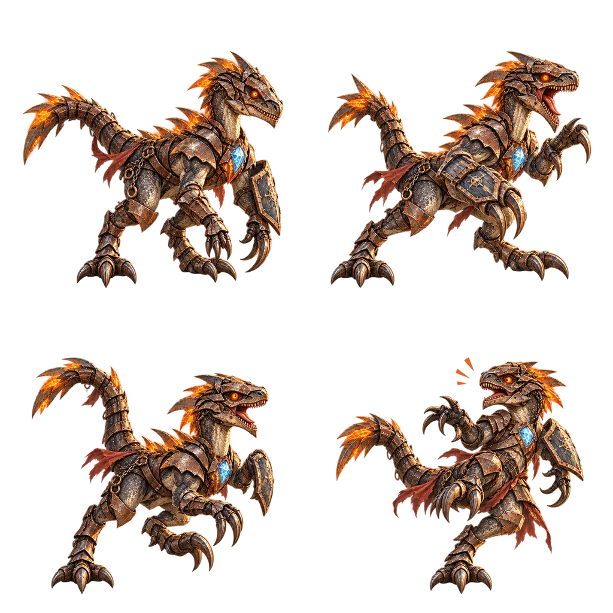

1024×1024; 317.7 KiB. Attempt 1.


<details><summary>Prompt and references</summary>

```text
ART STYLE: Lush, luminous digital painting in the spirit of a premium early-2000s Japanese RPG remastered in HD. Semi-realistic, anime-influenced characters with expressive faces and stylish asymmetrical adventure outfits: layered belts, buckles, straps, zippers, one-sleeved jackets, flowing scarves. Sun-drenched tropical environments painted in rich detail: saturated turquoise seas, white sand, emerald jungle, and ancient sandstone ruins carved with softly glowing glyphs. Golden-hour sunlight, with bioluminescent blue-green motes of light drifting through the air. Cinematic, epic and adventurous, with a mischievous sense of humor: witty, characterful expressions and small comedic details hidden in the scene. Mature and cool, never babyish or chibi.

This is an isolated game sprite: render ONLY the subject on a fully transparent background (PNG with alpha). No scenery, no ground, no cast shadow, no frame. Lit from the upper left with a soft rim light, crisp readable silhouette, full body with nothing cropped and clear empty space around it.

Rivet: a dog-sized scrap-metal raptor with neat patched plates and a tiny tower shield strapped to one arm. Stage 1 of one evolving pet line; rebuilt, polished and cared for, with a small crystal HEART glowing ice-blue. Stage 1 small and goofy, stage 2 sturdy and proud, stage 3 bigger and legendary. A sprite sheet for a 2D turn-based battle game: the SAME creature shown 4 times in a grid of 2 columns and 2 rows of equal square cells, on a fully transparent background, with no grid lines, labels or text. Full body at the same size and scale in every cell, standing on the same invisible baseline, facing RIGHT. Top row: (1) idle, content, (2) acting, performing its friendly special action. Bottom row: (3) happy, joyful, (4) hurt, startled but uninjured. Match the attached creature reference exactly.

Canvas 1024x1024. The attached guide image is a construction drawing: use it only for layout (where the floor, horizon, characters or cells are). Do not reproduce any of its lines, colors, shapes, labels or text. Match the attached reference's character exactly: same face, outfit, colors and weapon. Keep all bodies and props entirely inside their cells or frame. No accidental text or extra figures.

Rules: completely original designs; never imitate an existing franchise, character, creature, logo or emblem. No text, letters, numbers, logos, watermarks, signatures, borders or user interface, unless the prompt asks for glowing magic runes. Fierce and intense is great; no blood, gore or wounds. Every character is dressed for an all-ages game: modest clothing, no bare midriffs, no low necklines or cleavage, no revealing or tight-fitting costumes, and nothing sexualized in pose or proportion.
```

References: public/assets/anchors/key_art.webp, public/assets/anchors/cast_lineup.webp, public/assets/fiends/fiend_scrap_raptor/base.webp, art/guides/creature_sheet_2x2.png

</details>


### pet_raptor_2 / battle — approved

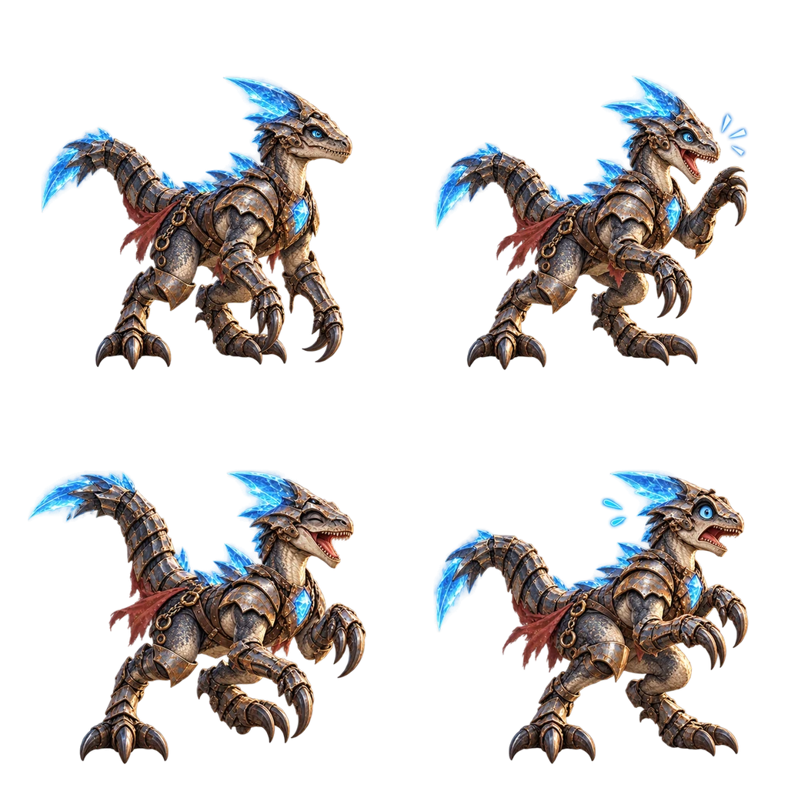

1024×1024; 303.3 KiB. Attempt 2.

Second attempt restores the ice-blue sharkfin crest; four right-facing poses.

<details><summary>Prompt and references</summary>

```text
ART STYLE: Lush, luminous digital painting in the spirit of a premium early-2000s Japanese RPG remastered in HD. Semi-realistic, anime-influenced characters with expressive faces and stylish asymmetrical adventure outfits: layered belts, buckles, straps, zippers, one-sleeved jackets, flowing scarves. Sun-drenched tropical environments painted in rich detail: saturated turquoise seas, white sand, emerald jungle, and ancient sandstone ruins carved with softly glowing glyphs. Golden-hour sunlight, with bioluminescent blue-green motes of light drifting through the air. Cinematic, epic and adventurous, with a mischievous sense of humor: witty, characterful expressions and small comedic details hidden in the scene. Mature and cool, never babyish or chibi.

This is an isolated game sprite: render ONLY the subject on a fully transparent background (PNG with alpha). No scenery, no ground, no cast shadow, no frame. Lit from the upper left with a soft rim light, crisp readable silhouette, full body with nothing cropped and clear empty space around it.

A pony-sized rebuilt raptor with a shark-fin crest like Cade's pauldron. Stage 2 of one evolving pet line; rebuilt, polished and cared for, with a small crystal HEART glowing ice-blue. Stage 1 small and goofy, stage 2 sturdy and proud, stage 3 bigger and legendary. A sprite sheet for a 2D turn-based battle game: the SAME creature shown 4 times in a grid of 2 columns and 2 rows of equal square cells, on a fully transparent background, with no grid lines, labels or text. Full body at the same size and scale in every cell, standing on the same invisible baseline, facing RIGHT. Top row: (1) idle, content, (2) acting, performing its friendly special action. Bottom row: (3) happy, joyful, (4) hurt, startled but uninjured. Match the attached creature reference exactly.

Canvas 1024x1024. The attached guide image is a construction drawing: use it only for layout (where the floor, horizon, characters or cells are). Do not reproduce any of its lines, colors, shapes, labels or text. Use the earlier stage and original fiend only for shared materials, palette and pet-line motifs; evolve the body and silhouette as described. Do not copy the earlier stage unchanged. Keep all bodies and props entirely inside their cells or frame. No accidental text or extra figures.

EVOLUTION REQUIREMENT: Evolve the raptor with a SINGLE LARGE shark-fin crest on its head/back like Cade's pauldron, glowing ICE-BLUE. Clean patched steel, friendly proud face, definitely a new sturdier form rather than the original fiend. No orange flames. Keep four poses in a 2x2 grid with idle, act, happy, hurt order, all facing right, entire creature and effects at least 48px from cell edges.

Rules: completely original designs; never imitate an existing franchise, character, creature, logo or emblem. No text, letters, numbers, logos, watermarks, signatures, borders or user interface, unless the prompt asks for glowing magic runes. Fierce and intense is great; no blood, gore or wounds. Every character is dressed for an all-ages game: modest clothing, no bare midriffs, no low necklines or cleavage, no revealing or tight-fitting costumes, and nothing sexualized in pose or proportion.
```

References: public/assets/anchors/key_art.webp, public/assets/anchors/cast_lineup.webp, public/assets/fiends/fiend_scrap_raptor/base.webp, public/assets/characters/pet_raptor_1/battle.webp, art/guides/creature_sheet_2x2.png

</details>


### pet_raptor_3 / battle — approved

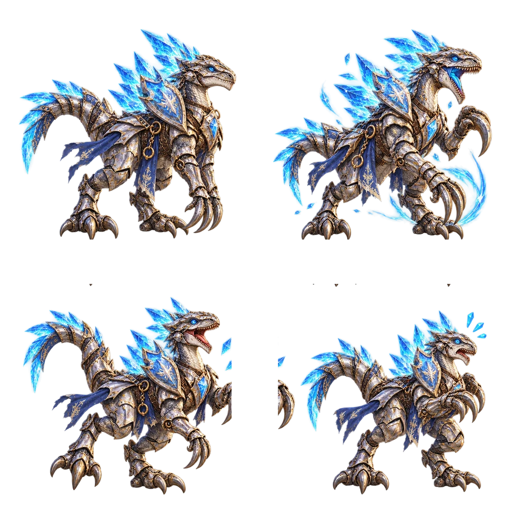

1024×1024; 383.6 KiB. Attempt 2.

- FLAG: Cell 0 source touches cell edge; inspect cropping/bleed

- FLAG: Cell 1 source touches cell edge; inspect cropping/bleed

- FLAG: Cell 2 source touches cell edge; inspect cropping/bleed

- FLAG: Cell 3 source touches cell edge; inspect cropping/bleed

Second attempt selected for polished shield crest, shoulder crystals and navy banner. Source-edge flags are plume/glow; solid body remains contained.

<details><summary>Prompt and references</summary>

```text
ART STYLE: Lush, luminous digital painting in the spirit of a premium early-2000s Japanese RPG remastered in HD. Semi-realistic, anime-influenced characters with expressive faces and stylish asymmetrical adventure outfits: layered belts, buckles, straps, zippers, one-sleeved jackets, flowing scarves. Sun-drenched tropical environments painted in rich detail: saturated turquoise seas, white sand, emerald jungle, and ancient sandstone ruins carved with softly glowing glyphs. Golden-hour sunlight, with bioluminescent blue-green motes of light drifting through the air. Cinematic, epic and adventurous, with a mischievous sense of humor: witty, characterful expressions and small comedic details hidden in the scene. Mature and cool, never babyish or chibi.

This is an isolated game sprite: render ONLY the subject on a fully transparent background (PNG with alpha). No scenery, no ground, no cast shadow, no frame. Lit from the upper left with a soft rim light, crisp readable silhouette, full body with nothing cropped and clear empty space around it.

A war-raptor in polished steel with a crystal shield-crest. Stage 3 of one evolving pet line; rebuilt, polished and cared for, with a small crystal HEART glowing ice-blue. Stage 1 small and goofy, stage 2 sturdy and proud, stage 3 bigger and legendary. A sprite sheet for a 2D turn-based battle game: the SAME creature shown 4 times in a grid of 2 columns and 2 rows of equal square cells, on a fully transparent background, with no grid lines, labels or text. Full body at the same size and scale in every cell, standing on the same invisible baseline, facing RIGHT. Top row: (1) idle, content, (2) acting, performing its friendly special action. Bottom row: (3) happy, joyful, (4) hurt, startled but uninjured. Match the attached creature reference exactly.

Canvas 1024x1024. The attached guide image is a construction drawing: use it only for layout (where the floor, horizon, characters or cells are). Do not reproduce any of its lines, colors, shapes, labels or text. Use the earlier stage and original fiend only for shared materials, palette and pet-line motifs; evolve the body and silhouette as described. Do not copy the earlier stage unchanged. Keep all bodies and props entirely inside their cells or frame. No accidental text or extra figures.

EVOLUTION REQUIREMENT: A LEGENDARY armored WAR-RAPTOR in bright polished SILVER STEEL, with a huge glowing ICE-BLUE CRYSTAL SHIELD-CREST rising from its back. A clear changed silhouette from stage1, broad regal armor and blue crystal crest, no orange flame spikes. Friendly loyal protector. Keep four poses in a 2x2 grid with idle, act, happy, hurt order, all facing right, entire creature and effects at least 48px from cell edges.

Rules: completely original designs; never imitate an existing franchise, character, creature, logo or emblem. No text, letters, numbers, logos, watermarks, signatures, borders or user interface, unless the prompt asks for glowing magic runes. Fierce and intense is great; no blood, gore or wounds. Every character is dressed for an all-ages game: modest clothing, no bare midriffs, no low necklines or cleavage, no revealing or tight-fitting costumes, and nothing sexualized in pose or proportion.
```

References: public/assets/anchors/key_art.webp, public/assets/anchors/cast_lineup.webp, public/assets/fiends/fiend_scrap_raptor/base.webp, public/assets/characters/pet_raptor_1/battle.webp, art/guides/creature_sheet_2x2.png

</details>


### pet_jelly_1 / battle — approved

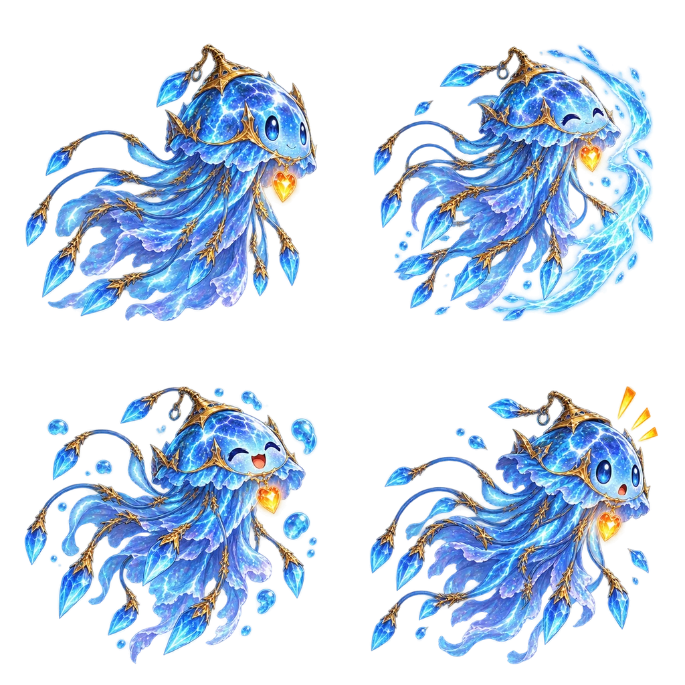

1024×1024; 443.1 KiB. Attempt 1.


<details><summary>Prompt and references</summary>

```text
ART STYLE: Lush, luminous digital painting in the spirit of a premium early-2000s Japanese RPG remastered in HD. Semi-realistic, anime-influenced characters with expressive faces and stylish asymmetrical adventure outfits: layered belts, buckles, straps, zippers, one-sleeved jackets, flowing scarves. Sun-drenched tropical environments painted in rich detail: saturated turquoise seas, white sand, emerald jungle, and ancient sandstone ruins carved with softly glowing glyphs. Golden-hour sunlight, with bioluminescent blue-green motes of light drifting through the air. Cinematic, epic and adventurous, with a mischievous sense of humor: witty, characterful expressions and small comedic details hidden in the scene. Mature and cool, never babyish or chibi.

This is an isolated game sprite: render ONLY the subject on a fully transparent background (PNG with alpha). No scenery, no ground, no cast shadow, no frame. Lit from the upper left with a soft rim light, crisp readable silhouette, full body with nothing cropped and clear empty space around it.

A friendly jelly the size of a lantern with a little brass cap. Stage 1 of one evolving pet line; rebuilt, polished and cared for, with a small crystal HEART glowing orange. Stage 1 small and goofy, stage 2 sturdy and proud, stage 3 bigger and legendary. A sprite sheet for a 2D turn-based battle game: the SAME creature shown 4 times in a grid of 2 columns and 2 rows of equal square cells, on a fully transparent background, with no grid lines, labels or text. Full body at the same size and scale in every cell, standing on the same invisible baseline, facing RIGHT. Top row: (1) idle, content, (2) acting, performing its friendly special action. Bottom row: (3) happy, joyful, (4) hurt, startled but uninjured. Match the attached creature reference exactly.

Canvas 1024x1024. The attached guide image is a construction drawing: use it only for layout (where the floor, horizon, characters or cells are). Do not reproduce any of its lines, colors, shapes, labels or text. Match the attached reference's character exactly: same face, outfit, colors and weapon. Keep all bodies and props entirely inside their cells or frame. No accidental text or extra figures.

Rules: completely original designs; never imitate an existing franchise, character, creature, logo or emblem. No text, letters, numbers, logos, watermarks, signatures, borders or user interface, unless the prompt asks for glowing magic runes. Fierce and intense is great; no blood, gore or wounds. Every character is dressed for an all-ages game: modest clothing, no bare midriffs, no low necklines or cleavage, no revealing or tight-fitting costumes, and nothing sexualized in pose or proportion.
```

References: public/assets/anchors/key_art.webp, public/assets/anchors/cast_lineup.webp, public/assets/fiends/fiend_volt_jelly/base.webp, art/guides/creature_sheet_2x2.png

</details>


### pet_jelly_2 / battle — approved

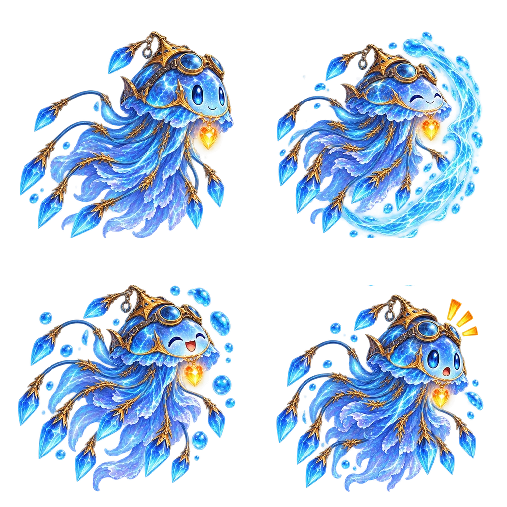

1024×1024; 447.6 KiB. Attempt 1.

- FLAG: Cell 1 source touches cell edge; inspect cropping/bleed

- FLAG: Cell 3 source touches cell edge; inspect cropping/bleed


<details><summary>Prompt and references</summary>

```text
ART STYLE: Lush, luminous digital painting in the spirit of a premium early-2000s Japanese RPG remastered in HD. Semi-realistic, anime-influenced characters with expressive faces and stylish asymmetrical adventure outfits: layered belts, buckles, straps, zippers, one-sleeved jackets, flowing scarves. Sun-drenched tropical environments painted in rich detail: saturated turquoise seas, white sand, emerald jungle, and ancient sandstone ruins carved with softly glowing glyphs. Golden-hour sunlight, with bioluminescent blue-green motes of light drifting through the air. Cinematic, epic and adventurous, with a mischievous sense of humor: witty, characterful expressions and small comedic details hidden in the scene. Mature and cool, never babyish or chibi.

This is an isolated game sprite: render ONLY the subject on a fully transparent background (PNG with alpha). No scenery, no ground, no cast shadow, no frame. Lit from the upper left with a soft rim light, crisp readable silhouette, full body with nothing cropped and clear empty space around it.

A friendly jelly with brass fins and goggles. Stage 2 of one evolving pet line; rebuilt, polished and cared for, with a small crystal HEART glowing orange. Stage 1 small and goofy, stage 2 sturdy and proud, stage 3 bigger and legendary. A sprite sheet for a 2D turn-based battle game: the SAME creature shown 4 times in a grid of 2 columns and 2 rows of equal square cells, on a fully transparent background, with no grid lines, labels or text. Full body at the same size and scale in every cell, standing on the same invisible baseline, facing RIGHT. Top row: (1) idle, content, (2) acting, performing its friendly special action. Bottom row: (3) happy, joyful, (4) hurt, startled but uninjured. Match the attached creature reference exactly.

Canvas 1024x1024. The attached guide image is a construction drawing: use it only for layout (where the floor, horizon, characters or cells are). Do not reproduce any of its lines, colors, shapes, labels or text. Match the attached reference's character exactly: same face, outfit, colors and weapon. Keep all bodies and props entirely inside their cells or frame. No accidental text or extra figures.

Rules: completely original designs; never imitate an existing franchise, character, creature, logo or emblem. No text, letters, numbers, logos, watermarks, signatures, borders or user interface, unless the prompt asks for glowing magic runes. Fierce and intense is great; no blood, gore or wounds. Every character is dressed for an all-ages game: modest clothing, no bare midriffs, no low necklines or cleavage, no revealing or tight-fitting costumes, and nothing sexualized in pose or proportion.
```

References: public/assets/anchors/key_art.webp, public/assets/anchors/cast_lineup.webp, public/assets/fiends/fiend_volt_jelly/base.webp, public/assets/characters/pet_jelly_1/battle.webp, art/guides/creature_sheet_2x2.png

</details>


### pet_jelly_3 / battle — approved

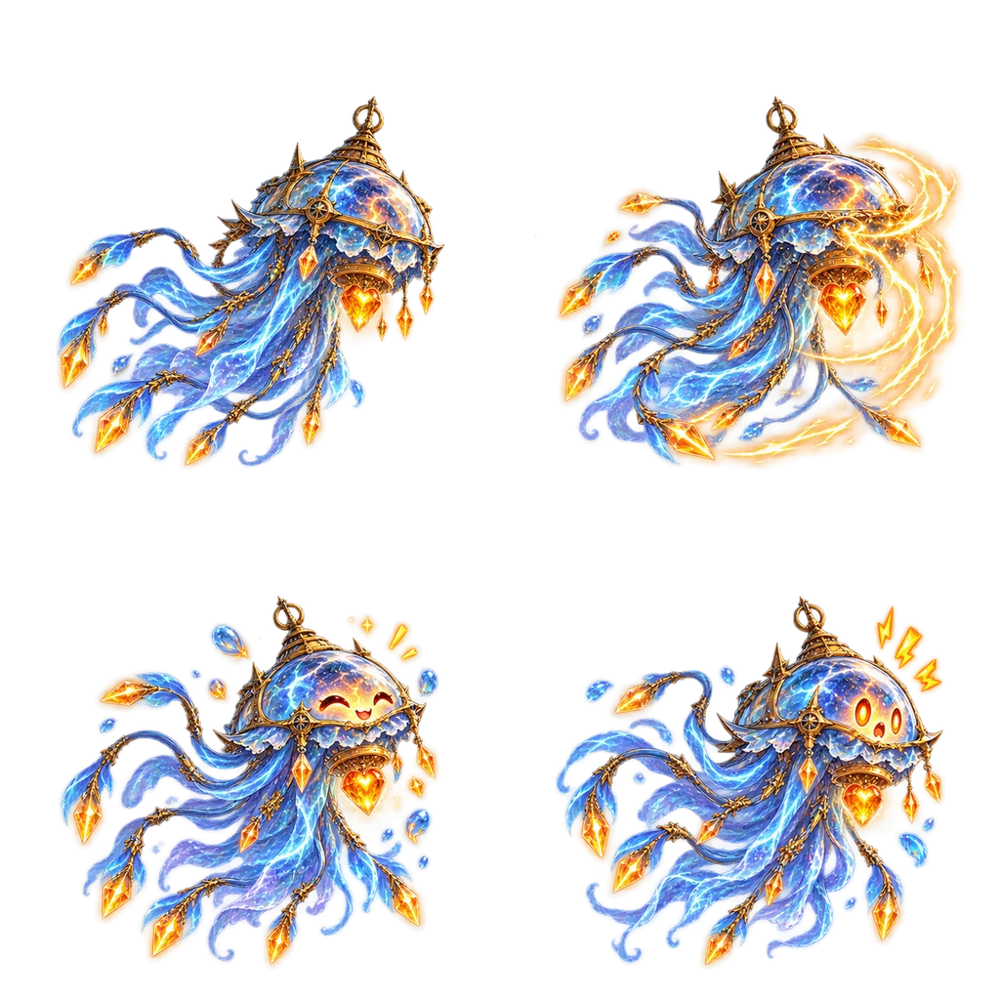

1024×1024; 393.2 KiB. Attempt 2.

- FLAG: Cell 0 source touches cell edge; inspect cropping/bleed

- FLAG: Cell 1 source touches cell edge; inspect cropping/bleed

Second attempt preserves buoy framework and orange heart. Idle/attack facial differences remain subtle; inspect acting at review.

<details><summary>Prompt and references</summary>

```text
ART STYLE: Lush, luminous digital painting in the spirit of a premium early-2000s Japanese RPG remastered in HD. Semi-realistic, anime-influenced characters with expressive faces and stylish asymmetrical adventure outfits: layered belts, buckles, straps, zippers, one-sleeved jackets, flowing scarves. Sun-drenched tropical environments painted in rich detail: saturated turquoise seas, white sand, emerald jungle, and ancient sandstone ruins carved with softly glowing glyphs. Golden-hour sunlight, with bioluminescent blue-green motes of light drifting through the air. Cinematic, epic and adventurous, with a mischievous sense of humor: witty, characterful expressions and small comedic details hidden in the scene. Mature and cool, never babyish or chibi.

This is an isolated game sprite: render ONLY the subject on a fully transparent background (PNG with alpha). No scenery, no ground, no cast shadow, no frame. Lit from the upper left with a soft rim light, crisp readable silhouette, full body with nothing cropped and clear empty space around it.

A storm-jelly like a floating airship buoy, with an orange crystal bell and lightning tendrils. Stage 3 of one evolving pet line; rebuilt, polished and cared for, with a small crystal HEART glowing orange. Stage 1 small and goofy, stage 2 sturdy and proud, stage 3 bigger and legendary. A sprite sheet for a 2D turn-based battle game: the SAME creature shown 4 times in a grid of 2 columns and 2 rows of equal square cells, on a fully transparent background, with no grid lines, labels or text. Full body at the same size and scale in every cell, standing on the same invisible baseline, facing RIGHT. Top row: (1) idle, content, (2) acting, performing its friendly special action. Bottom row: (3) happy, joyful, (4) hurt, startled but uninjured. Match the attached creature reference exactly.

Canvas 1024x1024. The attached guide image is a construction drawing: use it only for layout (where the floor, horizon, characters or cells are). Do not reproduce any of its lines, colors, shapes, labels or text. Use the earlier stage and original fiend only for shared materials, palette and pet-line motifs; evolve the body and silhouette as described. Do not copy the earlier stage unchanged. Keep all bodies and props entirely inside their cells or frame. No accidental text or extra figures.

EVOLUTION REQUIREMENT: A LEGENDARY STORM-JELLY shaped like a floating AIRSHIP BUOY: bulbous buoy bell, brass buoy framework, long trailing lightning tendrils, and an ORANGE CRYSTAL BELL glowing beneath its dome. The body must look like a buoy, not a copy of stage1. Warm orange dominant magic accents, bright orange heart. Keep four poses in a 2x2 grid with idle, act, happy, hurt order, all facing right, entire creature and effects at least 48px from cell edges.

Rules: completely original designs; never imitate an existing franchise, character, creature, logo or emblem. No text, letters, numbers, logos, watermarks, signatures, borders or user interface, unless the prompt asks for glowing magic runes. Fierce and intense is great; no blood, gore or wounds. Every character is dressed for an all-ages game: modest clothing, no bare midriffs, no low necklines or cleavage, no revealing or tight-fitting costumes, and nothing sexualized in pose or proportion.
```

References: public/assets/anchors/key_art.webp, public/assets/anchors/cast_lineup.webp, public/assets/fiends/fiend_volt_jelly/base.webp, public/assets/characters/pet_jelly_1/battle.webp, art/guides/creature_sheet_2x2.png

</details>


### pet_slime_1 / battle — approved

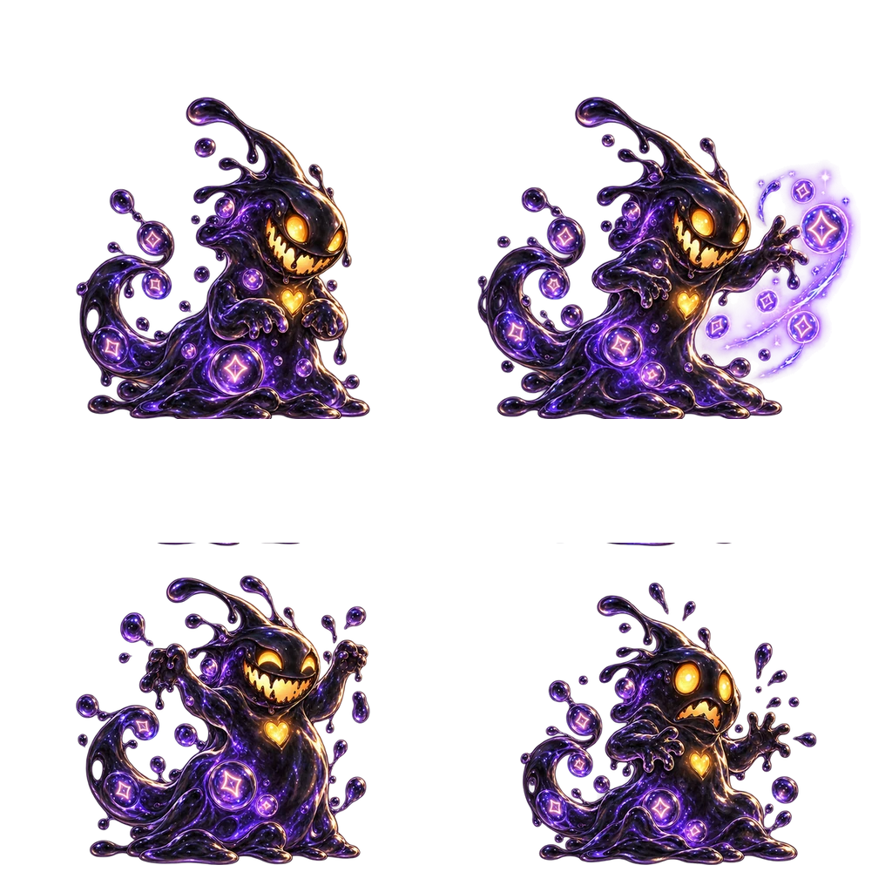

1024×1024; 295.1 KiB. Attempt 1.

- FLAG: Cell 0 source touches cell edge; inspect cropping/bleed

- FLAG: Cell 1 source touches cell edge; inspect cropping/bleed

- FLAG: Cell 2 source touches cell edge; inspect cropping/bleed

- FLAG: Cell 3 source touches cell edge; inspect cropping/bleed


<details><summary>Prompt and references</summary>

```text
ART STYLE: Lush, luminous digital painting in the spirit of a premium early-2000s Japanese RPG remastered in HD. Semi-realistic, anime-influenced characters with expressive faces and stylish asymmetrical adventure outfits: layered belts, buckles, straps, zippers, one-sleeved jackets, flowing scarves. Sun-drenched tropical environments painted in rich detail: saturated turquoise seas, white sand, emerald jungle, and ancient sandstone ruins carved with softly glowing glyphs. Golden-hour sunlight, with bioluminescent blue-green motes of light drifting through the air. Cinematic, epic and adventurous, with a mischievous sense of humor: witty, characterful expressions and small comedic details hidden in the scene. Mature and cool, never babyish or chibi.

This is an isolated game sprite: render ONLY the subject on a fully transparent background (PNG with alpha). No scenery, no ground, no cast shadow, no frame. Lit from the upper left with a soft rim light, crisp readable silhouette, full body with nothing cropped and clear empty space around it.

A friendly teacup-sized ink slime writing glowing magical glyphs in the air. Stage 1 of one evolving pet line; rebuilt, polished and cared for, with a small crystal HEART glowing gold. Stage 1 small and goofy, stage 2 sturdy and proud, stage 3 bigger and legendary. A sprite sheet for a 2D turn-based battle game: the SAME creature shown 4 times in a grid of 2 columns and 2 rows of equal square cells, on a fully transparent background, with no grid lines, labels or text. Full body at the same size and scale in every cell, standing on the same invisible baseline, facing RIGHT. Top row: (1) idle, content, (2) acting, performing its friendly special action. Bottom row: (3) happy, joyful, (4) hurt, startled but uninjured. Match the attached creature reference exactly.

Canvas 1024x1024. The attached guide image is a construction drawing: use it only for layout (where the floor, horizon, characters or cells are). Do not reproduce any of its lines, colors, shapes, labels or text. Match the attached reference's character exactly: same face, outfit, colors and weapon. Keep all bodies and props entirely inside their cells or frame. No accidental text or extra figures.

Rules: completely original designs; never imitate an existing franchise, character, creature, logo or emblem. No text, letters, numbers, logos, watermarks, signatures, borders or user interface, unless the prompt asks for glowing magic runes. Fierce and intense is great; no blood, gore or wounds. Every character is dressed for an all-ages game: modest clothing, no bare midriffs, no low necklines or cleavage, no revealing or tight-fitting costumes, and nothing sexualized in pose or proportion.
```

References: public/assets/anchors/key_art.webp, public/assets/anchors/cast_lineup.webp, public/assets/fiends/fiend_ink_slime/base.webp, art/guides/creature_sheet_2x2.png

</details>


### pet_slime_2 / battle — approved

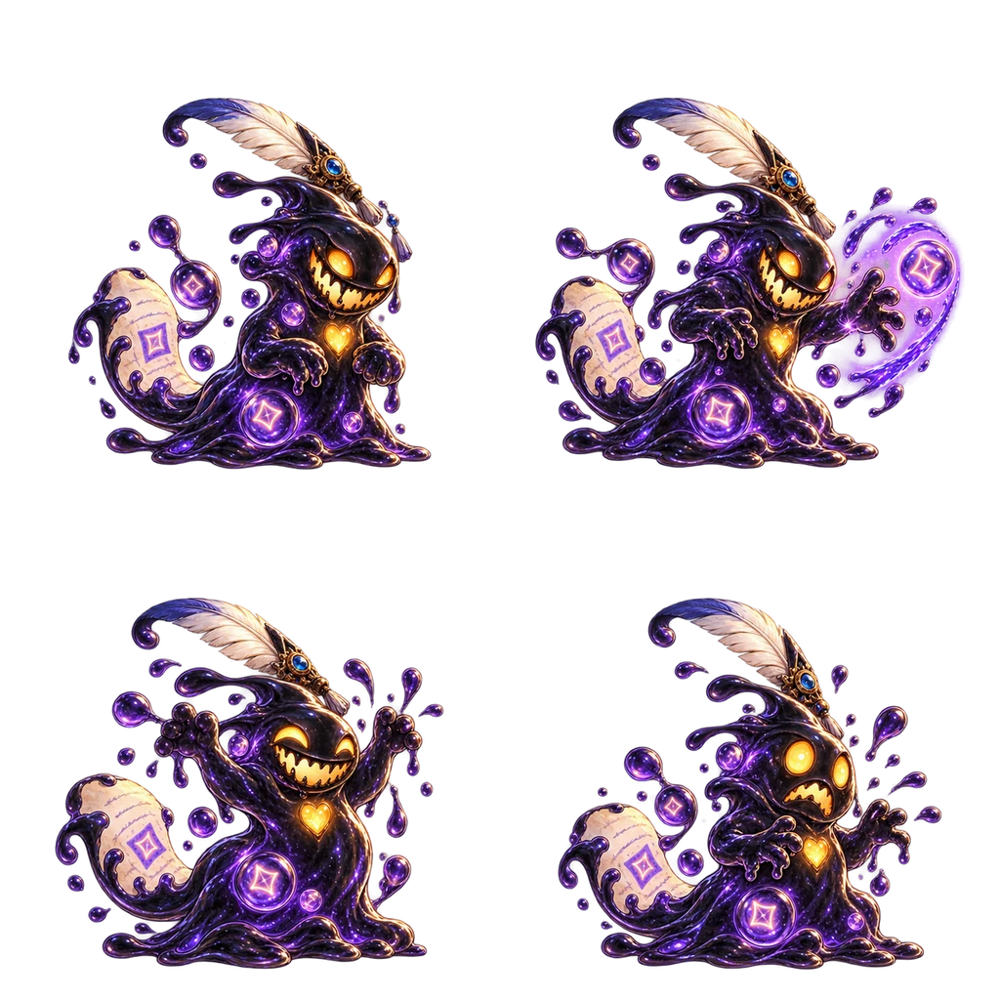

1024×1024; 337.9 KiB. Attempt 1.

- FLAG: Cell 1 source touches cell edge; inspect cropping/bleed


<details><summary>Prompt and references</summary>

```text
ART STYLE: Lush, luminous digital painting in the spirit of a premium early-2000s Japanese RPG remastered in HD. Semi-realistic, anime-influenced characters with expressive faces and stylish asymmetrical adventure outfits: layered belts, buckles, straps, zippers, one-sleeved jackets, flowing scarves. Sun-drenched tropical environments painted in rich detail: saturated turquoise seas, white sand, emerald jungle, and ancient sandstone ruins carved with softly glowing glyphs. Golden-hour sunlight, with bioluminescent blue-green motes of light drifting through the air. Cinematic, epic and adventurous, with a mischievous sense of humor: witty, characterful expressions and small comedic details hidden in the scene. Mature and cool, never babyish or chibi.

This is an isolated game sprite: render ONLY the subject on a fully transparent background (PNG with alpha). No scenery, no ground, no cast shadow, no frame. Lit from the upper left with a soft rim light, crisp readable silhouette, full body with nothing cropped and clear empty space around it.

A friendly ink slime wearing a quill like a hat, with a page-shaped tail. Stage 2 of one evolving pet line; rebuilt, polished and cared for, with a small crystal HEART glowing gold. Stage 1 small and goofy, stage 2 sturdy and proud, stage 3 bigger and legendary. A sprite sheet for a 2D turn-based battle game: the SAME creature shown 4 times in a grid of 2 columns and 2 rows of equal square cells, on a fully transparent background, with no grid lines, labels or text. Full body at the same size and scale in every cell, standing on the same invisible baseline, facing RIGHT. Top row: (1) idle, content, (2) acting, performing its friendly special action. Bottom row: (3) happy, joyful, (4) hurt, startled but uninjured. Match the attached creature reference exactly.

Canvas 1024x1024. The attached guide image is a construction drawing: use it only for layout (where the floor, horizon, characters or cells are). Do not reproduce any of its lines, colors, shapes, labels or text. Match the attached reference's character exactly: same face, outfit, colors and weapon. Keep all bodies and props entirely inside their cells or frame. No accidental text or extra figures.

Rules: completely original designs; never imitate an existing franchise, character, creature, logo or emblem. No text, letters, numbers, logos, watermarks, signatures, borders or user interface, unless the prompt asks for glowing magic runes. Fierce and intense is great; no blood, gore or wounds. Every character is dressed for an all-ages game: modest clothing, no bare midriffs, no low necklines or cleavage, no revealing or tight-fitting costumes, and nothing sexualized in pose or proportion.
```

References: public/assets/anchors/key_art.webp, public/assets/anchors/cast_lineup.webp, public/assets/fiends/fiend_ink_slime/base.webp, public/assets/characters/pet_slime_1/battle.webp, art/guides/creature_sheet_2x2.png

</details>


### pet_slime_3 / battle — approved

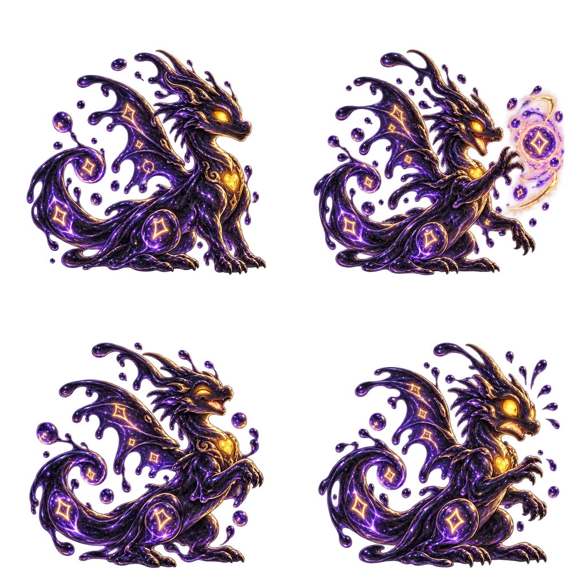

1024×1024; 406.0 KiB. Attempt 2.

Second attempt selected for readable ink-dragon muzzle, neck, script wings and tail.

<details><summary>Prompt and references</summary>

```text
ART STYLE: Lush, luminous digital painting in the spirit of a premium early-2000s Japanese RPG remastered in HD. Semi-realistic, anime-influenced characters with expressive faces and stylish asymmetrical adventure outfits: layered belts, buckles, straps, zippers, one-sleeved jackets, flowing scarves. Sun-drenched tropical environments painted in rich detail: saturated turquoise seas, white sand, emerald jungle, and ancient sandstone ruins carved with softly glowing glyphs. Golden-hour sunlight, with bioluminescent blue-green motes of light drifting through the air. Cinematic, epic and adventurous, with a mischievous sense of humor: witty, characterful expressions and small comedic details hidden in the scene. Mature and cool, never babyish or chibi.

This is an isolated game sprite: render ONLY the subject on a fully transparent background (PNG with alpha). No scenery, no ground, no cast shadow, no frame. Lit from the upper left with a soft rim light, crisp readable silhouette, full body with nothing cropped and clear empty space around it.

A small friendly ink dragon made of flowing magical script, with golden glyphs. Stage 3 of one evolving pet line; rebuilt, polished and cared for, with a small crystal HEART glowing gold. Stage 1 small and goofy, stage 2 sturdy and proud, stage 3 bigger and legendary. A sprite sheet for a 2D turn-based battle game: the SAME creature shown 4 times in a grid of 2 columns and 2 rows of equal square cells, on a fully transparent background, with no grid lines, labels or text. Full body at the same size and scale in every cell, standing on the same invisible baseline, facing RIGHT. Top row: (1) idle, content, (2) acting, performing its friendly special action. Bottom row: (3) happy, joyful, (4) hurt, startled but uninjured. Match the attached creature reference exactly.

Canvas 1024x1024. The attached guide image is a construction drawing: use it only for layout (where the floor, horizon, characters or cells are). Do not reproduce any of its lines, colors, shapes, labels or text. Use the earlier stage and original fiend only for shared materials, palette and pet-line motifs; evolve the body and silhouette as described. Do not copy the earlier stage unchanged. Keep all bodies and props entirely inside their cells or frame. No accidental text or extra figures.

EVOLUTION REQUIREMENT: A SMALL INK DRAGON, with dragon head and muzzle, a long dragon neck, flowing script wings and a long dragon tail, all made of glossy purple-black liquid ink. Golden glyphs and a gold crystal heart. NOT an upright humanoid slime blob. A new legendary dragon silhouette retaining the ink materials of stage1. Keep four poses in a 2x2 grid with idle, act, happy, hurt order, all facing right, entire creature and effects at least 48px from cell edges.

Rules: completely original designs; never imitate an existing franchise, character, creature, logo or emblem. No text, letters, numbers, logos, watermarks, signatures, borders or user interface, unless the prompt asks for glowing magic runes. Fierce and intense is great; no blood, gore or wounds. Every character is dressed for an all-ages game: modest clothing, no bare midriffs, no low necklines or cleavage, no revealing or tight-fitting costumes, and nothing sexualized in pose or proportion.
```

References: public/assets/anchors/key_art.webp, public/assets/anchors/cast_lineup.webp, public/assets/fiends/fiend_ink_slime/base.webp, public/assets/characters/pet_slime_1/battle.webp, art/guides/creature_sheet_2x2.png

</details>


### pet_tide_1 / battle — approved

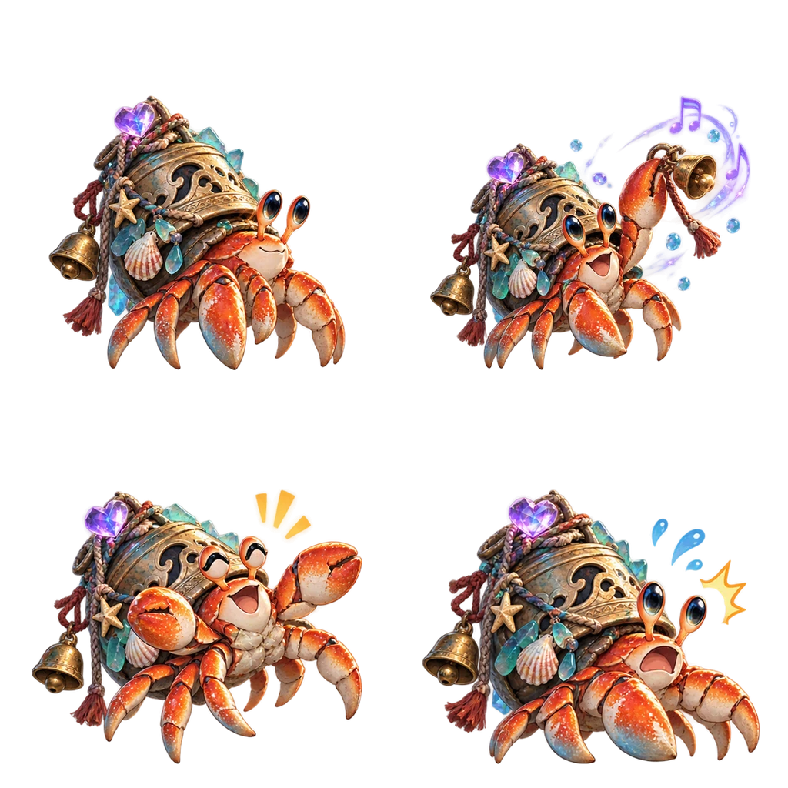

1024×1024; 308.6 KiB. Attempt 1.

- FLAG: Cell 1 source touches cell edge; inspect cropping/bleed


<details><summary>Prompt and references</summary>

```text
ART STYLE: Lush, luminous digital painting in the spirit of a premium early-2000s Japanese RPG remastered in HD. Semi-realistic, anime-influenced characters with expressive faces and stylish asymmetrical adventure outfits: layered belts, buckles, straps, zippers, one-sleeved jackets, flowing scarves. Sun-drenched tropical environments painted in rich detail: saturated turquoise seas, white sand, emerald jungle, and ancient sandstone ruins carved with softly glowing glyphs. Golden-hour sunlight, with bioluminescent blue-green motes of light drifting through the air. Cinematic, epic and adventurous, with a mischievous sense of humor: witty, characterful expressions and small comedic details hidden in the scene. Mature and cool, never babyish or chibi.

This is an isolated game sprite: render ONLY the subject on a fully transparent background (PNG with alpha). No scenery, no ground, no cast shadow, no frame. Lit from the upper left with a soft rim light, crisp readable silhouette, full body with nothing cropped and clear empty space around it.

A friendly sea-glass hermit crab with a little shrine bell for a shell. Stage 1 of one evolving pet line; rebuilt, polished and cared for, with a small crystal HEART glowing storm-violet. Stage 1 small and goofy, stage 2 sturdy and proud, stage 3 bigger and legendary. A sprite sheet for a 2D turn-based battle game: the SAME creature shown 4 times in a grid of 2 columns and 2 rows of equal square cells, on a fully transparent background, with no grid lines, labels or text. Full body at the same size and scale in every cell, standing on the same invisible baseline, facing RIGHT. Top row: (1) idle, content, (2) acting, performing its friendly special action. Bottom row: (3) happy, joyful, (4) hurt, startled but uninjured. Match the attached creature reference exactly.

Canvas 1024x1024. The attached guide image is a construction drawing: use it only for layout (where the floor, horizon, characters or cells are). Do not reproduce any of its lines, colors, shapes, labels or text. Match the attached reference's character exactly: same face, outfit, colors and weapon. Keep all bodies and props entirely inside their cells or frame. No accidental text or extra figures.

Rules: completely original designs; never imitate an existing franchise, character, creature, logo or emblem. No text, letters, numbers, logos, watermarks, signatures, borders or user interface, unless the prompt asks for glowing magic runes. Fierce and intense is great; no blood, gore or wounds. Every character is dressed for an all-ages game: modest clothing, no bare midriffs, no low necklines or cleavage, no revealing or tight-fitting costumes, and nothing sexualized in pose or proportion.
```

References: public/assets/anchors/key_art.webp, public/assets/anchors/cast_lineup.webp, art/guides/creature_sheet_2x2.png

</details>


### pet_tide_2 / battle — approved

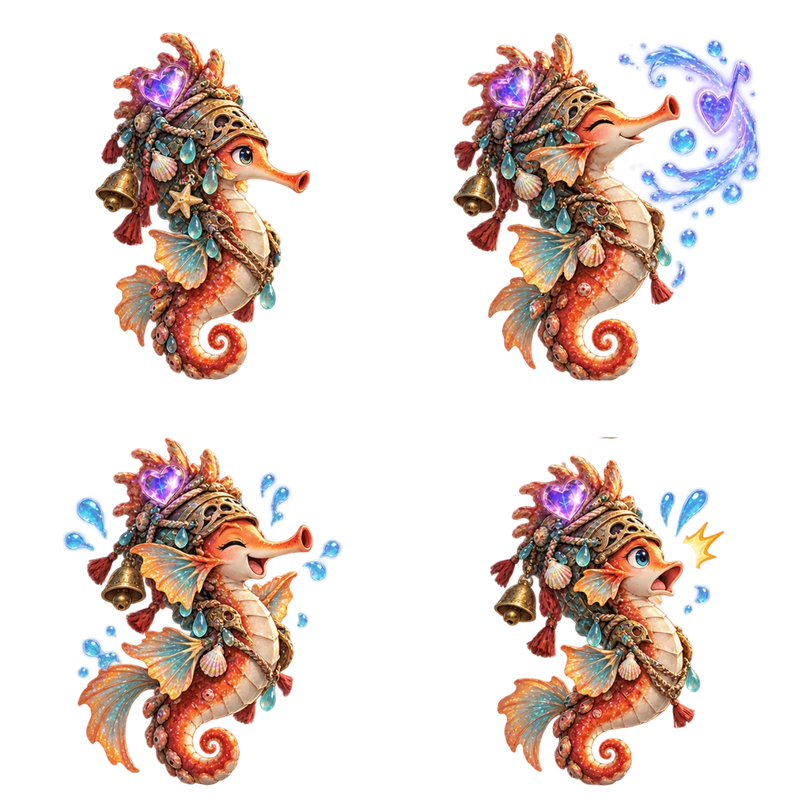

1024×1024; 318.9 KiB. Attempt 2.

- FLAG: Cell 1 source touches cell edge; inspect cropping/bleed

- FLAG: Cell 3 source touches cell edge; inspect cropping/bleed

Second attempt selected for distinct seahorse silhouette. Four right-facing poses.

<details><summary>Prompt and references</summary>

```text
ART STYLE: Lush, luminous digital painting in the spirit of a premium early-2000s Japanese RPG remastered in HD. Semi-realistic, anime-influenced characters with expressive faces and stylish asymmetrical adventure outfits: layered belts, buckles, straps, zippers, one-sleeved jackets, flowing scarves. Sun-drenched tropical environments painted in rich detail: saturated turquoise seas, white sand, emerald jungle, and ancient sandstone ruins carved with softly glowing glyphs. Golden-hour sunlight, with bioluminescent blue-green motes of light drifting through the air. Cinematic, epic and adventurous, with a mischievous sense of humor: witty, characterful expressions and small comedic details hidden in the scene. Mature and cool, never babyish or chibi.

This is an isolated game sprite: render ONLY the subject on a fully transparent background (PNG with alpha). No scenery, no ground, no cast shadow, no frame. Lit from the upper left with a soft rim light, crisp readable silhouette, full body with nothing cropped and clear empty space around it.

A friendly coral seahorse with a shell crest. Stage 2 of one evolving pet line; rebuilt, polished and cared for, with a small crystal HEART glowing storm-violet. Stage 1 small and goofy, stage 2 sturdy and proud, stage 3 bigger and legendary. A sprite sheet for a 2D turn-based battle game: the SAME creature shown 4 times in a grid of 2 columns and 2 rows of equal square cells, on a fully transparent background, with no grid lines, labels or text. Full body at the same size and scale in every cell, standing on the same invisible baseline, facing RIGHT. Top row: (1) idle, content, (2) acting, performing its friendly special action. Bottom row: (3) happy, joyful, (4) hurt, startled but uninjured. Match the attached creature reference exactly.

Canvas 1024x1024. The attached guide image is a construction drawing: use it only for layout (where the floor, horizon, characters or cells are). Do not reproduce any of its lines, colors, shapes, labels or text. Use the earlier stage and original fiend only for shared materials, palette and pet-line motifs; evolve the body and silhouette as described. Do not copy the earlier stage unchanged. Keep all bodies and props entirely inside their cells or frame. No accidental text or extra figures.

EVOLUTION REQUIREMENT: A CORAL SEAHORSE with a long horse-like snout, upright slender SEAHORSE neck, curled SEAHORSE tail, little fins and a shell CREST on the head/back, storm-violet crystal heart. NO CRAB BODY, NO CRAB LEGS, NO CRAB CLAWS. Shared sea-glass, coral, shell and small brass-bell details from stage1, evolved into a SEAHORSE. Keep four poses in a 2x2 grid with idle, act, happy, hurt order, all facing right, entire creature and effects at least 48px from cell edges.

Rules: completely original designs; never imitate an existing franchise, character, creature, logo or emblem. No text, letters, numbers, logos, watermarks, signatures, borders or user interface, unless the prompt asks for glowing magic runes. Fierce and intense is great; no blood, gore or wounds. Every character is dressed for an all-ages game: modest clothing, no bare midriffs, no low necklines or cleavage, no revealing or tight-fitting costumes, and nothing sexualized in pose or proportion.
```

References: public/assets/anchors/key_art.webp, public/assets/anchors/cast_lineup.webp, public/assets/characters/pet_tide_1/battle.webp, art/guides/creature_sheet_2x2.png

</details>


### pet_tide_3 / battle — approved

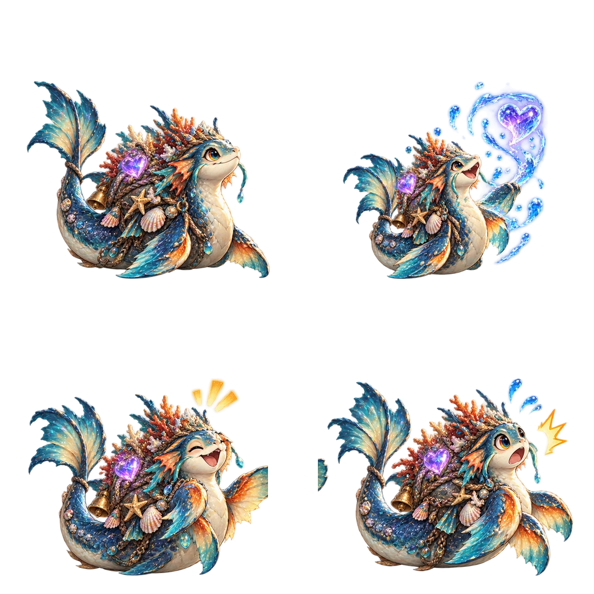

1024×1024; 323.0 KiB. Attempt 1.

- FLAG: Cell 2 source touches cell edge; inspect cropping/bleed

- FLAG: Cell 3 source touches cell edge; inspect cropping/bleed


<details><summary>Prompt and references</summary>

```text
ART STYLE: Lush, luminous digital painting in the spirit of a premium early-2000s Japanese RPG remastered in HD. Semi-realistic, anime-influenced characters with expressive faces and stylish asymmetrical adventure outfits: layered belts, buckles, straps, zippers, one-sleeved jackets, flowing scarves. Sun-drenched tropical environments painted in rich detail: saturated turquoise seas, white sand, emerald jungle, and ancient sandstone ruins carved with softly glowing glyphs. Golden-hour sunlight, with bioluminescent blue-green motes of light drifting through the air. Cinematic, epic and adventurous, with a mischievous sense of humor: witty, characterful expressions and small comedic details hidden in the scene. Mature and cool, never babyish or chibi.

This is an isolated game sprite: render ONLY the subject on a fully transparent background (PNG with alpha). No scenery, no ground, no cast shadow, no frame. Lit from the upper left with a soft rim light, crisp readable silhouette, full body with nothing cropped and clear empty space around it.

A small friendly tide-serpent with reef growth along its back. Stage 3 of one evolving pet line; rebuilt, polished and cared for, with a small crystal HEART glowing storm-violet. Stage 1 small and goofy, stage 2 sturdy and proud, stage 3 bigger and legendary. A sprite sheet for a 2D turn-based battle game: the SAME creature shown 4 times in a grid of 2 columns and 2 rows of equal square cells, on a fully transparent background, with no grid lines, labels or text. Full body at the same size and scale in every cell, standing on the same invisible baseline, facing RIGHT. Top row: (1) idle, content, (2) acting, performing its friendly special action. Bottom row: (3) happy, joyful, (4) hurt, startled but uninjured. Match the attached creature reference exactly.

Canvas 1024x1024. The attached guide image is a construction drawing: use it only for layout (where the floor, horizon, characters or cells are). Do not reproduce any of its lines, colors, shapes, labels or text. Match the attached reference's character exactly: same face, outfit, colors and weapon. Keep all bodies and props entirely inside their cells or frame. No accidental text or extra figures.

Rules: completely original designs; never imitate an existing franchise, character, creature, logo or emblem. No text, letters, numbers, logos, watermarks, signatures, borders or user interface, unless the prompt asks for glowing magic runes. Fierce and intense is great; no blood, gore or wounds. Every character is dressed for an all-ages game: modest clothing, no bare midriffs, no low necklines or cleavage, no revealing or tight-fitting costumes, and nothing sexualized in pose or proportion.
```

References: public/assets/anchors/key_art.webp, public/assets/anchors/cast_lineup.webp, public/assets/characters/pet_tide_1/battle.webp, art/guides/creature_sheet_2x2.png

</details>


## Section D


### fiend_barnacle_brute / base — approved

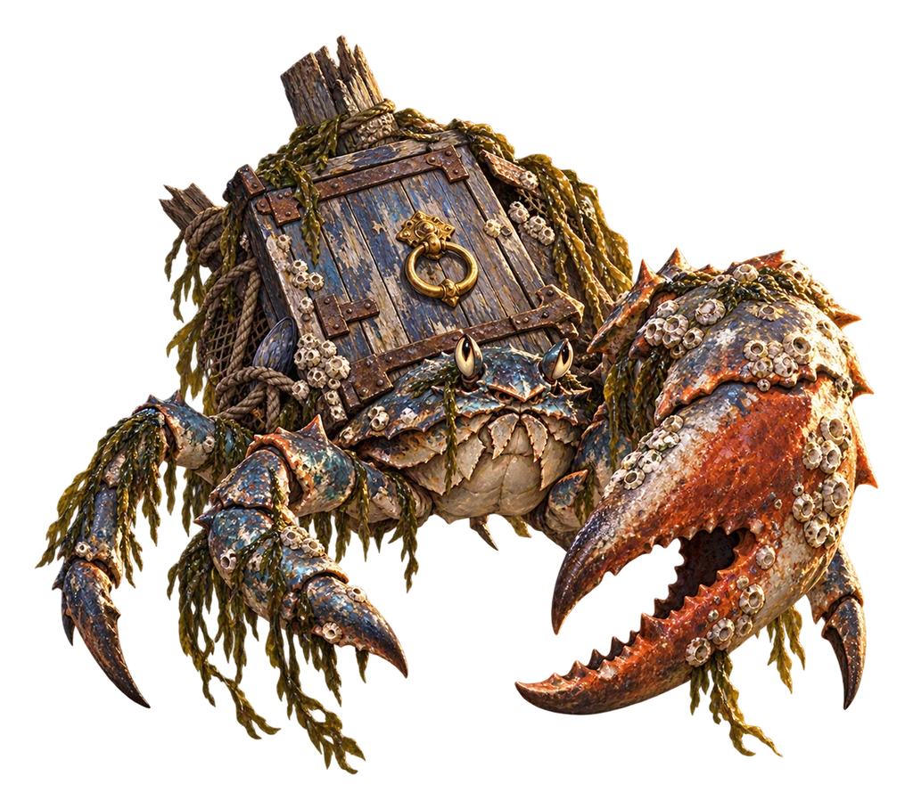

1024×908; 340.5 KiB. Attempt 2.

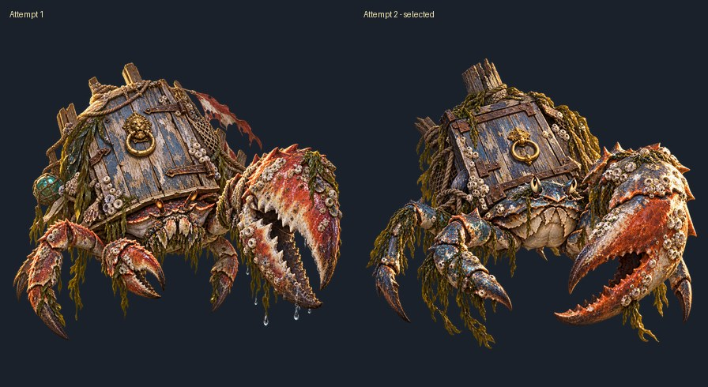

Candidate 2 selected: door-shell, knocker and unequal claws read clearly.

<details><summary>Prompt and references</summary>

```text
ART STYLE: Lush, luminous digital painting in the spirit of a premium early-2000s Japanese RPG remastered in HD. Semi-realistic, anime-influenced characters with expressive faces and stylish asymmetrical adventure outfits: layered belts, buckles, straps, zippers, one-sleeved jackets, flowing scarves. Sun-drenched tropical environments painted in rich detail: saturated turquoise seas, white sand, emerald jungle, and ancient sandstone ruins carved with softly glowing glyphs. Golden-hour sunlight, with bioluminescent blue-green motes of light drifting through the air. Cinematic, epic and adventurous, with a mischievous sense of humor: witty, characterful expressions and small comedic details hidden in the scene. Mature and cool, never babyish or chibi.

This is an isolated game sprite: render ONLY the subject on a fully transparent background (PNG with alpha). No scenery, no ground, no cast shadow, no frame. Lit from the upper left with a soft rim light, crisp readable silhouette, full body with nothing cropped and clear empty space around it.

An enemy creature, facing right: a giant crab the size of a rowboat, crusted in barnacles and seaweed, wearing a stolen wooden front door as its shell, with a brass door knocker still on it. One enormous claw and one small one. Low, heavy and grumpy, ready to snap.

Canvas 1024x1024.  Match the attached reference's character exactly: same face, outfit, colors and weapon. Keep all bodies and props entirely inside their cells or frame. No accidental text or extra figures.

Rules: completely original designs; never imitate an existing franchise, character, creature, logo or emblem. No text, letters, numbers, logos, watermarks, signatures, borders or user interface, unless the prompt asks for glowing magic runes. Fierce and intense is great; no blood, gore or wounds. Every character is dressed for an all-ages game: modest clothing, no bare midriffs, no low necklines or cleavage, no revealing or tight-fitting costumes, and nothing sexualized in pose or proportion.
```

References: public/assets/anchors/key_art.webp, public/assets/anchors/cast_lineup.webp

</details>


### fiend_barnacle_brute / battle — approved

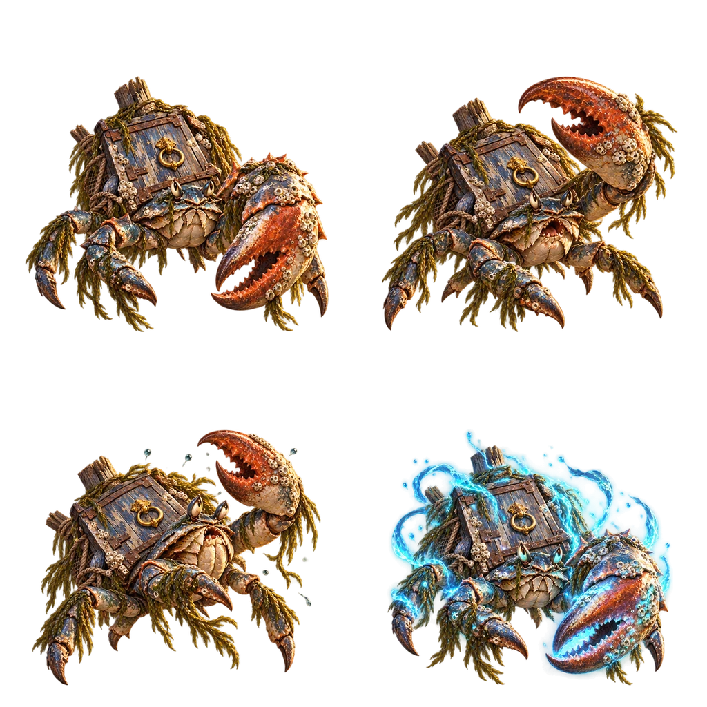

1024×1024; 380.1 KiB. Attempt 2.

Second attempt keeps compact claws inside all four source cells.

<details><summary>Prompt and references</summary>

```text
ART STYLE: Lush, luminous digital painting in the spirit of a premium early-2000s Japanese RPG remastered in HD. Semi-realistic, anime-influenced characters with expressive faces and stylish asymmetrical adventure outfits: layered belts, buckles, straps, zippers, one-sleeved jackets, flowing scarves. Sun-drenched tropical environments painted in rich detail: saturated turquoise seas, white sand, emerald jungle, and ancient sandstone ruins carved with softly glowing glyphs. Golden-hour sunlight, with bioluminescent blue-green motes of light drifting through the air. Cinematic, epic and adventurous, with a mischievous sense of humor: witty, characterful expressions and small comedic details hidden in the scene. Mature and cool, never babyish or chibi.

This is an isolated game sprite: render ONLY the subject on a fully transparent background (PNG with alpha). No scenery, no ground, no cast shadow, no frame. Lit from the upper left with a soft rim light, crisp readable silhouette, full body with nothing cropped and clear empty space around it.

An enemy creature, facing right: a giant crab the size of a rowboat, crusted in barnacles and seaweed, wearing a stolen wooden front door as its shell, with a brass door knocker still on it. One enormous claw and one small one. Low, heavy and grumpy, ready to snap.
A sprite sheet for a 2D turn-based battle game: the SAME creature shown 4 times in a grid of 2 columns and 2 rows of equal square cells, on a fully transparent background, with no grid lines, labels or text. Full body at the same size and scale in every cell, standing on the same invisible baseline, facing RIGHT. Top row: (1) idle, menacing, (2) attacking. Bottom row: (3) hurt, recoiling, (4) special attack, glowing with power. Match the attached creature reference exactly.

Canvas 1024x1024. The attached guide image is a construction drawing: use it only for layout (where the floor, horizon, characters or cells are). Do not reproduce any of its lines, colors, shapes, labels or text. Match the attached reference's character exactly: same face, outfit, colors and weapon. Keep all bodies and props entirely inside their cells or frame. No accidental text or extra figures.

Rules: completely original designs; never imitate an existing franchise, character, creature, logo or emblem. No text, letters, numbers, logos, watermarks, signatures, borders or user interface, unless the prompt asks for glowing magic runes. Fierce and intense is great; no blood, gore or wounds. Every character is dressed for an all-ages game: modest clothing, no bare midriffs, no low necklines or cleavage, no revealing or tight-fitting costumes, and nothing sexualized in pose or proportion.
```

References: public/assets/anchors/key_art.webp, public/assets/anchors/cast_lineup.webp, public/assets/fiends/fiend_barnacle_brute/base.webp, art/guides/creature_sheet_2x2.png

</details>


### fiend_wick_moth / base — approved


1017×1024; 335.5 KiB. Attempt 2.

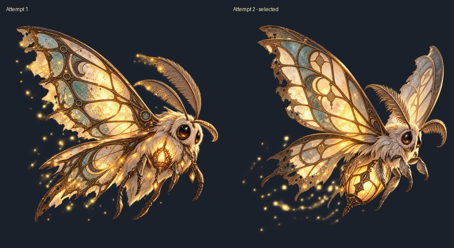

Candidate 2 selected for lamp-glass candle body and large dark eyes.

<details><summary>Prompt and references</summary>

```text
ART STYLE: Lush, luminous digital painting in the spirit of a premium early-2000s Japanese RPG remastered in HD. Semi-realistic, anime-influenced characters with expressive faces and stylish asymmetrical adventure outfits: layered belts, buckles, straps, zippers, one-sleeved jackets, flowing scarves. Sun-drenched tropical environments painted in rich detail: saturated turquoise seas, white sand, emerald jungle, and ancient sandstone ruins carved with softly glowing glyphs. Golden-hour sunlight, with bioluminescent blue-green motes of light drifting through the air. Cinematic, epic and adventurous, with a mischievous sense of humor: witty, characterful expressions and small comedic details hidden in the scene. Mature and cool, never babyish or chibi.

This is an isolated game sprite: render ONLY the subject on a fully transparent background (PNG with alpha). No scenery, no ground, no cast shadow, no frame. Lit from the upper left with a soft rim light, crisp readable silhouette, full body with nothing cropped and clear empty space around it.

An enemy creature, facing right: a moth as big as an umbrella, with wings like panes of old lantern glass in lead frames, a candle-flame glow in its fuzzy body, dusty antennae and huge sad dark eyes. Fluttering frantically, scattering glowing dust.

Canvas 1024x1024.  Match the attached reference's character exactly: same face, outfit, colors and weapon. Keep all bodies and props entirely inside their cells or frame. No accidental text or extra figures.

Rules: completely original designs; never imitate an existing franchise, character, creature, logo or emblem. No text, letters, numbers, logos, watermarks, signatures, borders or user interface, unless the prompt asks for glowing magic runes. Fierce and intense is great; no blood, gore or wounds. Every character is dressed for an all-ages game: modest clothing, no bare midriffs, no low necklines or cleavage, no revealing or tight-fitting costumes, and nothing sexualized in pose or proportion.
```

References: public/assets/anchors/key_art.webp, public/assets/anchors/cast_lineup.webp

</details>


### fiend_wick_moth / battle — approved

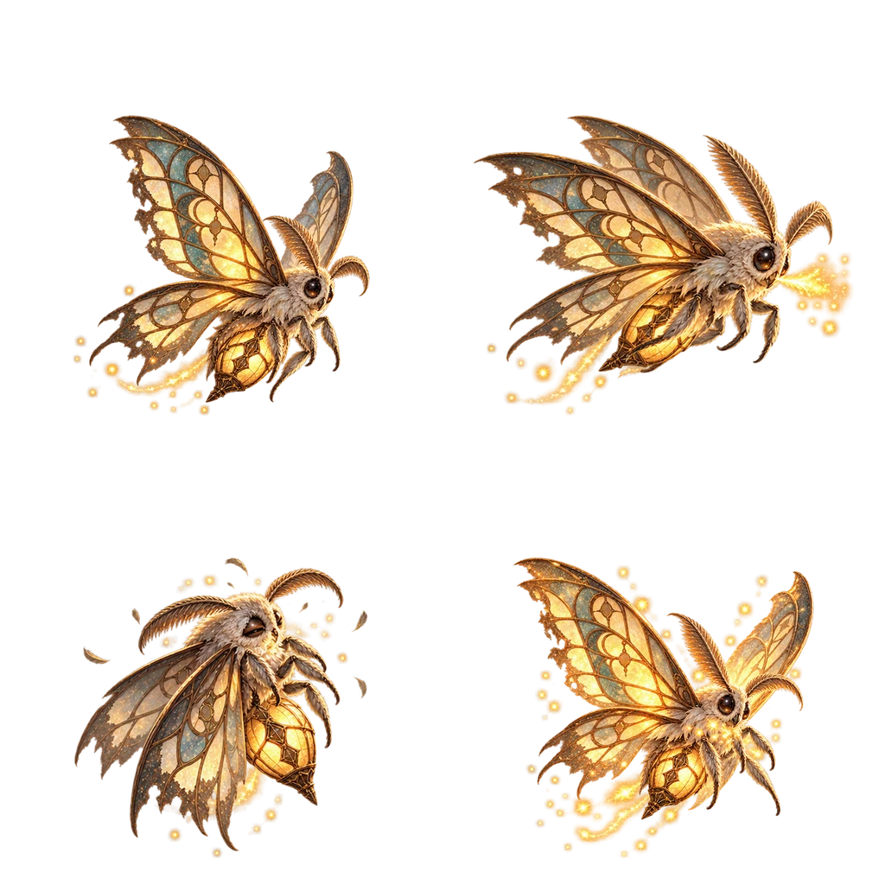

1024×1024; 272.4 KiB. Attempt 3.

- FLAG: Cell 3 source touches cell edge; inspect cropping/bleed

Third attempt selected. Full bodies contained; special sparks still touch a source edge at the attempt limit.

<details><summary>Prompt and references</summary>

```text
ART STYLE: Lush, luminous digital painting in the spirit of a premium early-2000s Japanese RPG remastered in HD. Semi-realistic, anime-influenced characters with expressive faces and stylish asymmetrical adventure outfits: layered belts, buckles, straps, zippers, one-sleeved jackets, flowing scarves. Sun-drenched tropical environments painted in rich detail: saturated turquoise seas, white sand, emerald jungle, and ancient sandstone ruins carved with softly glowing glyphs. Golden-hour sunlight, with bioluminescent blue-green motes of light drifting through the air. Cinematic, epic and adventurous, with a mischievous sense of humor: witty, characterful expressions and small comedic details hidden in the scene. Mature and cool, never babyish or chibi.

This is an isolated game sprite: render ONLY the subject on a fully transparent background (PNG with alpha). No scenery, no ground, no cast shadow, no frame. Lit from the upper left with a soft rim light, crisp readable silhouette, full body with nothing cropped and clear empty space around it.

An enemy creature, facing right: a moth as big as an umbrella, with wings like panes of old lantern glass in lead frames, a candle-flame glow in its fuzzy body, dusty antennae and huge sad dark eyes. Fluttering frantically, scattering glowing dust.
A sprite sheet for a 2D turn-based battle game: the SAME creature shown 4 times in a grid of 2 columns and 2 rows of equal square cells, on a fully transparent background, with no grid lines, labels or text. Full body at the same size and scale in every cell, standing on the same invisible baseline, facing RIGHT. Top row: (1) idle, menacing, (2) attacking. Bottom row: (3) hurt, recoiling, (4) special attack, glowing with power. Match the attached creature reference exactly.

Canvas 1024x1024. The attached guide image is a construction drawing: use it only for layout (where the floor, horizon, characters or cells are). Do not reproduce any of its lines, colors, shapes, labels or text. Match the attached reference's character exactly: same face, outfit, colors and weapon. Keep all bodies and props entirely inside their cells or frame. No accidental text or extra figures.

Rules: completely original designs; never imitate an existing franchise, character, creature, logo or emblem. No text, letters, numbers, logos, watermarks, signatures, borders or user interface, unless the prompt asks for glowing magic runes. Fierce and intense is great; no blood, gore or wounds. Every character is dressed for an all-ages game: modest clothing, no bare midriffs, no low necklines or cleavage, no revealing or tight-fitting costumes, and nothing sexualized in pose or proportion.
```

References: public/assets/anchors/key_art.webp, public/assets/anchors/cast_lineup.webp, public/assets/fiends/fiend_wick_moth/base.webp, art/guides/creature_sheet_2x2.png

</details>


### fiend_fog_glob / base — approved

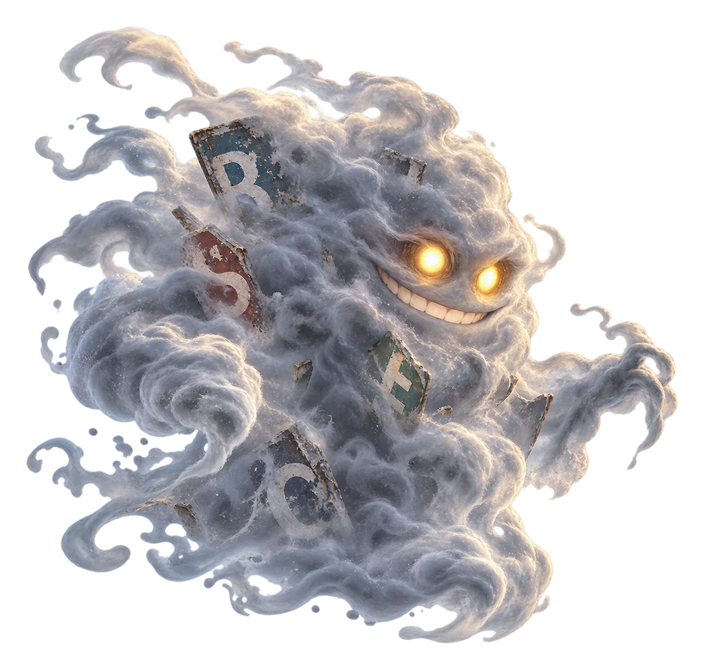

1024×975; 272.3 KiB. Attempt 3.

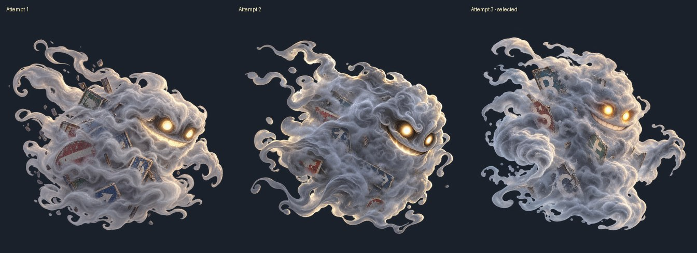

Third attempt replaces clear directional arrows with blurred letter-like marks.

<details><summary>Prompt and references</summary>

```text
ART STYLE: Lush, luminous digital painting in the spirit of a premium early-2000s Japanese RPG remastered in HD. Semi-realistic, anime-influenced characters with expressive faces and stylish asymmetrical adventure outfits: layered belts, buckles, straps, zippers, one-sleeved jackets, flowing scarves. Sun-drenched tropical environments painted in rich detail: saturated turquoise seas, white sand, emerald jungle, and ancient sandstone ruins carved with softly glowing glyphs. Golden-hour sunlight, with bioluminescent blue-green motes of light drifting through the air. Cinematic, epic and adventurous, with a mischievous sense of humor: witty, characterful expressions and small comedic details hidden in the scene. Mature and cool, never babyish or chibi.

This is an isolated game sprite: render ONLY the subject on a fully transparent background (PNG with alpha). No scenery, no ground, no cast shadow, no frame. Lit from the upper left with a soft rim light, crisp readable silhouette, full body with nothing cropped and clear empty space around it.

An enemy creature, facing right: a waist-high blob of thick grey sea fog, with half-swallowed painted letters from street signs drifting inside it and blurring as they sink. Two round eyes glow inside it like lamps in fog. A wide, sly smile. Wisps trail off its edges.

Canvas 1024x1024.  Match the attached reference's character exactly: same face, outfit, colors and weapon. Keep all bodies and props entirely inside their cells or frame. No accidental text or extra figures.

Rules: completely original designs; never imitate an existing franchise, character, creature, logo or emblem. No text, letters, numbers, logos, watermarks, signatures, borders or user interface, unless the prompt asks for glowing magic runes. Fierce and intense is great; no blood, gore or wounds. Every character is dressed for an all-ages game: modest clothing, no bare midriffs, no low necklines or cleavage, no revealing or tight-fitting costumes, and nothing sexualized in pose or proportion.
```

References: public/assets/anchors/key_art.webp, public/assets/anchors/cast_lineup.webp

</details>


### fiend_fog_glob / battle — approved

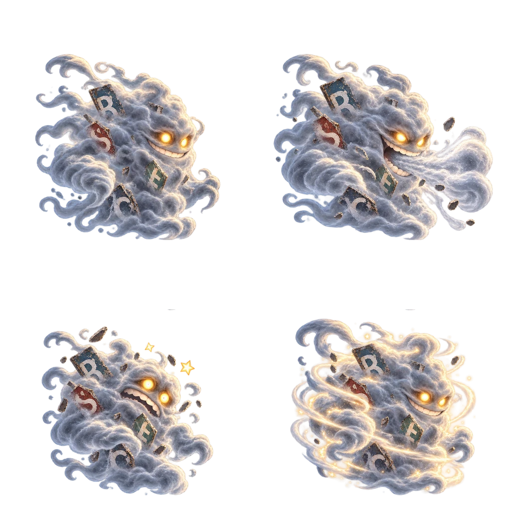

1024×1024; 272.8 KiB. Attempt 2.

- FLAG: Cell 0 source touches cell edge; inspect cropping/bleed

- FLAG: Cell 1 source touches cell edge; inspect cropping/bleed

- FLAG: Cell 2 source touches cell edge; inspect cropping/bleed

- FLAG: Cell 3 source touches cell edge; inspect cropping/bleed

Second attempt selected for compact mist bodies. Peripheral wisps touch source edges; solid anatomy remains complete.

<details><summary>Prompt and references</summary>

```text
ART STYLE: Lush, luminous digital painting in the spirit of a premium early-2000s Japanese RPG remastered in HD. Semi-realistic, anime-influenced characters with expressive faces and stylish asymmetrical adventure outfits: layered belts, buckles, straps, zippers, one-sleeved jackets, flowing scarves. Sun-drenched tropical environments painted in rich detail: saturated turquoise seas, white sand, emerald jungle, and ancient sandstone ruins carved with softly glowing glyphs. Golden-hour sunlight, with bioluminescent blue-green motes of light drifting through the air. Cinematic, epic and adventurous, with a mischievous sense of humor: witty, characterful expressions and small comedic details hidden in the scene. Mature and cool, never babyish or chibi.

This is an isolated game sprite: render ONLY the subject on a fully transparent background (PNG with alpha). No scenery, no ground, no cast shadow, no frame. Lit from the upper left with a soft rim light, crisp readable silhouette, full body with nothing cropped and clear empty space around it.

An enemy creature, facing right: a waist-high blob of thick grey sea fog, with half-swallowed painted letters from street signs drifting inside it and blurring as they sink. Two round eyes glow inside it like lamps in fog. A wide, sly smile. Wisps trail off its edges.
A sprite sheet for a 2D turn-based battle game: the SAME creature shown 4 times in a grid of 2 columns and 2 rows of equal square cells, on a fully transparent background, with no grid lines, labels or text. Full body at the same size and scale in every cell, standing on the same invisible baseline, facing RIGHT. Top row: (1) idle, menacing, (2) attacking. Bottom row: (3) hurt, recoiling, (4) special attack, glowing with power. Match the attached creature reference exactly.

Canvas 1024x1024. The attached guide image is a construction drawing: use it only for layout (where the floor, horizon, characters or cells are). Do not reproduce any of its lines, colors, shapes, labels or text. Match the attached reference's character exactly: same face, outfit, colors and weapon. Keep all bodies and props entirely inside their cells or frame. No accidental text or extra figures.

Rules: completely original designs; never imitate an existing franchise, character, creature, logo or emblem. No text, letters, numbers, logos, watermarks, signatures, borders or user interface, unless the prompt asks for glowing magic runes. Fierce and intense is great; no blood, gore or wounds. Every character is dressed for an all-ages game: modest clothing, no bare midriffs, no low necklines or cleavage, no revealing or tight-fitting costumes, and nothing sexualized in pose or proportion.
```

References: public/assets/anchors/key_art.webp, public/assets/anchors/cast_lineup.webp, public/assets/fiends/fiend_fog_glob/base.webp, art/guides/creature_sheet_2x2.png

</details>


### fiend_tick_mimic / base — approved

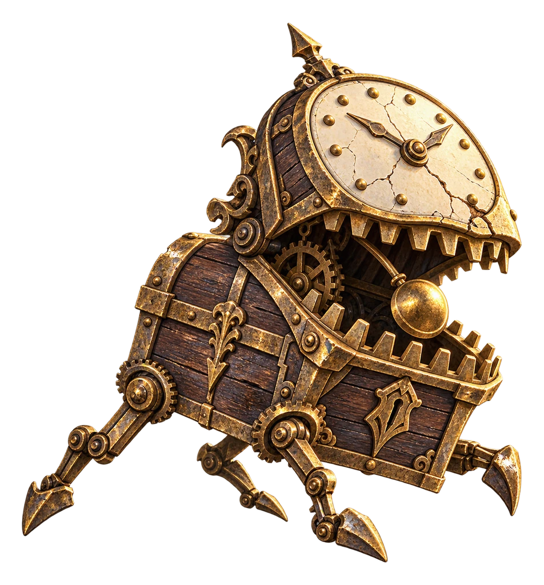

952×1024; 267.2 KiB. Attempt 3.

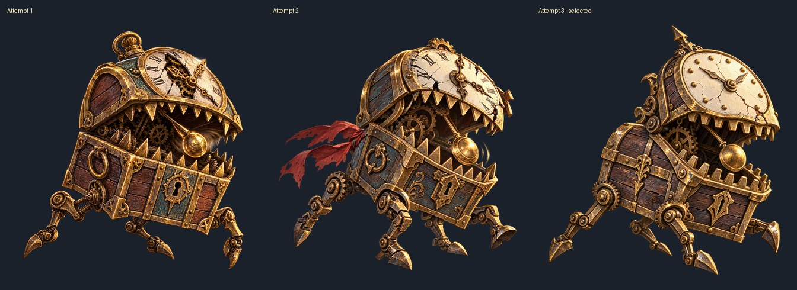

Third attempt removes Roman numerals in favor of plain hour dots, gear teeth and pendulum.

<details><summary>Prompt and references</summary>

```text
ART STYLE: Lush, luminous digital painting in the spirit of a premium early-2000s Japanese RPG remastered in HD. Semi-realistic, anime-influenced characters with expressive faces and stylish asymmetrical adventure outfits: layered belts, buckles, straps, zippers, one-sleeved jackets, flowing scarves. Sun-drenched tropical environments painted in rich detail: saturated turquoise seas, white sand, emerald jungle, and ancient sandstone ruins carved with softly glowing glyphs. Golden-hour sunlight, with bioluminescent blue-green motes of light drifting through the air. Cinematic, epic and adventurous, with a mischievous sense of humor: witty, characterful expressions and small comedic details hidden in the scene. Mature and cool, never babyish or chibi.

This is an isolated game sprite: render ONLY the subject on a fully transparent background (PNG with alpha). No scenery, no ground, no cast shadow, no frame. Lit from the upper left with a soft rim light, crisp readable silhouette, full body with nothing cropped and clear empty space around it.

An enemy creature, facing right: a wooden treasure chest that is secretly a clock: its lid is a cracked brass clock face, gear teeth line its open mouth, and a pendulum swings inside like a tongue. Little brass legs, mid-scuttle, too fast to trust.

Canvas 1024x1024.  Match the attached reference's character exactly: same face, outfit, colors and weapon. Keep all bodies and props entirely inside their cells or frame. No accidental text or extra figures.

Rules: completely original designs; never imitate an existing franchise, character, creature, logo or emblem. No text, letters, numbers, logos, watermarks, signatures, borders or user interface, unless the prompt asks for glowing magic runes. Fierce and intense is great; no blood, gore or wounds. Every character is dressed for an all-ages game: modest clothing, no bare midriffs, no low necklines or cleavage, no revealing or tight-fitting costumes, and nothing sexualized in pose or proportion.
```

References: public/assets/anchors/key_art.webp, public/assets/anchors/cast_lineup.webp

</details>


### fiend_tick_mimic / battle — approved

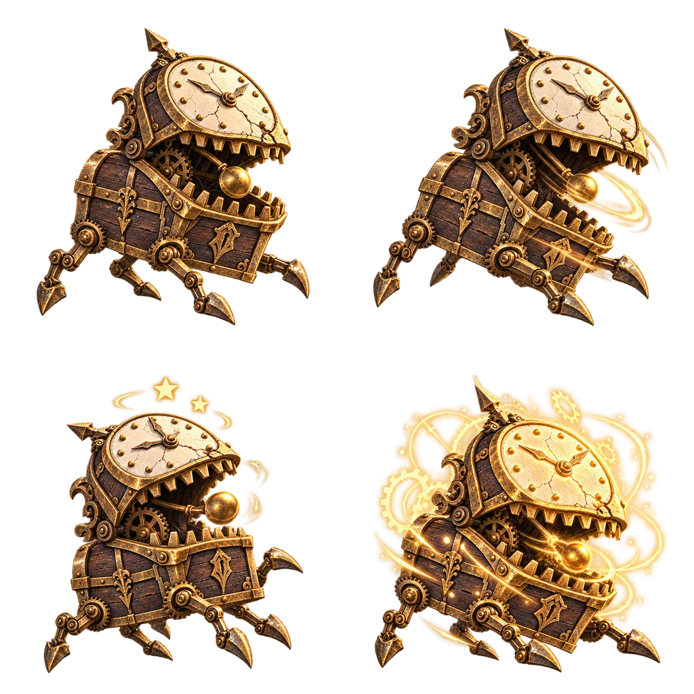

1024×1024; 327.8 KiB. Attempt 1.

- FLAG: Cell 1 source touches cell edge; inspect cropping/bleed

- FLAG: Cell 3 source touches cell edge; inspect cropping/bleed

Four complete bodies; attack/special glow reaches source edges.

<details><summary>Prompt and references</summary>

```text
ART STYLE: Lush, luminous digital painting in the spirit of a premium early-2000s Japanese RPG remastered in HD. Semi-realistic, anime-influenced characters with expressive faces and stylish asymmetrical adventure outfits: layered belts, buckles, straps, zippers, one-sleeved jackets, flowing scarves. Sun-drenched tropical environments painted in rich detail: saturated turquoise seas, white sand, emerald jungle, and ancient sandstone ruins carved with softly glowing glyphs. Golden-hour sunlight, with bioluminescent blue-green motes of light drifting through the air. Cinematic, epic and adventurous, with a mischievous sense of humor: witty, characterful expressions and small comedic details hidden in the scene. Mature and cool, never babyish or chibi.

This is an isolated game sprite: render ONLY the subject on a fully transparent background (PNG with alpha). No scenery, no ground, no cast shadow, no frame. Lit from the upper left with a soft rim light, crisp readable silhouette, full body with nothing cropped and clear empty space around it.

An enemy creature, facing right: a wooden treasure chest that is secretly a clock: its lid is a cracked brass clock face, gear teeth line its open mouth, and a pendulum swings inside like a tongue. Little brass legs, mid-scuttle, too fast to trust.
A sprite sheet for a 2D turn-based battle game: the SAME creature shown 4 times in a grid of 2 columns and 2 rows of equal square cells, on a fully transparent background, with no grid lines, labels or text. Full body at the same size and scale in every cell, standing on the same invisible baseline, facing RIGHT. Top row: (1) idle, menacing, (2) attacking. Bottom row: (3) hurt, recoiling, (4) special attack, glowing with power. Match the attached creature reference exactly.

Canvas 1024x1024. The attached guide image is a construction drawing: use it only for layout (where the floor, horizon, characters or cells are). Do not reproduce any of its lines, colors, shapes, labels or text. Match the attached reference's character exactly: same face, outfit, colors and weapon. Keep all bodies and props entirely inside their cells or frame. No accidental text or extra figures.

Rules: completely original designs; never imitate an existing franchise, character, creature, logo or emblem. No text, letters, numbers, logos, watermarks, signatures, borders or user interface, unless the prompt asks for glowing magic runes. Fierce and intense is great; no blood, gore or wounds. Every character is dressed for an all-ages game: modest clothing, no bare midriffs, no low necklines or cleavage, no revealing or tight-fitting costumes, and nothing sexualized in pose or proportion.
```

References: public/assets/anchors/key_art.webp, public/assets/anchors/cast_lineup.webp, public/assets/fiends/fiend_tick_mimic/base.webp, art/guides/creature_sheet_2x2.png

</details>


### fiend_crumb_goblin / base — approved

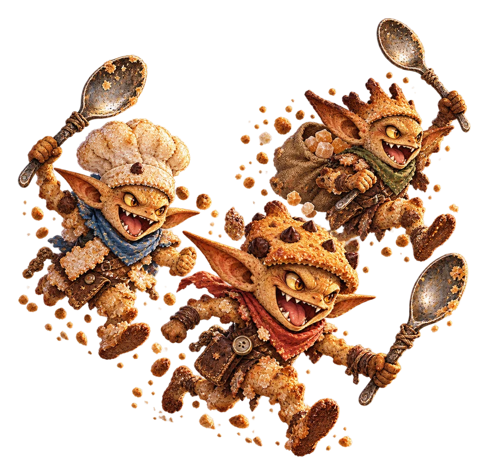

1024×995; 364.1 KiB. Attempt 1.

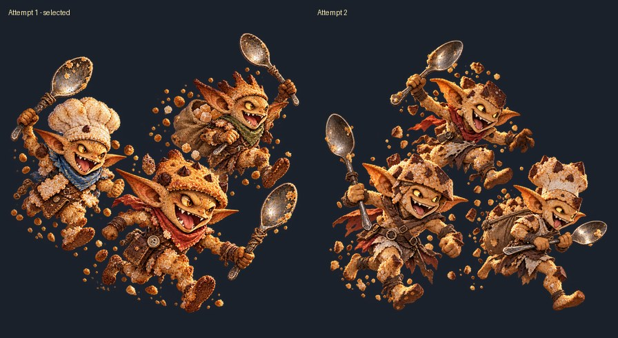

Candidate 1 selected over 2 for a distinct three-member gang: white chef cap and blue, red and green scarves, sugar lumps and burnt-crumb spoons.

<details><summary>Prompt and references</summary>

```text
ART STYLE: Lush, luminous digital painting in the spirit of a premium early-2000s Japanese RPG remastered in HD. Semi-realistic, anime-influenced characters with expressive faces and stylish asymmetrical adventure outfits: layered belts, buckles, straps, zippers, one-sleeved jackets, flowing scarves. Sun-drenched tropical environments painted in rich detail: saturated turquoise seas, white sand, emerald jungle, and ancient sandstone ruins carved with softly glowing glyphs. Golden-hour sunlight, with bioluminescent blue-green motes of light drifting through the air. Cinematic, epic and adventurous, with a mischievous sense of humor: witty, characterful expressions and small comedic details hidden in the scene. Mature and cool, never babyish or chibi.

This is an isolated game sprite: render ONLY the subject on a fully transparent background (PNG with alpha). No scenery, no ground, no cast shadow, no frame. Lit from the upper left with a soft rim light, crisp readable silhouette, full body with nothing cropped and clear empty space around it.

Enemy creatures, facing right: a gang of three knee-high goblins made of biscuit crumbs, sugar crystals and burnt edges, carrying stolen spoons as weapons. Mid-dash, crumbs flying off them, cackling.

Canvas 1024x1024.  Match the attached reference's character exactly: same face, outfit, colors and weapon. Keep all bodies and props entirely inside their cells or frame. No accidental text or extra figures.

Rules: completely original designs; never imitate an existing franchise, character, creature, logo or emblem. No text, letters, numbers, logos, watermarks, signatures, borders or user interface, unless the prompt asks for glowing magic runes. Fierce and intense is great; no blood, gore or wounds. Every character is dressed for an all-ages game: modest clothing, no bare midriffs, no low necklines or cleavage, no revealing or tight-fitting costumes, and nothing sexualized in pose or proportion.
```

References: public/assets/anchors/key_art.webp, public/assets/anchors/cast_lineup.webp

</details>


### fiend_crumb_goblin / battle — approved

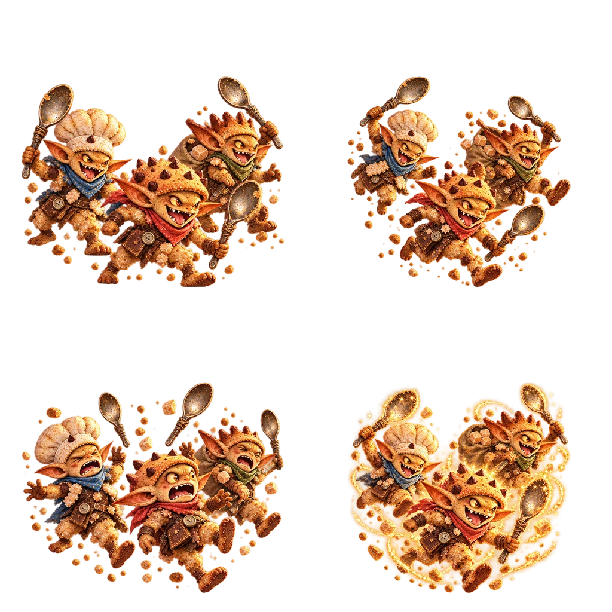

1024×1024; 375.8 KiB. Attempt 1.

Exactly three gang members in each of the four poses.

<details><summary>Prompt and references</summary>

```text
ART STYLE: Lush, luminous digital painting in the spirit of a premium early-2000s Japanese RPG remastered in HD. Semi-realistic, anime-influenced characters with expressive faces and stylish asymmetrical adventure outfits: layered belts, buckles, straps, zippers, one-sleeved jackets, flowing scarves. Sun-drenched tropical environments painted in rich detail: saturated turquoise seas, white sand, emerald jungle, and ancient sandstone ruins carved with softly glowing glyphs. Golden-hour sunlight, with bioluminescent blue-green motes of light drifting through the air. Cinematic, epic and adventurous, with a mischievous sense of humor: witty, characterful expressions and small comedic details hidden in the scene. Mature and cool, never babyish or chibi.

This is an isolated game sprite: render ONLY the subject on a fully transparent background (PNG with alpha). No scenery, no ground, no cast shadow, no frame. Lit from the upper left with a soft rim light, crisp readable silhouette, full body with nothing cropped and clear empty space around it.

Enemy creatures, facing right: a gang of three knee-high goblins made of biscuit crumbs, sugar crystals and burnt edges, carrying stolen spoons as weapons. Mid-dash, crumbs flying off them, cackling.
A sprite sheet for a 2D turn-based battle game: the SAME creature shown 4 times in a grid of 2 columns and 2 rows of equal square cells, on a fully transparent background, with no grid lines, labels or text. Full body at the same size and scale in every cell, standing on the same invisible baseline, facing RIGHT. Top row: (1) idle, menacing, (2) attacking. Bottom row: (3) hurt, recoiling, (4) special attack, glowing with power. Match the attached creature reference exactly.

Canvas 1024x1024. The attached guide image is a construction drawing: use it only for layout (where the floor, horizon, characters or cells are). Do not reproduce any of its lines, colors, shapes, labels or text. Match the attached reference's character exactly: same face, outfit, colors and weapon. Keep all bodies and props entirely inside their cells or frame. No accidental text or extra figures.

Rules: completely original designs; never imitate an existing franchise, character, creature, logo or emblem. No text, letters, numbers, logos, watermarks, signatures, borders or user interface, unless the prompt asks for glowing magic runes. Fierce and intense is great; no blood, gore or wounds. Every character is dressed for an all-ages game: modest clothing, no bare midriffs, no low necklines or cleavage, no revealing or tight-fitting costumes, and nothing sexualized in pose or proportion.
```

References: public/assets/anchors/key_art.webp, public/assets/anchors/cast_lineup.webp, public/assets/fiends/fiend_crumb_goblin/base.webp, art/guides/creature_sheet_2x2.png

</details>


### fiend_riptide_eel / base — approved

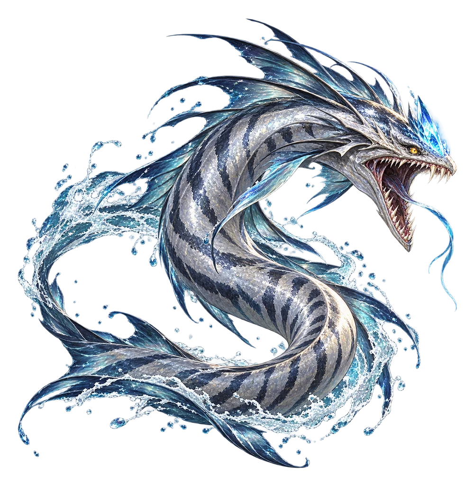

1002×1024; 370.6 KiB. Attempt 2.

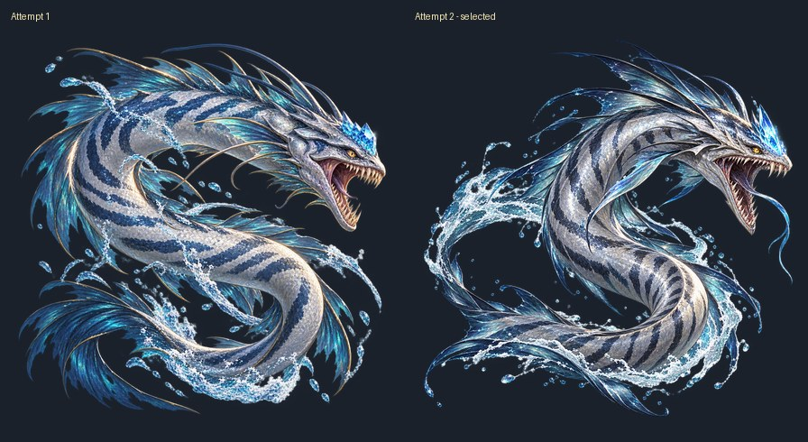

Candidate 2 selected for lean silver stripe, coiled blue fin and crystal brow.

<details><summary>Prompt and references</summary>

```text
ART STYLE: Lush, luminous digital painting in the spirit of a premium early-2000s Japanese RPG remastered in HD. Semi-realistic, anime-influenced characters with expressive faces and stylish asymmetrical adventure outfits: layered belts, buckles, straps, zippers, one-sleeved jackets, flowing scarves. Sun-drenched tropical environments painted in rich detail: saturated turquoise seas, white sand, emerald jungle, and ancient sandstone ruins carved with softly glowing glyphs. Golden-hour sunlight, with bioluminescent blue-green motes of light drifting through the air. Cinematic, epic and adventurous, with a mischievous sense of humor: witty, characterful expressions and small comedic details hidden in the scene. Mature and cool, never babyish or chibi.

This is an isolated game sprite: render ONLY the subject on a fully transparent background (PNG with alpha). No scenery, no ground, no cast shadow, no frame. Lit from the upper left with a soft rim light, crisp readable silhouette, full body with nothing cropped and clear empty space around it.

An enemy creature, facing right: a lean silver eel as long as a rowboat, striped like a tide chart, with a crystal glint on its brow, coiling fast out of dark water, fins swept back with speed.

Canvas 1024x1024.  Match the attached reference's character exactly: same face, outfit, colors and weapon. Keep all bodies and props entirely inside their cells or frame. No accidental text or extra figures.

Rules: completely original designs; never imitate an existing franchise, character, creature, logo or emblem. No text, letters, numbers, logos, watermarks, signatures, borders or user interface, unless the prompt asks for glowing magic runes. Fierce and intense is great; no blood, gore or wounds. Every character is dressed for an all-ages game: modest clothing, no bare midriffs, no low necklines or cleavage, no revealing or tight-fitting costumes, and nothing sexualized in pose or proportion.
```

References: public/assets/anchors/key_art.webp, public/assets/anchors/cast_lineup.webp

</details>


### fiend_riptide_eel / battle — approved


1024×1024; 442.2 KiB. Attempt 1.


<details><summary>Prompt and references</summary>

```text
ART STYLE: Lush, luminous digital painting in the spirit of a premium early-2000s Japanese RPG remastered in HD. Semi-realistic, anime-influenced characters with expressive faces and stylish asymmetrical adventure outfits: layered belts, buckles, straps, zippers, one-sleeved jackets, flowing scarves. Sun-drenched tropical environments painted in rich detail: saturated turquoise seas, white sand, emerald jungle, and ancient sandstone ruins carved with softly glowing glyphs. Golden-hour sunlight, with bioluminescent blue-green motes of light drifting through the air. Cinematic, epic and adventurous, with a mischievous sense of humor: witty, characterful expressions and small comedic details hidden in the scene. Mature and cool, never babyish or chibi.

This is an isolated game sprite: render ONLY the subject on a fully transparent background (PNG with alpha). No scenery, no ground, no cast shadow, no frame. Lit from the upper left with a soft rim light, crisp readable silhouette, full body with nothing cropped and clear empty space around it.

An enemy creature, facing right: a lean silver eel as long as a rowboat, striped like a tide chart, with a crystal glint on its brow, coiling fast out of dark water, fins swept back with speed.
A sprite sheet for a 2D turn-based battle game: the SAME creature shown 4 times in a grid of 2 columns and 2 rows of equal square cells, on a fully transparent background, with no grid lines, labels or text. Full body at the same size and scale in every cell, standing on the same invisible baseline, facing RIGHT. Top row: (1) idle, menacing, (2) attacking. Bottom row: (3) hurt, recoiling, (4) special attack, glowing with power. Match the attached creature reference exactly.

Canvas 1024x1024. The attached guide image is a construction drawing: use it only for layout (where the floor, horizon, characters or cells are). Do not reproduce any of its lines, colors, shapes, labels or text. Match the attached reference's character exactly: same face, outfit, colors and weapon. Keep all bodies and props entirely inside their cells or frame. No accidental text or extra figures.

Rules: completely original designs; never imitate an existing franchise, character, creature, logo or emblem. No text, letters, numbers, logos, watermarks, signatures, borders or user interface, unless the prompt asks for glowing magic runes. Fierce and intense is great; no blood, gore or wounds. Every character is dressed for an all-ages game: modest clothing, no bare midriffs, no low necklines or cleavage, no revealing or tight-fitting costumes, and nothing sexualized in pose or proportion.
```

References: public/assets/anchors/key_art.webp, public/assets/anchors/cast_lineup.webp, public/assets/fiends/fiend_riptide_eel/base.webp, art/guides/creature_sheet_2x2.png

</details>


### fiend_caged_drone / base — approved


1024×1024; 284.5 KiB. Attempt 2.


Candidate 2 selected for prominent belly cage and frightened blue creature behind bars.

<details><summary>Prompt and references</summary>

```text
ART STYLE: Lush, luminous digital painting in the spirit of a premium early-2000s Japanese RPG remastered in HD. Semi-realistic, anime-influenced characters with expressive faces and stylish asymmetrical adventure outfits: layered belts, buckles, straps, zippers, one-sleeved jackets, flowing scarves. Sun-drenched tropical environments painted in rich detail: saturated turquoise seas, white sand, emerald jungle, and ancient sandstone ruins carved with softly glowing glyphs. Golden-hour sunlight, with bioluminescent blue-green motes of light drifting through the air. Cinematic, epic and adventurous, with a mischievous sense of humor: witty, characterful expressions and small comedic details hidden in the scene. Mature and cool, never babyish or chibi.

This is an isolated game sprite: render ONLY the subject on a fully transparent background (PNG with alpha). No scenery, no ground, no cast shadow, no frame. Lit from the upper left with a soft rim light, crisp readable silhouette, full body with nothing cropped and clear empty space around it.

An enemy war machine of an evil empire, facing right: the same wedge-shaped gunmetal and crimson drone as the reference, but its belly holds a small iron cage, and inside it a small frightened glowing creature presses against the bars.

Canvas 1024x1024.  Match the attached reference's character exactly: same face, outfit, colors and weapon. Keep all bodies and props entirely inside their cells or frame. No accidental text or extra figures.

Rules: completely original designs; never imitate an existing franchise, character, creature, logo or emblem. No text, letters, numbers, logos, watermarks, signatures, borders or user interface, unless the prompt asks for glowing magic runes. Fierce and intense is great; no blood, gore or wounds. Every character is dressed for an all-ages game: modest clothing, no bare midriffs, no low necklines or cleavage, no revealing or tight-fitting costumes, and nothing sexualized in pose or proportion.
```

References: public/assets/anchors/key_art.webp, public/assets/anchors/cast_lineup.webp, public/assets/fiends/fiend_dominion_drone/base.webp

</details>


### fiend_caged_drone / battle — approved


1024×1024; 312.8 KiB. Attempt 2.

Second attempt contains red bolt tips and retains the captive in every pose.

<details><summary>Prompt and references</summary>

```text
ART STYLE: Lush, luminous digital painting in the spirit of a premium early-2000s Japanese RPG remastered in HD. Semi-realistic, anime-influenced characters with expressive faces and stylish asymmetrical adventure outfits: layered belts, buckles, straps, zippers, one-sleeved jackets, flowing scarves. Sun-drenched tropical environments painted in rich detail: saturated turquoise seas, white sand, emerald jungle, and ancient sandstone ruins carved with softly glowing glyphs. Golden-hour sunlight, with bioluminescent blue-green motes of light drifting through the air. Cinematic, epic and adventurous, with a mischievous sense of humor: witty, characterful expressions and small comedic details hidden in the scene. Mature and cool, never babyish or chibi.

This is an isolated game sprite: render ONLY the subject on a fully transparent background (PNG with alpha). No scenery, no ground, no cast shadow, no frame. Lit from the upper left with a soft rim light, crisp readable silhouette, full body with nothing cropped and clear empty space around it.

An enemy war machine of an evil empire, facing right: the same wedge-shaped gunmetal and crimson drone as the reference, but its belly holds a small iron cage, and inside it a small frightened glowing creature presses against the bars.
A sprite sheet for a 2D turn-based battle game: the SAME creature shown 4 times in a grid of 2 columns and 2 rows of equal square cells, on a fully transparent background, with no grid lines, labels or text. Full body at the same size and scale in every cell, standing on the same invisible baseline, facing RIGHT. Top row: (1) idle, menacing, (2) attacking. Bottom row: (3) hurt, recoiling, (4) special attack, glowing with power. Match the attached creature reference exactly.

Canvas 1024x1024. The attached guide image is a construction drawing: use it only for layout (where the floor, horizon, characters or cells are). Do not reproduce any of its lines, colors, shapes, labels or text. Match the attached reference's character exactly: same face, outfit, colors and weapon. Keep all bodies and props entirely inside their cells or frame. No accidental text or extra figures.

Rules: completely original designs; never imitate an existing franchise, character, creature, logo or emblem. No text, letters, numbers, logos, watermarks, signatures, borders or user interface, unless the prompt asks for glowing magic runes. Fierce and intense is great; no blood, gore or wounds. Every character is dressed for an all-ages game: modest clothing, no bare midriffs, no low necklines or cleavage, no revealing or tight-fitting costumes, and nothing sexualized in pose or proportion.
```

References: public/assets/anchors/key_art.webp, public/assets/anchors/cast_lineup.webp, public/assets/fiends/fiend_caged_drone/base.webp, art/guides/creature_sheet_2x2.png

</details>


## Section E


### boss_drain_engine / base — approved


1024×891; 354.0 KiB. Attempt 3.


Third attempt selected with six distinct feet, separately mounted clamp, three glowing back tanks and Clamp's glass cockpit.

<details><summary>Prompt and references</summary>

```text
ART STYLE: Lush, luminous digital painting in the spirit of a premium early-2000s Japanese RPG remastered in HD. Semi-realistic, anime-influenced characters with expressive faces and stylish asymmetrical adventure outfits: layered belts, buckles, straps, zippers, one-sleeved jackets, flowing scarves. Sun-drenched tropical environments painted in rich detail: saturated turquoise seas, white sand, emerald jungle, and ancient sandstone ruins carved with softly glowing glyphs. Golden-hour sunlight, with bioluminescent blue-green motes of light drifting through the air. Cinematic, epic and adventurous, with a mischievous sense of humor: witty, characterful expressions and small comedic details hidden in the scene. Mature and cool, never babyish or chibi.

This is an isolated game sprite: render ONLY the subject on a fully transparent background (PNG with alpha). No scenery, no ground, no cast shadow, no frame. Lit from the upper left with a soft rim light, crisp readable silhouette, full body with nothing cropped and clear empty space around it.

A colossal war machine of an evil iron empire, facing right: a crab-legged siphon engine the size of a building, in gunmetal and crimson, standing on six heavy iron legs. One giant clamp-claw reaches forward. Thick pipes run from the claw into a row of glass tanks on its back, glowing with stolen white-gold crystal light. A small glass cockpit sits on top, with a tall masked inspector inside holding a clipboard. Cold, industrial and menacing. Neutral menacing full-body stance.

Canvas 1024x1024.  Match the attached reference's character exactly: same face, outfit, colors and weapon. Keep all bodies and props entirely inside their cells or frame. No accidental text or extra figures.

Rules: completely original designs; never imitate an existing franchise, character, creature, logo or emblem. No text, letters, numbers, logos, watermarks, signatures, borders or user interface, unless the prompt asks for glowing magic runes. Fierce and intense is great; no blood, gore or wounds. Every character is dressed for an all-ages game: modest clothing, no bare midriffs, no low necklines or cleavage, no revealing or tight-fitting costumes, and nothing sexualized in pose or proportion.
```

References: public/assets/anchors/key_art.webp, public/assets/anchors/cast_lineup.webp, public/assets/characters/npc_clamp/base.webp

</details>


### boss_drain_engine / attack — approved


1024×956; 344.9 KiB. Attempt 2.

Second attempt selected: crouched forward lunge, nearly closed clamp and lit forward siphon tube.

<details><summary>Prompt and references</summary>

```text
ART STYLE: Lush, luminous digital painting in the spirit of a premium early-2000s Japanese RPG remastered in HD. Semi-realistic, anime-influenced characters with expressive faces and stylish asymmetrical adventure outfits: layered belts, buckles, straps, zippers, one-sleeved jackets, flowing scarves. Sun-drenched tropical environments painted in rich detail: saturated turquoise seas, white sand, emerald jungle, and ancient sandstone ruins carved with softly glowing glyphs. Golden-hour sunlight, with bioluminescent blue-green motes of light drifting through the air. Cinematic, epic and adventurous, with a mischievous sense of humor: witty, characterful expressions and small comedic details hidden in the scene. Mature and cool, never babyish or chibi.

This is an isolated game sprite: render ONLY the subject on a fully transparent background (PNG with alpha). No scenery, no ground, no cast shadow, no frame. Lit from the upper left with a soft rim light, crisp readable silhouette, full body with nothing cropped and clear empty space around it.

A colossal war machine of an evil iron empire, facing right: a crab-legged siphon engine the size of a building, in gunmetal and crimson, standing on six heavy iron legs. One giant clamp-claw reaches forward. Thick pipes run from the claw into a row of glass tanks on its back, glowing with stolen white-gold crystal light. A small glass cockpit sits on top, with a tall masked inspector inside holding a clipboard. Cold, industrial and menacing. The huge forward clamp lunges and siphons stolen light; all six legs and pipes remain on screen.

Canvas 1024x1024.  Match the attached reference's character exactly: same face, outfit, colors and weapon. Keep all bodies and props entirely inside their cells or frame. No accidental text or extra figures.

Rules: completely original designs; never imitate an existing franchise, character, creature, logo or emblem. No text, letters, numbers, logos, watermarks, signatures, borders or user interface, unless the prompt asks for glowing magic runes. Fierce and intense is great; no blood, gore or wounds. Every character is dressed for an all-ages game: modest clothing, no bare midriffs, no low necklines or cleavage, no revealing or tight-fitting costumes, and nothing sexualized in pose or proportion.
```

References: public/assets/anchors/key_art.webp, public/assets/anchors/cast_lineup.webp, public/assets/characters/npc_clamp/base.webp, public/assets/bosses/boss_drain_engine/base.webp

</details>


### boss_drain_engine / hurt — approved


1024×986; 379.2 KiB. Attempt 2.

Second attempt selected: recoil, inward-folded clamp, dim uneven tank light, steam and flustered pilot.

<details><summary>Prompt and references</summary>

```text
ART STYLE: Lush, luminous digital painting in the spirit of a premium early-2000s Japanese RPG remastered in HD. Semi-realistic, anime-influenced characters with expressive faces and stylish asymmetrical adventure outfits: layered belts, buckles, straps, zippers, one-sleeved jackets, flowing scarves. Sun-drenched tropical environments painted in rich detail: saturated turquoise seas, white sand, emerald jungle, and ancient sandstone ruins carved with softly glowing glyphs. Golden-hour sunlight, with bioluminescent blue-green motes of light drifting through the air. Cinematic, epic and adventurous, with a mischievous sense of humor: witty, characterful expressions and small comedic details hidden in the scene. Mature and cool, never babyish or chibi.

This is an isolated game sprite: render ONLY the subject on a fully transparent background (PNG with alpha). No scenery, no ground, no cast shadow, no frame. Lit from the upper left with a soft rim light, crisp readable silhouette, full body with nothing cropped and clear empty space around it.

A colossal war machine of an evil iron empire, facing right: a crab-legged siphon engine the size of a building, in gunmetal and crimson, standing on six heavy iron legs. One giant clamp-claw reaches forward. Thick pipes run from the claw into a row of glass tanks on its back, glowing with stolen white-gold crystal light. A small glass cockpit sits on top, with a tall masked inspector inside holding a clipboard. Cold, industrial and menacing. Recoiling, tanks flicker, no wreckage or injuries.

Canvas 1024x1024.  Match the attached reference's character exactly: same face, outfit, colors and weapon. Keep all bodies and props entirely inside their cells or frame. No accidental text or extra figures.

Rules: completely original designs; never imitate an existing franchise, character, creature, logo or emblem. No text, letters, numbers, logos, watermarks, signatures, borders or user interface, unless the prompt asks for glowing magic runes. Fierce and intense is great; no blood, gore or wounds. Every character is dressed for an all-ages game: modest clothing, no bare midriffs, no low necklines or cleavage, no revealing or tight-fitting costumes, and nothing sexualized in pose or proportion.
```

References: public/assets/anchors/key_art.webp, public/assets/anchors/cast_lineup.webp, public/assets/characters/npc_clamp/base.webp, public/assets/bosses/boss_drain_engine/base.webp

</details>


### boss_drain_engine / enraged — approved


1022×1024; 373.6 KiB. Attempt 2.

Second attempt selected: raised open clamp, braced feet and intense white-gold tanks.

<details><summary>Prompt and references</summary>

```text
ART STYLE: Lush, luminous digital painting in the spirit of a premium early-2000s Japanese RPG remastered in HD. Semi-realistic, anime-influenced characters with expressive faces and stylish asymmetrical adventure outfits: layered belts, buckles, straps, zippers, one-sleeved jackets, flowing scarves. Sun-drenched tropical environments painted in rich detail: saturated turquoise seas, white sand, emerald jungle, and ancient sandstone ruins carved with softly glowing glyphs. Golden-hour sunlight, with bioluminescent blue-green motes of light drifting through the air. Cinematic, epic and adventurous, with a mischievous sense of humor: witty, characterful expressions and small comedic details hidden in the scene. Mature and cool, never babyish or chibi.

This is an isolated game sprite: render ONLY the subject on a fully transparent background (PNG with alpha). No scenery, no ground, no cast shadow, no frame. Lit from the upper left with a soft rim light, crisp readable silhouette, full body with nothing cropped and clear empty space around it.

A colossal war machine of an evil iron empire, facing right: a crab-legged siphon engine the size of a building, in gunmetal and crimson, standing on six heavy iron legs. One giant clamp-claw reaches forward. Thick pipes run from the claw into a row of glass tanks on its back, glowing with stolen white-gold crystal light. A small glass cockpit sits on top, with a tall masked inspector inside holding a clipboard. Cold, industrial and menacing. Tanks flare with stolen white-gold light, legs spread aggressively; exactly six legs, whole claw.

Canvas 1024x1024.  Match the attached reference's character exactly: same face, outfit, colors and weapon. Keep all bodies and props entirely inside their cells or frame. No accidental text or extra figures.

Rules: completely original designs; never imitate an existing franchise, character, creature, logo or emblem. No text, letters, numbers, logos, watermarks, signatures, borders or user interface, unless the prompt asks for glowing magic runes. Fierce and intense is great; no blood, gore or wounds. Every character is dressed for an all-ages game: modest clothing, no bare midriffs, no low necklines or cleavage, no revealing or tight-fitting costumes, and nothing sexualized in pose or proportion.
```

References: public/assets/anchors/key_art.webp, public/assets/anchors/cast_lineup.webp, public/assets/characters/npc_clamp/base.webp, public/assets/bosses/boss_drain_engine/base.webp

</details>


### boss_drain_engine / portrait — approved


1024×1024; 389.6 KiB. Attempt 2.

- FLAG: Source opacity reaches canvas edge; inspect crop

Second attempt selected as head/cockpit framing. Source opacity at cropped lower tank/cockpit edges is intentional portrait framing.

<details><summary>Prompt and references</summary>

```text
ART STYLE: Lush, luminous digital painting in the spirit of a premium early-2000s Japanese RPG remastered in HD. Semi-realistic, anime-influenced characters with expressive faces and stylish asymmetrical adventure outfits: layered belts, buckles, straps, zippers, one-sleeved jackets, flowing scarves. Sun-drenched tropical environments painted in rich detail: saturated turquoise seas, white sand, emerald jungle, and ancient sandstone ruins carved with softly glowing glyphs. Golden-hour sunlight, with bioluminescent blue-green motes of light drifting through the air. Cinematic, epic and adventurous, with a mischievous sense of humor: witty, characterful expressions and small comedic details hidden in the scene. Mature and cool, never babyish or chibi.

This is an isolated game sprite: render ONLY the subject on a fully transparent background (PNG with alpha). No scenery, no ground, no cast shadow, no frame. Lit from the upper left with a soft rim light, crisp readable silhouette, full body with nothing cropped and clear empty space around it.

A colossal war machine of an evil iron empire, facing right: a crab-legged siphon engine the size of a building, in gunmetal and crimson, standing on six heavy iron legs. One giant clamp-claw reaches forward. Thick pipes run from the claw into a row of glass tanks on its back, glowing with stolen white-gold crystal light. A small glass cockpit sits on top, with a tall masked inspector inside holding a clipboard. Cold, industrial and menacing. Head-and-cockpit portrait, inspector visible, facing three-quarters right; no giant body needed.

Canvas 1024x1024. The attached guide image is a construction drawing: use it only for layout (where the floor, horizon, characters or cells are). Do not reproduce any of its lines, colors, shapes, labels or text. Match the attached reference's character exactly: same face, outfit, colors and weapon. Keep all bodies and props entirely inside their cells or frame. No accidental text or extra figures.

Rules: completely original designs; never imitate an existing franchise, character, creature, logo or emblem. No text, letters, numbers, logos, watermarks, signatures, borders or user interface, unless the prompt asks for glowing magic runes. Fierce and intense is great; no blood, gore or wounds. Every character is dressed for an all-ages game: modest clothing, no bare midriffs, no low necklines or cleavage, no revealing or tight-fitting costumes, and nothing sexualized in pose or proportion.
```

References: public/assets/anchors/key_art.webp, public/assets/anchors/cast_lineup.webp, public/assets/characters/npc_clamp/base.webp, public/assets/bosses/boss_drain_engine/base.webp, art/guides/portrait.png

</details>


## Section F


### titan_beaconwing / base — approved


740×1024; 289.8 KiB. Attempt 3.


Third attempt selected with contained eye beams and no ambient haze. Alpha checked on raw margins and processed output; native preview RGB backdrop is not part of the exported sprite.

<details><summary>Prompt and references</summary>

```text
ART STYLE: Lush, luminous digital painting in the spirit of a premium early-2000s Japanese RPG remastered in HD. Semi-realistic, anime-influenced characters with expressive faces and stylish asymmetrical adventure outfits: layered belts, buckles, straps, zippers, one-sleeved jackets, flowing scarves. Sun-drenched tropical environments painted in rich detail: saturated turquoise seas, white sand, emerald jungle, and ancient sandstone ruins carved with softly glowing glyphs. Golden-hour sunlight, with bioluminescent blue-green motes of light drifting through the air. Cinematic, epic and adventurous, with a mischievous sense of humor: witty, characterful expressions and small comedic details hidden in the scene. Mature and cool, never babyish or chibi.

This is an isolated game sprite: render ONLY the subject on a fully transparent background (PNG with alpha). No scenery, no ground, no cast shadow, no frame. Lit from the upper left with a soft rim light, crisp readable silhouette, full body with nothing cropped and clear empty space around it.

A colossal titan, facing right: a thunderbird as big as a lighthouse, made of storm and lamplight. Its feathers are tiers of lens-glass prisms throwing beams of white-gold light; a storm-violet glow runs through its wings; lightning crackles along the edges of its wings; a crystal lamp burns in its chest; its eyes are two sweeping lighthouse beams. Majestic, wild and kind. Full body, folded or partially opened wings, all feathers and tail inside the portrait frame.

Canvas 1024x1536.  Match the attached reference's character exactly: same face, outfit, colors and weapon. Keep all bodies and props entirely inside their cells or frame. No accidental text or extra figures.

Rules: completely original designs; never imitate an existing franchise, character, creature, logo or emblem. No text, letters, numbers, logos, watermarks, signatures, borders or user interface, unless the prompt asks for glowing magic runes. Fierce and intense is great; no blood, gore or wounds. Every character is dressed for an all-ages game: modest clothing, no bare midriffs, no low necklines or cleavage, no revealing or tight-fitting costumes, and nothing sexualized in pose or proportion.
```

References: public/assets/anchors/key_art.webp, public/assets/anchors/cast_lineup.webp

</details>


### titan_beaconwing / roar — approved


1020×958; 357.1 KiB. Attempt 2.

Second attempt selected: complete wings, tail and claws, open beak and contained light.

<details><summary>Prompt and references</summary>

```text
ART STYLE: Lush, luminous digital painting in the spirit of a premium early-2000s Japanese RPG remastered in HD. Semi-realistic, anime-influenced characters with expressive faces and stylish asymmetrical adventure outfits: layered belts, buckles, straps, zippers, one-sleeved jackets, flowing scarves. Sun-drenched tropical environments painted in rich detail: saturated turquoise seas, white sand, emerald jungle, and ancient sandstone ruins carved with softly glowing glyphs. Golden-hour sunlight, with bioluminescent blue-green motes of light drifting through the air. Cinematic, epic and adventurous, with a mischievous sense of humor: witty, characterful expressions and small comedic details hidden in the scene. Mature and cool, never babyish or chibi.

This is an isolated game sprite: render ONLY the subject on a fully transparent background (PNG with alpha). No scenery, no ground, no cast shadow, no frame. Lit from the upper left with a soft rim light, crisp readable silhouette, full body with nothing cropped and clear empty space around it.

A colossal titan, facing right: a thunderbird as big as a lighthouse, made of storm and lamplight. Its feathers are tiers of lens-glass prisms throwing beams of white-gold light; a storm-violet glow runs through its wings; lightning crackles along the edges of its wings; a crystal lamp burns in its chest; its eyes are two sweeping lighthouse beams. Majestic, wild and kind. Full body with wings spread, beak open in a majestic cry. Entire wing tips and tail inside canvas.

Canvas 1024x1024.  Match the attached reference's character exactly: same face, outfit, colors and weapon. Keep all bodies and props entirely inside their cells or frame. No accidental text or extra figures.

Rules: completely original designs; never imitate an existing franchise, character, creature, logo or emblem. No text, letters, numbers, logos, watermarks, signatures, borders or user interface, unless the prompt asks for glowing magic runes. Fierce and intense is great; no blood, gore or wounds. Every character is dressed for an all-ages game: modest clothing, no bare midriffs, no low necklines or cleavage, no revealing or tight-fitting costumes, and nothing sexualized in pose or proportion.
```

References: public/assets/anchors/key_art.webp, public/assets/anchors/cast_lineup.webp, public/assets/titans/titan_beaconwing/base.webp

</details>


### titan_beaconwing / attack — approved


1014×961; 353.4 KiB. Attempt 2.

Second attempt selected: complete wings and short contained golden fan beams.

<details><summary>Prompt and references</summary>

```text
ART STYLE: Lush, luminous digital painting in the spirit of a premium early-2000s Japanese RPG remastered in HD. Semi-realistic, anime-influenced characters with expressive faces and stylish asymmetrical adventure outfits: layered belts, buckles, straps, zippers, one-sleeved jackets, flowing scarves. Sun-drenched tropical environments painted in rich detail: saturated turquoise seas, white sand, emerald jungle, and ancient sandstone ruins carved with softly glowing glyphs. Golden-hour sunlight, with bioluminescent blue-green motes of light drifting through the air. Cinematic, epic and adventurous, with a mischievous sense of humor: witty, characterful expressions and small comedic details hidden in the scene. Mature and cool, never babyish or chibi.

This is an isolated game sprite: render ONLY the subject on a fully transparent background (PNG with alpha). No scenery, no ground, no cast shadow, no frame. Lit from the upper left with a soft rim light, crisp readable silhouette, full body with nothing cropped and clear empty space around it.

A colossal titan, facing right: a thunderbird as big as a lighthouse, made of storm and lamplight. Its feathers are tiers of lens-glass prisms throwing beams of white-gold light; a storm-violet glow runs through its wings; lightning crackles along the edges of its wings; a crystal lamp burns in its chest; its eyes are two sweeping lighthouse beams. Majestic, wild and kind. Full body sweeping white-gold lighthouse beams from its chest and eyes. Beams fan and end in radiant motes INSIDE the frame, no hard cutoff. Entire wings and tail visible.

Canvas 1024x1024.  Match the attached reference's character exactly: same face, outfit, colors and weapon. Keep all bodies and props entirely inside their cells or frame. No accidental text or extra figures.

Rules: completely original designs; never imitate an existing franchise, character, creature, logo or emblem. No text, letters, numbers, logos, watermarks, signatures, borders or user interface, unless the prompt asks for glowing magic runes. Fierce and intense is great; no blood, gore or wounds. Every character is dressed for an all-ages game: modest clothing, no bare midriffs, no low necklines or cleavage, no revealing or tight-fitting costumes, and nothing sexualized in pose or proportion.
```

References: public/assets/anchors/key_art.webp, public/assets/anchors/cast_lineup.webp, public/assets/titans/titan_beaconwing/base.webp

</details>


## Section G


### scene_harbor / base — approved


1536×1024; 447.7 KiB. Attempt 2.


Attempt 2 selected after three tries. Tower remains larger and higher than construction guide; measured final painting boxes are supplied for review.

<details><summary>Prompt and references</summary>

```text
ART STYLE: Lush, luminous digital painting in the spirit of a premium early-2000s Japanese RPG remastered in HD. Semi-realistic, anime-influenced characters with expressive faces and stylish asymmetrical adventure outfits: layered belts, buckles, straps, zippers, one-sleeved jackets, flowing scarves. Sun-drenched tropical environments painted in rich detail: saturated turquoise seas, white sand, emerald jungle, and ancient sandstone ruins carved with softly glowing glyphs. Golden-hour sunlight, with bioluminescent blue-green motes of light drifting through the air. Cinematic, epic and adventurous, with a mischievous sense of humor: witty, characterful expressions and small comedic details hidden in the scene. Mature and cool, never babyish or chibi.

This is a background painting for a 2D game: no characters or creatures unless the prompt asks for them, no user interface. Rich depth, clear foreground, midground and background.

late morning. A pirate port built from shipwrecks: hulls for roofs, masts for lampposts. A bell tower with silent bells and a clock face whose hands are scrambled. Jumble's ghost galleon *Misspelled* moored at one end, Clamp's small gunmetal Dominion cutter at the other. Honest Hal's shop front, the Salty Biscuit's sign, the dock leading off. Too quiet: laundry hanging still, nobody about.. One unified painterly exploration scene with all objects PAINTED IN, starting state. No foreground people; game draws them. A rest crystal and a tiny hidden three-eyed monkey. Keep walkable floor and character slots empty. Match the attached construction guide objects and their sizes, with figures at the 1.6x painted scale.
Layout pixel boxes: {"water": {"kind": "backdrop", "label": "harbor water: galleon left, Clamp's cutter right", "box": [893, 355, 1250, 632], "ground": null}, "hal": {"kind": "object", "label": "Honest Hal's shop front + door", "box": [164, 485, 336, 673], "ground": [250, 673]}, "tower": {"kind": "object", "label": "bell tower + clock face", "box": [551, 358, 682, 664], "ground": [616, 664]}, "tideboard": {"kind": "object", "label": "tide board, BLANK", "box": [819, 587, 895, 695], "ground": [857, 695]}, "biscuit": {"kind": "object", "label": "Salty Biscuit front + sign, BLANK", "box": [1164, 485, 1336, 673], "ground": [1250, 673]}, "rest": {"kind": "rest", "label": "rest crystal", "box": [1027, 593, 1081, 682], "ground": [1054, 682]}, "monkey": {"kind": "keep", "label": "keep clear: monkey", "box": [591, 442, 641, 499], "ground": [616, 655]}}

Canvas 1536x1024. The attached guide image is a construction drawing: use it only for layout (where the floor, horizon, characters or cells are). Do not reproduce any of its lines, colors, shapes, labels or text. Keep all bodies and props entirely inside their cells or frame. No accidental text or extra figures.

Rules: completely original designs; never imitate an existing franchise, character, creature, logo or emblem. No text, letters, numbers, logos, watermarks, signatures, borders or user interface, unless the prompt asks for glowing magic runes. Fierce and intense is great; no blood, gore or wounds. Every character is dressed for an all-ages game: modest clothing, no bare midriffs, no low necklines or cleavage, no revealing or tight-fitting costumes, and nothing sexualized in pose or proportion.
```

References: public/assets/anchors/key_art.webp, public/assets/anchors/cast_lineup.webp, public/assets/characters/mascot_monkey/base.webp, public/assets/scenes/story_ending.webp, public/assets/scenes/story_galleon.webp, art/guides/explore_harbor.png

</details>


### scene_harbor / clock_fixed — approved


1536×1024; 462.5 KiB. Attempt 1.


<details><summary>Prompt and references</summary>

```text
ART STYLE: Lush, luminous digital painting in the spirit of a premium early-2000s Japanese RPG remastered in HD. Semi-realistic, anime-influenced characters with expressive faces and stylish asymmetrical adventure outfits: layered belts, buckles, straps, zippers, one-sleeved jackets, flowing scarves. Sun-drenched tropical environments painted in rich detail: saturated turquoise seas, white sand, emerald jungle, and ancient sandstone ruins carved with softly glowing glyphs. Golden-hour sunlight, with bioluminescent blue-green motes of light drifting through the air. Cinematic, epic and adventurous, with a mischievous sense of humor: witty, characterful expressions and small comedic details hidden in the scene. Mature and cool, never babyish or chibi.

This is a background painting for a 2D game: no characters or creatures unless the prompt asks for them, no user interface. Rich depth, clear foreground, midground and background.

EDIT the attached base painting. Change ONLY this state: Set the clock hands correctly, with no readable numbers. Preserve camera, layout, every other object, colors and geometry pixel for pixel. No other repainting.

Canvas 1536x1024.  Keep all bodies and props entirely inside their cells or frame. No accidental text or extra figures.
On the clock face only, remove any extra erratic hand and set exactly two straight hands to a clean sensible time: one toward the top, one toward the right. No numerals. All buildings, boats, rest crystal, tide board, weather and lighting unchanged.
REFERENCE ROLES: the FIRST input image is the only painting to EDIT. The following style anchors are style references only: do not copy their characters, scenery or composition. Preserve the first image's complete scene; make only the specified state change. No new heroes or characters except ordinary townspeople explicitly requested for remembered.

Rules: completely original designs; never imitate an existing franchise, character, creature, logo or emblem. No text, letters, numbers, logos, watermarks, signatures, borders or user interface, unless the prompt asks for glowing magic runes. Fierce and intense is great; no blood, gore or wounds. Every character is dressed for an all-ages game: modest clothing, no bare midriffs, no low necklines or cleavage, no revealing or tight-fitting costumes, and nothing sexualized in pose or proportion.
```

References: public/assets/scenes/explore/scene_harbor.webp, public/assets/anchors/key_art.webp, public/assets/anchors/cast_lineup.webp

</details>


### scene_harbor / remembered — approved


1536×1024; 462.0 KiB. Attempt 2.


<details><summary>Prompt and references</summary>

```text
ART STYLE: Lush, luminous digital painting in the spirit of a premium early-2000s Japanese RPG remastered in HD. Semi-realistic, anime-influenced characters with expressive faces and stylish asymmetrical adventure outfits: layered belts, buckles, straps, zippers, one-sleeved jackets, flowing scarves. Sun-drenched tropical environments painted in rich detail: saturated turquoise seas, white sand, emerald jungle, and ancient sandstone ruins carved with softly glowing glyphs. Golden-hour sunlight, with bioluminescent blue-green motes of light drifting through the air. Cinematic, epic and adventurous, with a mischievous sense of humor: witty, characterful expressions and small comedic details hidden in the scene. Mature and cool, never babyish or chibi.

This is a background painting for a 2D game: no characters or creatures unless the prompt asks for them, no user interface. Rich depth, clear foreground, midground and background.

EDIT the attached base painting. Change ONLY this state: Bells swinging, townspeople outside in modest all-ages clothes, bunting up. Preserve camera, layout, every other object, colors and geometry pixel for pixel. No other repainting.

Canvas 1536x1024.  Keep all bodies and props entirely inside their cells or frame. No accidental text or extra figures.
REFERENCE ROLES: the FIRST input image is the only painting to EDIT. The following style anchors are style references only: do not copy their characters, scenery or composition. Preserve the first image's complete scene; make only the specified state change. No new heroes or characters except ordinary townspeople explicitly requested for remembered.
Retain the tower's round CLOCK FACE with its exactly two corrected hands. Do not replace the clock face with a bell. Only the existing bells above/below it swing; bunting and modest townspeople appear. Keep the fixed clock and all ships, shops and crystal unchanged.

Rules: completely original designs; never imitate an existing franchise, character, creature, logo or emblem. No text, letters, numbers, logos, watermarks, signatures, borders or user interface, unless the prompt asks for glowing magic runes. Fierce and intense is great; no blood, gore or wounds. Every character is dressed for an all-ages game: modest clothing, no bare midriffs, no low necklines or cleavage, no revealing or tight-fitting costumes, and nothing sexualized in pose or proportion.
```

References: art/scenes/scene_harbor/clock_fixed.webp, public/assets/anchors/key_art.webp, public/assets/anchors/cast_lineup.webp

</details>


### scene_hal_shop / base — approved


1536×1024; 500.0 KiB. Attempt 2.


Second attempt changes only the stand's pirate hat to Kit's faded striped knitted tea cozy.

<details><summary>Prompt and references</summary>

```text
ART STYLE: Lush, luminous digital painting in the spirit of a premium early-2000s Japanese RPG remastered in HD. Semi-realistic, anime-influenced characters with expressive faces and stylish asymmetrical adventure outfits: layered belts, buckles, straps, zippers, one-sleeved jackets, flowing scarves. Sun-drenched tropical environments painted in rich detail: saturated turquoise seas, white sand, emerald jungle, and ancient sandstone ruins carved with softly glowing glyphs. Golden-hour sunlight, with bioluminescent blue-green motes of light drifting through the air. Cinematic, epic and adventurous, with a mischievous sense of humor: witty, characterful expressions and small comedic details hidden in the scene. Mature and cool, never babyish or chibi.

This is a background painting for a 2D game: no characters or creatures unless the prompt asks for them, no user interface. Rich depth, clear foreground, midground and background.

day, inside. Stacked junk, a counter, a price board (numbers drawn by the game), a weapon rack, a tea cozy on a hat stand. One unified painterly exploration scene with all objects PAINTED IN, starting state. No foreground people; game draws them. A rest crystal and a tiny hidden three-eyed monkey. Keep walkable floor and character slots empty. Match the attached construction guide objects and their sizes, with figures at the 1.6x painted scale.
Layout pixel boxes: {"board": {"kind": "object", "label": "price board on the wall, numbers BLANK", "box": [476, 522, 596, 664], "ground": [536, 664]}, "counter": {"kind": "object", "label": "shop counter", "box": [635, 568, 901, 695], "ground": [768, 695]}, "rack": {"kind": "object", "label": "weapon rack", "box": [1060, 502, 1208, 673], "ground": [1134, 673]}, "cozy": {"kind": "object", "label": "hat stand + tea cozy", "box": [1278, 588, 1347, 739], "ground": [1313, 739]}, "rest": {"kind": "rest", "label": "rest crystal", "box": [268, 593, 322, 682], "ground": [295, 682]}, "hal": {"kind": "keep", "label": "keep clear: Hal", "box": [946, 564, 1054, 704], "ground": [1000, 704]}}

Canvas 1536x1024. The attached guide image is a construction drawing: use it only for layout (where the floor, horizon, characters or cells are). Do not reproduce any of its lines, colors, shapes, labels or text. Keep all bodies and props entirely inside their cells or frame. No accidental text or extra figures.

Rules: completely original designs; never imitate an existing franchise, character, creature, logo or emblem. No text, letters, numbers, logos, watermarks, signatures, borders or user interface, unless the prompt asks for glowing magic runes. Fierce and intense is great; no blood, gore or wounds. Every character is dressed for an all-ages game: modest clothing, no bare midriffs, no low necklines or cleavage, no revealing or tight-fitting costumes, and nothing sexualized in pose or proportion.
```

References: public/assets/anchors/key_art.webp, public/assets/anchors/cast_lineup.webp, public/assets/characters/mascot_monkey/base.webp, art/guides/explore_hal_shop.png

</details>


### scene_hal_shop / cozy_sold — approved


1536×1024; 459.5 KiB. Attempt 2.


Second attempt uses the shop as primary edit target and removes cozy/scarf, retaining the empty hat stand and room.

<details><summary>Prompt and references</summary>

```text
ART STYLE: Lush, luminous digital painting in the spirit of a premium early-2000s Japanese RPG remastered in HD. Semi-realistic, anime-influenced characters with expressive faces and stylish asymmetrical adventure outfits: layered belts, buckles, straps, zippers, one-sleeved jackets, flowing scarves. Sun-drenched tropical environments painted in rich detail: saturated turquoise seas, white sand, emerald jungle, and ancient sandstone ruins carved with softly glowing glyphs. Golden-hour sunlight, with bioluminescent blue-green motes of light drifting through the air. Cinematic, epic and adventurous, with a mischievous sense of humor: witty, characterful expressions and small comedic details hidden in the scene. Mature and cool, never babyish or chibi.

This is a background painting for a 2D game: no characters or creatures unless the prompt asks for them, no user interface. Rich depth, clear foreground, midground and background.

EDIT the attached base painting. Change ONLY this state: Remove only the tea cozy; its hat stand remains empty. Preserve camera, layout, every other object, colors and geometry pixel for pixel. No other repainting.

Canvas 1536x1024.  Keep all bodies and props entirely inside their cells or frame. No accidental text or extra figures.
REFERENCE ROLES: the FIRST input image is the only painting to EDIT. The following style anchors are style references only: do not copy their characters, scenery or composition. Preserve the first image's complete scene; make only the specified state change. No new heroes or characters except ordinary townspeople explicitly requested for remembered.

Rules: completely original designs; never imitate an existing franchise, character, creature, logo or emblem. No text, letters, numbers, logos, watermarks, signatures, borders or user interface, unless the prompt asks for glowing magic runes. Fierce and intense is great; no blood, gore or wounds. Every character is dressed for an all-ages game: modest clothing, no bare midriffs, no low necklines or cleavage, no revealing or tight-fitting costumes, and nothing sexualized in pose or proportion.
```

References: public/assets/scenes/explore/scene_hal_shop.webp, public/assets/anchors/key_art.webp, public/assets/anchors/cast_lineup.webp

</details>


### scene_biscuit / base — approved


1536×1024; 416.1 KiB. Attempt 1.


<details><summary>Prompt and references</summary>

```text
ART STYLE: Lush, luminous digital painting in the spirit of a premium early-2000s Japanese RPG remastered in HD. Semi-realistic, anime-influenced characters with expressive faces and stylish asymmetrical adventure outfits: layered belts, buckles, straps, zippers, one-sleeved jackets, flowing scarves. Sun-drenched tropical environments painted in rich detail: saturated turquoise seas, white sand, emerald jungle, and ancient sandstone ruins carved with softly glowing glyphs. Golden-hour sunlight, with bioluminescent blue-green motes of light drifting through the air. Cinematic, epic and adventurous, with a mischievous sense of humor: witty, characterful expressions and small comedic details hidden in the scene. Mature and cool, never babyish or chibi.

This is a background painting for a 2D game: no characters or creatures unless the prompt asks for them, no user interface. Rich depth, clear foreground, midground and background.

day, inside. A cosy galley-kitchen café, an oven, flour sacks, a recipe book open on the counter with blank pages. One unified painterly exploration scene with all objects PAINTED IN, starting state. No foreground people; game draws them. A rest crystal and a tiny hidden three-eyed monkey. Keep walkable floor and character slots empty. Match the attached construction guide objects and their sizes, with figures at the 1.6x painted scale.
Layout pixel boxes: {"sacks": {"kind": "object", "label": "flour sacks", "box": [258, 600, 385, 695], "ground": [322, 695]}, "book": {"kind": "object", "label": "counter + recipe book, BLANK", "box": [580, 590, 813, 700], "ground": [697, 700]}, "oven": {"kind": "object", "label": "big brick oven", "box": [1077, 484, 1244, 668], "ground": [1161, 668]}, "rest": {"kind": "rest", "label": "rest crystal", "box": [1321, 595, 1376, 686], "ground": [1348, 686]}, "baker": {"kind": "keep", "label": "keep clear: baker", "box": [870, 571, 987, 722], "ground": [929, 722]}}

Canvas 1536x1024. The attached guide image is a construction drawing: use it only for layout (where the floor, horizon, characters or cells are). Do not reproduce any of its lines, colors, shapes, labels or text. Keep all bodies and props entirely inside their cells or frame. No accidental text or extra figures.

Rules: completely original designs; never imitate an existing franchise, character, creature, logo or emblem. No text, letters, numbers, logos, watermarks, signatures, borders or user interface, unless the prompt asks for glowing magic runes. Fierce and intense is great; no blood, gore or wounds. Every character is dressed for an all-ages game: modest clothing, no bare midriffs, no low necklines or cleavage, no revealing or tight-fitting costumes, and nothing sexualized in pose or proportion.
```

References: public/assets/anchors/key_art.webp, public/assets/anchors/cast_lineup.webp, public/assets/characters/mascot_monkey/base.webp, art/guides/explore_biscuit.png

</details>


### scene_biscuit / recipes_back — approved


1536×1024; 442.4 KiB. Attempt 1.


<details><summary>Prompt and references</summary>

```text
ART STYLE: Lush, luminous digital painting in the spirit of a premium early-2000s Japanese RPG remastered in HD. Semi-realistic, anime-influenced characters with expressive faces and stylish asymmetrical adventure outfits: layered belts, buckles, straps, zippers, one-sleeved jackets, flowing scarves. Sun-drenched tropical environments painted in rich detail: saturated turquoise seas, white sand, emerald jungle, and ancient sandstone ruins carved with softly glowing glyphs. Golden-hour sunlight, with bioluminescent blue-green motes of light drifting through the air. Cinematic, epic and adventurous, with a mischievous sense of humor: witty, characterful expressions and small comedic details hidden in the scene. Mature and cool, never babyish or chibi.

This is a background painting for a 2D game: no characters or creatures unless the prompt asks for them, no user interface. Rich depth, clear foreground, midground and background.

EDIT the attached base painting. Change ONLY this state: The same recipe pages now glow with abstract magical writing, no readable words. Preserve camera, layout, every other object, colors and geometry pixel for pixel. No other repainting.

Canvas 1536x1024.  Keep all bodies and props entirely inside their cells or frame. No accidental text or extra figures.
REFERENCE ROLES: the FIRST input image is the only painting to EDIT. The following style anchors are style references only: do not copy their characters, scenery or composition. Preserve the first image's complete scene; make only the specified state change. No new heroes or characters except ordinary townspeople explicitly requested for remembered.

Rules: completely original designs; never imitate an existing franchise, character, creature, logo or emblem. No text, letters, numbers, logos, watermarks, signatures, borders or user interface, unless the prompt asks for glowing magic runes. Fierce and intense is great; no blood, gore or wounds. Every character is dressed for an all-ages game: modest clothing, no bare midriffs, no low necklines or cleavage, no revealing or tight-fitting costumes, and nothing sexualized in pose or proportion.
```

References: public/assets/scenes/explore/scene_biscuit.webp, public/assets/anchors/key_art.webp, public/assets/anchors/cast_lineup.webp

</details>


### scene_sword_dock / base — approved


1536×1024; 463.1 KiB. Attempt 2.


Second attempt extinguishes the forge so dock_won has a visible lighting change. Armchair crab matches the Barnacle Brute design.

<details><summary>Prompt and references</summary>

```text
ART STYLE: Lush, luminous digital painting in the spirit of a premium early-2000s Japanese RPG remastered in HD. Semi-realistic, anime-influenced characters with expressive faces and stylish asymmetrical adventure outfits: layered belts, buckles, straps, zippers, one-sleeved jackets, flowing scarves. Sun-drenched tropical environments painted in rich detail: saturated turquoise seas, white sand, emerald jungle, and ancient sandstone ruins carved with softly glowing glyphs. Golden-hour sunlight, with bioluminescent blue-green motes of light drifting through the air. Cinematic, epic and adventurous, with a mischievous sense of humor: witty, characterful expressions and small comedic details hidden in the scene. Mature and cool, never babyish or chibi.

This is a background painting for a 2D game: no characters or creatures unless the prompt asks for them, no user interface. Rich depth, clear foreground, midground and background.

morning. A dueling platform on the water, a forge built into a ship's stove, a big crab sitting in the Sword Master's armchair. One unified painterly exploration scene with all objects PAINTED IN, starting state. No foreground people; game draws them. A rest crystal and a tiny hidden three-eyed monkey. Keep walkable floor and character slots empty. Match the attached construction guide objects and their sizes, with figures at the 1.6x painted scale.
Layout pixel boxes: {"platform": {"kind": "backdrop", "label": "dueling platform out on the water", "box": [822, 409, 1357, 632], "ground": null}, "forge": {"kind": "object", "label": "forge built into a ship's stove", "box": [316, 490, 488, 673], "ground": [402, 673]}, "chair": {"kind": "object", "label": "armchair + big crab sitting in it", "box": [705, 556, 831, 695], "ground": [768, 695]}, "rest": {"kind": "rest", "label": "rest crystal", "box": [1330, 593, 1384, 682], "ground": [1357, 682]}, "swordmaster": {"kind": "keep", "label": "keep clear: Sword Master", "box": [1082, 607, 1240, 811], "ground": [1161, 811]}}

Canvas 1536x1024. The attached guide image is a construction drawing: use it only for layout (where the floor, horizon, characters or cells are). Do not reproduce any of its lines, colors, shapes, labels or text. Keep all bodies and props entirely inside their cells or frame. No accidental text or extra figures.
The big crab in the armchair uses the attached Barnacle Brute design: barnacles and seaweed, wooden door shell with brass knocker, one huge claw and one small claw. Keep the chair/crab and unlit forge at the guide's positions, with plenty of empty walkable deck. Do not put the crab in front of the open dueling platform.

Rules: completely original designs; never imitate an existing franchise, character, creature, logo or emblem. No text, letters, numbers, logos, watermarks, signatures, borders or user interface, unless the prompt asks for glowing magic runes. Fierce and intense is great; no blood, gore or wounds. Every character is dressed for an all-ages game: modest clothing, no bare midriffs, no low necklines or cleavage, no revealing or tight-fitting costumes, and nothing sexualized in pose or proportion.
```

References: public/assets/anchors/key_art.webp, public/assets/anchors/cast_lineup.webp, public/assets/characters/mascot_monkey/base.webp, public/assets/fiends/fiend_barnacle_brute/base.webp, art/guides/explore_sword_dock.png

</details>


### scene_sword_dock / dock_won — approved


1536×1024; 496.2 KiB. Attempt 1.


<details><summary>Prompt and references</summary>

```text
ART STYLE: Lush, luminous digital painting in the spirit of a premium early-2000s Japanese RPG remastered in HD. Semi-realistic, anime-influenced characters with expressive faces and stylish asymmetrical adventure outfits: layered belts, buckles, straps, zippers, one-sleeved jackets, flowing scarves. Sun-drenched tropical environments painted in rich detail: saturated turquoise seas, white sand, emerald jungle, and ancient sandstone ruins carved with softly glowing glyphs. Golden-hour sunlight, with bioluminescent blue-green motes of light drifting through the air. Cinematic, epic and adventurous, with a mischievous sense of humor: witty, characterful expressions and small comedic details hidden in the scene. Mature and cool, never babyish or chibi.

This is a background painting for a 2D game: no characters or creatures unless the prompt asks for them, no user interface. Rich depth, clear foreground, midground and background.

EDIT the attached base painting. Change ONLY this state: The big crab is gone from the chair; the forge is lit. Preserve camera, layout, every other object, colors and geometry pixel for pixel. No other repainting.

Canvas 1536x1024.  Keep all bodies and props entirely inside their cells or frame. No accidental text or extra figures.
REFERENCE ROLES: the FIRST input image is the only painting to EDIT. The following style anchors are style references only: do not copy their characters, scenery or composition. Preserve the first image's complete scene; make only the specified state change. No new heroes or characters except ordinary townspeople explicitly requested for remembered.

Rules: completely original designs; never imitate an existing franchise, character, creature, logo or emblem. No text, letters, numbers, logos, watermarks, signatures, borders or user interface, unless the prompt asks for glowing magic runes. Fierce and intense is great; no blood, gore or wounds. Every character is dressed for an all-ages game: modest clothing, no bare midriffs, no low necklines or cleavage, no revealing or tight-fitting costumes, and nothing sexualized in pose or proportion.
```

References: public/assets/scenes/explore/scene_sword_dock.webp, public/assets/anchors/key_art.webp, public/assets/anchors/cast_lineup.webp

</details>


### scene_menagerie / base — approved


1536×1024; 468.4 KiB. Attempt 1.


<details><summary>Prompt and references</summary>

```text
ART STYLE: Lush, luminous digital painting in the spirit of a premium early-2000s Japanese RPG remastered in HD. Semi-realistic, anime-influenced characters with expressive faces and stylish asymmetrical adventure outfits: layered belts, buckles, straps, zippers, one-sleeved jackets, flowing scarves. Sun-drenched tropical environments painted in rich detail: saturated turquoise seas, white sand, emerald jungle, and ancient sandstone ruins carved with softly glowing glyphs. Golden-hour sunlight, with bioluminescent blue-green motes of light drifting through the air. Cinematic, epic and adventurous, with a mischievous sense of humor: witty, characterful expressions and small comedic details hidden in the scene. Mature and cool, never babyish or chibi.

This is a background painting for a 2D game: no characters or creatures unless the prompt asks for them, no user interface. Rich depth, clear foreground, midground and background.

afternoon, inside. The hold of a beached ship as a creature sanctuary: tanks, nests, hammocks, small rebuilt fiends asleep, warm lantern light. One unified painterly exploration scene with all objects PAINTED IN, starting state. No foreground people; game draws them. A rest crystal and a tiny hidden three-eyed monkey. Keep walkable floor and character slots empty. Match the attached construction guide objects and their sizes, with figures at the 1.6x painted scale.
Layout pixel boxes: {"hammocks": {"kind": "backdrop", "label": "hammocks + sleeping creatures in the beams", "box": [661, 302, 1375, 543], "ground": null}, "tanks": {"kind": "object", "label": "creature tanks", "box": [282, 514, 504, 677], "ground": [393, 677]}, "nests": {"kind": "object", "label": "straw nests on the floor", "box": [965, 724, 1214, 811], "ground": [1089, 811]}, "rest": {"kind": "rest", "label": "rest crystal", "box": [1330, 596, 1385, 688], "ground": [1357, 688]}, "tamsin": {"kind": "keep", "label": "keep clear: Tamsin", "box": [715, 593, 857, 775], "ground": [786, 775]}}

Canvas 1536x1024. The attached guide image is a construction drawing: use it only for layout (where the floor, horizon, characters or cells are). Do not reproduce any of its lines, colors, shapes, labels or text. Keep all bodies and props entirely inside their cells or frame. No accidental text or extra figures.
The rebuilt fiends asleep in nests, tanks and hammocks use the attached pet designs: a patched scrap raptor with blue crystal heart, brass-capped blue jelly with orange heart, friendly ink slime with gold heart, sea-glass hermit crab with violet heart. No standing or awake creatures in the clear walkable floor.

Rules: completely original designs; never imitate an existing franchise, character, creature, logo or emblem. No text, letters, numbers, logos, watermarks, signatures, borders or user interface, unless the prompt asks for glowing magic runes. Fierce and intense is great; no blood, gore or wounds. Every character is dressed for an all-ages game: modest clothing, no bare midriffs, no low necklines or cleavage, no revealing or tight-fitting costumes, and nothing sexualized in pose or proportion.
```

References: public/assets/anchors/key_art.webp, public/assets/anchors/cast_lineup.webp, public/assets/characters/mascot_monkey/base.webp, public/assets/characters/pet_raptor_1/battle.webp, public/assets/characters/pet_jelly_1/battle.webp, public/assets/characters/pet_slime_1/battle.webp, public/assets/characters/pet_tide_1/battle.webp, art/guides/explore_menagerie.png

</details>


### scene_lighthouse / base — approved


1536×1024; 476.8 KiB. Attempt 2.


Second attempt corrects barricade to gunmetal and crimson inspection panels and retains dim lamp.

<details><summary>Prompt and references</summary>

```text
ART STYLE: Lush, luminous digital painting in the spirit of a premium early-2000s Japanese RPG remastered in HD. Semi-realistic, anime-influenced characters with expressive faces and stylish asymmetrical adventure outfits: layered belts, buckles, straps, zippers, one-sleeved jackets, flowing scarves. Sun-drenched tropical environments painted in rich detail: saturated turquoise seas, white sand, emerald jungle, and ancient sandstone ruins carved with softly glowing glyphs. Golden-hour sunlight, with bioluminescent blue-green motes of light drifting through the air. Cinematic, epic and adventurous, with a mischievous sense of humor: witty, characterful expressions and small comedic details hidden in the scene. Mature and cool, never babyish or chibi.

This is a background painting for a 2D game: no characters or creatures unless the prompt asks for them, no user interface. Rich depth, clear foreground, midground and background.

dusk. The lighthouse on a rocky point, its lamp dimming, the causeway barred with a Dominion "inspection" barricade. One unified painterly exploration scene with all objects PAINTED IN, starting state. No foreground people; game draws them. A rest crystal and a tiny hidden three-eyed monkey. Keep walkable floor and character slots empty. Match the attached construction guide objects and their sizes, with figures at the 1.6x painted scale.
Layout pixel boxes: {"tower": {"kind": "object", "label": "the lighthouse, lamp dimming", "box": [914, 317, 1086, 661], "ground": [1000, 661]}, "barricade": {"kind": "object", "label": "Dominion barricade across the causeway", "box": [568, 646, 826, 775], "ground": [697, 775]}, "rest": {"kind": "rest", "label": "rest crystal", "box": [330, 593, 384, 682], "ground": [357, 682]}}

Canvas 1536x1024. The attached guide image is a construction drawing: use it only for layout (where the floor, horizon, characters or cells are). Do not reproduce any of its lines, colors, shapes, labels or text. Keep all bodies and props entirely inside their cells or frame. No accidental text or extra figures.

Rules: completely original designs; never imitate an existing franchise, character, creature, logo or emblem. No text, letters, numbers, logos, watermarks, signatures, borders or user interface, unless the prompt asks for glowing magic runes. Fierce and intense is great; no blood, gore or wounds. Every character is dressed for an all-ages game: modest clothing, no bare midriffs, no low necklines or cleavage, no revealing or tight-fitting costumes, and nothing sexualized in pose or proportion.
```

References: public/assets/anchors/key_art.webp, public/assets/anchors/cast_lineup.webp, public/assets/characters/mascot_monkey/base.webp, art/guides/explore_lighthouse.png

</details>


### scene_lighthouse / after — approved


1536×1024; 461.6 KiB. Attempt 1.


<details><summary>Prompt and references</summary>

```text
ART STYLE: Lush, luminous digital painting in the spirit of a premium early-2000s Japanese RPG remastered in HD. Semi-realistic, anime-influenced characters with expressive faces and stylish asymmetrical adventure outfits: layered belts, buckles, straps, zippers, one-sleeved jackets, flowing scarves. Sun-drenched tropical environments painted in rich detail: saturated turquoise seas, white sand, emerald jungle, and ancient sandstone ruins carved with softly glowing glyphs. Golden-hour sunlight, with bioluminescent blue-green motes of light drifting through the air. Cinematic, epic and adventurous, with a mischievous sense of humor: witty, characterful expressions and small comedic details hidden in the scene. Mature and cool, never babyish or chibi.

This is a background painting for a 2D game: no characters or creatures unless the prompt asks for them, no user interface. Rich depth, clear foreground, midground and background.

EDIT the attached base painting. Change ONLY this state: Claw marks on the lighthouse and the inspection barricade wrecked. Preserve camera, layout, every other object, colors and geometry pixel for pixel. No other repainting.

Canvas 1536x1024.  Keep all bodies and props entirely inside their cells or frame. No accidental text or extra figures.
REFERENCE ROLES: the FIRST input image is the only painting to EDIT. The following style anchors are style references only: do not copy their characters, scenery or composition. Preserve the first image's complete scene; make only the specified state change. No new heroes or characters except ordinary townspeople explicitly requested for remembered.

Rules: completely original designs; never imitate an existing franchise, character, creature, logo or emblem. No text, letters, numbers, logos, watermarks, signatures, borders or user interface, unless the prompt asks for glowing magic runes. Fierce and intense is great; no blood, gore or wounds. Every character is dressed for an all-ages game: modest clothing, no bare midriffs, no low necklines or cleavage, no revealing or tight-fitting costumes, and nothing sexualized in pose or proportion.
```

References: public/assets/scenes/explore/scene_lighthouse.webp, public/assets/anchors/key_art.webp, public/assets/anchors/cast_lineup.webp

</details>


### scene_lamp_room / base — approved


1536×1024; 492.6 KiB. Attempt 1.


<details><summary>Prompt and references</summary>

```text
ART STYLE: Lush, luminous digital painting in the spirit of a premium early-2000s Japanese RPG remastered in HD. Semi-realistic, anime-influenced characters with expressive faces and stylish asymmetrical adventure outfits: layered belts, buckles, straps, zippers, one-sleeved jackets, flowing scarves. Sun-drenched tropical environments painted in rich detail: saturated turquoise seas, white sand, emerald jungle, and ancient sandstone ruins carved with softly glowing glyphs. Golden-hour sunlight, with bioluminescent blue-green motes of light drifting through the air. Cinematic, epic and adventurous, with a mischievous sense of humor: witty, characterful expressions and small comedic details hidden in the scene. Mature and cool, never babyish or chibi.

This is a background painting for a 2D game: no characters or creatures unless the prompt asks for them, no user interface. Rich depth, clear foreground, midground and background.

night, inside. A great crystal lens, the empty cradle where the new crystal goes, the keeper's chair, a desk with a logbook. One unified painterly exploration scene with all objects PAINTED IN, starting state. No foreground people; game draws them. A rest crystal and a tiny hidden three-eyed monkey. Keep walkable floor and character slots empty. Match the attached construction guide objects and their sizes, with figures at the 1.6x painted scale.
Layout pixel boxes: {"ceiling": {"kind": "backdrop", "label": "plain dark ceiling (the grid shows here)", "box": [197, 311, 1339, 409], "ground": null}, "desk": {"kind": "object", "label": "desk + logbook", "box": [409, 587, 573, 695], "ground": [491, 695]}, "lens": {"kind": "object", "label": "great crystal lens, empty cradle in its heart", "box": [669, 423, 903, 668], "ground": [786, 668]}, "chair": {"kind": "object", "label": "chair", "box": [1001, 587, 1107, 722], "ground": [1054, 722]}, "rest": {"kind": "rest", "label": "rest crystal", "box": [241, 595, 295, 686], "ground": [268, 686]}, "keeper": {"kind": "keep", "label": "keep clear: keeper", "box": [1197, 593, 1339, 775], "ground": [1268, 775]}}

Canvas 1536x1024. The attached guide image is a construction drawing: use it only for layout (where the floor, horizon, characters or cells are). Do not reproduce any of its lines, colors, shapes, labels or text. Keep all bodies and props entirely inside their cells or frame. No accidental text or extra figures.

Rules: completely original designs; never imitate an existing franchise, character, creature, logo or emblem. No text, letters, numbers, logos, watermarks, signatures, borders or user interface, unless the prompt asks for glowing magic runes. Fierce and intense is great; no blood, gore or wounds. Every character is dressed for an all-ages game: modest clothing, no bare midriffs, no low necklines or cleavage, no revealing or tight-fitting costumes, and nothing sexualized in pose or proportion.
```

References: public/assets/anchors/key_art.webp, public/assets/anchors/cast_lineup.webp, public/assets/characters/mascot_monkey/base.webp, art/guides/explore_lamp_room.png

</details>


### scene_lamp_room / grid — approved


1536×1024; 485.2 KiB. Attempt 1.


- FLAG: Patch: significant changes reach the extraction area border; inspect before/after for drift or clipping

The measured state area spans the complete ceiling and lens. Glowing paths intentionally reach the top canvas edge; the automatic border flag is retained for review. Before/after composite checked for an interior cutoff.

<details><summary>Prompt and references</summary>

```text
ART STYLE: Lush, luminous digital painting in the spirit of a premium early-2000s Japanese RPG remastered in HD. Semi-realistic, anime-influenced characters with expressive faces and stylish asymmetrical adventure outfits: layered belts, buckles, straps, zippers, one-sleeved jackets, flowing scarves. Sun-drenched tropical environments painted in rich detail: saturated turquoise seas, white sand, emerald jungle, and ancient sandstone ruins carved with softly glowing glyphs. Golden-hour sunlight, with bioluminescent blue-green motes of light drifting through the air. Cinematic, epic and adventurous, with a mischievous sense of humor: witty, characterful expressions and small comedic details hidden in the scene. Mature and cool, never babyish or chibi.

This is a background painting for a 2D game: no characters or creatures unless the prompt asks for them, no user interface. Rich depth, clear foreground, midground and background.

EDIT the attached base painting. Change ONLY this state: The old crystal's last light is caught by the lens, throwing a web of glowing nodes and paths across the ceiling. Preserve camera, layout, every other object, colors and geometry pixel for pixel. No other repainting.

Canvas 1536x1024.  Keep all bodies and props entirely inside their cells or frame. No accidental text or extra figures.
REFERENCE ROLES: the FIRST input image is the only painting to EDIT. The following style anchors are style references only: do not copy their characters, scenery or composition. Preserve the first image's complete scene; make only the specified state change. No new heroes or characters except ordinary townspeople explicitly requested for remembered.

Rules: completely original designs; never imitate an existing franchise, character, creature, logo or emblem. No text, letters, numbers, logos, watermarks, signatures, borders or user interface, unless the prompt asks for glowing magic runes. Fierce and intense is great; no blood, gore or wounds. Every character is dressed for an all-ages game: modest clothing, no bare midriffs, no low necklines or cleavage, no revealing or tight-fitting costumes, and nothing sexualized in pose or proportion.
```

References: public/assets/scenes/explore/scene_lamp_room.webp, public/assets/anchors/key_art.webp, public/assets/anchors/cast_lineup.webp

</details>


### scene_lamp_room / lit — approved


1536×1024; 436.0 KiB. Attempt 2.


Second attempt installs the teal Lore Crystal in the central gold cradle and retains the original blue rest crystal on the left.

<details><summary>Prompt and references</summary>

```text
ART STYLE: Lush, luminous digital painting in the spirit of a premium early-2000s Japanese RPG remastered in HD. Semi-realistic, anime-influenced characters with expressive faces and stylish asymmetrical adventure outfits: layered belts, buckles, straps, zippers, one-sleeved jackets, flowing scarves. Sun-drenched tropical environments painted in rich detail: saturated turquoise seas, white sand, emerald jungle, and ancient sandstone ruins carved with softly glowing glyphs. Golden-hour sunlight, with bioluminescent blue-green motes of light drifting through the air. Cinematic, epic and adventurous, with a mischievous sense of humor: witty, characterful expressions and small comedic details hidden in the scene. Mature and cool, never babyish or chibi.

This is a background painting for a 2D game: no characters or creatures unless the prompt asks for them, no user interface. Rich depth, clear foreground, midground and background.

EDIT the attached base painting. Change ONLY this state: The new teal Lore Crystal stands in the same cradle, blazing. Preserve camera, layout, every other object, colors and geometry pixel for pixel. No other repainting.

Canvas 1536x1024.  Keep all bodies and props entirely inside their cells or frame. No accidental text or extra figures.
REFERENCE ROLES: the FIRST input image is the only painting to EDIT. The following style anchors are style references only: do not copy their characters, scenery or composition. Preserve the first image's complete scene; make only the specified state change. No new heroes or characters except ordinary townspeople explicitly requested for remembered.

The crystal must be installed INSIDE THE GREAT ROUND LENS, in the empty GOLD CLAW CRADLE at image center x850 y450. Add a large blazing teal faceted crystal standing upright between those gold claws. Leave the tall blue rest crystal on the FAR LEFT x140 y500 completely unchanged. The far-left rest crystal is NOT the new Lore Crystal. Change ONLY the center cradle and its teal light/reflections; preserve everything else.

Rules: completely original designs; never imitate an existing franchise, character, creature, logo or emblem. No text, letters, numbers, logos, watermarks, signatures, borders or user interface, unless the prompt asks for glowing magic runes. Fierce and intense is great; no blood, gore or wounds. Every character is dressed for an all-ages game: modest clothing, no bare midriffs, no low necklines or cleavage, no revealing or tight-fitting costumes, and nothing sexualized in pose or proportion.
```

References: public/assets/scenes/explore/scene_lamp_room.webp, public/assets/anchors/key_art.webp, public/assets/anchors/cast_lineup.webp

</details>


### scene_sea_cave / base — approved


1536×1024; 454.4 KiB. Attempt 1.


<details><summary>Prompt and references</summary>

```text
ART STYLE: Lush, luminous digital painting in the spirit of a premium early-2000s Japanese RPG remastered in HD. Semi-realistic, anime-influenced characters with expressive faces and stylish asymmetrical adventure outfits: layered belts, buckles, straps, zippers, one-sleeved jackets, flowing scarves. Sun-drenched tropical environments painted in rich detail: saturated turquoise seas, white sand, emerald jungle, and ancient sandstone ruins carved with softly glowing glyphs. Golden-hour sunlight, with bioluminescent blue-green motes of light drifting through the air. Cinematic, epic and adventurous, with a mischievous sense of humor: witty, characterful expressions and small comedic details hidden in the scene. Mature and cool, never babyish or chibi.

This is a background painting for a 2D game: no characters or creatures unless the prompt asks for them, no user interface. Rich depth, clear foreground, midground and background.

night. The smugglers' tunnel under the cove's old wreck, lit by glowing kelp, wet steps leading up. One unified painterly exploration scene with all objects PAINTED IN, starting state. No foreground people; game draws them. A rest crystal and a tiny hidden three-eyed monkey. Keep walkable floor and character slots empty. Match the attached construction guide objects and their sizes, with figures at the 1.6x painted scale.
Layout pixel boxes: {"kelp": {"kind": "backdrop", "label": "glowing kelp on the cave walls", "box": [286, 311, 1268, 570], "ground": null}, "chest": {"kind": "object", "label": "small old chest", "box": [601, 681, 721, 775], "ground": [661, 775]}, "steps": {"kind": "object", "label": "wet stone steps going up", "box": [1172, 491, 1328, 682], "ground": [1250, 682]}, "rest": {"kind": "rest", "label": "rest crystal", "box": [937, 596, 992, 688], "ground": [964, 688]}}

Canvas 1536x1024. The attached guide image is a construction drawing: use it only for layout (where the floor, horizon, characters or cells are). Do not reproduce any of its lines, colors, shapes, labels or text. Keep all bodies and props entirely inside their cells or frame. No accidental text or extra figures.

Rules: completely original designs; never imitate an existing franchise, character, creature, logo or emblem. No text, letters, numbers, logos, watermarks, signatures, borders or user interface, unless the prompt asks for glowing magic runes. Fierce and intense is great; no blood, gore or wounds. Every character is dressed for an all-ages game: modest clothing, no bare midriffs, no low necklines or cleavage, no revealing or tight-fitting costumes, and nothing sexualized in pose or proportion.
```

References: public/assets/anchors/key_art.webp, public/assets/anchors/cast_lineup.webp, public/assets/characters/mascot_monkey/base.webp, art/guides/explore_sea_cave.png

</details>


### scene_sage_library / base — approved


1536×1024; 431.2 KiB. Attempt 1.


<details><summary>Prompt and references</summary>

```text
ART STYLE: Lush, luminous digital painting in the spirit of a premium early-2000s Japanese RPG remastered in HD. Semi-realistic, anime-influenced characters with expressive faces and stylish asymmetrical adventure outfits: layered belts, buckles, straps, zippers, one-sleeved jackets, flowing scarves. Sun-drenched tropical environments painted in rich detail: saturated turquoise seas, white sand, emerald jungle, and ancient sandstone ruins carved with softly glowing glyphs. Golden-hour sunlight, with bioluminescent blue-green motes of light drifting through the air. Cinematic, epic and adventurous, with a mischievous sense of humor: witty, characterful expressions and small comedic details hidden in the scene. Mature and cool, never babyish or chibi.

This is a background painting for a 2D game: no characters or creatures unless the prompt asks for them, no user interface. Rich depth, clear foreground, midground and background.

day, inside. A small round reading room off the Hall of Glyphs, one empty carved seat with a cushion, a crest map on a lectern. One unified painterly exploration scene with all objects PAINTED IN, starting state. No foreground people; game draws them. A rest crystal and a tiny hidden three-eyed monkey. Keep walkable floor and character slots empty. Match the attached construction guide objects and their sizes, with figures at the 1.6x painted scale.
Layout pixel boxes: {"shelves": {"kind": "backdrop", "label": "round walls of tablet shelves", "box": [197, 293, 1339, 570], "ground": null}, "seat": {"kind": "object", "label": "one empty carved seat + cushion", "box": [710, 558, 826, 700], "ground": [768, 700]}, "lectern": {"kind": "object", "label": "lectern + crest map", "box": [1041, 578, 1138, 718], "ground": [1089, 718]}, "rest": {"kind": "rest", "label": "rest crystal", "box": [392, 596, 447, 688], "ground": [420, 688]}}

Canvas 1536x1024. The attached guide image is a construction drawing: use it only for layout (where the floor, horizon, characters or cells are). Do not reproduce any of its lines, colors, shapes, labels or text. Keep all bodies and props entirely inside their cells or frame. No accidental text or extra figures.

Rules: completely original designs; never imitate an existing franchise, character, creature, logo or emblem. No text, letters, numbers, logos, watermarks, signatures, borders or user interface, unless the prompt asks for glowing magic runes. Fierce and intense is great; no blood, gore or wounds. Every character is dressed for an all-ages game: modest clothing, no bare midriffs, no low necklines or cleavage, no revealing or tight-fitting costumes, and nothing sexualized in pose or proportion.
```

References: public/assets/anchors/key_art.webp, public/assets/anchors/cast_lineup.webp, public/assets/characters/mascot_monkey/base.webp, art/guides/explore_sage_library.png

</details>


### scene_lair_deep / base — approved


1536×1024; 447.7 KiB. Attempt 1.


<details><summary>Prompt and references</summary>

```text
ART STYLE: Lush, luminous digital painting in the spirit of a premium early-2000s Japanese RPG remastered in HD. Semi-realistic, anime-influenced characters with expressive faces and stylish asymmetrical adventure outfits: layered belts, buckles, straps, zippers, one-sleeved jackets, flowing scarves. Sun-drenched tropical environments painted in rich detail: saturated turquoise seas, white sand, emerald jungle, and ancient sandstone ruins carved with softly glowing glyphs. Golden-hour sunlight, with bioluminescent blue-green motes of light drifting through the air. Cinematic, epic and adventurous, with a mischievous sense of humor: witty, characterful expressions and small comedic details hidden in the scene. Mature and cool, never babyish or chibi.

This is a background painting for a 2D game: no characters or creatures unless the prompt asks for them, no user interface. Rich depth, clear foreground, midground and background.

inside. A deeper glittering chamber below the Geode Titan's lair. One unified painterly exploration scene with all objects PAINTED IN, starting state. No foreground people; game draws them. A rest crystal and a tiny hidden three-eyed monkey. Keep walkable floor and character slots empty. Match the attached construction guide objects and their sizes, with figures at the 1.6x painted scale.
Layout pixel boxes: {"heart": {"kind": "object", "label": "great glittering crystal cluster", "box": [833, 491, 989, 682], "ground": [911, 682]}, "rest": {"kind": "rest", "label": "rest crystal", "box": [392, 596, 447, 688], "ground": [420, 688]}}

Canvas 1536x1024. The attached guide image is a construction drawing: use it only for layout (where the floor, horizon, characters or cells are). Do not reproduce any of its lines, colors, shapes, labels or text. Keep all bodies and props entirely inside their cells or frame. No accidental text or extra figures.

Rules: completely original designs; never imitate an existing franchise, character, creature, logo or emblem. No text, letters, numbers, logos, watermarks, signatures, borders or user interface, unless the prompt asks for glowing magic runes. Fierce and intense is great; no blood, gore or wounds. Every character is dressed for an all-ages game: modest clothing, no bare midriffs, no low necklines or cleavage, no revealing or tight-fitting costumes, and nothing sexualized in pose or proportion.
```

References: public/assets/anchors/key_art.webp, public/assets/anchors/cast_lineup.webp, public/assets/characters/mascot_monkey/base.webp, art/guides/explore_lair_deep.png

</details>


### scene_camp / base — approved


1536×1024; 431.9 KiB. Attempt 1.


Campfire and rest crystal measured on final painting. Party sprites are not painted into the scene; confirm their back-row staging around the crystal in game.

<details><summary>Prompt and references</summary>

```text
ART STYLE: Lush, luminous digital painting in the spirit of a premium early-2000s Japanese RPG remastered in HD. Semi-realistic, anime-influenced characters with expressive faces and stylish asymmetrical adventure outfits: layered belts, buckles, straps, zippers, one-sleeved jackets, flowing scarves. Sun-drenched tropical environments painted in rich detail: saturated turquoise seas, white sand, emerald jungle, and ancient sandstone ruins carved with softly glowing glyphs. Golden-hour sunlight, with bioluminescent blue-green motes of light drifting through the air. Cinematic, epic and adventurous, with a mischievous sense of humor: witty, characterful expressions and small comedic details hidden in the scene. Mature and cool, never babyish or chibi.

This is a background painting for a 2D game: no characters or creatures unless the prompt asks for them, no user interface. Rich depth, clear foreground, midground and background.

night. A campfire on a beach under the stars, with room around it for the party and Kit (the game draws them). One unified painterly exploration scene with all objects PAINTED IN, starting state. No foreground people; game draws them. A rest crystal and a tiny hidden three-eyed monkey. Keep walkable floor and character slots empty. Match the attached construction guide objects and their sizes, with figures at the 1.6x painted scale.
Layout pixel boxes: {"fire": {"kind": "object", "label": "campfire", "box": [691, 696, 845, 811], "ground": [768, 811]}, "left": {"kind": "keep", "label": "keep clear: two heroes", "box": [396, 604, 676, 802], "ground": [536, 802]}, "right": {"kind": "keep", "label": "keep clear: two heroes", "box": [860, 604, 1140, 802], "ground": [1000, 802]}, "back": {"kind": "keep", "label": "keep clear: hero + Kit", "box": [676, 571, 860, 722], "ground": [768, 722]}}

Canvas 1536x1024. The attached guide image is a construction drawing: use it only for layout (where the floor, horizon, characters or cells are). Do not reproduce any of its lines, colors, shapes, labels or text. Keep all bodies and props entirely inside their cells or frame. No accidental text or extra figures.

Rules: completely original designs; never imitate an existing franchise, character, creature, logo or emblem. No text, letters, numbers, logos, watermarks, signatures, borders or user interface, unless the prompt asks for glowing magic runes. Fierce and intense is great; no blood, gore or wounds. Every character is dressed for an all-ages game: modest clothing, no bare midriffs, no low necklines or cleavage, no revealing or tight-fitting costumes, and nothing sexualized in pose or proportion.
```

References: public/assets/anchors/key_art.webp, public/assets/anchors/cast_lineup.webp, public/assets/characters/mascot_monkey/base.webp, art/guides/explore_camp.png

</details>


### scene_cove / tide_out — approved


1536×1024; 450.0 KiB. Attempt 2.


Second attempt reveals a clearly visible dark tunnel mouth beneath the wreck; warm time of day and foreground puzzle objects preserved.

<details><summary>Prompt and references</summary>

```text
ART STYLE: Lush, luminous digital painting in the spirit of a premium early-2000s Japanese RPG remastered in HD. Semi-realistic, anime-influenced characters with expressive faces and stylish asymmetrical adventure outfits: layered belts, buckles, straps, zippers, one-sleeved jackets, flowing scarves. Sun-drenched tropical environments painted in rich detail: saturated turquoise seas, white sand, emerald jungle, and ancient sandstone ruins carved with softly glowing glyphs. Golden-hour sunlight, with bioluminescent blue-green motes of light drifting through the air. Cinematic, epic and adventurous, with a mischievous sense of humor: witty, characterful expressions and small comedic details hidden in the scene. Mature and cool, never babyish or chibi.

This is a background painting for a 2D game: no characters or creatures unless the prompt asks for them, no user interface. Rich depth, clear foreground, midground and background.

EDIT ONLY the requested state in the existing painted scene: The tide is out: sand extends farther and a sea-cave mouth shows under the old wreck. Preserve all other layout, objects, colors and camera exactly.

Canvas 1536x1024. The attached guide image is a construction drawing: use it only for layout (where the floor, horizon, characters or cells are). Do not reproduce any of its lines, colors, shapes, labels or text. Keep all bodies and props entirely inside their cells or frame. No accidental text or extra figures.
REFERENCE ROLES: the FIRST input image is the only painting to EDIT. The following style anchors are style references only: do not copy their characters, scenery or composition. Preserve the first image's complete scene; make only the specified state change. No new heroes or characters except ordinary townspeople explicitly requested for remembered.

Keep the warm golden time of day. Lower only the sea at the wreck: exposed damp sand extends under the wreck, and a dark cave mouth in rock directly below its hull at x740 y470 becomes visible. Keep the chest, bottle, tide pool, rest crystal, signpost and glowing right-hand gate unchanged.

CRITICAL: a clearly visible dark stone SEA-CAVE ENTRANCE must appear beneath the wreck. Make an arched black opening through the newly exposed rock, centered x650 y455, about 150px wide and 90px tall, with damp sand leading directly into it. This opening is a new physical tunnel mouth, not merely lowered water or gaps between timber. Keep the signpost in front x740 y550 unchanged.

Rules: completely original designs; never imitate an existing franchise, character, creature, logo or emblem. No text, letters, numbers, logos, watermarks, signatures, borders or user interface, unless the prompt asks for glowing magic runes. Fierce and intense is great; no blood, gore or wounds. Every character is dressed for an all-ages game: modest clothing, no bare midriffs, no low necklines or cleavage, no revealing or tight-fitting costumes, and nothing sexualized in pose or proportion.
```

References: public/assets/scenes/explore/scene_cove.webp, public/assets/anchors/key_art.webp, public/assets/anchors/cast_lineup.webp, art/guides/explore_cove.png

</details>


### scene_temple_hall / library_open — approved


1536×1024; 484.5 KiB. Attempt 1.


<details><summary>Prompt and references</summary>

```text
ART STYLE: Lush, luminous digital painting in the spirit of a premium early-2000s Japanese RPG remastered in HD. Semi-realistic, anime-influenced characters with expressive faces and stylish asymmetrical adventure outfits: layered belts, buckles, straps, zippers, one-sleeved jackets, flowing scarves. Sun-drenched tropical environments painted in rich detail: saturated turquoise seas, white sand, emerald jungle, and ancient sandstone ruins carved with softly glowing glyphs. Golden-hour sunlight, with bioluminescent blue-green motes of light drifting through the air. Cinematic, epic and adventurous, with a mischievous sense of humor: witty, characterful expressions and small comedic details hidden in the scene. Mature and cool, never babyish or chibi.

This is a background painting for a 2D game: no characters or creatures unless the prompt asks for them, no user interface. Rich depth, clear foreground, midground and background.

EDIT ONLY the requested state in the existing painted scene: The tablets glow and a sealed library door stands open. Preserve all other layout, objects, colors and camera exactly.

Canvas 1536x1024. The attached guide image is a construction drawing: use it only for layout (where the floor, horizon, characters or cells are). Do not reproduce any of its lines, colors, shapes, labels or text. Keep all bodies and props entirely inside their cells or frame. No accidental text or extra figures.
REFERENCE ROLES: the FIRST input image is the only painting to EDIT. The following style anchors are style references only: do not copy their characters, scenery or composition. Preserve the first image's complete scene; make only the specified state change. No new heroes or characters except ordinary townspeople explicitly requested for remembered.

Open the sealed rear arch at x780 y340, behind the cage, into a dark reading-room passage; illuminate the stone tablets on the LEFT shelf x350 y450. Keep the purple cage and its occupant unchanged.

Rules: completely original designs; never imitate an existing franchise, character, creature, logo or emblem. No text, letters, numbers, logos, watermarks, signatures, borders or user interface, unless the prompt asks for glowing magic runes. Fierce and intense is great; no blood, gore or wounds. Every character is dressed for an all-ages game: modest clothing, no bare midriffs, no low necklines or cleavage, no revealing or tight-fitting costumes, and nothing sexualized in pose or proportion.
```

References: public/assets/scenes/explore/scene_temple_hall.webp, public/assets/anchors/key_art.webp, public/assets/anchors/cast_lineup.webp, art/guides/explore_temple_hall.png

</details>


### scene_canyon / parts — approved


1536×1024; 440.9 KiB. Attempt 1.


<details><summary>Prompt and references</summary>

```text
ART STYLE: Lush, luminous digital painting in the spirit of a premium early-2000s Japanese RPG remastered in HD. Semi-realistic, anime-influenced characters with expressive faces and stylish asymmetrical adventure outfits: layered belts, buckles, straps, zippers, one-sleeved jackets, flowing scarves. Sun-drenched tropical environments painted in rich detail: saturated turquoise seas, white sand, emerald jungle, and ancient sandstone ruins carved with softly glowing glyphs. Golden-hour sunlight, with bioluminescent blue-green motes of light drifting through the air. Cinematic, epic and adventurous, with a mischievous sense of humor: witty, characterful expressions and small comedic details hidden in the scene. Mature and cool, never babyish or chibi.

This is a background painting for a 2D game: no characters or creatures unless the prompt asks for them, no user interface. Rich depth, clear foreground, midground and background.

EDIT ONLY the requested state in the existing painted scene: A propeller and brass Albatross figurehead are scattered where they can be found. Preserve all other layout, objects, colors and camera exactly.

Canvas 1536x1024. The attached guide image is a construction drawing: use it only for layout (where the floor, horizon, characters or cells are). Do not reproduce any of its lines, colors, shapes, labels or text. Keep all bodies and props entirely inside their cells or frame. No accidental text or extra figures.
REFERENCE ROLES: the FIRST input image is the only painting to EDIT. The following style anchors are style references only: do not copy their characters, scenery or composition. Preserve the first image's complete scene; make only the specified state change. No new heroes or characters except ordinary townspeople explicitly requested for remembered.

Add two findable salvage objects on the open stone floor near the wreck on the LEFT: one detached brass-and-wood propeller centered x460 y660, and one detached brass albatross-bird ship figurehead centered x640 y690. These are fallen ship parts, not an aircraft or living bird. Keep the wreck, canyon bridge, mist, crystal ledge, rest crystal, and right-hand cave unchanged.

Rules: completely original designs; never imitate an existing franchise, character, creature, logo or emblem. No text, letters, numbers, logos, watermarks, signatures, borders or user interface, unless the prompt asks for glowing magic runes. Fierce and intense is great; no blood, gore or wounds. Every character is dressed for an all-ages game: modest clothing, no bare midriffs, no low necklines or cleavage, no revealing or tight-fitting costumes, and nothing sexualized in pose or proportion.
```

References: public/assets/scenes/explore/scene_canyon.webp, public/assets/anchors/key_art.webp, public/assets/anchors/cast_lineup.webp, art/guides/explore_canyon.png

</details>


### bg_harbor_docks / base — approved


1536×1024; 448.0 KiB. Attempt 1.


<details><summary>Prompt and references</summary>

```text
ART STYLE: Lush, luminous digital painting in the spirit of a premium early-2000s Japanese RPG remastered in HD. Semi-realistic, anime-influenced characters with expressive faces and stylish asymmetrical adventure outfits: layered belts, buckles, straps, zippers, one-sleeved jackets, flowing scarves. Sun-drenched tropical environments painted in rich detail: saturated turquoise seas, white sand, emerald jungle, and ancient sandstone ruins carved with softly glowing glyphs. Golden-hour sunlight, with bioluminescent blue-green motes of light drifting through the air. Cinematic, epic and adventurous, with a mischievous sense of humor: witty, characterful expressions and small comedic details hidden in the scene. Mature and cool, never babyish or chibi.

This is a background painting for a 2D game: no characters or creatures unless the prompt asks for them, no user interface. Rich depth, clear foreground, midground and background.

Late morning on harbor docks made from old shipwreck planks; hull roofs, mast lampposts, turquoise harbor beyond, open dueling deck. No people; tiny hidden three-eyed monkey. Follow stage guide, perspective and floor edge precisely.

Canvas 1536x1024. The attached guide image is a construction drawing: use it only for layout (where the floor, horizon, characters or cells are). Do not reproduce any of its lines, colors, shapes, labels or text. Keep all bodies and props entirely inside their cells or frame. No accidental text or extra figures.

Rules: completely original designs; never imitate an existing franchise, character, creature, logo or emblem. No text, letters, numbers, logos, watermarks, signatures, borders or user interface, unless the prompt asks for glowing magic runes. Fierce and intense is great; no blood, gore or wounds. Every character is dressed for an all-ages game: modest clothing, no bare midriffs, no low necklines or cleavage, no revealing or tight-fitting costumes, and nothing sexualized in pose or proportion.
```

References: public/assets/anchors/key_art.webp, public/assets/anchors/cast_lineup.webp, art/guides/battle_stage.png

</details>


### bg_harbor_docks / fg — approved


1536×1024; 318.0 KiB. Attempt 1.

- FLAG: Export has nonzero border alpha

Central test rectangle x600-1000/y200-850 has alpha 0 throughout. Nonzero outer-edge alpha is intentional for parallax objects that run off the canvas.

<details><summary>Prompt and references</summary>

```text
ART STYLE: Lush, luminous digital painting in the spirit of a premium early-2000s Japanese RPG remastered in HD. Semi-realistic, anime-influenced characters with expressive faces and stylish asymmetrical adventure outfits: layered belts, buckles, straps, zippers, one-sleeved jackets, flowing scarves. Sun-drenched tropical environments painted in rich detail: saturated turquoise seas, white sand, emerald jungle, and ancient sandstone ruins carved with softly glowing glyphs. Golden-hour sunlight, with bioluminescent blue-green motes of light drifting through the air. Cinematic, epic and adventurous, with a mischievous sense of humor: witty, characterful expressions and small comedic details hidden in the scene. Mature and cool, never babyish or chibi.

This is an isolated game sprite: render ONLY the subject on a fully transparent background (PNG with alpha). No scenery, no ground, no cast shadow, no frame. Lit from the upper left with a soft rim light, crisp readable silhouette, Foreground objects intentionally extend off the outer canvas edge.

Transparent foreground parallax layer matching the attached arena: isolated dock posts, ropes and timber on harbor or rocky ledges and kelp on lighthouse coast, ONLY along the guide's outer allowed regions. Clear central stage. Each object runs off the appropriate image edge, natural hard object outlines, never rectangular cutoffs or fades.

Canvas 1536x1024. The attached guide image is a construction drawing: use it only for layout (where the floor, horizon, characters or cells are). Do not reproduce any of its lines, colors, shapes, labels or text. Foreground exception: extend objects off the outer edges as shown in the guide. No accidental text or extra figures.

Rules: completely original designs; never imitate an existing franchise, character, creature, logo or emblem. No text, letters, numbers, logos, watermarks, signatures, borders or user interface, unless the prompt asks for glowing magic runes. Fierce and intense is great; no blood, gore or wounds. Every character is dressed for an all-ages game: modest clothing, no bare midriffs, no low necklines or cleavage, no revealing or tight-fitting costumes, and nothing sexualized in pose or proportion.
```

References: public/assets/anchors/key_art.webp, public/assets/anchors/cast_lineup.webp, public/assets/backgrounds/battle/bg_harbor_docks.webp, art/guides/battle_foreground.png

</details>


### bg_lighthouse_rocks / base — approved


1536×1024; 447.5 KiB. Attempt 1.


<details><summary>Prompt and references</summary>

```text
ART STYLE: Lush, luminous digital painting in the spirit of a premium early-2000s Japanese RPG remastered in HD. Semi-realistic, anime-influenced characters with expressive faces and stylish asymmetrical adventure outfits: layered belts, buckles, straps, zippers, one-sleeved jackets, flowing scarves. Sun-drenched tropical environments painted in rich detail: saturated turquoise seas, white sand, emerald jungle, and ancient sandstone ruins carved with softly glowing glyphs. Golden-hour sunlight, with bioluminescent blue-green motes of light drifting through the air. Cinematic, epic and adventurous, with a mischievous sense of humor: witty, characterful expressions and small comedic details hidden in the scene. Mature and cool, never babyish or chibi.

This is a background painting for a 2D game: no characters or creatures unless the prompt asks for them, no user interface. Rich depth, clear foreground, midground and background.

Dusk on the broad rocky causeway beneath Driftwood lighthouse, dim blue lamp overhead, sea spray and fading gold horizon. Boss battle arena with ample flat stone floor. No people; tiny hidden three-eyed monkey. Follow stage guide, perspective and floor edge precisely.

Canvas 1536x1024. The attached guide image is a construction drawing: use it only for layout (where the floor, horizon, characters or cells are). Do not reproduce any of its lines, colors, shapes, labels or text. Keep all bodies and props entirely inside their cells or frame. No accidental text or extra figures.

Rules: completely original designs; never imitate an existing franchise, character, creature, logo or emblem. No text, letters, numbers, logos, watermarks, signatures, borders or user interface, unless the prompt asks for glowing magic runes. Fierce and intense is great; no blood, gore or wounds. Every character is dressed for an all-ages game: modest clothing, no bare midriffs, no low necklines or cleavage, no revealing or tight-fitting costumes, and nothing sexualized in pose or proportion.
```

References: public/assets/anchors/key_art.webp, public/assets/anchors/cast_lineup.webp, art/guides/battle_stage.png

</details>


### bg_lighthouse_rocks / fg — approved


1536×1024; 342.4 KiB. Attempt 2.

- FLAG: Export has nonzero border alpha

Second attempt replaces dock timbers with wet rock and kelp in dusk lighting. Outer canvas alpha is intentionally populated for parallax.

<details><summary>Prompt and references</summary>

```text
ART STYLE: Lush, luminous digital painting in the spirit of a premium early-2000s Japanese RPG remastered in HD. Semi-realistic, anime-influenced characters with expressive faces and stylish asymmetrical adventure outfits: layered belts, buckles, straps, zippers, one-sleeved jackets, flowing scarves. Sun-drenched tropical environments painted in rich detail: saturated turquoise seas, white sand, emerald jungle, and ancient sandstone ruins carved with softly glowing glyphs. Golden-hour sunlight, with bioluminescent blue-green motes of light drifting through the air. Cinematic, epic and adventurous, with a mischievous sense of humor: witty, characterful expressions and small comedic details hidden in the scene. Mature and cool, never babyish or chibi.

This is an isolated game sprite: render ONLY the subject on a fully transparent background (PNG with alpha). No scenery, no ground, no cast shadow, no frame. Lit from the upper left with a soft rim light, crisp readable silhouette, Foreground objects intentionally extend off the outer canvas edge.

Transparent foreground parallax layer matching the attached arena: ONLY wet jagged lighthouse-coast ROCK LEDGES and strands of KELP, with dusk blue-violet shadows and a fading gold rim, ONLY along the guide's outer allowed regions. Clear central stage. Each object runs off the appropriate image edge, natural hard object outlines, never rectangular cutoffs or fades.

Canvas 1536x1024. The attached guide image is a construction drawing: use it only for layout (where the floor, horizon, characters or cells are). Do not reproduce any of its lines, colors, shapes, labels or text. Foreground exception: extend objects off the outer edges as shown in the guide. No accidental text or extra figures.

No dock posts, crates, ship flags, timber, rope nets or ship furnishings. This is the ROCKY coast arena, not the harbor. First image shows the arena environment for style and lighting only, not content to reproduce: generate a new isolated rock-and-kelp foreground. Keep center completely transparent and foreground solids only in outer guide regions.

Rules: completely original designs; never imitate an existing franchise, character, creature, logo or emblem. No text, letters, numbers, logos, watermarks, signatures, borders or user interface, unless the prompt asks for glowing magic runes. Fierce and intense is great; no blood, gore or wounds. Every character is dressed for an all-ages game: modest clothing, no bare midriffs, no low necklines or cleavage, no revealing or tight-fitting costumes, and nothing sexualized in pose or proportion.
```

References: public/assets/backgrounds/battle/bg_lighthouse_rocks.webp, public/assets/anchors/key_art.webp, art/guides/battle_foreground.png

</details>


### map_driftwood / harbor_open — approved


1536×1024; 472.2 KiB. Attempt 1.

Expanded shipwreck-built harbor and open trail. Variant-specific harbor center and trail points measured; original map metadata retained.

<details><summary>Prompt and references</summary>

```text
ART STYLE: Lush, luminous digital painting in the spirit of a premium early-2000s Japanese RPG remastered in HD. Semi-realistic, anime-influenced characters with expressive faces and stylish asymmetrical adventure outfits: layered belts, buckles, straps, zippers, one-sleeved jackets, flowing scarves. Sun-drenched tropical environments painted in rich detail: saturated turquoise seas, white sand, emerald jungle, and ancient sandstone ruins carved with softly glowing glyphs. Golden-hour sunlight, with bioluminescent blue-green motes of light drifting through the air. Cinematic, epic and adventurous, with a mischievous sense of humor: witty, characterful expressions and small comedic details hidden in the scene. Mature and cool, never babyish or chibi.

This is a background painting for a 2D game: no characters or creatures unless the prompt asks for them, no user interface. Rich depth, clear foreground, midground and background.

EDIT the attached island map ONLY at its harbor landmark: show Driftwood Harbor as the real shipwreck-built pirate port with its lighthouse and trail fully open, not a teaser. Keep all other places, shorelines and trails identical. No text.

Canvas 1536x1024. The attached guide image is a construction drawing: use it only for layout (where the floor, horizon, characters or cells are). Do not reproduce any of its lines, colors, shapes, labels or text. Keep all bodies and props entirely inside their cells or frame. No accidental text or extra figures.
REFERENCE ROLES: the FIRST input image is the only painting to EDIT. The following style anchors are style references only: do not copy their characters, scenery or composition. Preserve the first image's complete scene; make only the specified state change. No new heroes or characters except ordinary townspeople explicitly requested for remembered.

Rules: completely original designs; never imitate an existing franchise, character, creature, logo or emblem. No text, letters, numbers, logos, watermarks, signatures, borders or user interface, unless the prompt asks for glowing magic runes. Fierce and intense is great; no blood, gore or wounds. Every character is dressed for an all-ages game: modest clothing, no bare midriffs, no low necklines or cleavage, no revealing or tight-fitting costumes, and nothing sexualized in pose or proportion.
```

References: public/assets/scenes/map/map_driftwood.webp, public/assets/anchors/key_art.webp, public/assets/anchors/cast_lineup.webp, art/guides/map_island.png

</details>


## Section H


### grid_board / base — approved


1536×1024; 108.8 KiB. Attempt 2.

Second attempt selected for a dark, unobtrusive center and faint constellation lines, without game nodes.

<details><summary>Prompt and references</summary>

```text
ART STYLE: Lush, luminous digital painting in the spirit of a premium early-2000s Japanese RPG remastered in HD. Semi-realistic, anime-influenced characters with expressive faces and stylish asymmetrical adventure outfits: layered belts, buckles, straps, zippers, one-sleeved jackets, flowing scarves. Sun-drenched tropical environments painted in rich detail: saturated turquoise seas, white sand, emerald jungle, and ancient sandstone ruins carved with softly glowing glyphs. Golden-hour sunlight, with bioluminescent blue-green motes of light drifting through the air. Cinematic, epic and adventurous, with a mischievous sense of humor: witty, characterful expressions and small comedic details hidden in the scene. Mature and cool, never babyish or chibi.

This is a background painting for a 2D game: no characters or creatures unless the prompt asks for them, no user interface. Rich depth, clear foreground, midground and background.

Deep night-blue space with very faint constellation lines, like light thrown across a ceiling. NO NODES, no planets, no symbols, no text: game draws all upgrade nodes.

Canvas 1536x1024.  Keep all bodies and props entirely inside their cells or frame. No accidental text or extra figures.

EDIT the first image into a quiet dark night-blue upgrade-board backdrop. Dramatically reduce brightness and texture: most pixels near deep navy #0d1730. Only very faint thin constellation lines and tiny dim pinpricks; no luminous nebula cloud bands, starbursts, upgrade nodes, circles or emblems. The game draws bright nodes over it, so the center must remain dark and unobtrusive.

Rules: completely original designs; never imitate an existing franchise, character, creature, logo or emblem. No text, letters, numbers, logos, watermarks, signatures, borders or user interface, unless the prompt asks for glowing magic runes. Fierce and intense is great; no blood, gore or wounds. Every character is dressed for an all-ages game: modest clothing, no bare midriffs, no low necklines or cleavage, no revealing or tight-fitting costumes, and nothing sexualized in pose or proportion.
```

References: public/assets/ui/grid_board.webp, public/assets/anchors/key_art.webp

</details>


### grid_nodes / sheet — approved


1024×1024; 288.9 KiB. Attempt 2.

- FLAG: Cell 8 source touches cell edge; inspect cropping/bleed

- FLAG: Cell 9 source touches cell edge; inspect cropping/bleed

- FLAG: Cell 10 source touches cell edge; inspect cropping/bleed

- FLAG: Cell 12 source touches cell edge; inspect cropping/bleed

- FLAG: Cell 13 source touches cell edge; inspect cropping/bleed

- FLAG: Cell 14 source touches cell edge; inspect cropping/bleed

Second attempt corrects colored symbols to neutral unlit and ivory-white-gold lit pairs.

<details><summary>Prompt and references</summary>

```text
ART STYLE: Lush, luminous digital painting in the spirit of a premium early-2000s Japanese RPG remastered in HD. Semi-realistic, anime-influenced characters with expressive faces and stylish asymmetrical adventure outfits: layered belts, buckles, straps, zippers, one-sleeved jackets, flowing scarves. Sun-drenched tropical environments painted in rich detail: saturated turquoise seas, white sand, emerald jungle, and ancient sandstone ruins carved with softly glowing glyphs. Golden-hour sunlight, with bioluminescent blue-green motes of light drifting through the air. Cinematic, epic and adventurous, with a mischievous sense of humor: witty, characterful expressions and small comedic details hidden in the scene. Mature and cool, never babyish or chibi.

This is an isolated game sprite: render ONLY the subject on a fully transparent background (PNG with alpha). No scenery, no ground, no cast shadow, no frame. Lit from the upper left with a soft rim light, crisp readable silhouette, full body with nothing cropped and clear empty space around it.

One 4x4 sheet of 16 upgrade icons, equal 256px cells. First eight icons, reading order: strength, health, new move, pet slot, weapon, locked skill gate as crystal padlock, start node, Calm Seas as calm wave; dark UNLIT. Last eight cells repeat the same symbols lit in white-gold. Bold silhouettes, no lettering.

Canvas 1024x1024. The attached guide image is a construction drawing: use it only for layout (where the floor, horizon, characters or cells are). Do not reproduce any of its lines, colors, shapes, labels or text. Keep all bodies and props entirely inside their cells or frame. No accidental text or extra figures.

The entire icon sheet must be NEUTRAL so the game can tint it: NO red hearts, blue blades, green leaves, brown monkeys or colored cloth. First eight icons are dark charcoal/pewter UNLIT symbols. Last eight repeat the exact same silhouettes illuminated ONLY in ivory WHITE-GOLD. Use a simple paw-print for pet slot and a small crystal seed/star for start. Confine each full icon and glow inside the central 75 percent of its cell, with transparent gutters.

Rules: completely original designs; never imitate an existing franchise, character, creature, logo or emblem. No text, letters, numbers, logos, watermarks, signatures, borders or user interface, unless the prompt asks for glowing magic runes. Fierce and intense is great; no blood, gore or wounds. Every character is dressed for an all-ages game: modest clothing, no bare midriffs, no low necklines or cleavage, no revealing or tight-fitting costumes, and nothing sexualized in pose or proportion.
```

References: public/assets/anchors/key_art.webp, public/assets/anchors/cast_lineup.webp, art/guides/icon_sheet.png

</details>


### grid_tokens / sheet — approved


1024×1024; 164.6 KiB. Attempt 1.

- FLAG: Cell 1 source touches cell edge; inspect cropping/bleed

- FLAG: Cell 2 source touches cell edge; inspect cropping/bleed

- FLAG: Cell 3 source touches cell edge; inspect cropping/bleed


<details><summary>Prompt and references</summary>

```text
ART STYLE: Lush, luminous digital painting in the spirit of a premium early-2000s Japanese RPG remastered in HD. Semi-realistic, anime-influenced characters with expressive faces and stylish asymmetrical adventure outfits: layered belts, buckles, straps, zippers, one-sleeved jackets, flowing scarves. Sun-drenched tropical environments painted in rich detail: saturated turquoise seas, white sand, emerald jungle, and ancient sandstone ruins carved with softly glowing glyphs. Golden-hour sunlight, with bioluminescent blue-green motes of light drifting through the air. Cinematic, epic and adventurous, with a mischievous sense of humor: witty, characterful expressions and small comedic details hidden in the scene. Mature and cool, never babyish or chibi.

This is an isolated game sprite: render ONLY the subject on a fully transparent background (PNG with alpha). No scenery, no ground, no cast shadow, no frame. Lit from the upper left with a soft rim light, crisp readable silhouette, full body with nothing cropped and clear empty space around it.

4x4 icon sheet: first five cells hold round tokens with faces Cade, Wren, Knox, Maren, Tamsin in that order, sixth a small glowing light mote. Only first six cells populated; ten remaining cells EMPTY transparent. Match individual hero faces exactly.

Canvas 1024x1024. The attached guide image is a construction drawing: use it only for layout (where the floor, horizon, characters or cells are). Do not reproduce any of its lines, colors, shapes, labels or text. Keep all bodies and props entirely inside their cells or frame. No accidental text or extra figures.
Exactly six icons total. The first five are HEAD/FACE MEDALLIONS ONLY, no full-body reference panel and no extra characters. The construction guide determines the 4x4 layout; character references identify faces. Every unused cell is completely empty transparent.

Rules: completely original designs; never imitate an existing franchise, character, creature, logo or emblem. No text, letters, numbers, logos, watermarks, signatures, borders or user interface, unless the prompt asks for glowing magic runes. Fierce and intense is great; no blood, gore or wounds. Every character is dressed for an all-ages game: modest clothing, no bare midriffs, no low necklines or cleavage, no revealing or tight-fitting costumes, and nothing sexualized in pose or proportion.
```

References: public/assets/anchors/key_art.webp, public/assets/anchors/cast_lineup.webp, public/assets/characters/ally_knight/base.webp, public/assets/characters/ally_gunner/base.webp, public/assets/characters/ally_spellwright/base.webp, public/assets/characters/ally_titancaller/base.webp, public/assets/characters/ally_beastkeeper/base.webp, art/guides/icon_sheet.png

</details>


## Section I


### weapons_ch2 / sheet — approved


1024×1024; 225.1 KiB. Attempt 2.

- FLAG: Cell 0 source touches cell edge; inspect cropping/bleed

- FLAG: Cell 1 source touches cell edge; inspect cropping/bleed

- FLAG: Cell 3 source touches cell edge; inspect cropping/bleed

- FLAG: Cell 4 source touches cell edge; inspect cropping/bleed

- FLAG: Cell 5 source touches cell edge; inspect cropping/bleed

- FLAG: Cell 6 source touches cell edge; inspect cropping/bleed

- FLAG: Cell 7 source touches cell edge; inspect cropping/bleed

- FLAG: Cell 8 source touches cell edge; inspect cropping/bleed

Second attempt contains the two compact crooks in row three. Transparent unused cells cleared during slicing; source edge/glow warnings remain visible for review. Tiny neighbor fragments removed from cells 4, 5 and 7; orbiting pages retained.

<details><summary>Prompt and references</summary>

```text
ART STYLE: Lush, luminous digital painting in the spirit of a premium early-2000s Japanese RPG remastered in HD. Semi-realistic, anime-influenced characters with expressive faces and stylish asymmetrical adventure outfits: layered belts, buckles, straps, zippers, one-sleeved jackets, flowing scarves. Sun-drenched tropical environments painted in rich detail: saturated turquoise seas, white sand, emerald jungle, and ancient sandstone ruins carved with softly glowing glyphs. Golden-hour sunlight, with bioluminescent blue-green motes of light drifting through the air. Cinematic, epic and adventurous, with a mischievous sense of humor: witty, characterful expressions and small comedic details hidden in the scene. Mature and cool, never babyish or chibi.

This is an isolated game sprite: render ONLY the subject on a fully transparent background (PNG with alpha). No scenery, no ground, no cast shadow, no frame. Lit from the upper left with a soft rim light, crisp readable silhouette, full body with nothing cropped and clear empty space around it.

One 4x4 icon sheet. First TEN cells: Cade crystal-edged sword, Cade sharkfin-crested blade; Wren brass cooling-fin blasters, Wren twin long-barrel storm blasters; Knox gold-clasp spellbook, Knox book with orbiting pages; Maren coral-crowned staff, Maren staff with living tide in its crystal; Tamsin brass-bound amber crook, Tamsin living branch crook with creature-shaped crystal. Last six cells EMPTY transparent. Only weapon icons, no people, no letters.

Canvas 1024x1024. The attached guide image is a construction drawing: use it only for layout (where the floor, horizon, characters or cells are). Do not reproduce any of its lines, colors, shapes, labels or text. Keep all bodies and props entirely inside their cells or frame. No accidental text or extra figures.
Character references identify weapon designs and colors ONLY; draw no faces, bodies, hands or character panels. Exactly ten weapon icons in the first ten cells, with no objects in the six unused cells.

CRITICAL CELL SAFETY: 4 by 4 equal cells. Every weapon including BOTH Tamsin crooks must be entirely INSIDE its assigned square, with at least 15 percent transparent margins on all sides. Use compact diagonal weapons, shorten the staff perspective if necessary. Third row: two crooks in first two cells, then two empty cells. Fourth row completely EMPTY: no crook tips may extend into it. No glow spilling across cells.

Rules: completely original designs; never imitate an existing franchise, character, creature, logo or emblem. No text, letters, numbers, logos, watermarks, signatures, borders or user interface, unless the prompt asks for glowing magic runes. Fierce and intense is great; no blood, gore or wounds. Every character is dressed for an all-ages game: modest clothing, no bare midriffs, no low necklines or cleavage, no revealing or tight-fitting costumes, and nothing sexualized in pose or proportion.
```

References: public/assets/anchors/key_art.webp, public/assets/anchors/cast_lineup.webp, public/assets/characters/ally_knight/base.webp, public/assets/characters/ally_gunner/base.webp, public/assets/characters/ally_spellwright/base.webp, public/assets/characters/ally_titancaller/base.webp, public/assets/characters/ally_beastkeeper/base.webp, art/guides/icon_sheet.png

</details>


## Section J


### story_harbor_arrival / base — approved


1536×864; 464.8 KiB. Attempt 2.

Second attempt fully covers Wren and Maren at chest and waist. Exactly four named heroes plus one Kit, walking into the silent harbor.

<details><summary>Prompt and references</summary>

```text
ART STYLE: Lush, luminous digital painting in the spirit of a premium early-2000s Japanese RPG remastered in HD. Semi-realistic, anime-influenced characters with expressive faces and stylish asymmetrical adventure outfits: layered belts, buckles, straps, zippers, one-sleeved jackets, flowing scarves. Sun-drenched tropical environments painted in rich detail: saturated turquoise seas, white sand, emerald jungle, and ancient sandstone ruins carved with softly glowing glyphs. Golden-hour sunlight, with bioluminescent blue-green motes of light drifting through the air. Cinematic, epic and adventurous, with a mischievous sense of humor: witty, characterful expressions and small comedic details hidden in the scene. Mature and cool, never babyish or chibi.

This is a background painting for a 2D game: no characters or creatures unless the prompt asks for them, no user interface. Rich depth, clear foreground, midground and background.

The party walking down into the silent harbor, morning. Paint 1536x1024 with all faces, hats and key action inside the middle 16:9 crop and ABOVE narration strip at 71%-87% image height. Use the named time of day rather than master golden hour. No readable text; squiggles in the logbook only. Tiny hidden three-eyed monkey where appropriate.

Canvas 1536x1024. The attached guide image is a construction drawing: use it only for layout (where the floor, horizon, characters or cells are). Do not reproduce any of its lines, colors, shapes, labels or text. Keep all bodies and props entirely inside their cells or frame. No accidental text or extra figures.
REFERENCE ROLES: anchors show paint style only, never copy their cast into a scene. Individual character references define ONLY the characters specifically named in this card. Match those faces, colors and weapons exactly while keeping clothing fully modest. No duplicate characters or full-body reference panels; guide gives composition only.
Party count: exactly ONE Cade (silver-haired knight, navy armor and ice-blue sword), ONE Wren (copper-red braid, teal bandana, brass left arm and orange blasters, fully covered torso), ONE Knox (indigo hood, two golden eyes and gold spellbook), ONE Maren (shell-braided black hair, coral/teal modest layers and violet staff), plus ONE Kit (round white robot, one lens, two fins and crooked tiny pirate hat). No Tamsin yet. They walk down into the quiet harbor rather than pose for a cast lineup. Reference subject board: top row Cade/Wren, middle Knox/Maren, bottom Kit/harbor.

EDIT FIRST IMAGE ONLY. Preserve all five party members, faces, harbor and walking composition. Correct Wren and Maren to FULLY MODEST clothing: Wren wears an opaque teal high-collar shirt underneath her leather jacket, fully covering chest and waist to the trouser waistband, with no cleavage. Maren wears an opaque white high-collar bodice extending down beneath the waist sash, fully covering chest and stomach. No bare midriffs or low necklines. Keep faces and weapons identical. Make no other changes.

Rules: completely original designs; never imitate an existing franchise, character, creature, logo or emblem. No text, letters, numbers, logos, watermarks, signatures, borders or user interface, unless the prompt asks for glowing magic runes. Fierce and intense is great; no blood, gore or wounds. Every character is dressed for an all-ages game: modest clothing, no bare midriffs, no low necklines or cleavage, no revealing or tight-fitting costumes, and nothing sexualized in pose or proportion.
```

References: art/raw/wave-08/story_harbor_arrival__base/1.png, public/assets/anchors/key_art.webp, art/guides/story_card.png

</details>


### story_clamp_meets_jumble / base — approved


1536×864; 469.8 KiB. Attempt 3.

Third attempt raises the clipboard and writing hand to chest level, clear of the narration strip. One calm Clamp and one outraged Jumble.

<details><summary>Prompt and references</summary>

```text
ART STYLE: Lush, luminous digital painting in the spirit of a premium early-2000s Japanese RPG remastered in HD. Semi-realistic, anime-influenced characters with expressive faces and stylish asymmetrical adventure outfits: layered belts, buckles, straps, zippers, one-sleeved jackets, flowing scarves. Sun-drenched tropical environments painted in rich detail: saturated turquoise seas, white sand, emerald jungle, and ancient sandstone ruins carved with softly glowing glyphs. Golden-hour sunlight, with bioluminescent blue-green motes of light drifting through the air. Cinematic, epic and adventurous, with a mischievous sense of humor: witty, characterful expressions and small comedic details hidden in the scene. Mature and cool, never babyish or chibi.

This is a background painting for a 2D game: no characters or creatures unless the prompt asks for them, no user interface. Rich depth, clear foreground, midground and background.

On the dock, Clamp calmly writing a parking fine beside the *Misspelled* while Jumble looms over him, outraged. Paint 1536x1024 with all faces, hats and key action inside the middle 16:9 crop and ABOVE narration strip at 71%-87% image height. Use the named time of day rather than master golden hour. No readable text; squiggles in the logbook only. Tiny hidden three-eyed monkey where appropriate.

Canvas 1536x1024. The attached guide image is a construction drawing: use it only for layout (where the floor, horizon, characters or cells are). Do not reproduce any of its lines, colors, shapes, labels or text. Keep all bodies and props entirely inside their cells or frame. No accidental text or extra figures.
REFERENCE ROLES: anchors show paint style only, never copy their cast into a scene. Individual character references define ONLY the characters specifically named in this card. Match those faces, colors and weapons exactly while keeping clothing fully modest. No duplicate characters or full-body reference panels; guide gives composition only.

FINAL CORRECTION: Clamp now HOLDS A VERTICAL CLIPBOARD UP AT CHEST LEVEL. Its entire paper rectangle is at x1050-1250/y470-650, and the pen-hand writes at y560. Do not have him writing on the tabletop below y700. Jumble's plume is shorter and droops LEFT, entirely below y120, so the 16:9 crop keeps it. Preserve one angry ghost and one calm masked inspector, the dock and moored galleon.

Rules: completely original designs; never imitate an existing franchise, character, creature, logo or emblem. No text, letters, numbers, logos, watermarks, signatures, borders or user interface, unless the prompt asks for glowing magic runes. Fierce and intense is great; no blood, gore or wounds. Every character is dressed for an all-ages game: modest clothing, no bare midriffs, no low necklines or cleavage, no revealing or tight-fitting costumes, and nothing sexualized in pose or proportion.
```

References: art/raw/wave-08/story_clamp_meets_jumble__base/2.png, public/assets/characters/npc_clamp/base.webp, public/assets/characters/npc_jumble/base.webp, public/assets/anchors/key_art.webp, art/guides/story_card.png

</details>


### story_keeper_climbs / base — approved


1536×864; 225.8 KiB. Attempt 2.

Second attempt places the small yellow-hooded keeper in a wide dark interior spiral stairwell, lit by his lantern.

<details><summary>Prompt and references</summary>

```text
ART STYLE: Lush, luminous digital painting in the spirit of a premium early-2000s Japanese RPG remastered in HD. Semi-realistic, anime-influenced characters with expressive faces and stylish asymmetrical adventure outfits: layered belts, buckles, straps, zippers, one-sleeved jackets, flowing scarves. Sun-drenched tropical environments painted in rich detail: saturated turquoise seas, white sand, emerald jungle, and ancient sandstone ruins carved with softly glowing glyphs. Golden-hour sunlight, with bioluminescent blue-green motes of light drifting through the air. Cinematic, epic and adventurous, with a mischievous sense of humor: witty, characterful expressions and small comedic details hidden in the scene. Mature and cool, never babyish or chibi.

This is a background painting for a 2D game: no characters or creatures unless the prompt asks for them, no user interface. Rich depth, clear foreground, midground and background.

The old keeper climbing the lighthouse's spiral stairs at night with his lantern, small in the dark. Paint 1536x1024 with all faces, hats and key action inside the middle 16:9 crop and ABOVE narration strip at 71%-87% image height. Use the named time of day rather than master golden hour. No readable text; squiggles in the logbook only. Tiny hidden three-eyed monkey where appropriate.

Canvas 1536x1024. The attached guide image is a construction drawing: use it only for layout (where the floor, horizon, characters or cells are). Do not reproduce any of its lines, colors, shapes, labels or text. Keep all bodies and props entirely inside their cells or frame. No accidental text or extra figures.
REFERENCE ROLES: anchors show paint style only, never copy their cast into a scene. Individual character references define ONLY the characters specifically named in this card. Match those faces, colors and weapons exactly while keeping clothing fully modest. No duplicate characters or full-body reference panels; guide gives composition only.

COMPOSITION PRIORITY: a very wide view INSIDE a dark enclosed cylindrical lighthouse stairwell. The spiral stone stair coils around the wall into darkness. The yellow-hooded old keeper is SMALL, only about 18 percent of total image height, at x900 y450, climbing with his one lantern. Architecture and darkness dominate. Only a tiny slit window, no broad exterior harbor panorama. No large foreground keeper or full-body character portrait. His lantern is the isolated warm light in the dark night stairwell.

Rules: completely original designs; never imitate an existing franchise, character, creature, logo or emblem. No text, letters, numbers, logos, watermarks, signatures, borders or user interface, unless the prompt asks for glowing magic runes. Fierce and intense is great; no blood, gore or wounds. Every character is dressed for an all-ages game: modest clothing, no bare midriffs, no low necklines or cleavage, no revealing or tight-fitting costumes, and nothing sexualized in pose or proportion.
```

References: public/assets/anchors/key_art.webp, public/assets/anchors/cast_lineup.webp, public/assets/characters/npc_keeper/base.webp, art/guides/story_card.png

</details>


### story_logbook / base — approved


1536×864; 406.9 KiB. Attempt 1.


<details><summary>Prompt and references</summary>

```text
ART STYLE: Lush, luminous digital painting in the spirit of a premium early-2000s Japanese RPG remastered in HD. Semi-realistic, anime-influenced characters with expressive faces and stylish asymmetrical adventure outfits: layered belts, buckles, straps, zippers, one-sleeved jackets, flowing scarves. Sun-drenched tropical environments painted in rich detail: saturated turquoise seas, white sand, emerald jungle, and ancient sandstone ruins carved with softly glowing glyphs. Golden-hour sunlight, with bioluminescent blue-green motes of light drifting through the air. Cinematic, epic and adventurous, with a mischievous sense of humor: witty, characterful expressions and small comedic details hidden in the scene. Mature and cool, never babyish or chibi.

This is a background painting for a 2D game: no characters or creatures unless the prompt asks for them, no user interface. Rich depth, clear foreground, midground and background.

A close-up of an open logbook on the lamp-room desk, by lantern light: pages of the same short line in a shaky hand (unreadable squiggles; the game draws the words). Paint 1536x1024 with all faces, hats and key action inside the middle 16:9 crop and ABOVE narration strip at 71%-87% image height. Use the named time of day rather than master golden hour. No readable text; squiggles in the logbook only. Tiny hidden three-eyed monkey where appropriate.

Canvas 1536x1024. The attached guide image is a construction drawing: use it only for layout (where the floor, horizon, characters or cells are). Do not reproduce any of its lines, colors, shapes, labels or text. Keep all bodies and props entirely inside their cells or frame. No accidental text or extra figures.
REFERENCE ROLES: anchors show paint style only, never copy their cast into a scene. Individual character references define ONLY the characters specifically named in this card. Match those faces, colors and weapons exactly while keeping clothing fully modest. No duplicate characters or full-body reference panels; guide gives composition only.

Rules: completely original designs; never imitate an existing franchise, character, creature, logo or emblem. No text, letters, numbers, logos, watermarks, signatures, borders or user interface, unless the prompt asks for glowing magic runes. Fierce and intense is great; no blood, gore or wounds. Every character is dressed for an all-ages game: modest clothing, no bare midriffs, no low necklines or cleavage, no revealing or tight-fitting costumes, and nothing sexualized in pose or proportion.
```

References: public/assets/anchors/key_art.webp, public/assets/anchors/cast_lineup.webp, public/assets/scenes/explore/scene_lamp_room.webp, art/guides/story_card.png

</details>


### story_jumble_audit / base — approved


1536×864; 490.8 KiB. Attempt 1.


<details><summary>Prompt and references</summary>

```text
ART STYLE: Lush, luminous digital painting in the spirit of a premium early-2000s Japanese RPG remastered in HD. Semi-realistic, anime-influenced characters with expressive faces and stylish asymmetrical adventure outfits: layered belts, buckles, straps, zippers, one-sleeved jackets, flowing scarves. Sun-drenched tropical environments painted in rich detail: saturated turquoise seas, white sand, emerald jungle, and ancient sandstone ruins carved with softly glowing glyphs. Golden-hour sunlight, with bioluminescent blue-green motes of light drifting through the air. Cinematic, epic and adventurous, with a mischievous sense of humor: witty, characterful expressions and small comedic details hidden in the scene. Mature and cool, never babyish or chibi.

This is a background painting for a 2D game: no characters or creatures unless the prompt asks for them, no user interface. Rich depth, clear foreground, midground and background.

On the galleon's deck, Clamp stamping a file while Jumble stands still, his plume drooping, his face fallen. Quiet, not funny. Paint 1536x1024 with all faces, hats and key action inside the middle 16:9 crop and ABOVE narration strip at 71%-87% image height. Use the named time of day rather than master golden hour. No readable text; squiggles in the logbook only. Tiny hidden three-eyed monkey where appropriate.

Canvas 1536x1024. The attached guide image is a construction drawing: use it only for layout (where the floor, horizon, characters or cells are). Do not reproduce any of its lines, colors, shapes, labels or text. Keep all bodies and props entirely inside their cells or frame. No accidental text or extra figures.
REFERENCE ROLES: anchors show paint style only, never copy their cast into a scene. Individual character references define ONLY the characters specifically named in this card. Match those faces, colors and weapons exactly while keeping clothing fully modest. No duplicate characters or full-body reference panels; guide gives composition only.

Rules: completely original designs; never imitate an existing franchise, character, creature, logo or emblem. No text, letters, numbers, logos, watermarks, signatures, borders or user interface, unless the prompt asks for glowing magic runes. Fierce and intense is great; no blood, gore or wounds. Every character is dressed for an all-ages game: modest clothing, no bare midriffs, no low necklines or cleavage, no revealing or tight-fitting costumes, and nothing sexualized in pose or proportion.
```

References: public/assets/anchors/key_art.webp, public/assets/anchors/cast_lineup.webp, public/assets/characters/npc_clamp/base.webp, public/assets/characters/npc_jumble/base.webp, public/assets/scenes/story_galleon.webp, art/guides/story_card.png

</details>


### story_engine_arrives / base — approved


1536×864; 429.5 KiB. Attempt 3.

[1920×1080 film first frame](../video-refs/frames/story_engine_arrives-16x9.jpg)

Third attempt selected without extra heroes. A top-aligned 16:9 export preserves the complete lighthouse spire and Engine tanks; six legs partly occluded by spray. Inspect narration staging in game.

<details><summary>Prompt and references</summary>

```text
ART STYLE: Lush, luminous digital painting in the spirit of a premium early-2000s Japanese RPG remastered in HD. Semi-realistic, anime-influenced characters with expressive faces and stylish asymmetrical adventure outfits: layered belts, buckles, straps, zippers, one-sleeved jackets, flowing scarves. Sun-drenched tropical environments painted in rich detail: saturated turquoise seas, white sand, emerald jungle, and ancient sandstone ruins carved with softly glowing glyphs. Golden-hour sunlight, with bioluminescent blue-green motes of light drifting through the air. Cinematic, epic and adventurous, with a mischievous sense of humor: witty, characterful expressions and small comedic details hidden in the scene. Mature and cool, never babyish or chibi.

This is a background painting for a 2D game: no characters or creatures unless the prompt asks for them, no user interface. Rich depth, clear foreground, midground and background.

Dusk: the Drain Engine climbing out of the harbor and clamping onto the lighthouse, its tanks glowing. Drain Engine and lighthouse large and clear, moment just before action begins, suitable as a film's first frame. Paint 1536x1024 with all faces, hats and key action inside the middle 16:9 crop and ABOVE narration strip at 71%-87% image height. Use the named time of day rather than master golden hour. No readable text; squiggles in the logbook only. Tiny hidden three-eyed monkey where appropriate.

Canvas 1536x1024. The attached guide image is a construction drawing: use it only for layout (where the floor, horizon, characters or cells are). Do not reproduce any of its lines, colors, shapes, labels or text. Keep all bodies and props entirely inside their cells or frame. No accidental text or extra figures.
REFERENCE ROLES: anchors show paint style only, never copy their cast into a scene. Individual character references define ONLY the characters specifically named in this card. Match those faces, colors and weapons exactly while keeping clothing fully modest. No duplicate characters or full-body reference panels; guide gives composition only.

NEW WIDE COMPOSITION matching the supplied Engine and lighthouse references. The entire lighthouse INCLUDING ITS LANTERN AND SPIRE must fit between y200 and y650. The six-legged Drain Engine's THREE tank caps, glass cockpit with Clamp and full clamp arm fit between y180 and y650. Scale BOTH machine and lighthouse smaller in this wide view: ample sky above and open dock floor below. The giant claw grips the lighthouse midsection as the legs climb out of the sea. No party members, no copied anchor cast. Zero important anatomy touches the safe 16:9 crop. This is a new wider composition, not a close crop of a prior card.

Rules: completely original designs; never imitate an existing franchise, character, creature, logo or emblem. No text, letters, numbers, logos, watermarks, signatures, borders or user interface, unless the prompt asks for glowing magic runes. Fierce and intense is great; no blood, gore or wounds. Every character is dressed for an all-ages game: modest clothing, no bare midriffs, no low necklines or cleavage, no revealing or tight-fitting costumes, and nothing sexualized in pose or proportion.
```

References: public/assets/bosses/boss_drain_engine/base.webp, public/assets/characters/npc_clamp/base.webp, public/assets/scenes/explore/scene_lighthouse.webp, public/assets/anchors/key_art.webp, art/guides/story_card.png

</details>


### story_beaconwing_wakes / base — approved


1536×864; 426.9 KiB. Attempt 3.

[1920×1080 film first frame](../video-refs/frames/story_beaconwing_wakes-16x9.jpg)

Third attempt selected without extra heroes. A top-aligned 16:9 export preserves the highest feathers and complete bird. Great lens and sweeping harbor beams retained; inspect narration staging in game.

<details><summary>Prompt and references</summary>

```text
ART STYLE: Lush, luminous digital painting in the spirit of a premium early-2000s Japanese RPG remastered in HD. Semi-realistic, anime-influenced characters with expressive faces and stylish asymmetrical adventure outfits: layered belts, buckles, straps, zippers, one-sleeved jackets, flowing scarves. Sun-drenched tropical environments painted in rich detail: saturated turquoise seas, white sand, emerald jungle, and ancient sandstone ruins carved with softly glowing glyphs. Golden-hour sunlight, with bioluminescent blue-green motes of light drifting through the air. Cinematic, epic and adventurous, with a mischievous sense of humor: witty, characterful expressions and small comedic details hidden in the scene. Mature and cool, never babyish or chibi.

This is a background painting for a 2D game: no characters or creatures unless the prompt asks for them, no user interface. Rich depth, clear foreground, midground and background.

Night: the thunderbird unfolding out of the great lens, beams sweeping the harbor, a storm breaking around it. Thunderbird and lens large and clear, moment just before action begins, suitable as a film's first frame. Paint 1536x1024 with all faces, hats and key action inside the middle 16:9 crop and ABOVE narration strip at 71%-87% image height. Use the named time of day rather than master golden hour. No readable text; squiggles in the logbook only. Tiny hidden three-eyed monkey where appropriate.

Canvas 1536x1024. The attached guide image is a construction drawing: use it only for layout (where the floor, horizon, characters or cells are). Do not reproduce any of its lines, colors, shapes, labels or text. Keep all bodies and props entirely inside their cells or frame. No accidental text or extra figures.
REFERENCE ROLES: anchors show paint style only, never copy their cast into a scene. Individual character references define ONLY the characters specifically named in this card. Match those faces, colors and weapons exactly while keeping clothing fully modest. No duplicate characters or full-body reference panels; guide gives composition only.

FINAL REFRAME: show the COMPLETE prism-feather thunderbird with ALL wing tips and tail strictly inside x220-1320/y200-650. Scale bird down in a much wider composition so there is at least 180 pixels of dark sky above its highest feather. The great round lens beneath it releases lightning, and its beams sweep across the night harbor. No humans or robots. No feather tips cross the middle 16:9 safe crop. Match the supplied bird design exactly.

Rules: completely original designs; never imitate an existing franchise, character, creature, logo or emblem. No text, letters, numbers, logos, watermarks, signatures, borders or user interface, unless the prompt asks for glowing magic runes. Fierce and intense is great; no blood, gore or wounds. Every character is dressed for an all-ages game: modest clothing, no bare midriffs, no low necklines or cleavage, no revealing or tight-fitting costumes, and nothing sexualized in pose or proportion.
```

References: public/assets/titans/titan_beaconwing/base.webp, public/assets/scenes/explore/scene_lamp_room.webp, public/assets/anchors/key_art.webp, art/guides/story_card.png

</details>


### story_crystal_lit / base — approved


1536×864; 474.3 KiB. Attempt 2.

Second attempt uses the installed teal Lore Crystal in the great lens, with a beam across the night harbor and the bell tower visible.

<details><summary>Prompt and references</summary>

```text
ART STYLE: Lush, luminous digital painting in the spirit of a premium early-2000s Japanese RPG remastered in HD. Semi-realistic, anime-influenced characters with expressive faces and stylish asymmetrical adventure outfits: layered belts, buckles, straps, zippers, one-sleeved jackets, flowing scarves. Sun-drenched tropical environments painted in rich detail: saturated turquoise seas, white sand, emerald jungle, and ancient sandstone ruins carved with softly glowing glyphs. Golden-hour sunlight, with bioluminescent blue-green motes of light drifting through the air. Cinematic, epic and adventurous, with a mischievous sense of humor: witty, characterful expressions and small comedic details hidden in the scene. Mature and cool, never babyish or chibi.

This is a background painting for a 2D game: no characters or creatures unless the prompt asks for them, no user interface. Rich depth, clear foreground, midground and background.

The new crystal blazing in the lens, light rolling over the harbor, the bells swinging. Paint 1536x1024 with all faces, hats and key action inside the middle 16:9 crop and ABOVE narration strip at 71%-87% image height. Use the named time of day rather than master golden hour. No readable text; squiggles in the logbook only. Tiny hidden three-eyed monkey where appropriate.

Canvas 1536x1024. The attached guide image is a construction drawing: use it only for layout (where the floor, horizon, characters or cells are). Do not reproduce any of its lines, colors, shapes, labels or text. Keep all bodies and props entirely inside their cells or frame. No accidental text or extra figures.
REFERENCE ROLES: anchors show paint style only, never copy their cast into a scene. Individual character references define ONLY the characters specifically named in this card. Match those faces, colors and weapons exactly while keeping clothing fully modest. No duplicate characters or full-body reference panels; guide gives composition only.

PRIMARY SUBJECT: the GREAT ROUND LENS inside the lighthouse lamp room, with the new large TEAL LORE CRYSTAL blazing in its CENTRAL GOLD CLAW CRADLE. First image shows the exact installed crystal and lens, match them. A strong teal light beam passes through the lens and rolls out across the harbor seen through the arches; distant bell tower bells swing. Night time turning luminous. No freestanding rest crystal on the docks as main subject. No heroes or humans. Lens and installed teal crystal both prominent and entirely inside the safe middle 16:9 area.

Rules: completely original designs; never imitate an existing franchise, character, creature, logo or emblem. No text, letters, numbers, logos, watermarks, signatures, borders or user interface, unless the prompt asks for glowing magic runes. Fierce and intense is great; no blood, gore or wounds. Every character is dressed for an all-ages game: modest clothing, no bare midriffs, no low necklines or cleavage, no revealing or tight-fitting costumes, and nothing sexualized in pose or proportion.
```

References: art/scenes/scene_lamp_room/lit.webp, public/assets/anchors/key_art.webp, public/assets/scenes/explore/scene_harbor.webp, art/guides/story_card.png

</details>


### story_ch2_ending / base — approved


1536×864; 424.9 KiB. Attempt 2.

[1920×1080 film first frame](../video-refs/frames/story_ch2_ending-16x9.jpg)

Second attempt keeps the complete flying bird and tiny tricorn inside the 16:9 crop. Kit wears the striped knitted cozy on the lighthouse gallery.

<details><summary>Prompt and references</summary>

```text
ART STYLE: Lush, luminous digital painting in the spirit of a premium early-2000s Japanese RPG remastered in HD. Semi-realistic, anime-influenced characters with expressive faces and stylish asymmetrical adventure outfits: layered belts, buckles, straps, zippers, one-sleeved jackets, flowing scarves. Sun-drenched tropical environments painted in rich detail: saturated turquoise seas, white sand, emerald jungle, and ancient sandstone ruins carved with softly glowing glyphs. Golden-hour sunlight, with bioluminescent blue-green motes of light drifting through the air. Cinematic, epic and adventurous, with a mischievous sense of humor: witty, characterful expressions and small comedic details hidden in the scene. Mature and cool, never babyish or chibi.

This is a background painting for a 2D game: no characters or creatures unless the prompt asks for them, no user interface. Rich depth, clear foreground, midground and background.

Dawn: Beaconwing flying away over the sea wearing Kit's tiny tricorn hat; on the lighthouse gallery, Kit in a tea cozy watching it go. Characters large and clear, moment just before action begins, suitable as a film's first frame. Paint 1536x1024 with all faces, hats and key action inside the middle 16:9 crop and ABOVE narration strip at 71%-87% image height. Use the named time of day rather than master golden hour. No readable text; squiggles in the logbook only. Tiny hidden three-eyed monkey where appropriate.

Canvas 1536x1024. The attached guide image is a construction drawing: use it only for layout (where the floor, horizon, characters or cells are). Do not reproduce any of its lines, colors, shapes, labels or text. Keep all bodies and props entirely inside their cells or frame. No accidental text or extra figures.
REFERENCE ROLES: anchors show paint style only, never copy their cast into a scene. Individual character references define ONLY the characters specifically named in this card. Match those faces, colors and weapons exactly while keeping clothing fully modest. No duplicate characters or full-body reference panels; guide gives composition only.

No party members, no Cade, Wren, Knox or Maren. Only the subjects specifically named in this card; anchor characters must never appear.

EDIT FIRST IMAGE ONLY: preserve Kit in the tea cozy, dawn sea, lighthouse gallery and the bird wearing the tiny tricorn. Pull the camera back slightly and shift the bird down so ALL its wing tips are below y120 and its full body fits y120-650. Keep Kit and his hat above y700. Preserve the faces, designs and atmosphere, with no new figures.

Rules: completely original designs; never imitate an existing franchise, character, creature, logo or emblem. No text, letters, numbers, logos, watermarks, signatures, borders or user interface, unless the prompt asks for glowing magic runes. Fierce and intense is great; no blood, gore or wounds. Every character is dressed for an all-ages game: modest clothing, no bare midriffs, no low necklines or cleavage, no revealing or tight-fitting costumes, and nothing sexualized in pose or proportion.
```

References: art/raw/wave-08/story_ch2_ending__base/1.png, public/assets/titans/titan_beaconwing/base.webp, public/assets/anchors/key_art.webp, art/guides/story_card.png

</details>


### story_jumble_smoke / base — approved


1536×864; 433.7 KiB. Attempt 1.


<details><summary>Prompt and references</summary>

```text
ART STYLE: Lush, luminous digital painting in the spirit of a premium early-2000s Japanese RPG remastered in HD. Semi-realistic, anime-influenced characters with expressive faces and stylish asymmetrical adventure outfits: layered belts, buckles, straps, zippers, one-sleeved jackets, flowing scarves. Sun-drenched tropical environments painted in rich detail: saturated turquoise seas, white sand, emerald jungle, and ancient sandstone ruins carved with softly glowing glyphs. Golden-hour sunlight, with bioluminescent blue-green motes of light drifting through the air. Cinematic, epic and adventurous, with a mischievous sense of humor: witty, characterful expressions and small comedic details hidden in the scene. Mature and cool, never babyish or chibi.

This is a background painting for a 2D game: no characters or creatures unless the prompt asks for them, no user interface. Rich depth, clear foreground, midground and background.

Night: the *Misspelled* sailing toward a smoking volcano on the horizon. Paint 1536x1024 with all faces, hats and key action inside the middle 16:9 crop and ABOVE narration strip at 71%-87% image height. Use the named time of day rather than master golden hour. No readable text; squiggles in the logbook only. Tiny hidden three-eyed monkey where appropriate.

Canvas 1536x1024. The attached guide image is a construction drawing: use it only for layout (where the floor, horizon, characters or cells are). Do not reproduce any of its lines, colors, shapes, labels or text. Keep all bodies and props entirely inside their cells or frame. No accidental text or extra figures.
REFERENCE ROLES: anchors show paint style only, never copy their cast into a scene. Individual character references define ONLY the characters specifically named in this card. Match those faces, colors and weapons exactly while keeping clothing fully modest. No duplicate characters or full-body reference panels; guide gives composition only.

No party members, no Cade, Wren, Knox or Maren. Only the subjects specifically named in this card; anchor characters must never appear.

Rules: completely original designs; never imitate an existing franchise, character, creature, logo or emblem. No text, letters, numbers, logos, watermarks, signatures, borders or user interface, unless the prompt asks for glowing magic runes. Fierce and intense is great; no blood, gore or wounds. Every character is dressed for an all-ages game: modest clothing, no bare midriffs, no low necklines or cleavage, no revealing or tight-fitting costumes, and nothing sexualized in pose or proportion.
```

References: public/assets/anchors/key_art.webp, public/assets/anchors/cast_lineup.webp, public/assets/scenes/story_galleon.webp, public/assets/characters/npc_jumble/base.webp, art/guides/story_card.png

</details>


## Section K


### prop_logbook / base — approved


1024×776; 222.5 KiB. Attempt 2.

Second attempt is the isolated open brass-bound logbook, with unreadable handwriting and no character.

<details><summary>Prompt and references</summary>

```text
ART STYLE: Lush, luminous digital painting in the spirit of a premium early-2000s Japanese RPG remastered in HD. Semi-realistic, anime-influenced characters with expressive faces and stylish asymmetrical adventure outfits: layered belts, buckles, straps, zippers, one-sleeved jackets, flowing scarves. Sun-drenched tropical environments painted in rich detail: saturated turquoise seas, white sand, emerald jungle, and ancient sandstone ruins carved with softly glowing glyphs. Golden-hour sunlight, with bioluminescent blue-green motes of light drifting through the air. Cinematic, epic and adventurous, with a mischievous sense of humor: witty, characterful expressions and small comedic details hidden in the scene. Mature and cool, never babyish or chibi.

This is an isolated game sprite: render ONLY the subject on a fully transparent background (PNG with alpha). No scenery, no ground, no cast shadow, no frame. Lit from the upper left with a soft rim light, crisp readable silhouette, full body with nothing cropped and clear empty space around it.

An old brass-bound lighthouse logbook, resting open on the lamp-room desk; unreadable squiggles only, no actual letters.

Canvas 1024x1024. The attached guide image is a construction drawing: use it only for layout (where the floor, horizon, characters or cells are). Do not reproduce any of its lines, colors, shapes, labels or text.  Keep all bodies and props entirely inside their cells or frame. No accidental text or extra figures.

PROP/ICON ONLY. Do not draw any human, hero, robot, hands, faces or bodies. Anchors are material and paint style only. The tiny human in the construction guide is a scale marker ONLY, never content to reproduce. Isolate only the named object(s) on real transparency.

Draw ONLY one old brass-bound OPEN LOGBOOK lying flat at the prop-view angle. No person holding it, no Knox, no wizard, no hands or staff, no desk/background. The book itself has two cream pages with faint unreadable repeated squiggles, worn dark navy leather boards and brass corner bindings. Keep the full book inside the transparent canvas.

Rules: completely original designs; never imitate an existing franchise, character, creature, logo or emblem. No text, letters, numbers, logos, watermarks, signatures, borders or user interface, unless the prompt asks for glowing magic runes. Fierce and intense is great; no blood, gore or wounds. Every character is dressed for an all-ages game: modest clothing, no bare midriffs, no low necklines or cleavage, no revealing or tight-fitting costumes, and nothing sexualized in pose or proportion.
```

References: public/assets/anchors/key_art.webp, public/assets/anchors/cast_lineup.webp, art/guides/prop_view.png

</details>


### prop_bottle_ch2 / base — approved


1024×784; 222.8 KiB. Attempt 2.

Second attempt changes the glass to emerald green, retaining the cork, parchment and brass/rope fittings.

<details><summary>Prompt and references</summary>

```text
ART STYLE: Lush, luminous digital painting in the spirit of a premium early-2000s Japanese RPG remastered in HD. Semi-realistic, anime-influenced characters with expressive faces and stylish asymmetrical adventure outfits: layered belts, buckles, straps, zippers, one-sleeved jackets, flowing scarves. Sun-drenched tropical environments painted in rich detail: saturated turquoise seas, white sand, emerald jungle, and ancient sandstone ruins carved with softly glowing glyphs. Golden-hour sunlight, with bioluminescent blue-green motes of light drifting through the air. Cinematic, epic and adventurous, with a mischievous sense of humor: witty, characterful expressions and small comedic details hidden in the scene. Mature and cool, never babyish or chibi.

This is an isolated game sprite: render ONLY the subject on a fully transparent background (PNG with alpha). No scenery, no ground, no cast shadow, no frame. Lit from the upper left with a soft rim light, crisp readable silhouette, full body with nothing cropped and clear empty space around it.

A new Captain Jumble message bottle in sea-green glass, cork and rolled blank parchment inside, lying on sand; isolated bottle only.

Canvas 1024x1024. The attached guide image is a construction drawing: use it only for layout (where the floor, horizon, characters or cells are). Do not reproduce any of its lines, colors, shapes, labels or text.  Keep all bodies and props entirely inside their cells or frame. No accidental text or extra figures.

PROP/ICON ONLY. Do not draw any human, hero, robot, hands, faces or bodies. Anchors are material and paint style only. The tiny human in the construction guide is a scale marker ONLY, never content to reproduce. Isolate only the named object(s) on real transparency.

EDIT the bottle's glass color ONLY to unmistakable deep EMERALD GREEN, matching Jumble's green glow. Keep the same long bottle, cork, rolled blank parchment inside, ropes and brass ornament. No blue/cyan glass and no scenery, people or sand.

Rules: completely original designs; never imitate an existing franchise, character, creature, logo or emblem. No text, letters, numbers, logos, watermarks, signatures, borders or user interface, unless the prompt asks for glowing magic runes. Fierce and intense is great; no blood, gore or wounds. Every character is dressed for an all-ages game: modest clothing, no bare midriffs, no low necklines or cleavage, no revealing or tight-fitting costumes, and nothing sexualized in pose or proportion.
```

References: art/raw/wave-08/prop_bottle_ch2__base/1.png, public/assets/anchors/key_art.webp, art/guides/prop_view.png

</details>


### prop_cozy / base — approved


1007×917; 282.6 KiB. Attempt 2.

Second attempt is an empty wearable knitted cozy, with no teapot or robot and a blank price tag.

<details><summary>Prompt and references</summary>

```text
ART STYLE: Lush, luminous digital painting in the spirit of a premium early-2000s Japanese RPG remastered in HD. Semi-realistic, anime-influenced characters with expressive faces and stylish asymmetrical adventure outfits: layered belts, buckles, straps, zippers, one-sleeved jackets, flowing scarves. Sun-drenched tropical environments painted in rich detail: saturated turquoise seas, white sand, emerald jungle, and ancient sandstone ruins carved with softly glowing glyphs. Golden-hour sunlight, with bioluminescent blue-green motes of light drifting through the air. Cinematic, epic and adventurous, with a mischievous sense of humor: witty, characterful expressions and small comedic details hidden in the scene. Mature and cool, never babyish or chibi.

This is an isolated game sprite: render ONLY the subject on a fully transparent background (PNG with alpha). No scenery, no ground, no cast shadow, no frame. Lit from the upper left with a soft rim light, crisp readable silhouette, full body with nothing cropped and clear empty space around it.

A knitted tea cozy in faded stripes with a pom-pom, on Hal's counter, with a BLANK price tag. Isolated cozy and tag only, no counter scenery.

Canvas 1024x1024. The attached guide image is a construction drawing: use it only for layout (where the floor, horizon, characters or cells are). Do not reproduce any of its lines, colors, shapes, labels or text.  Keep all bodies and props entirely inside their cells or frame. No accidental text or extra figures.

Match the faded striped knitted pompom tea cozy worn by Kit in the reference portraits. Blank hanging price tag; no digits.

PROP/ICON ONLY. Do not draw any human, hero, robot, hands, faces or bodies. Anchors are material and paint style only. The tiny human in the construction guide is a scale marker ONLY, never content to reproduce. Isolate only the named object(s) on real transparency.

Render ONLY the empty faded striped knitted TEA COZY with its pompom and a blank hanging price tag. It is a soft dome shaped cloth cover that Kit can wear as a hat. NO TEAPOT, NO SPOUT, NO CERAMIC HANDLE, NO robot inside. Match Kit's red/cream/navy striped knitted cozy. Keep all edges inside the canvas.

Rules: completely original designs; never imitate an existing franchise, character, creature, logo or emblem. No text, letters, numbers, logos, watermarks, signatures, borders or user interface, unless the prompt asks for glowing magic runes. Fierce and intense is great; no blood, gore or wounds. Every character is dressed for an all-ages game: modest clothing, no bare midriffs, no low necklines or cleavage, no revealing or tight-fitting costumes, and nothing sexualized in pose or proportion.
```

References: public/assets/anchors/key_art.webp, public/assets/anchors/cast_lineup.webp, public/assets/characters/tutor_droid/portraits_cozy.webp, art/guides/prop_view.png

</details>


### items_ch2 / sheet — approved


1024×1024; 270.8 KiB. Attempt 3.

- FLAG: Cell 2 source touches cell edge; inspect cropping/bleed

- FLAG: Cell 4 source touches cell edge; inspect cropping/bleed

- FLAG: Cell 5 source touches cell edge; inspect cropping/bleed

- FLAG: Cell 6 source touches cell edge; inspect cropping/bleed

- FLAG: Cell 7 source touches cell edge; inspect cropping/bleed

- FLAG: Cell 8 source touches cell edge; inspect cropping/bleed

- FLAG: Cell 9 source touches cell edge; inspect cropping/bleed

- FLAG: Cell 10 source touches cell edge; inspect cropping/bleed

- FLAG: Cell 11 source touches cell edge; inspect cropping/bleed

- FLAG: Cell 12 source touches cell edge; inspect cropping/bleed

- FLAG: Cell 14 source touches cell edge; inspect cropping/bleed

- FLAG: Cell 15 source touches cell edge; inspect cropping/bleed

- FLAG: Three-attempt limit: inspect tight fish-fin, paper-corner and hat framing in source cells.

Third attempt selected for two complete scale pans, emerald bottle, round bakery biscuit and striped cozy. Neighbor fragments removed from cells 6, 8, 9 and 11. Source-edge flags remain at the three-attempt limit, including tight fish-fin/paper-corner/hat framing. Four unused cells are fully transparent.

<details><summary>Prompt and references</summary>

```text
ART STYLE: Lush, luminous digital painting in the spirit of a premium early-2000s Japanese RPG remastered in HD. Semi-realistic, anime-influenced characters with expressive faces and stylish asymmetrical adventure outfits: layered belts, buckles, straps, zippers, one-sleeved jackets, flowing scarves. Sun-drenched tropical environments painted in rich detail: saturated turquoise seas, white sand, emerald jungle, and ancient sandstone ruins carved with softly glowing glyphs. Golden-hour sunlight, with bioluminescent blue-green motes of light drifting through the air. Cinematic, epic and adventurous, with a mischievous sense of humor: witty, characterful expressions and small comedic details hidden in the scene. Mature and cool, never babyish or chibi.

This is an isolated game sprite: render ONLY the subject on a fully transparent background (PNG with alpha). No scenery, no ground, no cast shadow, no frame. Lit from the upper left with a soft rim light, crisp readable silhouette, full body with nothing cropped and clear empty space around it.

One 4x4 icon sheet. First TWELVE cells in order: fish, measuring jug, scale with weights, clock key, Hal's receipt with abstract marks, Clamp's parking fine with abstract marks, crest map with symbols but no words, sea-green bottle, pet food, biscuit, striped tea cozy with pom-pom, Kit's navy pirate tricorn with white feather. Last four cells EMPTY transparent. No readable text or numbers.

Canvas 1024x1024. The attached guide image is a construction drawing: use it only for layout (where the floor, horizon, characters or cells are). Do not reproduce any of its lines, colors, shapes, labels or text.  Keep all bodies and props entirely inside their cells or frame. No accidental text or extra figures.

PROP/ICON ONLY. Do not draw any human, hero, robot, hands, faces or bodies. Anchors are material and paint style only. The tiny human in the construction guide is a scale marker ONLY, never content to reproduce. Isolate only the named object(s) on real transparency.

NEW ICON SHEET, NOT AN EDIT: exact 4 columns by 4 rows of equal squares. Each icon maximum width and height 14 percent of whole canvas (56 percent of one cell), leaving huge transparent gutters. Row1 centers at x12.5/37.5/62.5/87.5 percent, y12.5 percent: fish; measuring jug; complete scale with TWO complete pans and weights; clock key. Row2 same x centers, y37.5 percent: receipt; parking fine; crest map; emerald-green long bottle matching the bottle reference. Row3 same x centers, y62.5 percent: pet food; ROUND bakery biscuit; red-cream-navy striped pompom cozy matching reference; crooked navy tricorn. Row4 y87.5 percent completely EMPTY. Every object fully inside its cell, including both scale pans, all hat feathers, parchment corners, fish fins and bottle ornaments. No halo or stray particle outside its own cell. No numbers or words.

Rules: completely original designs; never imitate an existing franchise, character, creature, logo or emblem. No text, letters, numbers, logos, watermarks, signatures, borders or user interface, unless the prompt asks for glowing magic runes. Fierce and intense is great; no blood, gore or wounds. Every character is dressed for an all-ages game: modest clothing, no bare midriffs, no low necklines or cleavage, no revealing or tight-fitting costumes, and nothing sexualized in pose or proportion.
```

References: public/assets/props/prop_bottle_ch2.webp, public/assets/props/prop_cozy.webp, public/assets/anchors/key_art.webp, art/guides/icon_sheet.png

</details>
