# Wave 09: Section A review

Section A only, on `claude/project-thread-ftrlee`. Generated with the built-in image tool; **flagged draft / replace**, pending parent review. Sections B–E were outside this run.

## tutor_droid — field_cozy.webp — flagged

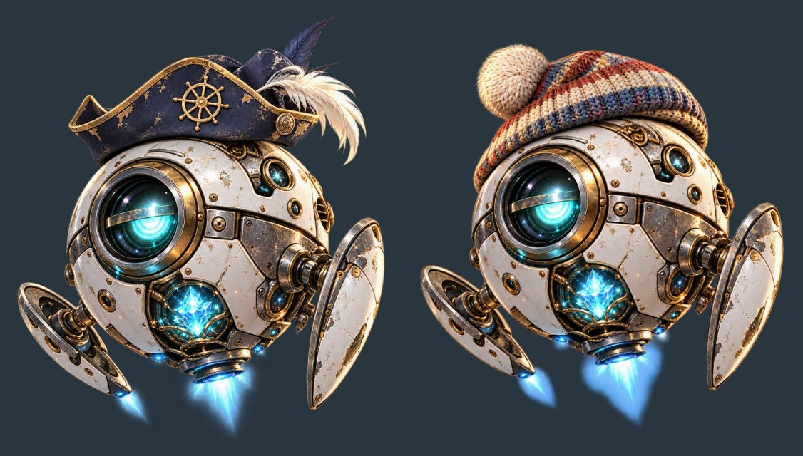

| Original base | Cozy field sprite |
|---|---|
| 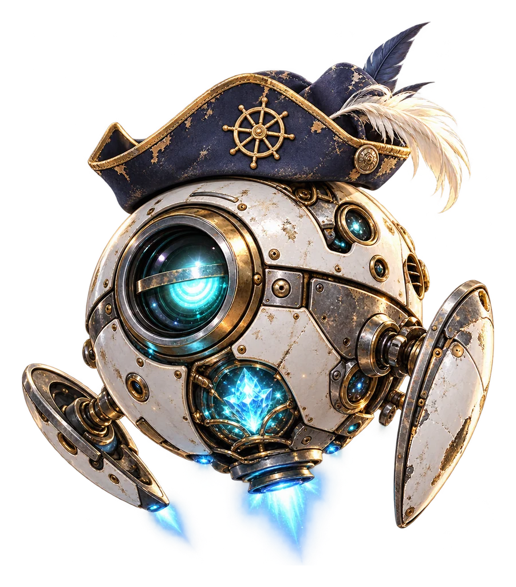 | 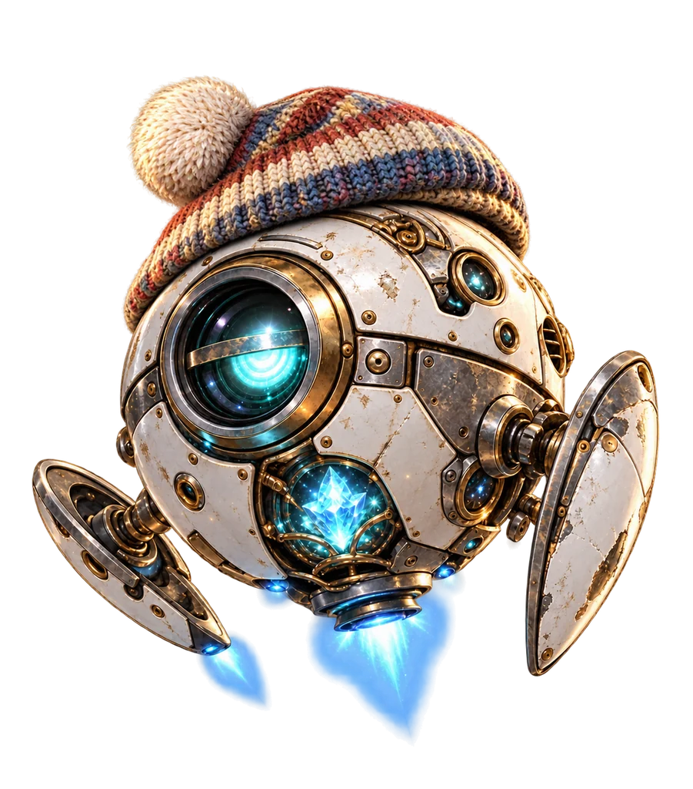 |

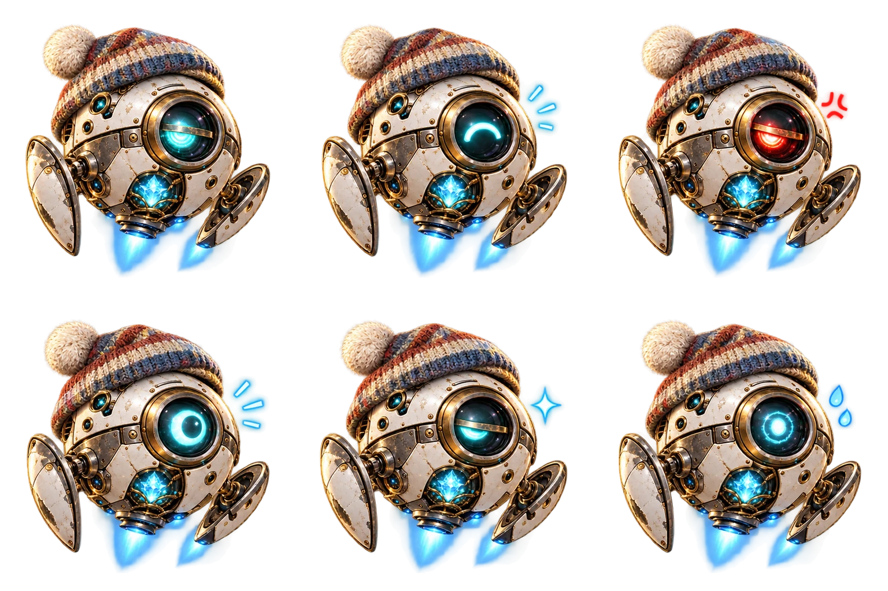

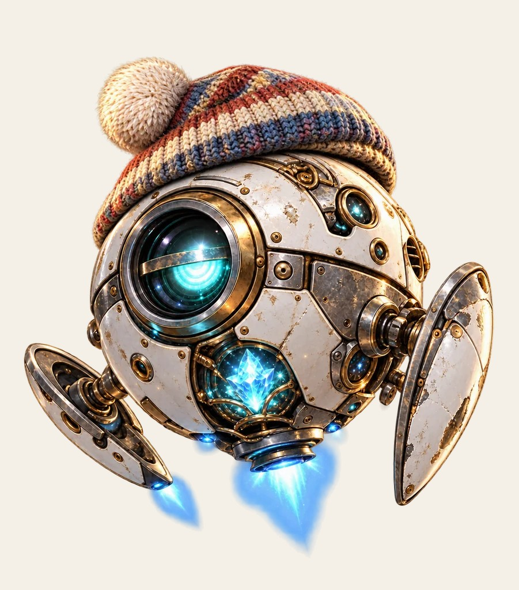

**Attempt 3 selected, of 3.** Faded rust, cream and blue knit stripes, cream pom-pom and crooked fit match the cozy reference. Original tricorn, emblem and feathers removed. Full sprite; no text, scenery, shadow or guide marks. Alpha inspected on dark and light backgrounds: no visible matte fringe; intended cyan jet glow retained.

**Flag:** all three edits changed non-hat details and moved the body upward. Attempt 3 is the closest review candidate, but does **not** meet the exact hat-only preservation requirement: body plates, fins and jet shapes differ, and the eye/body registration is visibly higher than the base. No fourth attempt or alternate design. Manifest variant marked `replace`; do not treat it as approved.

901×1024; 199,970 bytes (195.3 KiB); WebP quality 86, alpha retained. Anchor copied exactly from base: **[451, 986]**. The generator returned 1176×1337; processing resized the entire canvas to 901×1024 without trimming, padding or recentering. Alpha noise at values 1–8 cleared before resizing. All four corners and the entire exported border have alpha 0. Source base and cozy portraits unchanged; only the new manifest variant was added.

Raw attempts: `art/raw/wave-09/tutor_droid/field_cozy-attempt-{1,2,3}.png` (ignored).
Processing: `node tools/art/wave09-a-process.mjs 3` (initial export).
QA record: [wave09-a-record.json](../../tools/art/wave09-a-record.json).

<details><summary>Selected prompt and references</summary>

```text
ART STYLE: Lush, luminous digital painting in the spirit of a premium early-2000s Japanese RPG remastered in HD. Semi-realistic, anime-influenced characters with expressive faces and stylish asymmetrical adventure outfits: layered belts, buckles, straps, zippers, one-sleeved jackets, flowing scarves. Sun-drenched tropical environments painted in rich detail: saturated turquoise seas, white sand, emerald jungle, and ancient sandstone ruins carved with softly glowing glyphs. Golden-hour sunlight, with bioluminescent blue-green motes of light drifting through the air. Cinematic, epic and adventurous, with a mischievous sense of humor: witty, characterful expressions and small comedic details hidden in the scene. Mature and cool, never babyish or chibi.

This is an isolated game sprite: render ONLY the subject on a fully transparent background (PNG with alpha). No scenery, no ground, no cast shadow, no frame. Lit from the upper left with a soft rim light, crisp readable silhouette, full body with nothing cropped and clear empty space around it.

Edit target: the attached droid sprite. Keep everything exactly as it is (the round white-and-brass body, the big cyan eye, the arms, the jets, the pose, the size and the framing) and change only its hat: replace the navy tricorn with the knitted tea cozy from the second reference, in the same faded stripes with the cream pom-pom, pulled down over the top of its head and sitting slightly crooked, as the tricorn did. Transparent background, no shadow.

Image 1 is the edit target base.webp; Image 2 is portraits_cozy.webp, reference ONLY for the hat. Images 3 and 4 are painting-style anchors only. Match the attached reference character exactly: same face, outfit, colors and weapon. Change only the hat; keep the body, eye, arms, jets and every non-hat detail at the identical pixel position and size. Keep the 901x1024 canvas and anchor [451,986], with no trimming, recentering or scaling. Use the faded cream, rust and blue knitted stripes and cream pom-pom from Image 2. Remove all tricorn brim, emblem and feathers. No additional characters or objects. Highest quality, actual transparent alpha with all borders transparent.

LAST ATTEMPT: This is a localized inpainting task, not a redraw. Copy the first image exactly and edit only the tricorn mask above the ceramic head. Do not change one pixel of the eye, body, arms, crystal or jets. Retain the original idle eye shutter angle (nearly horizontal, slightly downward to the right), circular body, and exact extent of both original fins and original jets. The hat should be shorter than the old feathers and leave MORE empty space at the top; do not use that space to enlarge or move the body. Critical correction: do NOT reposition or shrink the body to fit the hat. The first reference is the immutable edit target. Preserve its EXACT silhouette below the hat. On the 901x1024 target the large eye center is approximately (330,500), left fin reaches x38 and y650, right fin reaches x861 and y500, main jet ends near y986. Keep these positions. Put the new knit hat ONLY in the old hat area at the top; body must not follow the smaller portrait proportions. All non-hat pixels should remain unchanged. Replace the old tricorn including feathers with the cozy; adapt the cozy to the existing head, never adapt the head/body to the cozy.

Rules: completely original designs; never imitate an existing franchise, character, creature, logo or emblem. No text, letters, numbers, logos, watermarks, signatures, borders or user interface, unless the prompt asks for glowing magic runes. Fierce and intense is great; no blood, gore or wounds. Every character is dressed for an all-ages game: modest clothing, no bare midriffs, no low necklines or cleavage, no revealing or tight-fitting costumes, and nothing sexualized in pose or proportion.

```

References, in order:
- Edit target: `public/assets/characters/tutor_droid/base.webp`.
- Cozy design only: `public/assets/characters/tutor_droid/portraits_cozy.webp`.
- Style only: `public/assets/anchors/key_art.webp`.
- Style only: `public/assets/anchors/cast_lineup.webp`.

No guide is named for Section A.

</details>

Validation: `npm test` — 268 tests passed without installing game dependencies. Review the hat match and the flagged body drift beside the base before approving any game use.


<!-- WAVE09 B START -->

# Section B: baby Wick Moth review

Section B only, on `claude/project-thread-ftrlee`. Built-in image generation; **flagged draft / replace**, pending parent review. Section A entries and Notes retained; Sections C–E outside this run.

## pet_moth_1 — battle.webp — flagged

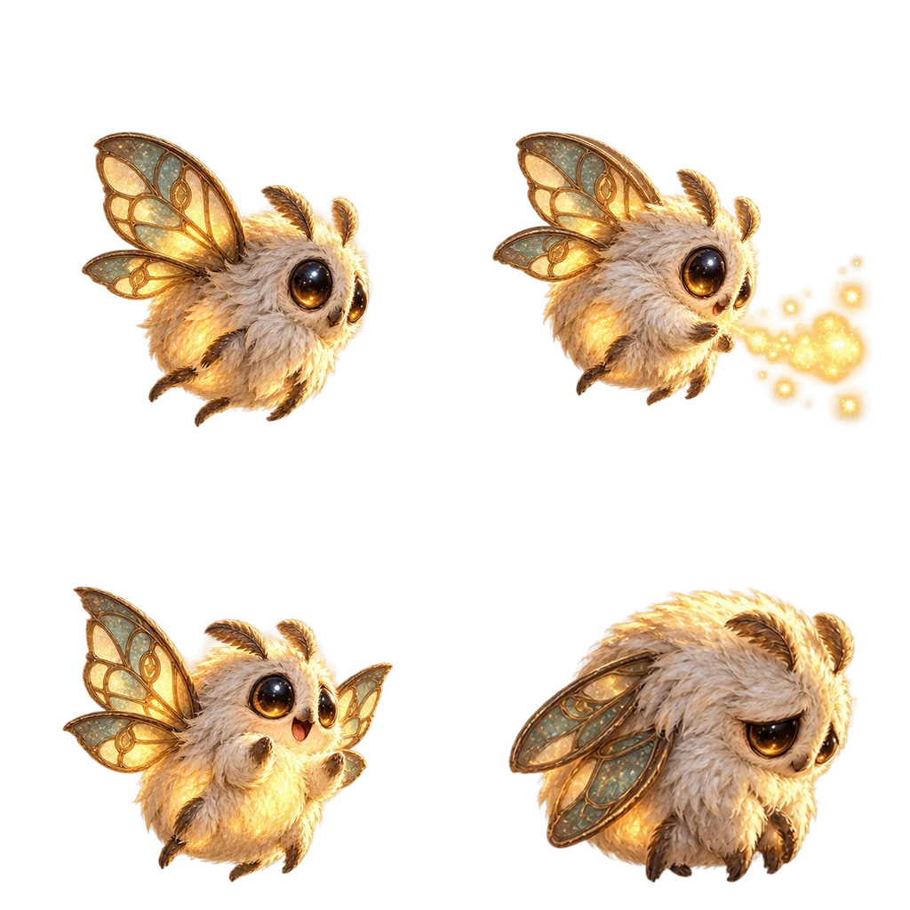

| Species reference | Baby sheet |

|---|---|

| 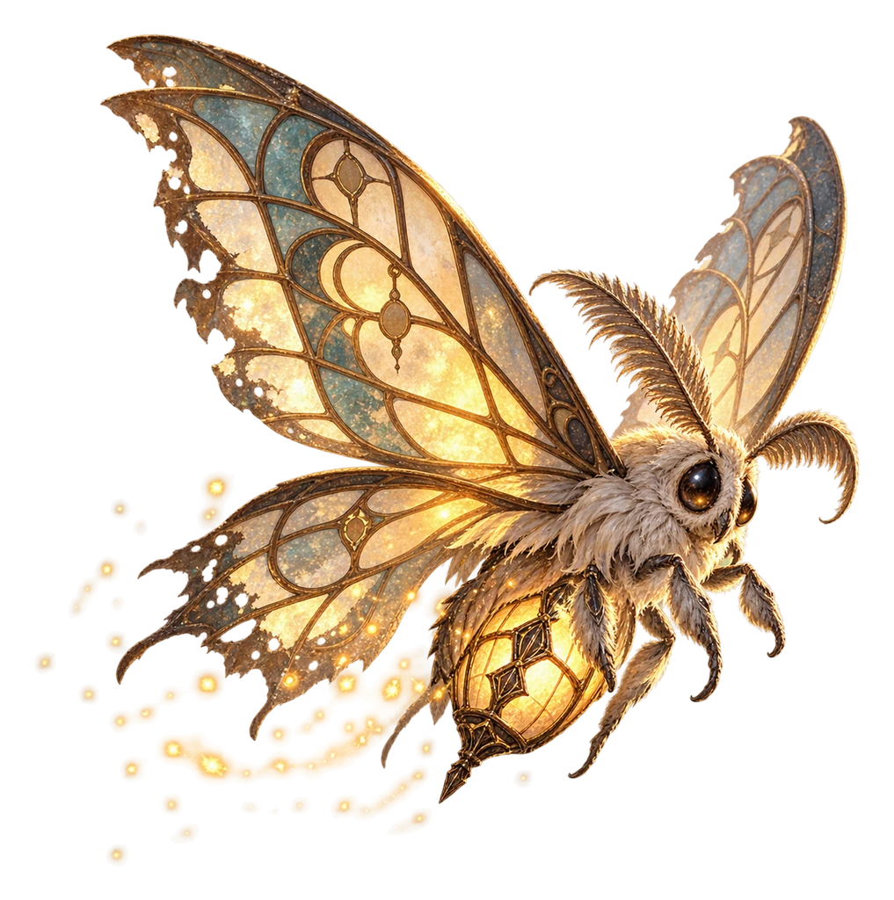 |  |

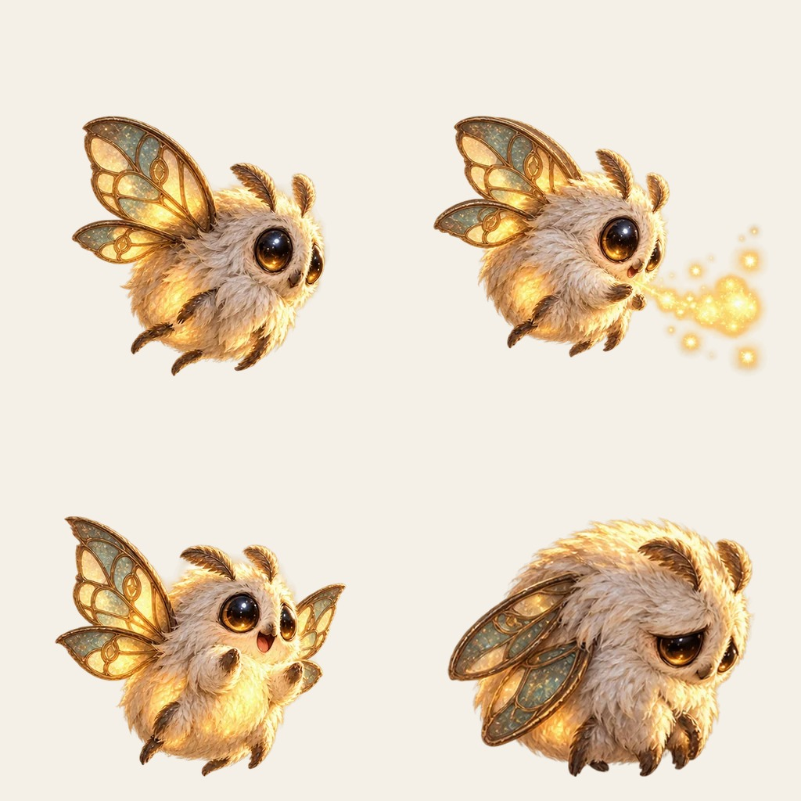

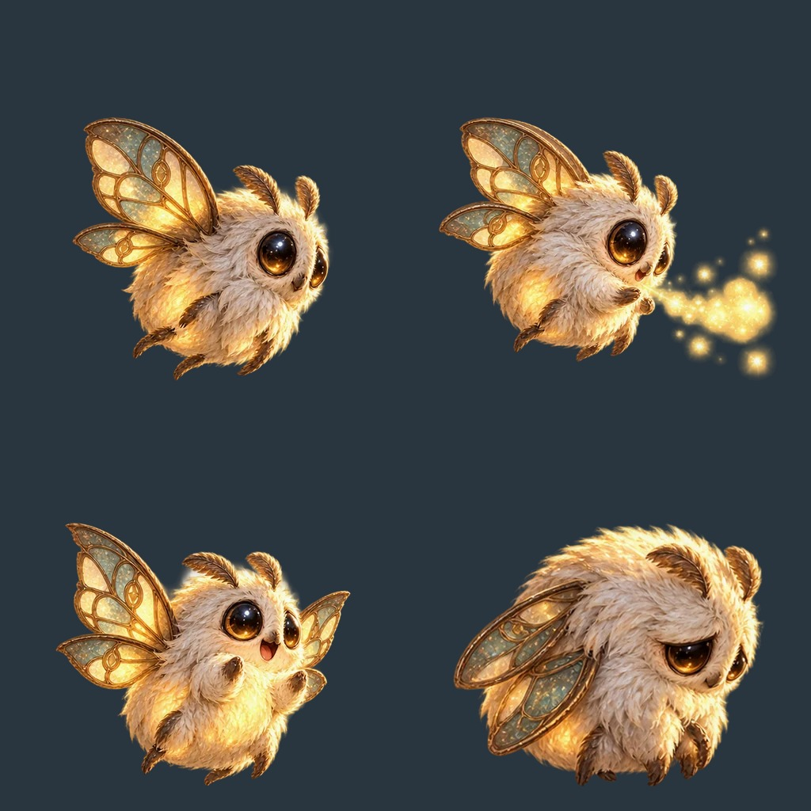

**Attempt 3 selected, of 3.** Round, fluffy cream body, warm internal glow, dark shiny eyes, old amber/teal lantern-glass wings and shorter dusty antennae. No crystal heart, jewelry, scenery, text or guide marks. Poses in reading order: idle, act (glowing dust), happy, hurt. All face right; wings overlap in the three-quarter views. Full poses and dust remain inside their cells.

**Flags:**
- Wings remain larger than the tiny-wing baby brief after three attempts.
- Hurt internal glow is only slightly dimmer; stronger dimming remains for review.
- Hurt body reads larger after equal-height sheet normalization because its wings are folded.

1024×1024; **202,842 bytes (198.1 KiB)**. 2×2, 512×512 cells. WebP quality 86, alpha retained. Manifest shaped like pet_raptor_1, with wave 9 provenance and status replace; every prior manifest entry preserved.

QA: all four corner alphas = 0; outer border and all cell borders fully transparent. No empty cells, source edge contact or cell bleed. Each frame centered horizontally with bottom baseline 481; content heights 333 px. Alpha values 1–8 cleared (66963 pixels) before slicing to remove generation noise. Inspected on light and dark backgrounds: no visible matte fringe, intended act dust retained, no visible neighboring-frame strays. The existing Python stray-check tool could not run because Pillow is unavailable; no software installed. Hurt body-scale limitation noted above.

Generator canvas: 1254×1254. Equal 627×627 source cells sliced and rebuilt at 1024×1024. Raw attempts: `art/raw/wave-09/pet_moth_1/attempt-{1,2,3}.png` (ignored).

Processing: `node tools/art/wave09-b-process.mjs`. [QA record](../../tools/art/wave09-b-record.json). [All attempt prompts](../../tools/art/wave09-b-prompts.json).

<details><summary>Selected prompt and references</summary>

```text
ART STYLE: Lush, luminous digital painting in the spirit of a premium early-2000s Japanese RPG remastered in HD. Semi-realistic, anime-influenced characters with expressive faces and stylish asymmetrical adventure outfits: layered belts, buckles, straps, zippers, one-sleeved jackets, flowing scarves. Sun-drenched tropical environments painted in rich detail: saturated turquoise seas, white sand, emerald jungle, and ancient sandstone ruins carved with softly glowing glyphs. Golden-hour sunlight, with bioluminescent blue-green motes of light drifting through the air. Cinematic, epic and adventurous, with a mischievous sense of humor: witty, characterful expressions and small comedic details hidden in the scene. Mature and cool, never babyish or chibi.

This is an isolated game sprite: render ONLY the subject on a fully transparent background (PNG with alpha). No scenery, no ground, no cast shadow, no frame. Lit from the upper left with a soft rim light, crisp readable silhouette, full body with nothing cropped and clear empty space around it.

A small creature sheet, facing right: a baby Wick Moth no bigger than a teacup, round and very fuzzy, with four small wings like panes of old lantern glass in thin lead frames, a warm candle-flame glow inside its fuzzy body, short dusty antennae and huge dark shiny eyes. Shy, sweet and a little clumsy, not sad. The same species as the reference giant moth, but a baby: rounder and fluffier, with tiny wings. Four cells: idle (hovering, wings mid-beat), act (puffing out a brave little cloud of glowing dust), happy (wings spread wide, glowing brighter), hurt (wings folded, its glow dimmed).

A sprite sheet for a 2D turn-based battle game: the SAME creature shown 4 times in a grid of 2 columns and 2 rows of equal square cells, on a fully transparent background, with no grid lines, labels or text. Full body at the same size and scale in every cell, on the same invisible baseline, facing RIGHT. Top row: (1) idle, hovering, wings mid-beat, (2) act, puffing a brave little cloud of glowing dust toward the right. Bottom row: (3) happy, wings spread wide, glowing brighter, (4) hurt, wings folded, glow dimmed; no wounds. Match the attached creature reference's species exactly, adapted ONLY to the described baby proportions.

1024x1024 canvas, four 512x512 cells. Image 1 key art and Image 2 cast lineup are PAINTING STYLE ONLY, do not draw their characters or scenery. Image 3 is the giant Wick Moth SPECIES reference: cream fluffy body, old warm amber and muted teal lantern-glass wings in thin metal frames, dark shiny eyes. Make the baby rounder and very fuzzy, short dusty antennae and four tiny unbroken wings; no adult's tattered wing edges or long lantern abdomen. Image 4 jelly sheet shows FORMAT ONLY: four isolated consistent poses. Do NOT copy jelly features, jewelry or crystal hearts. The baby Wick Moth has NO crystal heart, no necklace and no hanging jewel. Image 5 guide is LAYOUT ONLY. The attached guide image is a construction drawing: use it only for layout (where the floor, horizon, characters or cells are). Do not reproduce any of its lines, colors, shapes, labels or text. Ignore its pose labels and follow idle/act/happy/hurt here. Every pose's head, gaze and body face right including happy and hurt. Keep all wings, antennae, feet and dust fully within each cell with generous clear transparent margins. Four anatomically consistent wings: two forewings and two smaller hindwings, visible paired roots, even if folded or overlapping. Same fluffy body scale in all four cells. Painterly detailed fur and glass, never a flat cartoon. Real transparent alpha, no black/white matte, no checkerboard, no ground shadows or ambient background haze. Internal glow stays within the body; only the act frame has a small discrete glowing dust cloud.

Final correction, attempt 3: Prior candidate kept adult-sized wings and long adult plumes. Baby design must have a plump round ball of fluffy fur larger than each wing, FOUR SMALL wings each at most ONE THIRD the fluffy body's height, like four little glass fins on a fuzzy ball, and TWO SHORT dusty antennae barely protruding from the head, not long feathery adult arcs. Antennae maximum one quarter head height, two stubby fuzzy nubs. Dominant silhouette is a fluffy rounded body, not enormous butterfly wings. Render the exact baby description; do not retain adult proportions. All four heads face three-quarter RIGHT, including happy (never frontal). Happy spreads its FOUR TINY wings without making them large. No extra floating sparkle trails in happy or idle; glow contained in the body. Preserve detailed painterly lantern-glass materials and cream fur. Hurt folds its four small wings visibly along the round body and dims the internal light. Four equal cells, correct ordering, completely transparent margins.

Rules: completely original designs; never imitate an existing franchise, character, creature, logo or emblem. No text, letters, numbers, logos, watermarks, signatures, borders or user interface, unless the prompt asks for glowing magic runes. Fierce and intense is great; no blood, gore or wounds. Every character is dressed for an all-ages game: modest clothing, no bare midriffs, no low necklines or cleavage, no revealing or tight-fitting costumes, and nothing sexualized in pose or proportion.
```

References, in order:
- `public/assets/anchors/key_art.webp`
- `public/assets/anchors/cast_lineup.webp`
- `public/assets/fiends/fiend_wick_moth/base.webp`
- `public/assets/characters/pet_jelly_1/battle.webp`
- `art/guides/creature_sheet_2x2.png`

</details>

Validation: `npm test` — **268 passed, 0 failed**, without installing anything. No commit attempted and no push. Review the flagged wing proportions, hurt glow and body scale before approval.


<!-- WAVE09 C START -->

# Section C: story cards

Built-in image generation on `claude/project-thread-ftrlee`. Both cards pending parent approval. Sections A and B review entries and Notes preserved.

## story_tamsin_meets — flagged draft / replace

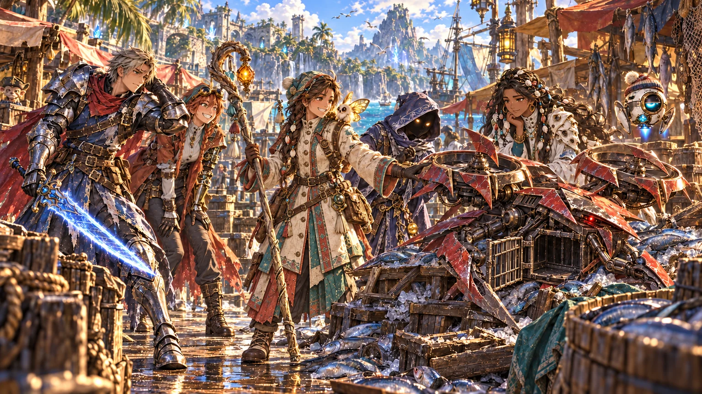

1536×864; **463,226 bytes**, WebP quality 86, opaque. Attempt 3 selected. Raw source 1672×941 center-cropped to 16:9; raw outputs in `art/raw/wave-09/story_tamsin_meets/` (ignored).

Visual QA: all five heroes appear once, fully covered with high-necked blouses; Tamsin’s coat is buttoned shut. Recognizable crashed red/brass twin-rotor drone in fish-stall debris, visibly open empty cage, one fuzzy amber-winged baby moth on Tamsin’s shoulder, sheepish Cade, grinning Wren, leaning Knox/Maren, cozy-wearing Kit, hidden Pockets. Faces and rescue action above narration strip. No visible text, guide marks, borders, gore or exposed midriffs. Rejected attempt 1: low Maren neckline, open Tamsin coat, creature still in cage, low cage; attempt 2: coat still open and cage opening unclear. Maren’s staff is not visible in this leaning-in composition.

Flags: Cade’s sword remains angled downward rather than half-raised after three attempts.

<details><summary>Selected prompt and references</summary>

```text
ART STYLE: Lush, luminous digital painting in the spirit of a premium early-2000s Japanese RPG remastered in HD. Semi-realistic, anime-influenced characters with expressive faces and stylish asymmetrical adventure outfits: layered belts, buckles, straps, zippers, one-sleeved jackets, flowing scarves. Sun-drenched tropical environments painted in rich detail: saturated turquoise seas, white sand, emerald jungle, and ancient sandstone ruins carved with softly glowing glyphs. Golden-hour sunlight, with bioluminescent blue-green motes of light drifting through the air. Cinematic, epic and adventurous, with a mischievous sense of humor: witty, characterful expressions and small comedic details hidden in the scene. Mature and cool, never babyish or chibi.

This is a background painting for a 2D game: no characters or creatures unless the prompt asks for them, no user interface. Rich depth, clear foreground, midground and background.

Afternoon in the harbor's market street: the beaten Caged Drone has crashed into a fish stall, fish everywhere, and the little cage in its belly is pried open. Tamsin, crook in hand, has just vaulted the stall and stands between the drone and Cade, as a baby Wick Moth flutters out of the cage onto her shoulder. Cade, sword half-raised, looks sheepish; Wren grins behind him; Knox and Maren lean in to see; Kit, in the tea cozy, hovers, unimpressed.

Reference roles: Image 1 is the EDIT TARGET. Image 2 is the key art and cast lineup STYLE board. Preserve the target composition and people; change only the coat and cage specified below. Image 3 is a reference board of the five approved character bases from LEFT TO RIGHT: Cade the silver-haired navy/crimson armored knight, Wren the copper-braided teal/brass gunner, Knox the small indigo-hooded spellwright with two golden eyes, Maren the shell-braided dark-haired white/coral/teal titan caller, Tamsin the brown-haired teal/cream/rust beastkeeper with wooden crook. Match the attached reference's character exactly: same face, outfit, colors and weapon, with the mandatory modest clothing corrections below. Include each of these five heroes exactly once. Image 4 is a scene/creature/Kit reference board in reading order; use these named references for their specified roles only; do not copy sprite-sheet grids or extra poses.

Everyone is fully and modestly dressed. Cade has a covered torso under his armor. Wren wears a high-necked loose blouse reaching below her waistband, covered abdomen, long loose trousers, and her weathered coat and brass mechanical left arm. Maren wears a high-necked opaque blouse and layered long skirt/trousers covering her abdomen and legs. Tamsin wears her approved high-necked blouse and CLOSED coat, loose layered clothing and long trousers; no Rivet. Never copy exposed midriffs or revealing clothing from older anchors. Knox wears his full loose indigo robe.

Image 4 TOP LEFT is harbor environment continuity. Image 4 TOP RIGHT is the crashed red/brass twin-rotor Caged Drone: intact recognizable design lying beaten and inactive in the fish stall, its belly cage OPEN and EMPTY after rescue. Image 4 BOTTOM LEFT is baby moth species and appearance, use just one teacup-sized cream fuzzy amber-glass-winged moth fluttering to Tamsin's shoulder. Image 4 BOTTOM RIGHT is Kit's white/brass ceramic sphere, cyan lens eye and faded striped knitted tea cozy with cream pom-pom, eyelid unimpressed. Pockets, the small three-eyed monkey in a pirate hat, is hidden subtly in the market background. The stalled drone, opened cage, Tamsin and shoulder moth must be legible; make a cohesive scene, no inset panels. Keep Tamsin centrally between crashed drone and sheepish Cade.

The attached guide image is a construction drawing: use it only for layout (where the floor, horizon, characters or cells are). Do not reproduce any of its lines, colors, shapes, labels or text. Generate a single wide landscape painting, 1536x1024 source canvas with a centered 1536x864 safe crop (top and bottom 80 pixels are expendable scenery). All faces, Kit, moth, open cage and key story action must fit in the central horizontal band y=150–690, above the bottom narration overlay. Keep complete figures and weapons in the safe crop where possible. Bottom strip is incidental floor/parapet, never essential faces. No text anywhere, including stalls, banners, objects or clothing.

RETRY CORRECTION: Maren's blouse must be buttoned all the way up to a HIGH COLLARBONE collar, no V-neck, no visible chest. Tamsin's coat must be CLOSED and BUTTONED continuously from high neck through waist and hips: a loose cream closed coat with teal/rust trim, not two open front panels. Wren also has a high buttoned collar. The pried-open cage is EMPTY, absolutely no creature or blue eyes inside it: one baby moth only, on Tamsin's shoulder. Raise the crashed drone and its visibly open empty cage on top of the fish stall to the center-right y=440–650 of the 1536x1024 canvas, above narration. Cade's sword HALF-RAISED toward the drone, sheepish expression, not lowered to the floor. Keep the reference character identities and exact original story composition brief.

FINAL TARGETED EDIT: Keep this painting intact, including faces, modest high-necked blouses, weapons, harbor, Kit, shoulder moth and drone. Close Tamsin's cream coat front over her green vest: add one continuous loose cream center-front panel from high neck to below waist with visible buttons fastening it shut and teal/rust piping. Do not leave two separated coat panels around a teal vest. The Caged Drone belly cage at center-right must visibly stand open: swing its rectangular barred FRONT DOOR OUTWARD to the LEFT, clear of the cage opening, showing a dark EMPTY interior and vacant floor, with no blue light/eyes or creature in it. Move only this cage front door. Keep the cage above the bottom narration strip, attached under drone's belly. This edit fixes two details without redesigning the scene.

Rules: completely original designs; never imitate an existing franchise, character, creature, logo or emblem. No text, letters, numbers, logos, watermarks, signatures, borders or user interface, unless the prompt asks for glowing magic runes. Fierce and intense is great; no blood, gore or wounds. Every character is dressed for an all-ages game: modest clothing, no bare midriffs, no low necklines or cleavage, no revealing or tight-fitting costumes, and nothing sexualized in pose or proportion.
```

References:
- `public/assets/anchors/key_art.webp`
- `public/assets/anchors/cast_lineup.webp`
- `public/assets/characters/ally_knight/base.webp`
- `public/assets/characters/ally_gunner/base.webp`
- `public/assets/characters/ally_spellwright/base.webp`
- `public/assets/characters/ally_titancaller/base.webp`
- `public/assets/characters/ally_beastkeeper/base.webp`
- `public/assets/scenes/explore/scene_harbor.webp`
- `public/assets/fiends/fiend_caged_drone/base.webp`
- `public/assets/characters/pet_moth_1/battle.webp`
- `public/assets/characters/tutor_droid/portraits_cozy.webp`
- `art/guides/story_card.png`

The tool accepts at most five input images. All references passed via the two separate anchors, a five-hero reference board, an asset-specific reference board, and the separate layout guide. Boards preserve source images and contain no added text.

</details>

## story_gallery_dawn — draft

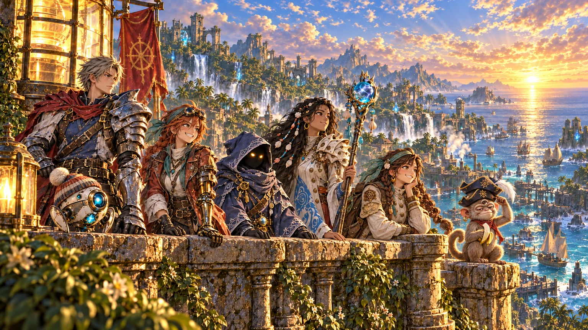

1536×864; **432,694 bytes**, WebP quality 86, opaque. Attempt 2 selected. Raw source 1672×941 center-cropped to 16:9; raw outputs in `art/raw/wave-09/story_gallery_dawn/` (ignored).

Visual QA: Cade, Wren, Knox, Maren and Tamsin once each at the rail, fully covered; Tamsin’s high-necked blouse and closed buttoned coat. Kit in striped tea cozy; three-eyed Pockets in two stacked tricorns at far end of rail. Warm great lens behind curved glass on left, sandstone parapet, brass lantern and red wheel-motif banner match the ending reference. Boats heading out and first chimney smoke below; no Titan or Rivet. Faces above narration strip. No visible text, guide marks, borders or revealing clothing. Attempt 2 closes Tamsin’s coat while preserving attempt 1’s composition.

Flags: none observed in the exported card.

<details><summary>Selected prompt and references</summary>

```text
ART STYLE: Lush, luminous digital painting in the spirit of a premium early-2000s Japanese RPG remastered in HD. Semi-realistic, anime-influenced characters with expressive faces and stylish asymmetrical adventure outfits: layered belts, buckles, straps, zippers, one-sleeved jackets, flowing scarves. Sun-drenched tropical environments painted in rich detail: saturated turquoise seas, white sand, emerald jungle, and ancient sandstone ruins carved with softly glowing glyphs. Golden-hour sunlight, with bioluminescent blue-green motes of light drifting through the air. Cinematic, epic and adventurous, with a mischievous sense of humor: witty, characterful expressions and small comedic details hidden in the scene. Mature and cool, never babyish or chibi.

This is a background painting for a 2D game: no characters or creatures unless the prompt asks for them, no user interface. Rich depth, clear foreground, midground and background.

Dawn on the lighthouse gallery: Cade, Wren, Knox, Maren and Tamsin at the stone rail, the harbor waking below (the first chimney smoke, boats heading out), the great lens glowing warm behind the gallery's glass. Kit in its tea cozy, and at the far end of the rail Pockets in both tricorns, very pleased with himself. No Titan in the sky, and no Rivet (it may be any of its three sizes by then).

Reference roles: Image 1 is the EDIT TARGET; preserve this entire scene and every character exactly except the specific clothing correction. Image 2 is a style board with key art above cast lineup. Image 3 is a reference board of the five approved character bases from LEFT TO RIGHT: Cade the silver-haired navy/crimson armored knight, Wren the copper-braided teal/brass gunner, Knox the small indigo-hooded spellwright with two golden eyes, Maren the shell-braided dark-haired white/coral/teal titan caller, Tamsin the brown-haired teal/cream/rust beastkeeper with wooden crook. Match the attached reference's character exactly: same face, outfit, colors and weapon, with the mandatory modest clothing corrections below. Include each of these five heroes exactly once. Image 4 is a scene/creature/Kit reference board in reading order; use these named references for their specified roles only; do not copy sprite-sheet grids or extra poses.

Everyone is fully and modestly dressed. Cade has a covered torso under his armor. Wren wears a high-necked loose blouse reaching below her waistband, covered abdomen, long loose trousers, and her weathered coat and brass mechanical left arm. Maren wears a high-necked opaque blouse and layered long skirt/trousers covering her abdomen and legs. Tamsin wears her approved high-necked blouse and CLOSED coat, loose layered clothing and long trousers; no Rivet. Never copy exposed midriffs or revealing clothing from older anchors. Knox wears his full loose indigo robe.

Image 4 TOP LEFT is the exact gallery continuity reference: match its weathered sandstone parapet, cylindrical glazed warm lighthouse lens on the LEFT, brass lantern at the parapet, and hanging crimson banner with ornamental wheel motif. Same tropical harbor and waterfall-draped ruins below, viewed at DAWN. The five heroes gather along this same gallery rail, faces and torsos readable above the narration strip. Image 4 TOP RIGHT is Pockets: small fuzzy THREE-eyed monkey, two stacked navy-and-gold tricorns, red neckerchief, banana, curled tail, at far end of rail. Image 4 BOTTOM LEFT is Kit in its striped tea cozy and cream pom-pom. No giant bird, Titan, robot pet or Rivet anywhere. Show boats setting out and fine first chimney smoke below. Preserve architectural continuity with the ending painting, not an unrelated balcony.

The attached guide image is a construction drawing: use it only for layout (where the floor, horizon, characters or cells are). Do not reproduce any of its lines, colors, shapes, labels or text. Generate a single wide landscape painting, 1536x1024 source canvas with a centered 1536x864 safe crop (top and bottom 80 pixels are expendable scenery). All faces, Kit, moth, open cage and key story action must fit in the central horizontal band y=150–690, above the bottom narration overlay. Keep complete figures and weapons in the safe crop where possible. Bottom strip is incidental floor/parapet, never essential faces. No text anywhere, including stalls, banners, objects or clothing.

EDIT ONLY TAMSIN’S COAT: the brown-haired beastkeeper leaning on the rail immediately left of Pockets must wear a CLOSED coat, buttoned continuously up the center from waist to the base of her neck. Cover the teal inner waistcoat with the closed loose cream/weathered-tan coat front; preserve cream sleeves, teal/rust trim, high-necked blouse collar, face, braids, pose and everything else. Keep all five people fully modest. Preserve the same lighthouse glass/lens, lantern, red banner, parapet, harbor and sunrise. No other changes.

Rules: completely original designs; never imitate an existing franchise, character, creature, logo or emblem. No text, letters, numbers, logos, watermarks, signatures, borders or user interface, unless the prompt asks for glowing magic runes. Fierce and intense is great; no blood, gore or wounds. Every character is dressed for an all-ages game: modest clothing, no bare midriffs, no low necklines or cleavage, no revealing or tight-fitting costumes, and nothing sexualized in pose or proportion.
```

References:
- `public/assets/anchors/key_art.webp`
- `public/assets/anchors/cast_lineup.webp`
- `public/assets/characters/ally_knight/base.webp`
- `public/assets/characters/ally_gunner/base.webp`
- `public/assets/characters/ally_spellwright/base.webp`
- `public/assets/characters/ally_titancaller/base.webp`
- `public/assets/characters/ally_beastkeeper/base.webp`
- `public/assets/scenes/story_ch2_ending.webp`
- `public/assets/characters/mascot_monkey/field_twohats.webp`
- `public/assets/characters/tutor_droid/portraits_cozy.webp`
- `art/guides/story_card.png`

The tool accepts at most five input images. All references passed via the two separate anchors, a five-hero reference board, an asset-specific reference board, and the separate layout guide. Boards preserve source images and contain no added text.

</details>

Review the story action and clothing, the gallery architecture beside [the ending card](../../public/assets/scenes/story_ch2_ending.webp), and narration overlap in the game. No game/runtime visual acceptance claimed.

[All attempt prompts](../../tools/art/wave09-c-prompts.json) · [Processing and QA record](../../tools/art/wave09-c-records.json). Selected edits also include their previous raw attempt as the edit target and combine both anchors into a single board to respect the five-image tool limit.

Validation: `npm test` — **268 passed, 0 failed**, without installing anything. No commit attempted and no push.


## map_driftwood, harbor_open: the harbor's three places and trails, draft (flagged)

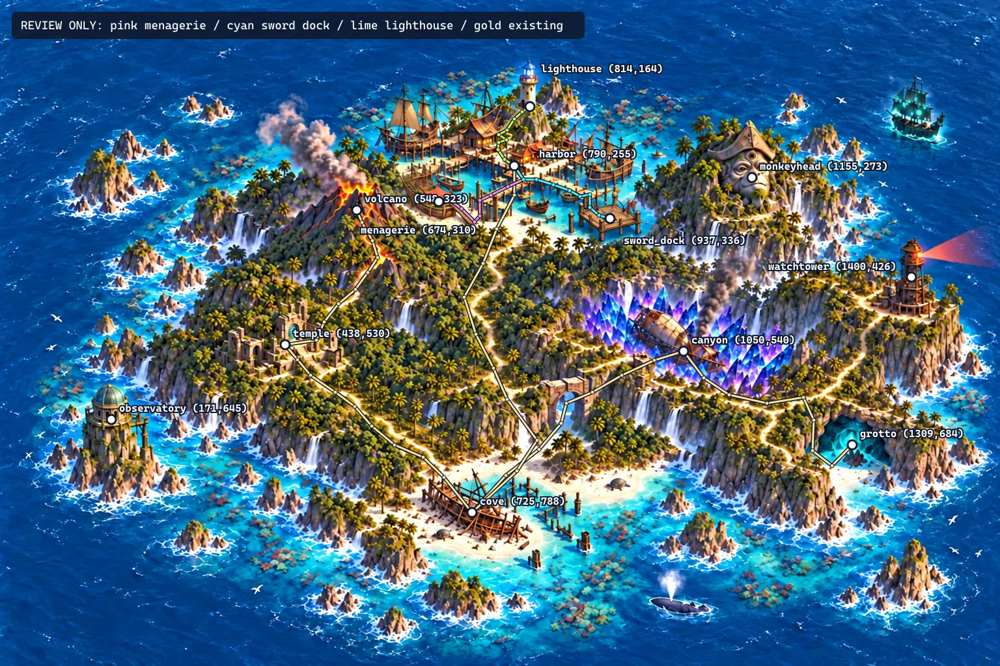

Shipped: [map_driftwood__harbor_open.webp](../../public/assets/scenes/map/map_driftwood__harbor_open.webp), 1536x1024, 436 KiB. Repaint attempt 3 of 3 adds a beached ship west of the harbor (the menagerie), a dueling platform on the water east of it (the Sword Master's dock) and steps up the rocks to the lighthouse. The rest of the island keeps its landmarks and layout, with minor texture changes.

Measured on the painting (painting pixels), in `variants.harbor_open`:

| Place | Point | Trail from harbor |
|---|---|---|
| menagerie | [674, 310] | 10 points along the boardwalk west to the beached ship |
| sword_dock | [937, 336] | 10 points along the pier east to the platform |
| lighthouse | [814, 164] | 10 points up the rock steps to the lighthouse |

Flags: the interrupted run didn't save attempt 3's exact prompt (earlier attempts' prompts are in [wave09-d-prompts.json](../../tools/art/wave09-d-prompts.json)). [Processing record](../../tools/art/wave09-d-record.json).


<!-- WAVE09 E bg_harbor_docks_fg -->

## Section E: bg_harbor_docks_fg — draft

| Before, foreground over arena | After, foreground over arena |
|---|---|
| 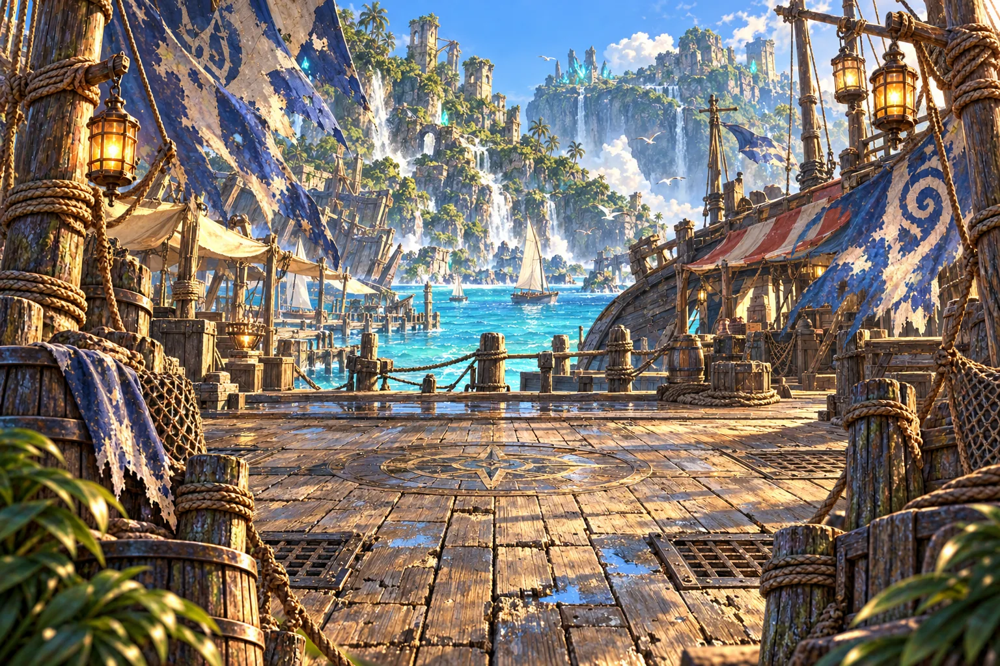 | 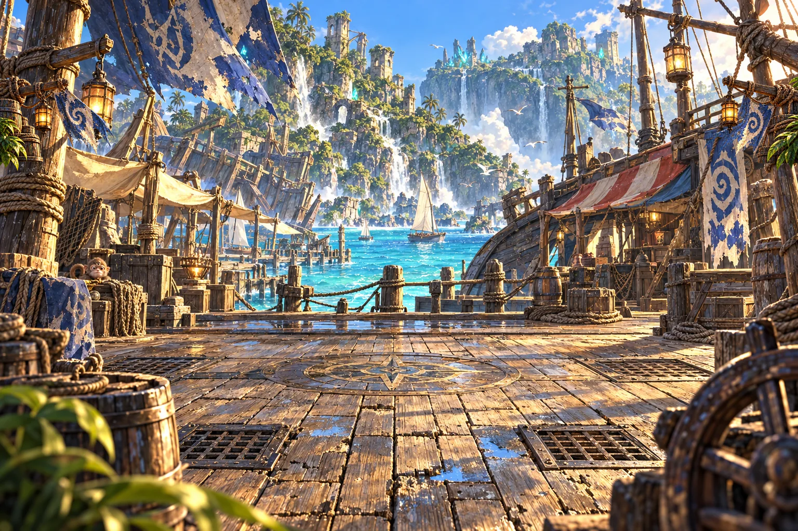 |

Shipped: [bg_harbor_docks_fg.webp](../../public/assets/backgrounds/battle/bg_harbor_docks_fg.webp), **1536×1024**, 50,200 bytes, WebP quality 86 with alpha preserved. Selected attempt 3. Raw outputs: `art/raw/wave-09/bg_harbor_docks_fg/` (ignored).

Complete generated side groupings were uniformly reduced into the upper green pockets, keeping their natural outlines and side-edge attachment; no clipping or fading at green borders. Near-invisible alpha noise (values 1–8) removed. Original arena and previous manifest provenance preserved.

Pixel QA on exported WebP: **0 nontransparent pixels in the red fighter rectangle** (x=124–1389, y=338–773), **0 outside all green pockets**, corner alpha **[0,0,0,0]**. Flags: none in the exported asset; visual parent review pending.

<details><summary>Selected prompt and references</summary>

```text
ART STYLE: Lush, luminous digital painting in the spirit of a premium early-2000s Japanese RPG remastered in HD. Semi-realistic, anime-influenced characters with expressive faces and stylish asymmetrical adventure outfits: layered belts, buckles, straps, zippers, one-sleeved jackets, flowing scarves. Sun-drenched tropical environments painted in rich detail: saturated turquoise seas, white sand, emerald jungle, and ancient sandstone ruins carved with softly glowing glyphs. Golden-hour sunlight, with bioluminescent blue-green motes of light drifting through the air. Cinematic, epic and adventurous, with a mischievous sense of humor: witty, characterful expressions and small comedic details hidden in the scene. Mature and cool, never babyish or chibi.

This is an isolated game sprite: render ONLY the subject on a fully transparent background (PNG with alpha). No scenery, no ground, no cast shadow, no frame. Lit from the upper left with a soft rim light, crisp readable silhouette, full body with nothing cropped and clear empty space around it.

Repaint the harbor foreground with the same weathered barrels, rope, navy/cream flags and warm brass lanterns. Same daylight as arena reference. 1536x1024 transparent PNG, no people.

This is ONLY TWO TINY decorative clusters at the far left and far right, at the UPPER SIDES of a huge empty transparent canvas. Left cluster fits entirely inside x=0..390,y=145..315. Right cluster fits entirely inside x=1260..1535,y=145..315. Each cluster is attached horizontally to its nearest side edge: a short horizontal rope-bound wooden support projecting from offscreen, holding one miniature warm brass lantern and one little tattered navy/cream flag, with part of a small wooden barrel behind and several green leaves at the edge. Same materials and objects as the old foreground, compressed into these little side-attached groupings. Nothing extends below y=320. No tall posts or pillars. No lower frame. 85 percent of the canvas empty. All four corners clear. The artwork should occupy about two postcard-sized spaces on this canvas, not a frame.

Reference 1: key art and cast lineup, style only, no characters. Reference 2: arena, material and daylight only. Reference 3: old foreground, objects only, its layout is wrong and must NOT be copied. Reference 4: example of outline cutouts, not its framing. Reference 5: guide.

The attached guide image is a construction drawing: use it only for layout (where the floor, horizon, characters or cells are). Do not reproduce any of its lines, colors, shapes, labels or text. Only the two UPPER green pockets may contain art. Everything below the two small clusters is totally transparent, including the entire red rectangle. Each grouping physically continues off the left/right image edge. Natural frayed/rounded silhouette everywhere else, no cuts at green borders, no faded endings, no glow outside the lantern glass, no matte haze, no shadows, no gradients. Actual alpha=0 empty pixels, not black painted scenery.

Rules: completely original designs; never imitate an existing franchise, character, creature, logo or emblem. No text, letters, numbers, logos, watermarks, signatures, borders or user interface, unless the prompt asks for glowing magic runes. Fierce and intense is great; no blood, gore or wounds. Every character is dressed for an all-ages game: modest clothing, no bare midriffs, no low necklines or cleavage, no revealing or tight-fitting costumes, and nothing sexualized in pose or proportion.
```

References:
- `art/raw/wave-09/references/anchors.png`
- `public/assets/backgrounds/battle/bg_harbor_docks.webp`
- `art/raw/wave-09/bg_harbor_docks_fg/before.webp`
- `public/assets/backgrounds/battle/bg_shipwreck_cove_fg.webp`
- `art/guides/battle_foreground.png`

Both style anchors passed together as an unlabelled reference board to fit the five-reference limit.

</details>

[All attempt prompts](../../tools/art/wave09-e-prompts.json) · [Processing and alpha QA](../../tools/art/wave09-e-records.json). No game/runtime acceptance claimed.


<!-- WAVE09 E bg_lighthouse_rocks_fg -->

## Section E: bg_lighthouse_rocks_fg — draft, attempt 2 selected

| Before: attempt 1 over arena | After: attempt 2 over arena |
|---|---|
| 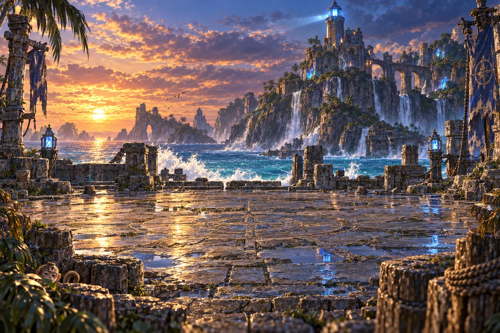 | 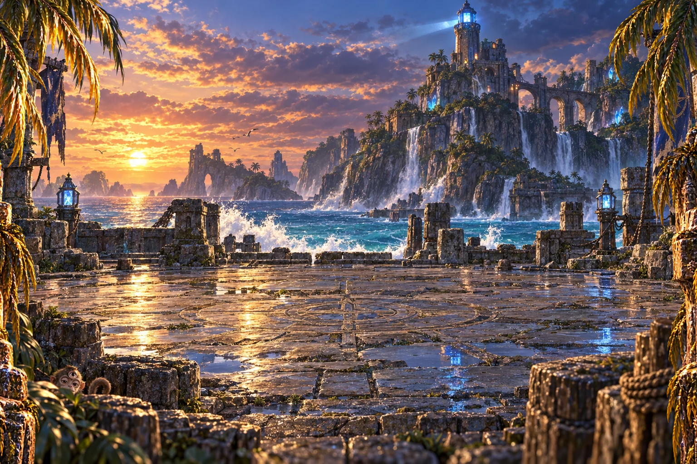 |

Shipped: [bg_lighthouse_rocks_fg.webp](../../public/assets/backgrounds/battle/bg_lighthouse_rocks_fg.webp), **1536×1024**, 144,328 bytes, WebP quality 86 with alpha preserved. **Attempt 2 of 3 selected** using built-in image_gen (model identifier not exposed). Raw: `art/raw/wave-09/bg_lighthouse_rocks_fg/attempt-2.png` (ignored). Attempt 3 was not used.

Attempt 1's small floating clusters are superseded. Attempt 2 has asymmetric tall wet stone pillars with kelp continuing off the bottom edge, and separate foliage hanging from the top edge. Sunset highlights from the left and blue reflections match the arena. The full vertical scale is preserved. Both complete side arrangements were translated outward **108 px** and cropped only by the actual canvas edges; no clipping or fading at an internal guide border, and no reduction into small clusters. Near-invisible alpha noise (1–8) removed; the four exact corner pixels were cleared. No guide lines, text, matte or visible halos found on visual inspection.

Exported WebP QA: **0 nontransparent pixels in the red fighter rectangle** (x=123–1390, y=337–774), **0 outside the requested lateral bands**, corner alpha **[0,0,0,0]**. Top attachment: left 209, right 118 visible pixels; bottom attachment: left 74, right 40. The user's top/bottom edge-attachment request explicitly extends the green bands through y=0–122 and y=806–1023, so this is not a claim of zero alpha outside the original green rectangles. Empty central space remains transparent.

Raw-generation layout flag: initially too wide (22,535 visible pixels in red; bottom corners nonzero), corrected by outward translation and corner cleanup during processing. Exported asset flags: none; parent visual/in-game approval pending. [Original pre-wave foreground over arena](wave-09/bg_lighthouse_rocks_fg-original-before.png). Harbor foreground remains byte-for-byte unchanged, at its existing attempt 3.

<details><summary>Selected attempt 2 prompt and references</summary>

```text
ART STYLE: Lush, luminous digital painting in the spirit of a premium early-2000s Japanese RPG remastered in HD. Semi-realistic, anime-influenced characters with expressive faces and stylish asymmetrical adventure outfits: layered belts, buckles, straps, zippers, one-sleeved jackets, flowing scarves. Sun-drenched tropical environments painted in rich detail: saturated turquoise seas, white sand, emerald jungle, and ancient sandstone ruins carved with softly glowing glyphs. Golden-hour sunlight, with bioluminescent blue-green motes of light drifting through the air. Cinematic, epic and adventurous, with a mischievous sense of humor: witty, characterful expressions and small comedic details hidden in the scene. Mature and cool, never babyish or chibi.

This is an isolated game sprite: render ONLY the subject on a fully transparent background (PNG with alpha). No scenery, no ground, no cast shadow, no frame. Lit from the upper left with a soft rim light, crisp readable silhouette, full body with nothing cropped and clear empty space around it.

Repaint ONLY bg_lighthouse_rocks_fg, attempt 2 of 3. 1536x1024 transparent PNG foreground parallax layer. Keep the same wet dark stone and golden olive kelp, left sunset highlights and reflected blue lantern glow of the lighthouse arena. No people or creatures. The intentional edge-attached environmental cutouts override the sprite block's uncropped-subject instruction.

References in order: Image 1 is the key-art/cast-lineup board, style ONLY, copy no characters or matte. Image 2 is the lighthouse arena, exact wet-stone materials and orange-left/blue-right lighting ONLY, never paint the scene itself. Image 3 is attempt 1, the FAILED layout: small clusters floating midway down the edges; replace these with tall bottom-anchored pillars and top-anchored foliage. Image 4 is the cove foreground: use its TALL edge-attached composition, with bottom-running vertical side pieces and top-hanging fronds. Do not copy wood, ropes, flags or the RGB streaks inside its transparent regions. Image 5 is the layout guide.

The attached guide image is a construction drawing: use it only for layout (where the floor, horizon, characters or cells are). Do not reproduce any of its lines, colors, shapes, labels or text.

Composition on the exact 1536x1024 canvas:
LEFT: a tall slender dark wet rock pillar, built from weathered irregular stone with kelp hugging it, rising from OFF THE BOTTOM EDGE at y=1024 to a chipped rounded top around y=400. Its entire width including kelp is contained in x=8..100. It is vertically substantial, NOT a short floating outcrop. Its base is cut by the bottom canvas edge and continues below the image.
RIGHT: a different taller rugged wet rock pillar with a different ledged profile and winding kelp, rising from OFF THE BOTTOM EDGE at y=1024 to its natural top around y=370. Entire width including kelp x=1415..1525. Its base continues below the canvas. Do not mirror the left.
TOP LEFT: a few olive-gold kelp or palm fronds hanging from OFF THE TOP EDGE, starting along x=25..300 at y=0 and naturally tapering down into the upper-left green box, terminating by y=320, never beyond x=400.
TOP RIGHT: a different, smaller arrangement of kelp/palm fronds hanging from OFF THE TOP EDGE, starting along x=1290..1505 at y=0 and tapering down into the upper-right box, terminating by y=315, never left of x=1255. Different leaf count, curves and silhouette from the left.
Top/bottom canvas edge attachment is REQUIRED: the top fronds extend through y=0..122 into the green upper pockets, and the narrow rock pillars extend below y=805 through the bottom edge, as the user specifically requests. Do not stop or fade the pillars at y=805. These edge extensions stay within the same lateral bands.
All FOUR corner pixels must remain completely transparent: inset the top stems and bottom pillar bases a little from the left/right edge at the corners.
EVERY piece is rooted off a TOP or BOTTOM image edge. Preserve natural irregular silhouettes. No rectangular clipping at any interior green border, no shrinking the pillars to tiny clusters, no disconnected floating chunks. No bottom horizontal ledge or connection between the two sides.
The CENTRAL RED FIGHTER AREA x=123..1390, y=337..774 is absolutely EMPTY alpha=0. All middle canvas stays empty, no ocean, floor, sky, mist, gradients, backdrop, shadows, halos or checkerboard. Outside the described four edge zones every pixel is truly transparent. Clean detailed antialiased natural outlines with no colored matte.

Rules: completely original designs; never imitate an existing franchise, character, creature, logo or emblem. No text, letters, numbers, logos, watermarks, signatures, borders or user interface, unless the prompt asks for glowing magic runes. Fierce and intense is great; no blood, gore or wounds. Every character is dressed for an all-ages game: modest clothing, no bare midriffs, no low necklines or cleavage, no revealing or tight-fitting costumes, and nothing sexualized in pose or proportion.
```

References:
- `art/raw/wave-09/references/anchors.png`
- `public/assets/backgrounds/battle/bg_lighthouse_rocks.webp`
- `public/assets/backgrounds/battle/bg_lighthouse_rocks_fg.webp`
- `public/assets/backgrounds/battle/bg_shipwreck_cove_fg.webp`
- `art/guides/battle_foreground.png`

Both style anchors passed together as the existing unlabelled reference board. Reference 3 was the shipped attempt-1 foreground, backed up at `art/raw/wave-09/bg_lighthouse_rocks_fg/selected-attempt-1.webp` before replacement.

</details>

[All attempt prompts](../../tools/art/wave09-e-prompts.json) · [Processing and alpha QA](../../tools/art/wave09-e-records.json) · [Attempt 2 processor](../../tools/art/wave09-e-lighthouse-attempt2.mjs). No game/runtime acceptance claimed.


Section E validation: `npm test` — **268 passed, 0 failed**, no installation. Existing manifest entries and Sections A–D review text/Notes preserved. Lighthouse attempt 2 is selected; harbor attempt 3 remains unchanged. Both foregrounds remain draft pending parent visual approval. No commit attempted; no push.
