# Wave 10 review: Wren, dressed for all ages

On `claude/project-thread-ftrlee`. Every picture of Captain Wren redone in chapter 2's covered look (`scenes/story_harbor_arrival.webp`): a teal collared shirt buttoned to the collarbone and tucked under her belts, and full dark brown trousers. Everything else unchanged. All edits are **attempt 1 of 3**; nothing flagged. Status stays `draft` until the parent approves.

**What to review:** the look reference beside the new base, the portrait collars, the walk strip, and Wren in each big picture.

## Checks (all sections)

- [x] The look matches the reference, and nobody shows a bare midriff, a low neckline or bare thighs.
- [x] Canvas sizes, cells, frame order and facing unchanged; every manifest entry unchanged.
- [x] Each cell's feet sit within 2 px of the old cell's (measured on the shipped files).
- [x] Sprite corners and every cell edge have alpha 0; `clean_sheets.py --dry-run` reports Wren's sheets clean.
- [x] Big pictures: only a crop around Wren was edited and pasted back through a soft mask limited to what changed on her; every pixel outside the crop matched the original before the WebP export.
- [x] The walk's upper body moves frame to frame as in the old walk (centroids within 2 px), so `"aligned"` stays.
- [x] Size budgets: base 167 KiB, sheets 189 to 444 KiB, scenes 382 to 491 KiB, video references 229 to 301 KiB.
- [x] `npm test`: 268 passed.

## Section A: her base

Look reference (cropped from `story_harbor_arrival`, x 420 to 780, y 120 to 864), the old base, the new base:

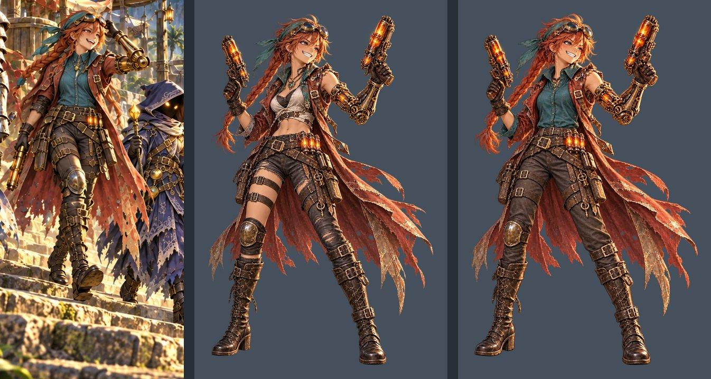

681×1024, anchor [341, 986] kept (feet at y 986 before and after). Transparent, no shadow.

## Section B: her sheets

Each cell was cropped, scaled 2× onto a 1024×1024 canvas, edited, scaled back and pasted into its own cell. Battle cells 2 (cast) and 5 (victory) and field cell 2 (talk) came back drawn larger; they were scaled back to the old figure height, then their feet lined up with the old cell's.

### battle.webp (before above, after below)

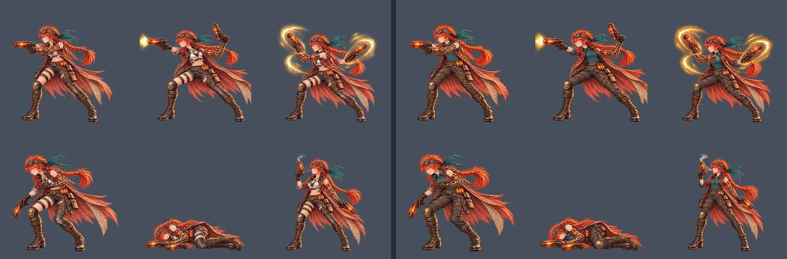

### portraits.webp: the collar is buttoned to the collarbone in all six

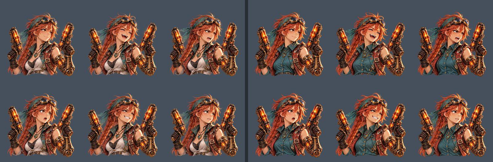

### walk.webp: all eight frames in a row

Before:

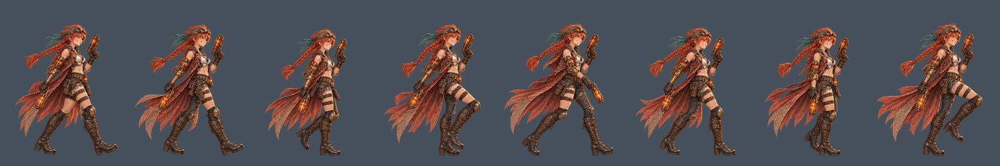

After:

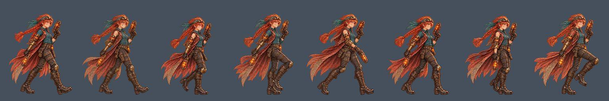

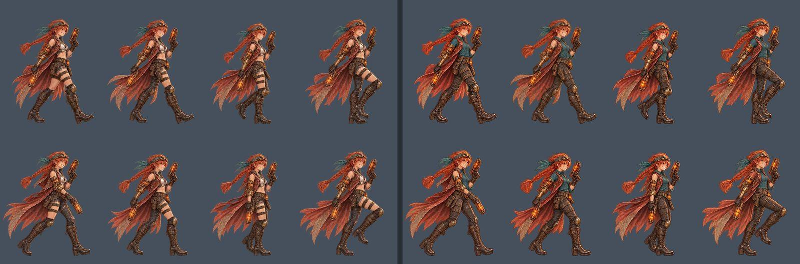

### field.webp

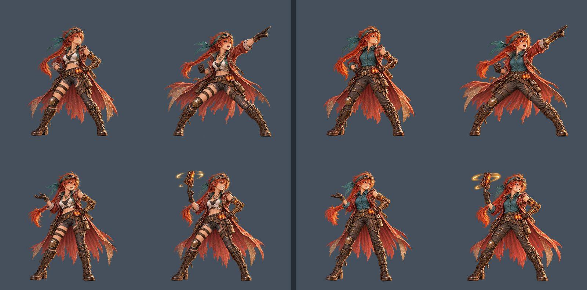

## Section C: the big pictures

Each shows Wren's crop before (left) and after (right). Outside these crops the pictures are unchanged.

### `scenes/title_art.webp`: the title screen

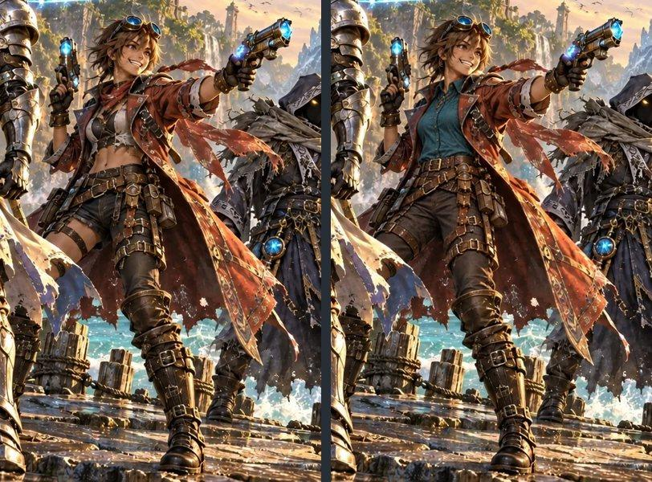

### `scenes/story_deck.webp`: the opening, on the deck (also a film first frame)

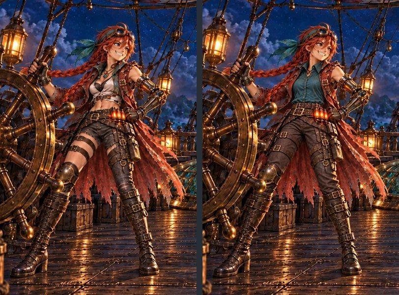

### `scenes/story_fall.webp`: the opening, after the ram (also a film first frame; now retired by the new intro storyboard, kept as made)

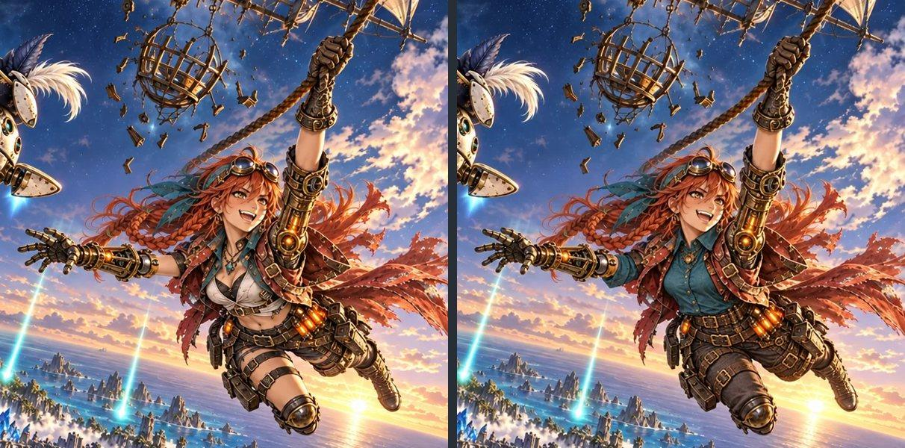

### `scenes/story_descent.webp`: the ride down to the grotto

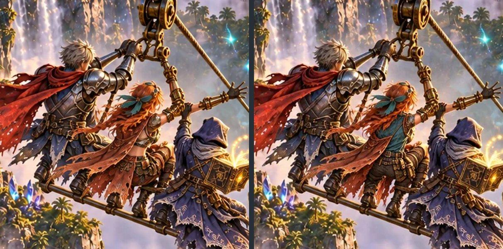

### `scenes/story_crystal_remade.webp`: the chapter 1 ending (also a film first frame)

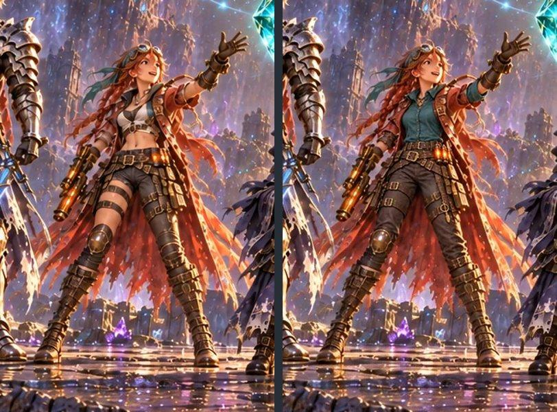

### `anchors/key_art.webp`: fallback and style reference

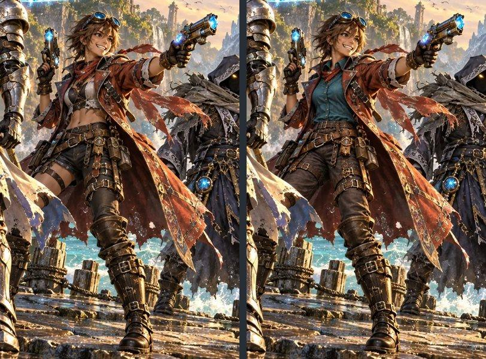

### `anchors/cast_lineup.webp`: style reference

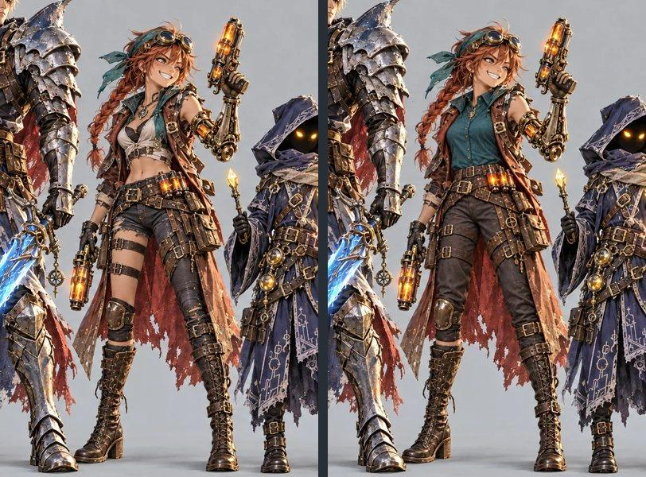

### `anchors/battle_mock.webp`: style anchor

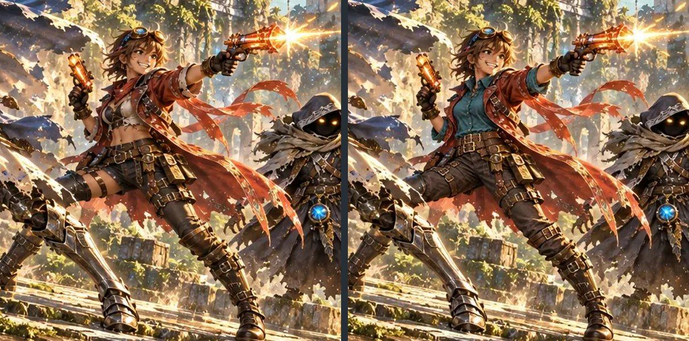

## Section D: for the parent's films

### `art/video-refs/ally_gunner/`: front, left, right (before, then after)

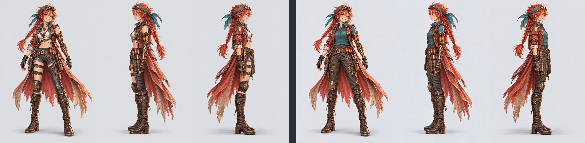

The front was edited first and passed as the reference for both profiles. 1024×1536, JPEG 90.

### `art/video-refs/frames/`

`story_deck`, `story_fall` and `story_crystal_remade` re-exported from the new paintings: `<id>.jpg` (1536×1024, JPEG 92) and `<id>-16x9.jpg` (the middle 16:9, y 80 to 944, at the existing file's size: 1920×1080, 1920×1080 and 1536×864). `story_fall_first.jpg` and `story_ram_first.jpg` untouched.

**For the parent:** the chapter 1 ending's crystal film still shows the old outfit until it's remade from the new `frames/story_crystal_remade-16x9.jpg` (prompt in `art/video-refs/ending-clips.md`).

<details><summary>Prompt (every edit)</summary>

Each request attached the edit target, the look reference and (after Section A) the new `base.webp`; the profiles attached the new front instead of the base.

```text
Change only Wren's clothes, so she is dressed for an all-ages game, exactly as in the look reference: her cropped white blouse and the dark top under it become one loose teal shirt with a collar, buttoned up to her collarbone and tucked in under her belts, so no skin shows between the shirt and the belts and nothing is low-cut. Her ripped shorts and torn stocking become full dark brown canvas trousers, with the same thigh straps, holsters, brass knee guard and buckled boots over them, so no bare thigh shows. Keep everything else exactly as it is: her face and expression, her pose, size and framing, her arms, the copper-red braid, teal bandana and goggles, the long patched rust-red coat, the brass mechanical left arm, the crossed belts and the bandolier of glowing orange cells, the twin orange blasters, and the background.
```

Plus, per asset: keep the same canvas, position, size and pose, feet in the same place, a transparent background for sprites (opaque for pictures), no text; dressed for an all-ages game: no bare midriff, no low neckline or cleavage, no bare thighs.

</details>

Raw inputs and edits: `art/raw/wave-10/` (ignored).
