# Wave 12 review: forged weapons in the heroes' hands

On `claude/weapons-on-heroes-n4hkux`. Every picture was painted with Codex one cell at a time and pasted back into its own cell (`tools/art/wave12-gen.py`, `wave12-bare.py`, `wave12-c.py`, `wave12-icons.py`). Each cell was fitted onto the old cell by a shift and scale search (`wave12-fit.py`) and checked with a red/cyan overlay of old against new (`wave12-overlay.py`; grey means the body lines up). Status stays `draft` until the parent approves.

**What to review:**
1. The 128 px idle strip below: can you name each step from across the room?
2. The battle sheets, one hero at a time.
3. The new weapon icons.
4. The weaponless walks and stands.

## Checks

- [x] Canvas sizes, grids, frame order and facing unchanged; every new manifest entry is a copy of its source entry with the new `src`.
- [x] The hero's body lines up with the old cell in every frame (overlays). In standing frames the feet sit on the old feet line; where a big blade glows below the boots, the feet were checked by eye, because the measurement counts the glow.
- [x] Sprite corners and cell edges have alpha 0. Where a raised weapon reaches the cell edge (Cade's step 1 victory and step 2 attack), it fades out over the last 12 px instead of being cut.
- [x] Maren keeps her size; her new entries carry `scale` (battle_1, battle_2, stand 1.12; walk_bare 1.1), set by hand because PR #27 isn't on this branch.
- [x] Checked in the game: `?battle=h1&weapon=1` and `&weapon=2` load all five heroes' new sheets; `?explore&scene=harbor&at=day2` shows all five walking and standing with no weapon. Checks were muted, and the page and server were closed afterwards.
- [x] Sheets 322 to 450 KB, walks 303 to 422 KB, stands 61 to 87 KB, icon sheet 258 KB.
- [x] `npm test` passes.

## At a glance: as found, step 1, step 2 (idle frame at 128 px, about fight size)

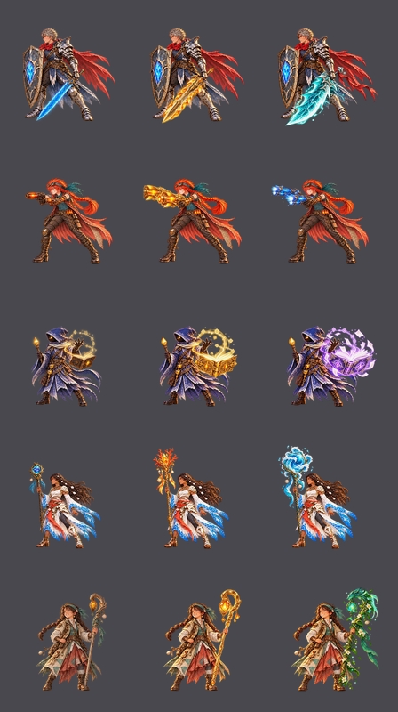

## Section C: the battle sheets (as found, step 1, step 2, top to bottom)

Step 1 is bright gold, about 1.3 times the old weapon, with a warm glow. Step 2 is the hero's signature color, about 1.6 times, with a strong glow and sparkles.

### Cade: Shard Sword (gold longsword with amber shards), Sharkfin Blade (teal-and-white with white lightning)
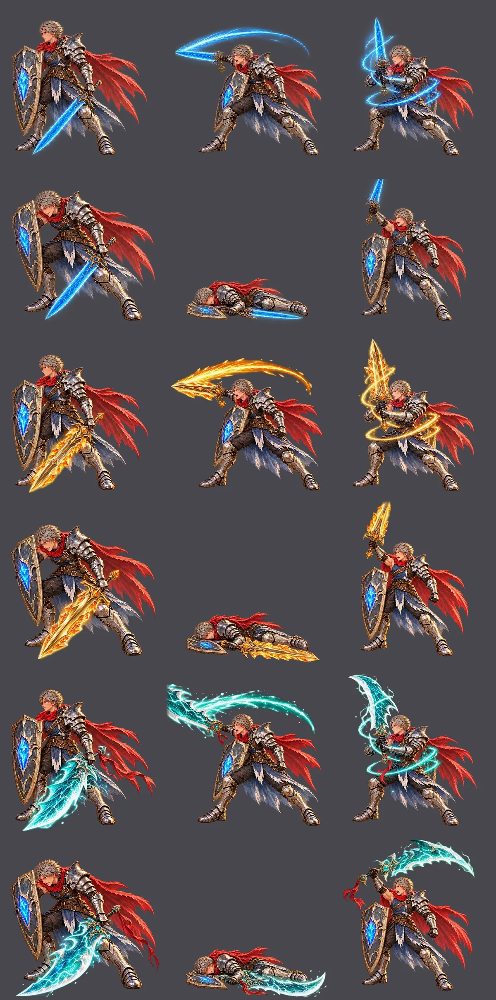

### Wren: Brass-Fin Blasters (gold hand cannons), Storm Blasters (electric blue)
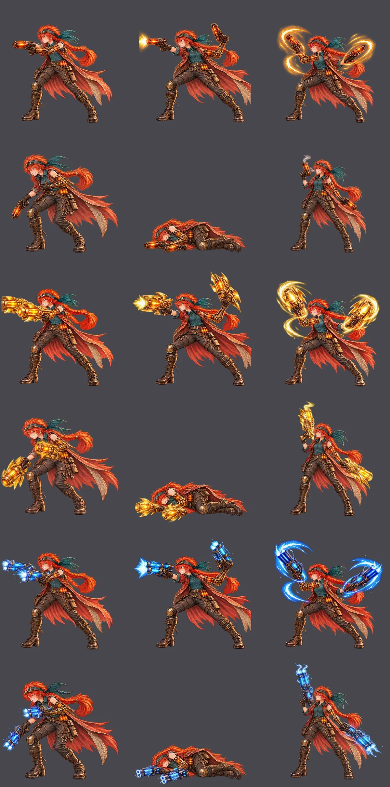

### Knox: Gold-Clasp Spellbook (gold-armored book with a sigil), Book of Flying Pages (violet and white)
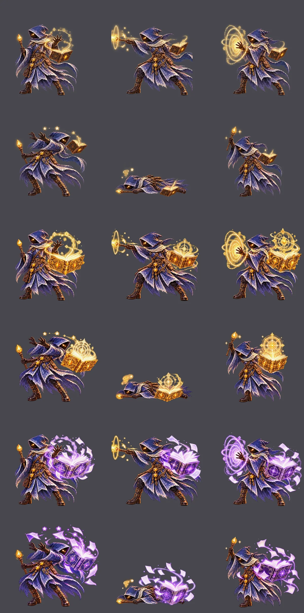

### Maren: Coral Crown Staff (red-orange coral crown), Living Tide Staff (swirling sea-blue orb)
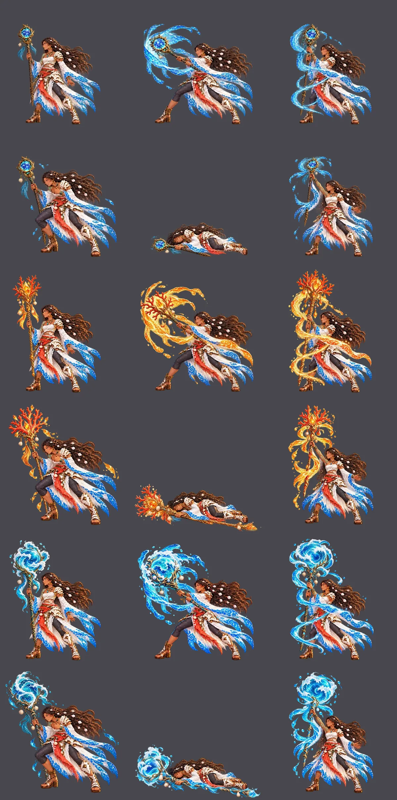

### Tamsin: Amber Crook (gold crook, big lantern), Greenwood Crook (leafy green, sea-dragon head)
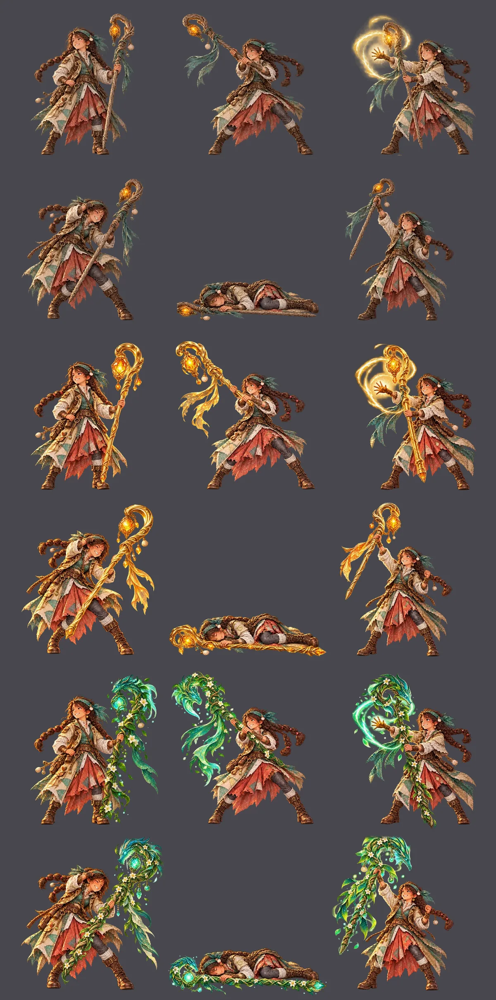

## The weapon icons (`icons/weapons_ch2.webp`)

Before:

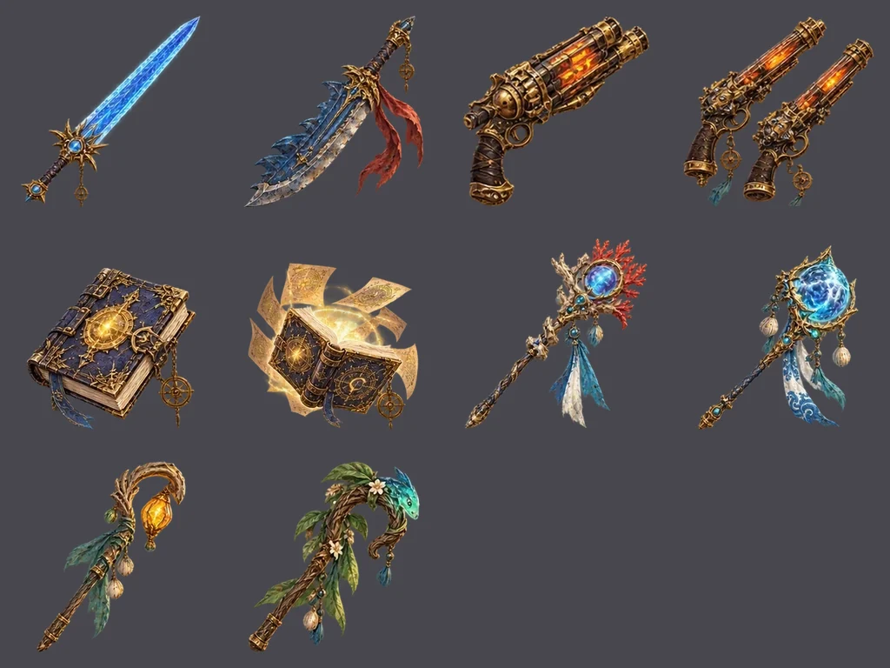

After, painted from each hero's finished idle cell:

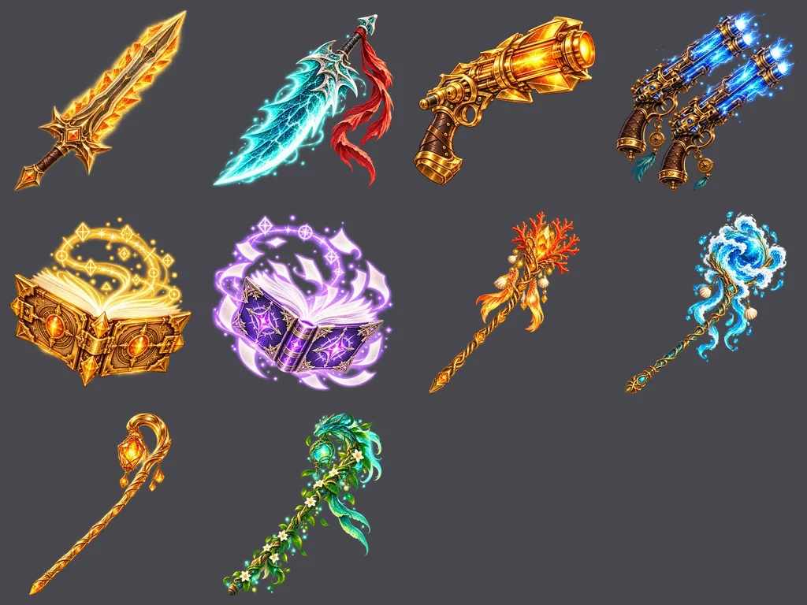

## Section B: exploring without a weapon

Each image shows the old walk on top and the weaponless walk below, with the battle idle and KO on the right next to the new stand.

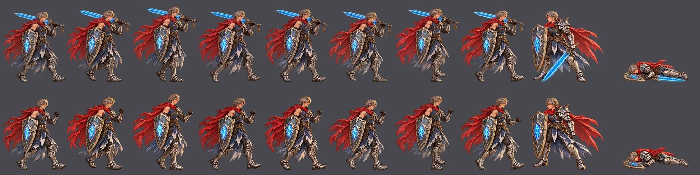
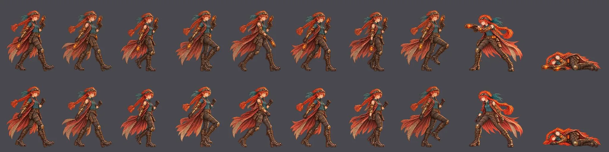
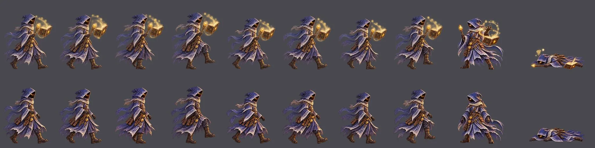
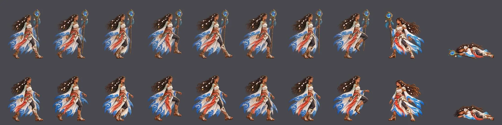
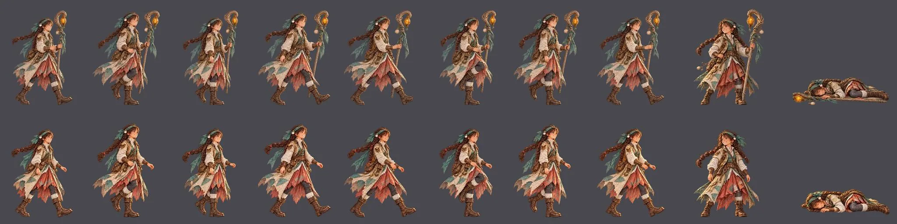

## Retries and flags

- Section C, Cade: the step 1 victory took 3 tries (the raised blade kept running off the top). Step 2 idle took 5, attack 2, cast 4 and victory 2: Codex kept redrawing him at another size, or the blade ran off the edge.
- Section C, others: Wren's, Knox's and Tamsin's first gold step 1 looked too close to their old amber and brass weapons at 128 px, so the wave's "push further" rule applied. They were repainted bigger and brighter, with no brown, and their step 1 icons were redone to match. Wren's step 2 idle and the step 2 KO frames of Knox, Maren and Tamsin took a second try.
- Fitting: the first Section C fits snapped the feet to the lowest pixels, which a big blade's glow below the boots dragged up by up to 30 px. Section C now fits without the snap, and a few KO cells were fitted at scale 1, because the search shrank big glowing weapons to cut mismatched pixels. Every result was checked by overlay.
- Section A (the first forged sheets, now replaced by Section C) and Section B notes are in the wave file.
